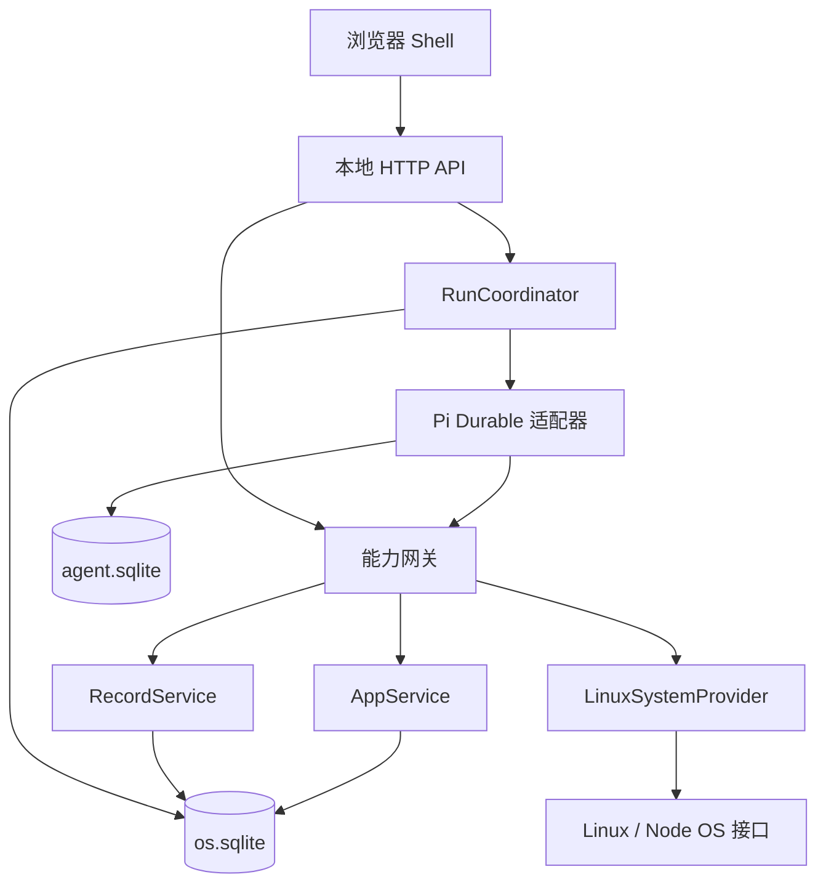

# AgentOS v0.1：完整最小框架实施规格

版本：0.1-draft；编写日期：2026-10-28；目标目录：`E:\agentos`。

本文是 v0.1 的实施规格，编写时作为下一轮编码基线。当前仓库已经实现宿主、界面、接口和测试；当时“尚未实现”指的是写规格的时候，不是现在的代码。验收见 [ACCEPTANCE_V0.1.md](ACCEPTANCE_V0.1.md)。下述 `AgentOS` 接口、表名、状态和限制均为本项目设计，不应误认为 Pi Durable 已经提供。

## 1. 首版交付与完成条件

交付一个运行在 Linux 上的单用户应用运行时：用户通过网页输入需求，Pi Durable 调用 AgentOS 能力生成声明式应用，宿主校验并激活应用；应用由确定性渲染器运行，数据保存在本机；用户能够修改应用、切换历史版本、取消生成任务，并在宿主进程重启后恢复工作。

贯穿开发的唯一主验收用例：

1. 输入“做一个待办应用”，得到任务标题、完成状态、创建/编辑/删除、搜索与完成筛选。
2. 添加两条任务，刷新页面和重启宿主后仍存在。
3. 输入“增加优先级和优先级筛选”，得到第二个应用版本，原记录默认优先级为 `normal`。
4. 把其中一条改为 `high`，切回第一版，修改它的标题，再新增一条记录。
5. 再切到第二版，原来的 `high` 保留，新记录优先级为 `normal`。
6. 在生成与发布过程的指定位置强制终止宿主，重启后任务恢复；已经提交的发布不会重复执行。
7. 关闭模型连接后，已生成应用的增删改查仍然正常。

完成不是“能聊天”“能输出 JSON”或“有待办演示截图”。以上路径和第 18 节的验收项全部通过，才称 v0.1 完成。

## 2. 固定范围

| 维度 | v0.1 的明确选择 |
|---|---|
| 运行目标 | Linux，首个验收环境使用 Ubuntu 24.04 LTS + systemd；Windows 可编辑源代码 |
| 用户与工作区 | 一个本地用户，一个工作区，一个宿主写入进程 |
| Agent | 一个 Pi Durable Harness，一个固定 root conversation；同时最多一个未终结的生成任务 |
| 应用范围 | 一个应用一张记录集合；字段驱动的列表、表单、搜索、筛选 |
| 生成产物 | 严格 JSON AppBundle；无生成 JavaScript、HTML、SQL、Shell 或依赖安装 |
| UI | 浏览器 Shell + 可信 React 渲染器；模型产物只作为数据解析 |
| 系统能力 | 一个真实的只读 `system.info` provider；应用数据与版本管理 provider |
| 数据恢复 | 进程崩溃恢复；应用代码/界面版本切换；用户记录独立保留 |
| 网络 | 模型访问由宿主完成；Web 服务只监听 `127.0.0.1` |
| 并发 | 用户可继续编辑记录；第二个生成任务返回 `RUN_BUSY`；手动版本切换须等生成任务结束 |

后续版本才增加：任意生成代码、独立应用进程/容器、特权 broker、文件和设备写入、通用 UI 组件树、应用间调用、多用户、多 Agent、后台自治维护、Wayland、系统镜像、Nix/OCI 依赖供应、eBPF。

这意味着 v0.1 是 AgentOS 用户态核心和受限应用生成闭环；其生成能力覆盖记录型应用。完整 Linux 控制能力通过后续 providers 扩充。

## 3. 技术栈与依赖边界

| 部分 | 选择 |
|---|---|
| JavaScript 运行时 | Node.js 24 LTS，基线 `24.22.1`，ESM |
| 包管理 | pnpm 10 workspace，提交 `pnpm-lock.yaml`；CI 使用 `--frozen-lockfile` |
| 类型/构建 | TypeScript；宿主用 `tsc`，Web 用 Vite 7 |
| Agent | `@earendil-works/pi-durable`、`@earendil-works/pi-ai`、`@earendil-works/chord` 全部精确锁定 `1.4.0` |
| HTTP | Fastify 5，同一进程提供 `/api` 与构建后的 Web 静态文件 |
| UI | React 19；固定组件，不引入远程组件加载 |
| 校验 | AJV 8 的 Draft 2020-12 实现；共享 schema；不启用自动类型转换/自动删除未知字段 |
| 持久化 | Node 内置 SQLite；两份独立数据库：`os.sqlite`、`agent.sqlite` |
| 测试 | Vitest；Playwright；Pi AI 官方 faux provider；真实 SQLite 和子进程故障注入 |

Pi 1.4.0 包声明 Node 最低版本为 22.19.0。上述 Pi 版本和包名已核查；框架的其他依赖在初始化时用 `--save-exact` 固定解析到的补丁版本，再提交锁文件。实现以安装版本的类型声明为准。[Pi 包元数据](https://github.com/earendil-works/pi/blob/v1.4.0/packages/durable/package.json)、[Node 发布信息](https://nodejs.org/en/about/previous-releases)

第一版保留 Pi Durable 一套 Agent 调度机制。DSH/Cordis 的服务依赖和清理思想用于组织可信宿主模块；模块启停使用显式顺序和 `dispose()`，无需加入完整 DSH 或再实现通用依赖注入框架。

## 4. 架构、进程与调用方向



只有一个宿主进程。`systemd` 管进程启动和重启；Pi Durable 管 Agent 任务；AppService 管应用发布。v0.1 的应用没有自己的操作系统进程，运行器就是可信的声明式渲染器和固定 CRUD 服务。

调用方向固定为 `HTTP / Agent tools → capability gateway → domain services → repositories/providers`。领域服务不导入 Pi 类型，不通过 HTTP 回调本机服务，数据库层不调用模型。

普通应用交互走 `Shell → records API → RecordService → os.sqlite`，不进入 Pi。

## 5. 仓库结构与模块职责

```text
agentos/
  package.json
  pnpm-workspace.yaml
  pnpm-lock.yaml
  tsconfig.base.json
  .node-version
  .gitignore
  .env.example
  packages/
    contracts/src/          AppBundle、DTO、错误码、schema与语义校验
    core/src/
      apps/                AppService、兼容性检查、版本激活
      records/             RecordService、默认值、字段投影、CAS
      runs/                RunCoordinator、取消、对账、预算
      capabilities/        能力描述、调用主体、授权与操作收据
      persistence/         os.sqlite migrations/repositories
      providers/           system.info
    agent-pi/src/          Pi Durable适配、可信tools、提示词、faux场景
    host/src/              配置、独占锁、HTTP、启动关闭、日志
    web/src/               Shell、应用列表、表单、任务与版本界面
  fixtures/                从docs/examples复制的可执行测试fixture
  tests/integration/       SQLite、恢复、权限、HTTP测试
  tests/e2e/               浏览器主路径
  deploy/                  systemd unit、安装/备份说明
  docs/
    AGENTOS_MVP_V0.1.md
    contracts/app-bundle.schema.json
    examples/todo-v1.json
    examples/todo-v2.json
```

运行时目录为 `$AGENTOS_DATA_DIR`，默认 `~/.local/share/agentos`。数据库、模型凭据、日志和备份不进入源码仓库。运行时包格式只有一个 JSON 文件；原来的 manifest/data/view 分别成为 JSON 内部字段，减少文件间不一致。

`contracts` 只依赖校验库；`core` 依赖 contracts；`agent-pi` 通过 core 的服务接口执行工具；`host` 负责装配；`web` 只依赖 contracts。浏览器构建不能包含 Node、Pi SDK 或模型 API key。

## 6. AppBundle 完整契约

机器可读结构见 [app-bundle.schema.json](contracts/app-bundle.schema.json)。可直接用的示例见 [todo-v1.json](examples/todo-v1.json) 与 [todo-v2.json](examples/todo-v2.json)。示例 appId 是固定 fixture ID；真实运行必须换成宿主分配的目标 appId。

```ts
interface AppBundle {
  formatVersion: 1;
  manifest: {
    appId: string;          // 宿主分配的UUID
    title: string;
    description?: string;
    runtime: "declarative-v1";
    capabilities: ("records.read" | "records.write")[];
  };
  data: { fields: Record<string, Field> };
  view: {
    kind: "records";
    titleField: string;
    columns: string[];
    formFields: string[];
    searchField?: string;
    filters: string[];
  };
}
```

Field 只允许四种：`string`（minLength/maxLength）、`boolean`、安全范围内的 `integer`（minimum/maximum）、`enum`（values）。每个字段有纯文本 label，可有 default。`null`、嵌套对象、数组、日期公式和计算字段均不在 v0.1。

所有字段在一条完整记录中都必须有值。创建时缺少的字段由后端 default 补齐；没有 default 的字段必须提交。显式空字符串与缺失不同，是否允许空字符串由 minLength 决定；不做隐式字符串/数字/布尔转换。字符串长度按 Unicode code point 计，语义与 JSON Schema 一致。

JSON Schema 之后必须再做语义检查：

1. appId 必须等于宿主本次绑定的目标；字段名拒绝 `constructor`、`prototype`、`__proto__`。
2. minLength ≤ maxLength，minimum ≤ maximum；default 必须满足对应字段约束，enum default 必须在 values 中。
3. 所有 view 引用都存在且数组内无重复；titleField/searchField 是 string；columns 包含 titleField；filters 只引用 boolean/enum。
4. 没有 default 的字段必须出现在 formFields 中；有 default 的字段可以隐藏。
5. `records.read` 必需；`records.write` 是申请项，宿主仅批准当前应用私有记录访问。只读应用不显示写按钮，后端也拒绝写入。
6. 新候选必须包含当前数据契约中的全部字段，并满足第 8 节的兼容规则。

渲染规则固定：manifest.title 显示标题；columns 决定列表列顺序；formFields 决定创建/编辑表单顺序；searchField 提供大小写敏感的 contains 搜索；filters 提供 boolean/enum 等值筛选，多项用 AND。无排序表达式，列表固定按 `createdAt DESC, id DESC`。

新增、编辑、删除是宿主固有动作，不写入 actions DSL。boolean 用复选框，enum 用选择器，integer 用数值输入，string 用文本输入；较长 string 可由可信渲染器显示 textarea。所有标签和值均按文本渲染，不能使用 `dangerouslySetInnerHTML`。

## 7. 业务数据库与事实归属

`agent.sqlite` 仅由 Pi 适配器管理。会话、工具任务、检查点由 Pi 保存，业务代码不查询其内部表。

`os.sqlite` 是应用和用户数据的唯一事实来源，采用 WAL、`foreign_keys=ON`、`busy_timeout=5000`、`synchronous=FULL`。所有业务写事务内不执行网络调用、Pi 调用或文件写入；异步任务不得在持有事务时等待外部操作。

需要的表及完整核心字段如下。标注 JSON 的列存严格 JSON 文本；schema_version migrations 定义实际约束和索引。

| 表 | 字段与约束 |
|---|---|
| `meta` | 单行：`schema_version`、`store_uuid`、`client_epoch`、`agent_binding_state(pending/bound)`、`created_at`；store_uuid 在重启和备份恢复后不变 |
| `apps` | `id PK`、`active_revision_id nullable`、`epoch >= 0`、`contract_json`、`created_at`、`updated_at`；创建占位应用的epoch=0 |
| `revisions` | `(app_id, id) PK`，id为规范化bundle的SHA256；`bundle_json`、`created_by_run_id nullable`、`created_at`、`first_activated_at nullable`；bundle内容不可修改，首次激活时间由发布事务写入 |
| `records` | `(app_id, id) PK`、`version >= 1`、`data_json`、`created_at`、`updated_at`；app_id FK |
| `runs` | `id PK`、`request_key UNIQUE`、`request_hash`、`target_app_id FK`、`expected_app_epoch`、`intent`、`frozen_submit_json`、`submit_hash`、`status`、`dispatch_state`、`pi_submission_id nullable`、`applied_revision_id nullable`、`model_request_count >= 0`、`stop_reason nullable`、`last_validation_json nullable`、`error_json nullable`、`deadline_at`、`created_at`、`updated_at` |
| `operations` | `(principal, operation_key) PK`、`request_hash`、`status_code`、`result_json`、`created_at`；业务变更和收据在同一事务提交 |
| `run_steps` | `(run_id, kind, durable_task_id) PK`、`created_at`；记录进入宿主execute的工具/stage预算，不将重放算成新的逻辑工具任务 |
| `events` | `seq INTEGER PK AUTOINCREMENT`、`kind`、`app_id nullable`、`run_id nullable`、`payload_json`、`created_at`；仅存业务状态摘要 |

数据库额外约束：`apps.active_revision_id` 必须属于相同 app；records/revisions/runs 的 appId 必须存在；唯一部分索引确保最多一个 `queued/running/cancel_requested/blocked` run。events 给 Web 轮询提供变更序号，不承担 Pi 检查点职责。

首版不删除应用或历史版本，也不清理幂等收据。记录删除会在 os.sqlite 中物理删除该条记录；切换应用版本不会恢复已删除记录。明确展示这一语义，记录恢复依赖备份。

`RecordEnvelope = { id, appId, recordVersion, createdAt, updatedAt, data }`。所有时间用服务端 UTC ISO 8601，界面按本地时区显示。UUID 由服务端生成。

Pi适配器另在固定root保存`agentos.workspace` Document：`{storeUUID, protocolVersion:1}`。这是两库配对标记，不存用户records。创建新工作区时os.meta.agent_binding_state=pending；仅在确认Pi库是未承载任务的新库时，允许写入此Document并以普通持久提交完成，再将os标为bound。若两步之间崩溃，重启比对已写标记后补写bound。bound工作区遇到Pi文件缺失、标记缺失或storeUUID不匹配必须阻止调度，不能自动创建替代库。

## 8. 数据契约、升级和切回旧版

每个 appId 有一个只增不减的当前数据契约，与 active revision 分开。

- 初次激活：从 bundle 提取数据字段，作为契约。
- 新增版本：允许加字段、改界面布局、改标题和 label。新增字段必须有合法 default。
- 已激活字段的 type、约束、enum values 和 default 固定。省略的约束先规范化再比较：string minLength=0，integer 上下界为 JS 安全整数界。label 不属于存储契约。
- 新候选必须带上所有契约字段。想隐藏字段时从 columns/formFields 移除；没有 default 的字段仍须在 formFields 出现。
- 曾成功激活的历史版本可包含当前契约的字段子集；判据为first_activated_at非空。仅被stage暂存的候选仍按新候选完整契约校验，不能进入历史回滚通道。

激活事务顺序：

1. 按第9节统一顺序检查主体、先查询幂等收据，再检查run fence和expectedAppEpoch；取消后仍允许回放已有成功收据。
2. 读取不可变 revision，重新结构/引用校验，再核对当前数据契约。
3. 新增字段时，为全部已有记录补 default，并检查记录大小与类型；实际改变的记录 version +1。
4. 更新 contract_json、active_revision_id、epoch +1，首次发布时填写revision.first_activated_at；如由 Agent 发起，同时写 runs.applied_revision_id。
5. 写操作收据和 app.activated 事件，提交。

激活任一步失败则全部回滚。首次激活和后续切换都以数据库提交为发布完成点；不把浏览器打开成功当作数据库事务条件。渲染器支持全部已接受 schema，组件渲染故障由 Shell 错误边界显示，并允许用户切换版本。

切回 v1 只改变 active_revision_id 和 epoch，契约及记录保留 v2 的新增字段。旧版本 PATCH 只合并其允许的字段，绝不整体替换 data_json。旧版创建新记录仍按完整当前契约补齐隐藏字段默认值。

记录 GET 默认只投影 active bundle 的字段，存储层保留完整记录。模型 `app_get` 同时获得 active bundle 和完整数据契约，因此从旧版再次修改时不会误删隐藏字段。

重复激活当前同一revision返回`changed:false`，不增加epoch。Agent本run首次进行这一有效no-op激活，仍原子写runs.applied_revision_id、收据和run发布事件，并关闭本run后续写资格；因此可以正确报告“当前版本已经满足需求”。手动同版本切换不涉及run。请求仍需通过身份检查；同幂等键重试按统一规则返回原结果。

## 9. 写入、授权与幂等的统一规则

所有域写入都通过能力网关。调用主体由 HTTP 会话或 Pi 适配器构造，不接受模型或浏览器提供的 `principal/role/grants/runId` 作为授权证据。

| 主体 | 可调用范围 |
|---|---|
| 本地用户 | 管理本工作区应用、提交/取消run、切换历史版本、操作记录 |
| Agent run | 只读系统概况、列出应用元信息；只在本次target_app_id暂存/校验/激活；不能改用户记录 |
| 声明式应用动作 | 当前appId且当前epoch的records.read/write；不能激活版本或发起Agent任务 |

manifest.capabilities 是请求，实际授权由固定本地策略产生。应用没有执行任意代码的入口；内部 app 主体用于统一检查和测试，不宣称在同一个本地用户浏览器里形成多用户安全隔离。

HTTP写入携带`Idempotency-Key`和`X-AgentOS-Epoch`。键为客户端UUID；同一操作重试复用原键，新操作使用新键。宿主对方法、规范化路径、主体和规范化JSON body求hash。恢复后client_epoch改变：失效会话返回401；有效会话仍提交旧epoch则返回409 CLIENT_EPOCH_STALE。

Pi 写入的 operation_key 由宿主生成：`store_uuid/run_id/pi_task_id/tool_name`，不能让模型填写。一个工具只对应一个域事务。相同 Pi task 重放使用相同键；模型在新 task 再调用同名工具是新操作，仍受发布 fence 限制。

业务写事务采用统一流程：验证身份和工作区client epoch → 查询收据 → 同key不同hash返回409 → 已有收据返回原结果 → 检查run fence/app epoch/record version → 校验并写业务变更 → 写收据与业务事件 → COMMIT。

已经完成的旧操作可在取消后返回其收据，帮助 Pi 收敛；未完成的新操作受取消 fence 拦截。可预期领域错误（409/422）也可以提交为该操作的最终收据；瞬时数据库错误、宿主关闭和连接失败不写“成功”收据。

创建记录携带expectedAppEpoch；更新/删除再携带expectedRecordVersion。客户端可提交的字段集合精确定义为活动版本view.formFields，并且须有records.write授权。POST不接受客户端id或记录元信息，其他字段只由后端default补齐。PATCH使用非空changes字段合并，拒绝隐藏字段和未知字段，保留其余数据。版本不符返回409，UI重新读取并要求用户重试，不自动覆盖别人刚写入的内容。

AppBundle hash：递归按对象键排序、数组保留顺序、严格 JSON UTF-8、SHA256；schema校验前先限制字节数，校验后规范化约束再求hash。hash算法属于contracts，fixture与服务共享。返回的revisionId以`sha256:`前缀表达，存储可保留完整字符串。

## 10. Pi Durable 适配与生成工具

仅 `packages/agent-pi` 可以导入 Pi Durable。对外提供本项目接口：

```ts
interface AgentEngine {
  open(): Promise<void>;       // 打开存储，尚不恢复调度
  resume(): void;
  submit(run: FrozenRunInput): Promise<{ submissionId: number }>;
  status(submissionId: number): Promise<AgentSubmissionStatus>;
  cancelConversation(): Promise<void>;
  transcript(): Promise<TranscriptSummary>;
  isIdle(): Promise<boolean>;  // 纯读投影，不能暗中恢复任务
  close(): Promise<void>;
}
```

内部使用`Harness.open`、固定`harness.root`、`root.submit`、`harness.resume`、`root.abort(context,{background:true})`、`harness.close`。提交用`requestId=runId`、`whenBusy:"reject"`。读取状态使用提交状态/只读任务投影，不能把会启动调度的等待API当成GET探测。

1.4.0适配器固定配置：

```ts
settings: {
  stream: { maxRetries: 0, transport: "sse" },
  retry: { enabled: true, maxRetries: 2 },
  compaction: { enabled: true, backgroundTokens: 0 },
  toolExecution: "sequential"
}
```

backgroundTokens=0关闭后台压缩，保留当前generation需要的阻塞式压缩；其模型请求计入当前run预算。首版不开放手动压缩、子任务或其他后台任务，避免任务越过run边界后错误取得下一run的授权。

isIdle实现为一次纯读`inspect(context)`所得tasks与submissions数组均为空；须包含等待、blocked及后台任务，不能只检查普通对话的idle标志。释放run槽位前再次检查这一条件。[压缩实现](https://github.com/earendil-works/pi/blob/v1.4.0/packages/durable/src/harness/compaction.ts)

Pi ID 是 branded number；AgentOS appId/runId 是 UUID。对外DTO不要混用。工具结果使用1.4.0的 `output`，不是早期示例的 `content`。`root`的agent初始配置仅首次生效；需要变更时通过显式配置路径完成。首版运行中不改模型或工具集合。[固定版本类型](https://github.com/earendil-works/pi/blob/v1.4.0/packages/durable/src/harness/types.ts)

注册一个可信扩展 `agentos-app-builder`，仅提供下列工具。点号是领域能力名；Pi工具名固定用下划线，适配层显式映射。

| Pi工具 | 输入 | 输出与规则 |
|---|---|---|
| `system_info` | `{}` | platform、arch、uptime、内存概况、宿主版本；读取Node OS接口 |
| `app_list` | `{}` | 工作区应用id/title/epoch/activeRevision；不返回记录内容 |
| `app_get` | `{}` | 宿主绑定targetApp的active bundle、完整数据契约、expectedEpoch、限制和schema说明 |
| `app_stage` | `{bundle: AppBundle}` | revisionId、基础校验结果；appId取宿主绑定且与bundle比对；持久保存不可变候选 |
| `app_validate` | `{revisionId}` | `{valid, errors:[{path,code,message}]}`；重新检查引用与兼容性；不更改活动版本 |
| `app_activate` | `{revisionId}` | `{appId, revisionId, appEpoch, changed}`；必须属于目标app、满足当前run fence且无已发布结果 |

结构不合法的app_stage返回结构化错误，不保存为revision；可在runs.last_validation_json中保存有界诊断。合法但语义不兼容的候选可暂存，validate返回错误，activate仍会重做校验。模型收到错误后提交完整修正版bundle，不接受模型提供补丁脚本。

模型任务提示词必须包含：当前意图、目标appId、预期epoch、完整数据契约、输出schema/上限、固定工具顺序、字段兼容规则，以及“发布成功后结束；超出首版能力则说明原因”。应用说明、历史内容和模型生成文本不能改变这些宿主授权规则。

生成循环为`app_get → app_stage → app_validate → app_activate`。最多三次进入execute的stage尝试（初次+两次修复），每run最多20个通过工具参数schema且进入宿主execute的不同工具任务；run_steps去重相同Pi task的重放。参数schema在Pi层拒绝的调用不进入此计数，由模型请求上限和deadline兜底。

每run最多6次模型请求准入，包含压缩、重试及重启后重新发送；每次请求前在宿主provider包装器内事务检查并递增runs.model_request_count，达到上限不连接上游。计数是保守预算：预留后若在发请求前崩溃也不返还，不宣称等于精确HTTP请求数。

真实配置为`settings.stream.maxRetries=0`关闭支持此选项的provider/SDK内部重试，`settings.retry={enabled:true,maxRetries:2}`限制Durable重试；首版只启用经过该行为验收的provider与SSE传输。provider包装器每次调用仍经过预算准入，并通过pi-ai的maxTokens选项限制输出为8192 tokens；maxTokens不属于Durable ConversationStreamOptions，不能直接塞进settings.stream。墙钟deadline为接受需求后300秒，停机时间也计入。

预算最终拦截点是provider请求入口和工具execute/业务事务入口，Pi hooks仅辅助观察，不能依赖普通beforeRequest hook抛错来实现硬拒绝。超预算/超时先持久写cancel_requested及stop_reason=budget/deadline以关闭新写fence，再由Coordinator abort收敛；无发布则failed，有appliedRevision仍succeeded并附诊断。

发布后的run禁止再执行新业务写入。可以给activate结果附上 `control.terminate:true`，但不能依赖它保证立即结束：同一轮中其他工具结果会影响终止条件。`applied_revision_id`才是发布事实。[固定版本工具实现](https://github.com/earendil-works/pi/blob/v1.4.0/packages/durable/src/harness/tool.ts)

不加载Pi默认CodingTools、不开放任意exec、不自动发现本地第三方扩展；本版模型只通过上述工具完成应用构建。正常用户数据存于os.sqlite，不能随会话压缩、fork或reset改变。

## 11. Run状态、跨库恢复与取消

### 11.1 两个独立状态

`status`：`queued → running → succeeded | failed | cancelled`；运行中可转 `cancel_requested`；恢复次数耗尽等情况进入 `blocked`。blocked仍占用唯一生成槽位，可查看原因或取消。

`dispatch_state`：`pending → dispatching → submitted`，用于跨库投递对账。状态可以在业务上终结后保留最后值作为诊断。

`applied_revision_id`与status独立：一旦发布成功就不可清空。发布后仍可能短暂running，等待Pi结束。发布后模型失败、超时或取消收敛，最终状态仍为succeeded，附带warning，不能报告“应用未发布”。

### 11.2 接受需求

1. 验证本地会话、client_epoch、Idempotency-Key和正文hash；已有同key请求返回原run。
2. 确认无未终结run且Pi root已经idle，否则409 RUN_BUSY。
3. 创建应用时由宿主分配appId并建立空契约占位行；修改时绑定所选appId和当前epoch。
4. 在一个os.sqlite事务中写run、冻结的提交正文和其hash，及请求收据。返回202和runId。
5. 后台Coordinator以条件更新事务把pending改为dispatching，条件为run仍可运行、未取消且未过期；成功后才调用Pi提交，返回后保存submissionId和submitted。取消先赢时条件更新失败，禁止派发。

冻结正文含版本化系统上下文、目标appId、原始意图和提交时的基础信息。恢复时必须重投原正文，不能以同runId重新拼接当前应用状态。当前实时应用状态由app_get读取，激活仍以expectedEpoch判冲突。

### 11.3 两库之间的恢复协议

os.sqlite与agent.sqlite没有共同事务。可靠性通过持久outbox和业务收据实现：

| 崩溃点 | 恢复动作 |
|---|---|
| os已接受，Pi尚未提交 | 以冻结正文和相同runId提交 |
| Pi已提交，os尚未保存submissionId | 以相同runId重投，取得原submission；写回映射 |
| tool进入事务前 | 同一tool task恢复后执行 |
| 业务事务中途 | SQLite回滚未完成事务，恢复后重试 |
| 业务已提交，Pi尚未记录tool结果 | 相同operation_key命中收据，返回原结果，不重复激活/创建 |
| 已发布，Pi尚未终结 | 根据appliedRevision保留发布事实，恢复/停止剩余会话工作后置succeeded |
| Pi已终结，os run尚未终结 | 读取submission与root空闲状态，按发布事实补写run终态 |

Pi的requestId去重不代替宿主正文hash校验。Pi工具仅在宿主已实现上述收据机制、并经恢复测试后才标记 `replay:"safe"`；后续添加外部系统写入时必须另行设计幂等和状态核对。[提交实现](https://github.com/earendil-works/pi/blob/v1.4.0/packages/durable/src/harness/submissions.ts)、[Durable规范](https://github.com/earendil-works/pi/blob/v1.4.0/packages/durable/docs/spec.md)

### 11.4 活动run绑定

宿主启动时先从os.sqlite恢复唯一活动run，再创建工具调用上下文。任何submit/resume及可能启动调度的方法都必须在绑定完成后调用。

工具上下文至少包含 `storeUUID, runId, targetAppId, expectedAppEpoch, piTaskId`。runId在一次工具调用内固定。域事务再次检查run仍有写资格；不能仅依赖内存中的布尔值。

下一run只在inspect确认无任何未终结任务/提交且旧run终结后开始。若发现Pi有未完成任务而os没有相应活动run，进入恢复错误状态，阻止新任务；不得把这些旧任务绑定到新run。保持普通应用可读，诊断说明数据库配对问题。

### 11.5 用户取消

取消API先在os事务中判断，检查顺序如下：

- 已有appliedRevision：返回409 ALREADY_APPLIED，并显示已发布版本。用户需要通过版本切换撤回界面变更。
- 无发布且已经failed/cancelled：原样返回该终态，不能重新打开旧run或影响当前新run；已经cancel_requested则返回现状。
- 其余活动状态尚未发布：持久写cancel_requested及stop_reason=user，立即撤销新业务写资格，然后异步执行取消。

pending取消与pending→dispatching的条件事务互斥：取消先赢则不提交Pi；dispatch先赢则按不确定已投递处理。对已dispatching但未取得submissionId的run，以相同requestId重投取得句柄时，工具写入已被fence拦截，随后abort会话。对submitted调用root.abort(context,{background:true})，并等待inspect中的tasks/submissions全部收敛，再按stop_reason置cancelled或failed并释放槽位。

取消与激活在同一业务数据库写锁下竞争：先提交取消，激活必须失败；先提交激活，取消返回ALREADY_APPLIED。相同旧operation的收据仍可回放。

正常SIGTERM属于关闭宿主，用harness.close保存待恢复工作；用户取消才调用root.abort。HTTP客户端断开、浏览器关闭、取消某个等待都不能隐式取消run。

### 11.6 失败与重试

Pi正常结束但没有appliedRevision：run=failed，错误为NO_APPLICATION_PUBLISHED，保留验证错误或模型说明。模型密钥缺失、网络失败、格式修复耗尽、deadline超时等各有明确错误码。

失败后用户点击“重试”，产生新的请求键和runId；保持同targetAppId，读取最新epoch，重新冻结正文。失败的创建应用保留占位appId，不在已发布应用列表显示。重试不会复用旧run的授权或收据。

blocked任务需先取消并完成收敛，再创建新run；v0.1不提供通用Pi任务编辑器。若harness发生存储级失败，宿主标记unready并退出非零，由systemd重启；不得继续用已失败的Harness接请求。

## 12. HTTP、状态与错误协议

HTTP DTO在contracts中定义，所有对象拒绝未知字段。响应为JSON。业务成功响应包裹为 `{data: ...}`；错误为 `{error:{code,message,retryable,details?}}`。details仅包含有界字段路径、版本号和诊断摘要，不返回密钥或堆栈。

所有需要身份的GET使用本地会话；所有业务写入使用JSON、Idempotency-Key和X-AgentOS-Epoch。登录接口是例外。参数中的expectedAppEpoch属于业务CAS，与恢复后的client_epoch不是同一概念。

| 接口 | 输入/输出与行为 |
|---|---|
| `GET /health/live` | 无身份，最小存活结果，不返回路径/密钥 |
| `GET /health/ready` | 200 ready或503 recovering/unavailable |
| `POST /api/auth/session` | `{token}`；建立本地会话 |
| `GET /api/state` | clientEpoch、当前eventSeq、应用摘要、当前run摘要、modelAvailable、hostVersion |
| `GET /api/system` | system.info只读结果 |
| `GET /api/apps/:appId` | appEpoch、activeRevision、活动bundle、完整数据契约；无活动版本时明确draft |
| `GET /api/apps/:appId/revisions` | 仅返回first_activated_at非空的历史版本：revisionId/title/createdAt/firstActivatedAt/isActive；首版上限内一次返回 |
| `POST /api/apps/:appId/activate` | `{revisionId, expectedAppEpoch}`；仅曾成功激活的历史revision；有活动run时409 RUN_BUSY |
| `POST /api/runs` | `{intent,targetAppId:null或UUID,expectedAppEpoch?:number}`；新建时不传epoch；修改时必需；返回202 `{runId,targetAppId,status}` |
| `GET /api/runs/:runId` | status、dispatchState、目标、appliedRevision、lastValidation、error、deadline、bounded进度摘要 |
| `POST /api/runs/:runId/cancel` | `{}`；返回202 cancel_requested、已取消结果或409 ALREADY_APPLIED |
| `GET /api/runs/:runId/transcript` | 终态后最多最近50条消息/工具摘要；历史正文不参与AppBundle执行 |
| `GET /api/apps/:appId/records` | q可选、filters为JSON等值对象、offset/limit；返回appEpoch、items、total、offset、limit |
| `POST /api/apps/:appId/records` | `{expectedAppEpoch,data}`；返回201完整RecordEnvelope（按活动字段投影） |
| `PATCH /api/apps/:appId/records/:recordId` | `{expectedAppEpoch,expectedRecordVersion,changes}`；只合并changes |
| `DELETE /api/apps/:appId/records/:recordId` | JSON `{expectedAppEpoch,expectedRecordVersion}`；返回200 `{deleted:true,id}` |

records查询先校验q长度、filters字段及值。首版可在事务快照内读取最多1000条记录，以可信代码过滤，再按固定排序分页，无需动态拼接JSON字段SQL。列表分页是实时视图，不承诺跨多次GET的快照一致；写后从第一页刷新。

GET应用和对应记录的appEpoch必须来自一致读快照。活动版本改变时，旧表单的POST/PATCH/DELETE返回409 APP_EPOCH_STALE。单记录冲突返回409 RECORD_VERSION_STALE。客户端保留输入并提示刷新对比，不自动套用旧提交。

错误码最低集合：AUTH_REQUIRED(401)、FORBIDDEN(403)、NOT_FOUND(404)、REQUEST_CONFLICT(409)、RUN_BUSY(409)、APP_EPOCH_STALE(409)、RECORD_VERSION_STALE(409)、CLIENT_EPOCH_STALE(409)、ALREADY_APPLIED(409)、INVALID_BUNDLE(422)、SCHEMA_INCOMPATIBLE(422)、INVALID_RECORD(422)、LIMIT_EXCEEDED(422)、MODEL_UNAVAILABLE(503)、STORE_UNAVAILABLE(503)。run终态另有CANCELLED、DEADLINE_EXCEEDED、BUDGET_EXCEEDED、NO_APPLICATION_PUBLISHED、RECOVERY_BLOCKED。

首版使用轮询：任务运行时每1秒GET run状态，空闲时每10秒GET state，页面恢复焦点立即刷新。写操作完成立即刷新相关数据。每次连接/重连均读取完整state，不依赖漏掉的前端事件；业务events用于序号和审计。首版不实现SSE/WebSocket/token流，界面显示阶段、工具和最终结果即可。

## 13. Shell的必要界面和行为

| 界面 | 必需内容 |
|---|---|
| 首次访问 | 本地token输入、登录状态；不显示模型密钥 |
| 工作区 | 应用列表、“创建应用”、系统状态、模型连接状态 |
| 应用区 | 标题、列表、分页、搜索、筛选、创建/编辑表单、删除按钮 |
| 需求区 | 明确当前是新建还是修改所选app、输入框、提交、取消、阶段和错误 |
| 版本区 | 当前revision、历史revision、切换按钮、切换后刷新 |
| 故障区 | 恢复中/blocked/校验失败/已发布但生成收尾失败等准确状态；重试入口 |

只有存在records.write授权时渲染写控件。Schema决定表单字段，后端是最终校验者。必填值错误在字段旁显示。dirty表单遇到版本切换时保留输入副本，但停用提交并提示刷新。

应用界面用React ErrorBoundary包裹，渲染错误不能让Shell导航和历史版本入口消失。UI显示发布事实时以服务端activeRevision为准，不能看到模型说“完成”就自己更新应用。

已生成应用始终可在模型不可用时操作。模型不可用只禁用创建/修改需求入口，并允许查看失败原因。

## 14. 配置、启动、关闭和本地访问

配置项：

```text
AGENTOS_DATA_DIR=~/.local/share/agentos
AGENTOS_HOST=127.0.0.1
AGENTOS_PORT=4317
AGENTOS_MODEL_PROVIDER=<配置的provider>
AGENTOS_MODEL_ID=<该provider支持的model id>
AGENTOS_MODEL_MODE=real | faux
AGENTOS_LOG_LEVEL=info
```

模型密钥使用所选pi-ai provider的官方环境变量，写入用户私有EnvironmentFile，权限0600；`.env.example`只列变量名和说明。至少支持一个真实provider和faux验收模式。provider/model未配置时仍启动应用服务，modelAvailable=false；禁止静默替用户选择付费模型。

启动顺序必须固定：

1. 解析配置、创建0700数据目录，取得该数据目录对应的Linux advisory lock。
2. 以独占锁保证只有一个进程打开这两份库；不要用“PID文件存在”作为锁。统一启动脚本用`flock`持有文件锁并以`--no-fork` exec Node；开发、测试和systemd均经过该入口，数据目录必须位于本地文件系统。
3. 在打开数据库前检查restore-in-progress标记，存在则拒绝启动；否则打开os.sqlite、做有版本的migration、验证store_uuid/client_epoch，预留监听端口并对业务接口暂回503。
4. 注册全部可信系统服务和Pi tools，打开agent.sqlite但不恢复调度，按第7节核对/完成两库绑定标记。
5. 恢复活动run与工具授权绑定，对账cancel_requested、dispatching、已发布结果、过期deadline。
6. 执行需要的冻结提交重投、取消或resume；此处之后任务才可以执行。
7. 校验活动AppBundle可由本版渲染器接受，加载静态Shell，ready=true。

Pi root未知残留、两库不配对或migration失败时停止接收新写入并给出恢复错误；不要自动删库重建。首版不做自动降级迁移。

关闭顺序：ready=false、停止外部HTTP新写入和Coordinator新派发 → 立即启动`harness.close` → 等Pi关闭及已经进入的原子业务事务排空 → 关闭HTTP和os.sqlite → 释放进程锁。内部工具遵守取消Context，已进入事务允许提交；不能因宿主stopping就给Pi工具返回普通业务失败并持久化错误收据。关闭中断不把run改为cancelled。最长15秒，超时由systemd终止，下一次走崩溃恢复。

本地认证：首次启动生成256位随机auth-token文件，0600；用户从本机文件取得token进行一次登录。登录换取HttpOnly、SameSite=Strict、限时的签名会话cookie；client_epoch加入会话校验。回环HTTP不冒充TLS；服务只接受配置的Host与同源Origin，CORS关闭，写入只接受application/json。Web不把token放进URL、本地存储或日志。测试使用临时token。

默认在Linux虚拟机浏览器访问；从Windows访问时使用SSH本地端口转发到127.0.0.1:4317，保持服务回环监听。应用数据不放在Windows映射盘上。

## 15. 资源上限、备份、日志与部署

| 项目 | v0.1上限/策略 |
|---|---|
| 工作区应用 | 20个（含失败创建的占位应用）；开发重置仅限专用测试数据目录 |
| Bundle | 64 KiB UTF-8；字段32个；enum值32个 |
| 单条record.data | 16 KiB UTF-8；每应用最多1000条现存记录 |
| 应用历史 | 每应用100个revision；超限返回LIMIT_EXCEEDED，首版不自动删历史 |
| 生成意图 | 8000个Unicode code points；HTTP正文最大128 KiB |
| 查询 | search 128字符；limit默认50，最大100；offset非负整数 |
| 生成 | 单并发、300秒、最多6次模型请求准入/20个进入宿主的不同工具task/3次stage；每次输出最多8192 tokens |
| 日志 | JSON行格式，单文件10 MiB、保留5份；也可交给journald保留策略 |
| 业务事务 | 禁止外部等待；最多处理当前应用1000条记录；慢事务记录耗时 |

日志包含requestId/runId/appId/revisionId/piTaskId/operationKey/status/duration，默认不记录token、cookie、完整prompt、完整record或模型响应正文。业务events记录变更类别、对象ID、epoch等元信息；需要原文诊断时在已认证的run详情中查看有界结果。

数据目录示意：

```text
~/.local/share/agentos/
  host.lock
  auth-token
  os.sqlite
  os.sqlite-wal             存在时属于数据库的一部分
  agent.sqlite
  agent.sqlite-wal
  logs/
```

首版实现停机备份，不做热备份：停止服务 → 等待进程退出 → 取得同一host.lock → 复制两份sqlite及存在的WAL为一个备份集合 → 写manifest（storeUUID、schema版本、Pi版本、时间和文件hash）→ 释放锁 → 重启服务。不能在进程运行时直接复制一个sqlite文件，也不能只备份一份库。

恢复流程：停止并取得原host.lock → 验证manifest和hash → 先备份当前集合 → 写入并flush恢复标记restore-in-progress → 在暂存目录验证完整备份集合 → 替换两库及对应WAL、清除旧库残留sidecar → 更新client_epoch、轮换本地token → integrity_check和版本检查 → 移除并flush恢复标记 → 启动正常对账。整个过程保持原host.lock文件及inode，不替换锁文件。若中途退出，宿主见到恢复标记必须拒绝打开数据库，由恢复命令重新完成或还原原备份。

store_uuid保持备份值，以保留Pi操作收据键；旧页面会被client_epoch拒绝。备份恢复点之后的用户记录自然不在旧备份中，UI和文档要明确“恢复整个工作区到备份时间”。

业务SQLite设FULL提高提交持久性；Pi Node SQLite默认NORMAL，支持进程崩溃恢复，最新提交在断电/主机故障下可能丢失。本版验收范围为进程终止。要提高Pi库断电持久性，后续通过真实SQLite连接设置并专门验证；不要虚构`synchronous`作为openNodeSqliteStorage的选项。[存储实现](https://github.com/earendil-works/pi/blob/v1.4.0/packages/chord/src/sqlite/node.ts)

部署必须提供一个`agentos-host`启动脚本：使用经过版本校验的绝对Node路径和数据目录锁，再执行构建后的host入口。开发模式同样取得锁。若Vite独立运行，其代理只转发到本地host；验收和部署统一使用host提供静态页面的同源模式。

systemd用户unit的基线内容（安装器将路径替换为实际绝对路径）：

```ini
[Unit]
Description=AgentOS local runtime
StartLimitIntervalSec=60
StartLimitBurst=5

[Service]
Type=simple
WorkingDirectory=%h/agentos
EnvironmentFile=%h/.config/agentos/agentos.env
ExecStart=%h/agentos/bin/agentos-host
Restart=on-failure
RestartSec=2
TimeoutStopSec=15
UMask=0077
NoNewPrivileges=yes

[Install]
WantedBy=default.target
```

首版以登录用户的systemd服务验收。需要无人登录也常驻时，由部署步骤明确配置用户linger或系统服务，不让Agent自行改变主机启动策略。systemd负责宿主恢复，不声称这一unit构成任意代码沙箱。

## 16. 必须实现的脚本与运行入口

以下命令契约已由当前仓库的 `package.json` scripts 实现（编写本文时尚未实现）：

| 命令 | 必须完成的动作 |
|---|---|
| `pnpm install --frozen-lockfile` | 从已提交锁文件安装依赖 |
| `pnpm typecheck` | 全workspace类型检查 |
| `pnpm build` | contracts/core/agent-pi/host及Web构建；host能找到静态产物 |
| `pnpm dev` | 开发宿主与Web，同一dataDir只允许一个宿主 |
| `pnpm start` | 通过锁入口运行构建产物；关闭终端不会误称已安装常驻服务 |
| `pnpm test` | contracts、业务服务、Pi适配器和HTTP集成测试 |
| `pnpm test:recovery` | Linux子进程终止/重启与两库对账测试 |
| `pnpm test:e2e` | 同源生产构建的浏览器验收，faux模式 |
| `pnpm smoke:real` | 用户明确配置真实provider后，完整创建与升级一个测试app；退出码表达结果 |
| `pnpm backup -- --output <目录>` | 停机条件与独占锁检查，备份集合和manifest |
| `pnpm restore -- --backup <目录>` | 先保存当前数据，再按第15节恢复 |

服务安装文档必须包括Node路径、EnvironmentFile创建、数据目录、登录token位置、systemctl --user启动/状态/日志/停止，以及loopback端口转发方法。首版无需一键安装整个Linux发行版。

业务状态不得只保存在Web localStorage。UI可以临时保存未提交输入，但应用记录、活动版本、run和发布事实全部由服务端恢复。

## 17. 编码顺序与每阶段退出条件

### M1：协议与数据层

实现contracts、AppBundle结构/语义/兼容校验、canonical hash、SQLite migration、AppService/RecordService、收据和CAS。先用手写fixture运行，无模型和浏览器依赖。

退出条件：v1写记录 → v2补默认值 → 回滚v1 → 更新和新建 → 再切v2的数据保留测试通过；重复操作不重复写；错误激活事务无部分结果。

### M2：HTTP与确定性Shell

实现host启动锁、认证、应用和records接口、React列表/表单、版本界面、system.info。测试fixture通过内部测试入口seed，生产不开放任意种子导入API。

退出条件：浏览器完整CRUD、搜索筛选、历史切换；模型未配置仍可使用已加载fixture；重启保留数据；旧页面写入得到409。

### M3：Pi Durable与生成闭环

实现agent-pi适配器、固定扩展、outbox Coordinator、active-run绑定、faux provider场景、真实provider配置。完成创建和修改需求，显示阶段和最终结果。

退出条件：faux在真实Durable+真实SQLite路径下执行stage/validate/activate；无效bundle可修复且次数受限；再用真实模型完成相同流程。模拟验收与真实模型验收在报告中分别标记。

### M4：恢复、取消与运行交付

完成第11节所有对账分支、取消fence、预算、blocked/error状态、SIGTERM、systemd unit、备份恢复和故障注入测试。

退出条件：第18节全通过，干净环境按README安装后可复现，构建和启动无未接线stub。

阶段可以分提交完成，但v0.1交付必须包括M1—M4。不能把恢复、记录持久化、授权或错误处理写成“以后补”。

## 18. 验收矩阵

故障测试必须使用临时数据目录与真实Linux子进程，不能把内存对象重新new一次当作崩溃恢复。生产故障注入代码默认禁用，只有测试构建或显式test环境可启用。

| ID | 检查 | 通过条件 |
|---|---|---|
| C01 | 两个示例Bundle结构和语义 | 均通过；v2相对v1兼容 |
| C02 | 未知runtime、字段、HTML/代码入口、越界默认值 | 422，活动应用不变 |
| C03 | 引用不存在字段、search类型错误、缺失无默认值表单字段 | 返回准确字段路径 |
| C04 | 修改已有字段类型/enum集合/default或新候选漏字段 | SCHEMA_INCOMPATIBLE |
| C05 | 未发布候选尝试走历史版本切换 | 拒绝；版本列表只显示曾成功激活的版本 |
| D01 | v1→v2→v1→v2主路径 | high值保留，隐藏字段不丢，新行补normal |
| D02 | 同操作键重复创建记录 | 一个record，返回相同id/version |
| D03 | 同操作键不同正文 | REQUEST_CONFLICT且无写入 |
| D04 | stale app epoch/record version | 409，无覆盖 |
| D05 | 新增字段使单行超过16KiB | 整次激活回滚，契约/指针/数据/收据无部分提交 |
| D06 | 跨appId、未授权records.write | FORBIDDEN，不影响目标记录 |
| D07 | POST/PATCH提交隐藏字段或客户端记录id | 拒绝，隐藏数据不被覆盖 |
| A01 | faux通过正式Pi adapter创建/修改应用 | 使用真实tool和数据库路径，出现正确revision |
| A02 | 模型三次产物无效、预算/期限耗尽 | run失败且旧版本正常可用 |
| A03 | 第二个生成请求 | RUN_BUSY；不会形成第二个活动run |
| A04 | 发布后模型继续调用写工具 | 新写被拒绝，appliedRevision保持不变 |
| A05 | Agent激活当前相同revision | changed=false、epoch不变、appliedRevision已记，run成功收敛 |
| R01 | os接受后、Pi提交前kill | 重启自动提交一次 |
| R02 | Pi提交后、submissionId写回前kill | 同runId找回同一submission |
| R03 | 激活事务提交前kill | 全部旧状态或全部新状态，不存在半升级 |
| R04 | 激活提交后、Pi结果持久化前kill | 相同Pi task命中收据，epoch只加一次 |
| R05 | 取消先提交，再与激活竞争 | 无发布；重启后仍落实取消 |
| R06 | 激活先提交，再取消 | ALREADY_APPLIED；最终报告已发布 |
| R07 | SIGTERM/浏览器断开 | 前者待恢复，后者任务继续；均不隐式取消 |
| R08 | 旧任务恢复时提交新任务 | 新任务被拒绝，旧任务不获得新run授权 |
| R09 | 任务达到Pi restart limit或缺定义 | blocked可见，无无限重启写入；可取消 |
| R10 | 对旧failed/cancelled任务重复取消；取消与dispatch竞争 | 旧终态不重开、不影响新run；仅dispatch获胜才允许投递 |
| R11 | 首次两库绑定中途终止、或替换成其他Pi库 | 前者可完成pending绑定；后者拒绝调度且不静默新建库 |
| R12 | 长对话触发压缩、取消后开始下一run | 仅阻塞式压缩，调用计入所属run；未收敛任务不能获得下一run的授权 |
| O01 | 同dataDir启动第二宿主 | 打开数据库前因锁失败退出 |
| O02 | 无模型/断模型连接 | 应用CRUD正常，生成入口明确不可用/失败 |
| O03 | 冷备份/恢复 | 两库配对正确；旧client_epoch写被拒绝；重新登录后数据符合备份 |
| O04 | 迁移/存储失败 | 无自动删库；ready失败；日志不泄露密钥 |
| O05 | 两库恢复只替换一库后强制退出 | 恢复标记阻止宿主打开混合数据库集合 |
| U01 | 刷新、重连、宿主重启 | 以服务器完整快照恢复应用和任务状态 |
| U02 | 渲染错误边界 | Shell和历史版本入口仍可操作 |
| U03 | 跨源写入/错误Host/无会话 | 拒绝，不能读取工作区数据 |
| L01 | system.info | 来自真实系统API，结构化返回；未解析shell输出 |
| E01 | 真实模型主路径 | 完成创建及升级，记录实际provider/模型/用量；不得用faux冒充 |

预算和恢复测试使用可控时钟；强制终止测试仍需真实进程和SQLite。faux来自官方`@earendil-works/pi-ai/providers/faux`，避免自己写一个绕开Pi Durable的假AgentEngine替代核心验收。[Faux实现](https://github.com/earendil-works/pi/blob/v1.4.0/packages/ai/src/providers/faux.ts)

## 19. 完成交付清单

下面的空勾是写规格时的清单。当前实现状态见 [ACCEPTANCE_V0.1.md](ACCEPTANCE_V0.1.md)。没有模型密钥时，真实 provider 那一项仍然不能算通过。

- [ ] workspace和全部依赖精确锁定，Node版本明确。
- [ ] schema、语义/兼容校验、两版fixture及协议DTO齐全。
- [ ] SQLite migrations、单实例锁、原子激活、records CRUD、幂等/CAS全部实现。
- [ ] Pi Durable真实适配器、可信tools、outbox、恢复/取消/预算全部接通。
- [ ] Shell能独立于模型运行应用，能显示已发布/失败/取消/blocked的真实状态。
- [ ] 启动、关闭、systemd、日志、备份恢复有可复现命令。
- [ ] typecheck/build/integration/recovery/e2e全部通过。
- [ ] 至少一个真实provider完成E01；缺密钥时明确标记该项未验收，不能声称v0.1完整通过。
- [ ] README从干净Linux环境写起，列出配置、端口、数据目录、日常操作和已知范围。
- [ ] 没有关键TODO、假发布结果、内存代替持久化或未接线的生产stub。

## 20. 后续扩展保持的接口

下一阶段添加`isolated-code-v1`运行器时：AppService仍管理不可变revision和active pointer，CapabilityGateway仍注入主体和授权，RunCoordinator仍负责需求与发布结果；新增代码构建、独立执行器、健康检查和进程级隔离。届时发布的事务涉及外部进程，必须增加显式prepare/activate/reconcile协议，不能套用本版“单SQLite事务即可发布”的结论。

Linux文件/进程/设备providers接入时，每个能力明确输入输出schema、权限范围、幂等键、超时、取消、可重复执行性和结果核对方法。特权操作交给独立的小型broker，模型和生成应用继续使用相同能力协议。

未来OS镜像把已验证的host和Shell装入Linux启动流程；UI可移至全屏Wayland宿主。以上变化不会要求重新定义runId、appId、revision、数据归属或授权来源。

## 21. 实施依据与验证范围

本方案对Pi的依赖依据固定版本1.4.0源码、类型和存储接口核查；方案自身的AppBundle、数据库、HTTP和恢复协议是AgentOS设计。文档中的Node/React/Pi代码片段用于说明契约，不是已运行原型。

- [Pi Durable 1.4.0 README](https://github.com/earendil-works/pi/blob/v1.4.0/packages/durable/README.md)：宿主、工具和存储入口。
- [Pi Durable 1.4.0规范](https://github.com/earendil-works/pi/blob/v1.4.0/packages/durable/docs/spec.md)：持久任务与外部副作用边界。
- [Pi类型定义](https://github.com/earendil-works/pi/blob/v1.4.0/packages/durable/src/harness/types.ts)：适配时的真实签名。
- [Pi提交实现](https://github.com/earendil-works/pi/blob/v1.4.0/packages/durable/src/harness/submissions.ts)：requestId去重。
- [Pi工具实现](https://github.com/earendil-works/pi/blob/v1.4.0/packages/durable/src/harness/tool.ts)：工具重放与终止行为。
- [Node SQLite适配](https://github.com/earendil-works/pi/blob/v1.4.0/packages/chord/src/sqlite/node.ts)：持久化连接选项。

下一轮编码从M1开始，完成M1—M4才交付完整最小框架。


