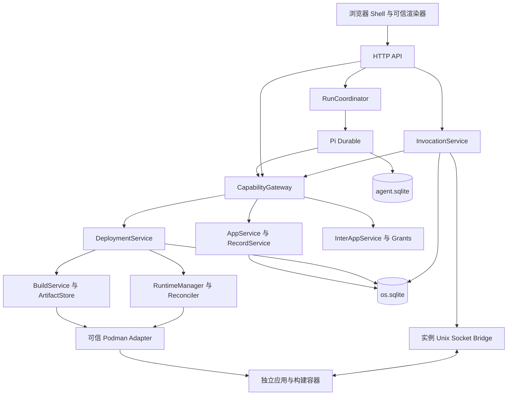

# AgentOS v0.2：隔离代码与应用协同实施规格

版本：0.2-draft；编写日期：2026-10-28；承接版本：v0.1；目标文档目录：`E:\agentos\docs`。

本文是 v0.2 下一轮编码的实施基线，沿用 [v0.1 实施规格](AGENTOS_MVP_V0.1.md) 的组织方式，明确交付范围、模块职责、协议、恢复规则、编码顺序和验收条件。本次只交付方案，不包含实现代码，也不创建本文列出的未来 schema、fixture 或脚本。

v0.2 的目标是：在保留已有声明式应用的基础上，让模型生成在独立沙箱中运行的 TypeScript 业务逻辑，用通用组件组合界面，通过固定依赖目录完成构建，并让两个应用在用户授权后交换结构化查询结果。应用数据继续由宿主统一持久化，发布、回退和崩溃恢复都有明确的事实依据。

本方案参考两份本地 Word 大纲，以及 GitHub 仓库 `cszf1/agentos` 的提交 `36882fd501db5e489a8b68451b62dc76a5b50676`。仓库已包含 v0.1 实现和验收报告；本次进行了静态阅读，未重新运行其测试。以下新增接口、表、限制和状态均为 AgentOS 的设计要求，不代表现有仓库或 Pi Durable 已经实现。

## 1. 本版交付与完成条件

交付一个支持双运行器的 Linux 单用户应用运行时：原有 `declarative-v1` 继续工作，新增 `isolated-code-v1` 承载自定义业务计算与命令处理。浏览器中的可信渲染器增加 `slot-tree-v1`，可以组合任务看板、统计卡片、图表和操作表单。

贯穿开发的主验收用例：

1. 从真实 v0.1 工作区副本升级，已有待办应用、记录、历史版本和操作收据保持有效。
2. 输入“把这个待办应用改成按完成状态分列的看板，显示各优先级数量，并增加批量完成操作”，生成同一 appId 的代码型新版本。
3. 看板分组、统计和批量完成由生成代码实现；一次批量操作原子提交，重复请求不重复修改数据。
4. 再输入“增加预计工时和剩余工时统计”，新增 `estimate_minutes` 整数字段，默认值为 0；既有字段继续保持兼容。
5. 为记录写入工时后切回旧声明式版本，编辑标题并新建记录；切回代码型版本后，原工时保留，新记录工时为 0。
6. 创建第二个“工作概览”应用，授权它调用待办应用的 `summary` 查询服务，显示任务总数和剩余工时；撤销授权后立即停止获得新结果。
7. 制造构建失败、启动失败、死循环、内存超限，以及发布各阶段宿主被强制终止的情况；其他应用和 Shell 保持可用，重启后发布结果能正确对账。
8. 关闭模型连接和外部网络，已缓存依赖下的应用运行、记录操作、应用间查询及历史版本切换正常。

依赖供应另用一个 CSV 导入 fixture 验收：选择已批准的数据处理依赖包，解析最多 100 行待办记录，经宿主校验后一次性写入。它证明依赖机制真实接线，不替代上述主路径。

完成条件是第 24 节的验收矩阵通过，并在报告中区分模拟模型、真实模型和真实 Linux 沙箱测试。只展示生成代码、容器截图或新界面，不构成本版完成。

## 2. 固定范围与大纲对应关系

### 2.1 本版的明确选择

| 维度 | v0.2 的明确选择 |
|---|---|
| 运行环境 | Linux + systemd + cgroup v2 + rootless Podman；首轮沿用仓库验收报告中的 Debian 13，Ubuntu 24.04 作为后续独立验证环境 |
| 用户与工作区 | 一个本地用户、一个工作区、一个业务数据库写入宿主 |
| Agent 调度 | 保留一个 Pi root、一个未终结生成 run；多个已生成应用可以同时运行 |
| 应用运行器 | 同时支持 `declarative-v1` 和 `isolated-code-v1`，同一 appId 可以在兼容版本间切换 |
| 生成代码 | TypeScript ESM，固定入口和 handler 协议；支持自定义计算、状态转换、批量处理 |
| 前端界面 | 可信 React 组件库 + Slot Tree 数据描述；生成代码在应用容器中执行 |
| 持久化 | 每应用仍是一张记录集合；沿用 string、boolean、integer、enum 四种持久字段 |
| 数据写入 | 代码返回有界变更计划，由宿主统一校验并在一个事务内提交 |
| 依赖供应 | OCI 镜像 + 精确锁定的有限依赖配置；本版选定 OCI 路线，不并行建设 Nix |
| 应用间调用 | 用户授权的同步只读查询，一跳调用，结果有输入输出 schema |
| 应用运行网络 | 无外部网络；宿主与容器只通过每实例独立的 Unix socket 通信 |
| 发布 | Prepare / Activate / Reconcile；数据库提交是激活事实，实例健康单独报告 |
| 运行故障 | 同版本有限重启、故障隔离、用户切换历史版本；用户可显式发起修复 run |
| 运维 | 支持完整冷备份、离线恢复和有界缓存清理 |

### 2.2 将大纲落实为可验收能力

| 大纲方向 | v0.2 实现落点 | 本轮保留的边界 |
|---|---|---|
| 隔离代码运行器 | 独立 rootless OCI 容器、固定 SDK、宿主侧资源限制 | 应用不能自行安装依赖、读取宿主文件或直连宿主数据库 |
| 三阶段发布 | 持久 deployment、候选健康检查、原子活动指针、实例对账 | 不承诺跨进程零停顿或任何时刻都健康 |
| 通用 UI | 布局、看板、表格、表单、统计、图表和命令绑定 | 不接受任意前端 JavaScript、HTML、CSS、插件或富文本编辑器 |
| 透明依赖 | 用户无需为每个应用执行安装命令；宿主选用已审核镜像和精确版本 | 不支持任意 npm 包、安装脚本、原生扩展和用户生成 Dockerfile |
| 应用协同 | 显式授权后调用目标应用声明的只读 export | 跨应用写入、事务、事件订阅和长连接留待后续版本 |

“自由代码”在本版指沙箱内的业务逻辑自由度；UI 和系统访问仍受平台协议约束。持久定时任务、后台常驻副作用、多集合关系数据库、外部 HTTP、文件及设备 providers、特权 broker、eBPF、多 Agent、后台自动改代码、Wayland 和 OS 镜像不进入本轮交付。

容器内可以运行定时器，但这不构成平台提供的可靠调度能力。任务不能依赖容器内存或临时文件保存进度，也不能在后台自行提交记录变更。

## 3. v0.1 承接与实施前核对

### 3.1 已有实现的接入位置

| 现有位置 | 静态阅读可确认的职责 | v0.2 衔接方式 |
|---|---|---|
| `packages/core/src/apps/app-service.ts` | 暂存不可变 revision、校验、`activateInTx`、字段默认值回填 | 保留数据激活事务，外层增加 DeploymentService；容器构建和启动移到事务外 |
| `packages/core/src/capabilities/gateway.ts` | user/run/app 主体、同步写事务、操作收据、CAS | 增加实例和 invocation 上下文；长任务只在短事务内登记，不把异步等待塞入 `write` 回调 |
| `packages/core/src/persistence/migrations.ts` | v0.1 数据表、单活动 run 索引、revision 不可变与发布事实不可清空约束 | 追加 migration；保留原历史、hash 和已有约束语义 |
| `packages/agent-pi/src/tools.ts` | 六个构建工具，宿主生成操作身份 | 扩展目录、准备和状态工具；保留 run 绑定，按协议版本更新工具定义 |
| `packages/web/src/AppView.tsx` | 声明式应用渲染入口 | 保留旧视图；增加按 runtime/view kind 分发的 SlotRenderer |
| `deploy/agentos-host.service` | 用户态服务、独占锁入口、重启、`NoNewPrivileges=yes` | 增加独立的 rootless Podman 用户服务及启动前环境核对 |
| `docs/ACCEPTANCE_V0.1.md` | 仓库记录了类型、集成、恢复、浏览器及真实模型验收结果 | 作为已有报告引用；v0.2 仍需在升级环境复跑回归 |

参考：[固定提交中的 AppService](https://github.com/cszf1/agentos/blob/36882fd501db5e489a8b68451b62dc76a5b50676/packages/core/src/apps/app-service.ts)、[CapabilityGateway](https://github.com/cszf1/agentos/blob/36882fd501db5e489a8b68451b62dc76a5b50676/packages/core/src/capabilities/gateway.ts)、[v0.1 验收报告](https://github.com/cszf1/agentos/blob/36882fd501db5e489a8b68451b62dc76a5b50676/docs/ACCEPTANCE_V0.1.md)。

### 3.2 进入开发前必须保留的事实

appId、runId、revisionId、storeUUID 的含义不变；业务事实仍在 `os.sqlite`，Pi 状态仍在 `agent.sqlite`。原 `formatVersion:1` schema 和规范化 hash 算法冻结，历史 bundle 不重写、不重新编号。

升级前先完成 v0.1 冷备份，记录源码提交、Node/Pi/SQLite 版本及实际 `schema_version`。迁移顺序不能用产品版本号推测，应按现有 migration 编号追加。

首轮升级只在没有未终结 run、Pi root 的 tasks/submissions 全部空闲时执行。存在运行中或 blocked 任务时，先在旧宿主中结束或取消并完成收敛。v0.2 不尝试用新工具定义恢复旧版尚未完成的 Pi 调用。

原有 root 配置是否需要显式更新，按现有 adapter 与安装版 Pi API 落实；工具集和提示词更新须有迁移记录。不得仅改扩展名称后假设旧 root 已自动采用新配置，也不得为此清空 `agent.sqlite`。现有双库配对协议保持，新增应用运行器协议独立编号。

## 4. 技术栈与依赖边界

| 部分 | 选择与要求 |
|---|---|
| 宿主 | 沿用已锁定 Node.js 24.22.1、pnpm 10.34.9、TypeScript、Fastify 5、React 19、Vite 7 |
| Agent | 沿用 Pi Durable / pi-ai / chord 1.4.0；本轮不捆绑 Agent 框架升级 |
| 校验与业务存储 | 沿用 AJV、Node SQLite、WAL、收据、事务和 CAS |
| 容器引擎 | rootless Podman，通过仅本地可访问的 Unix socket 调用版本化 REST API |
| 构建 | 固定构建镜像中的 TypeScript 检查与 esbuild 打包；宿主控制全部参数与配置 |
| 应用运行 | 固定 Node 运行镜像、可信 runner、项目自有 `@agentos/app-sdk` |
| 依赖内容 | 项目维护的 runtime catalog；镜像按平台 manifest digest 固定，库按精确版本锁定 |
| 前端 | 可信组件库及受限绑定解释器；图表由可信代码渲染 |
| 验证 | 延续 Vitest、Playwright、正式 Pi faux 路径；增加真实 Podman 隔离及故障注入测试 |

新增构建工具、Podman API 和镜像版本在 M0/M1 验证后写入锁文件与运行时目录，不能使用 `latest`、浮动 tag 或宽松版本范围作为发布身份。镜像的 CPU 架构必须与目标 Linux 环境匹配。

Podman 的容器配置可以提供独立文件系统、网络命名空间、只读挂载和资源约束；这些选项是否生效必须在部署环境验证。[Podman 容器运行文档](https://docs.podman.io/en/latest/markdown/podman-run.1.html)

Node `vm` 明确不提供安全边界，因此不能把 `vm`、Worker Threads 或普通同用户子进程作为隔离代码运行器的替代实现。[Node VM 文档](https://nodejs.org/api/vm.html)

## 5. 架构与调用方向



本版共有三种执行环境：可信宿主、可信构建工具所在的受限构建容器、承载生成代码的受限应用容器。浏览器只运行仓库构建的可信 JavaScript。

生成路径为 `Pi tools → 网关 → 暂存/准备/激活服务`。日常路径为 `Shell → 查询或命令 API → InvocationService → 应用容器 → 宿主校验/提交`。跨应用路径为 `源应用查询 → 网关 → 授权检查 → 目标查询 handler`。

Podman 调用、下载、编译、健康检查与等待容器退出全部在 SQLite 写事务之外。领域层不导入 Pi 或 Podman SDK，不通过 HTTP 回调自身服务，生成代码不在宿主进程中被 import 或执行。

## 6. 仓库结构与模块职责

下面是未来编码目录。已有文件按职责增量修改，不要求为了目录外观重写 v0.1。

```text
agentos/
  packages/
    contracts/src/
      bundle-v2/           CodeBundle、结构和兼容性校验
      ui/                  Slot Tree、绑定、组件属性协议
      runtime/             runner ABI、消息、查询和命令结果
      deployment/          准备、发布、实例与诊断 DTO
    core/src/
      apps/                保留 AppService 和数据契约
      records/             增加数据集版本和原子批量变更
      builds/              构建任务及产物登记
      deployments/         Prepare、Activate、历史切换
      runtime/             期望状态、实例绑定与对账
      invocations/         命令准入、结果校验、提交与重放
      inter-app/           export 目录、授权、查询路由
      capabilities/        实例主体、上下文与收据检查
      persistence/         追加 migrations 与 repositories
    runtime-podman/src/    容器 API、镜像、配额、状态核对
    app-sdk/src/           应用开发类型与受限查询调用封装
    app-runner/src/        固定入口、RPC、handler 分发
    agent-pi/src/          扩展构建工具、提示词和 faux 场景
    host/src/              装配、HTTP、socket、启动恢复、备份
    web/src/               SlotRenderer、运行状态、权限与发布界面
  runtime/
    catalog/               经过审核的不可变运行时锁定描述
    images/                平台维护的构建和运行镜像配方
  fixtures/v0.2/           看板、统计、CSV、跨应用及故障样例
  tests/
    integration/
    sandbox/
    recovery/
    e2e/
  docs/
    AGENTOS_MVP_V0.2.md
    contracts/             下一轮实现的 v2 契约
    ACCEPTANCE_V0.2.md      下一轮实际验收结果
```

`RuntimeDriver` 的项目接口固定覆盖：检查环境、确保指定镜像可用、创建实例、启动、检查、停止、删除、列出本工作区实例、读取有界诊断。接口输入是强类型配置，输出是结构化状态，不接受模型给出的命令行或挂载路径。

`ArtifactStore` 负责按内容 hash 写入、读取、验证、引用追踪和有界清理。`DeploymentService` 决定发布意图和事务，`RuntimeManager` 决定实例生命周期；二者通过持久状态协作，不能各自维护互不一致的“当前版本”。

## 7. 双运行器应用包契约

### 7.1 格式和身份

原 AppBundle 保持 `formatVersion:1`、`runtime:declarative-v1`。新增 CodeBundle 使用 `formatVersion:2`、`runtime:isolated-code-v1`、`view.kind:slot-tree-v1`。两种格式分别校验，再以明确的判别联合接入服务，不放宽旧 schema 来接收任意代码字段。

| CodeBundle 字段 | 必需内容与约束 |
|---|---|
| `formatVersion` | 固定为 2 |
| `manifest` | appId、title、description、runtime、请求的 capabilities；长度约束沿用 v0.1 |
| `data.fields` | 同 v0.1 的四类字段、默认值与完整累积契约规则 |
| `code.entry` | 固定 `src/app.ts` |
| `code.files` | 路径到 UTF-8 TypeScript 源码的映射；最多 16 个文件，总源码最多 256 KiB |
| `runtimeLockId` | 宿主目录中已有的精确运行时锁 ID，包含构建镜像、运行镜像、SDK/ABI 和批准依赖集合 |
| `queries` | 以 handlerId 为键的查询声明，含 inputSchema、outputSchema；至少有 `main` |
| `commands` | 命令声明，含 inputSchema、outputSchema、允许的 create/update/delete 类别与 writableFields；可为空 |
| `exports` | 对外服务声明：exportName、queryId、contractVersion、description；只允许映射 query |
| `imports` | 本应用希望使用的服务别名及期望输入输出契约；不包含实际授权凭证 |
| `view` | Slot Tree、查询绑定、表单状态和事件到命令的绑定 |

handlerId、exportName、字段名及别名使用受限 ASCII 标识符，并拒绝原型相关保留键。代码文件路径仅允许 `src/` 下规范化的相对 POSIX 路径；拒绝绝对路径、盘符、反斜杠、空段、`.`、`..`、重复归一化路径、符号链接和非文本输入。宿主不接收源码压缩包。

RPC schema 使用有界 JSON Schema 子集：object、array、string、integer、number、boolean、enum、required、范围与长度限制；对象拒绝未知字段。禁止外部引用、递归、任意正则和执行扩展，最大嵌套深度为 8。这里允许 number/array/object 作为计算输入输出，不扩展持久记录的四种字段类型。

v2 revisionId 是规范化 CodeBundle 的 SHA256；原始源码文本纳入 hash，不能用“格式化后看起来相同”替代字节规则。规范化采用独立 v2 算法，冻结 runtimeLockId 与代码内容；编译产物使用另外的 artifactId，不能把镜像 tag、构建任务 ID 或运行 PID 当作 revisionId。

### 7.2 生成代码的运行契约

固定 runner 加载一个模块，模块提供与声明匹配的查询和命令 handlers。SDK 的第一版只提供请求上下文、当前应用的记录快照、只读服务调用及结果类型。应用不能调用发布、授权管理、Pi、Podman 或数据库连接接口。

模块导出名固定为 `queries` 和 `commands`，均为 handlerId 到函数的映射；没有命令时导出空 commands。函数统一接收 `input` 与只读 `context`，可同步返回或返回 Promise。context 固定包含 callId、appId、revisionId、appEpoch、dataEpoch、logicalTime、deadline、RecordEnvelope 数组和受限 services 接口；服务端不把授权 token 作为业务参数传给函数。

查询接收经过 schema 校验的参数和只读记录快照，返回符合 outputSchema 的 JSON。命令接收用户输入和相同形式的快照，返回 `result` 与 `mutations`；它本身不提交业务写入。每个 mutation 只能创建、局部更新或删除本应用的记录。

mutation 的判别字段固定为 `kind`：create 带 localKey 和 data；update 带 recordId、expectedRecordVersion 和 changes；delete 带 recordId、expectedRecordVersion。禁止额外 appId、SQL、文件路径和主体字段。outputSchema 只校验业务 result，mutations 另由平台固定 schema 校验。

runner 握手包含 abiVersion、revisionId、artifactId、instanceId 和宿主 challenge。宿主必须核对预期身份、导出 handlers 和协议版本；单纯打印“ready”或监听端口不算准备完成。

生成代码即使绕开 SDK，仍只能接触容器内可见资源。导入白名单和 TypeScript 类型检查用于可维护性与早期诊断，实际隔离依靠容器配置与宿主授权。

## 8. 兼容性与数据模型演进

同一 appId 的完整数据契约继续只增不减。新字段必须有合法 default；已有字段类型、范围、枚举集合和 default 固定。切换 UI 或 runtime 不改变这些规则，也不运行模型编写的数据迁移脚本。

v1 到 v2 的新增版本必须包含完整当前契约。v2 切回已激活的 v1 历史版本时，只投影其原有字段；新建记录由完整契约补默认值，局部更新保留隐藏字段。历史版本的判据继续是 `first_activated_at` 非空。

v1 的 `view.formFields` 继续界定浏览器 CRUD 可写字段。v2 的每个命令通过 `writableFields` 和允许的变更类别限定写入；字段必须存在于该 revision 的数据定义中。宿主逐项复核，不能只相信 command 声明或 SDK。

v2 必须提供能填写全部无 default 必填字段的创建路径；可由可信表单绑定一个 create 命令实现。否则普通用户无法创建合法记录，语义校验应拒绝该包。暂存阶段还要检查组件绑定、handler 引用、export/import schema 和资源大小。

新增 `apps.data_epoch` 表示整个应用记录集合的版本：成功的单条 CRUD、一次有实际变更的批量命令、激活时真实发生的默认值回填，分别在其事务中增加一次；失败、重放和没有数据变化的操作不增加。`apps.epoch` 继续只表达应用版本切换，`record.version` 继续表达单条记录变化。

v0.1 的所有记录写入口也必须接入 data_epoch 更新，否则代码命令无法识别来自旧视图的并发修改。默认值回填同时保留 v0.1 的单条 record.version 递增规则。

## 9. Slot Tree 界面协议

### 9.1 插槽和组件

应用只控制 `main`、`toolbar`、`aside` 三个插槽。Shell 的导航、版本切换、登录、权限确认、宿主故障提示及运行停止按钮始终由宿主提供，不能被应用覆盖。

首轮组件集合固定如下；组件属性必须各有 schema，不允许通用 `props:any`。

| 类别 | 组件 | 主要属性 |
|---|---|---|
| 布局 | Stack、Grid、Tabs | 子节点、间距 token、列数、标签；最大嵌套深度 12 |
| 内容 | Text、Alert、Metric | 纯文本、状态枚举、数字和单位 |
| 数据 | Table、Kanban | items 绑定、列或分组配置、记录 ID、选择状态；不直接含持久写逻辑 |
| 输入 | Form、TextInput、TextArea、Select、Checkbox | 表单 ID、字段名、标签、固定验证规则；数值输入由 TextInput 的受限数值模式提供 |
| 操作 | Button | 绑定已声明 command，输入取自表单或选择结果 |
| 图表 | BarChart、LineChart | 有界系列、x/y 数据键、纯文本图例 |

全树最多 256 个节点；表格使用分页，图表每系列最多 500 点、最多 8 个系列。SlotRenderer 对未知组件、非法属性、超深树和超量数据拒绝渲染，并把错误留在应用区域。

### 9.2 绑定和刷新

绑定是有类型的数据描述，只允许从 `query`、`form`、`selection` 和组件当前 `item` 的 JSON Pointer 读取。路径遍历只访问自身属性，不解析 JavaScript、不插入模板表达式、不调用对象方法；条件显示只支持存在判断与标量相等判断。

自定义计算在 query handler 中完成，返回适合组件消费的数据。树本身随 revision 固定；查询结果驱动卡片值、列表内容和可见状态。本版不允许查询响应替换任意组件定义或注册浏览器代码。

所有标签和值作为文本处理；禁止 HTML、内联脚本、生成 CSS、外部图片和任意 URL 导航。图表和看板事件由可信组件生成，再由 Shell 绑定到已声明命令。

主查询在打开应用、命令成功、收到更新的 app/data epoch、恢复焦点时刷新。需要定时刷新时由声明指定不低于 5 秒的周期；隐藏页暂停，任何时刻每个视图最多一个未完成刷新。迟到响应必须核对 revision、appEpoch、runtimeGeneration 和请求序号。

编辑中的表单遇到版本改变时保留本地输入副本并停用旧提交，要求用户按新表单确认。组件 ErrorBoundary 负责同步渲染异常；异步查询错误单独展示，不能假设 ErrorBoundary 会捕获所有 promise 异常。

## 10. 查询、命令与原子业务变更

### 10.1 查询快照

宿主在一个短读事务中取得 revision、appEpoch、dataEpoch 及当前 revision 可见的完整记录快照，再释放事务并调用容器。最多 1000 条记录，序列化快照上限 20 MiB；容器消息上限与此配套，不能沿用普通 HTTP 的小正文限制。

查询无持久写权限；返回结果最多 256 KiB。查询结束前重新检查版本与授权，旧版本或已撤销授权的结果不得作为当前结果返回。dataEpoch 在查询期间改变时可返回带原 dataEpoch 的快照结果，并由 Shell 立即刷新；不宣称所有并行查询共享同一瞬间。

### 10.2 命令准入与执行

1. HTTP 校验本地会话、client_epoch、Idempotency-Key、命令 schema、expectedAppEpoch。
2. 在短事务中查询已有收据与 invocation；同键同正文返回原状态，同键不同正文返回冲突。新请求登记 invocationId、目标 revision、appEpoch、dataEpoch、命令与输入、逻辑时间、deadline，并返回 202。
3. Dispatcher 在短读事务中获取匹配 dataEpoch 的记录快照；若集合已经变化，结束为 `DATA_EPOCH_STALE`，没有业务写入。
4. 在事务外调用目标实例。应用返回命令 result 和 mutation 列表，宿主先限制字节数，再做结构、能力、字段、记录和大小校验。
5. 最终提交事务再次查询最终收据，核对 invocation、当前 appEpoch/dataEpoch、实例代次、记录版本、deadline 和写权限，原子提交全部变更、最终收据、事件和 invocation 终态。
6. 浏览器轮询 invocation 状态得到结果，再刷新对应查询；HTTP 断开不取消已经接受的命令。

冻结输入与版本号持久化，完整记录快照不长期复制到 invocation 表。宿主重启后，只在 dataEpoch 仍相同时重建快照并重试；否则返回冲突，让用户基于最新数据发起新命令。

### 10.3 Mutation 规则

一次命令最多 100 个 mutation、总计划最多 256 KiB；同一已有记录最多出现一次。create 由宿主分配 UUID 并补全默认值；update 必须携带 expectedRecordVersion 且只合并 changes；delete 必须携带 expectedRecordVersion。所有结果仍满足 16 KiB 单条记录和 1000 条现存记录上限。

create 可以带命令内唯一 localKey，最终收据返回 localKey 到宿主 UUID 的映射；本版不支持 mutation 之间的外键引用或任意 SQL。业务 result 与提交结果分开，避免应用在提交前自行声称生成了最终记录 ID。

任何一项失败则整个批次失败，不留下部分更新；成功有变化时 dataEpoch 只加一次。空 mutation 可作为纯计算命令成功，仍有结果收据。已接受请求的 202 收据与最终业务收据分开命名，不能把“已经排队”当作“记录已经写入”。

应用代码可能被重新执行，其内部随机值也可能不同；本协议保证的是同一 invocation 的业务提交至多一次。该保证来自“执行阶段没有外部业务副作用 + 最终事务和收据”，不依赖生成代码天然确定性。运行代码无外网、无跨应用写入，也没有直接 records.write RPC。

用户主动修改记录仍遵循原授权；版本回退不会撤销已提交的数据变更或复活已删除记录。恢复这些内容仍依赖备份。

## 11. 独立运行器与沙箱约束

### 11.1 固定容器配置

每个代码应用实例使用独立 rootless 容器；构建容器独立创建，不能复用正在运行应用的容器。所有创建参数由宿主从可信策略生成。

| 项目 | 必须落实的限制 |
|---|---|
| 身份 | 非特权用户，启用用户命名空间；固定 UID 映射，使实例只能使用分配给它的通信 socket |
| 网络 | 独立 network namespace，network=none；不映射 TCP 端口，不共享 host network |
| 文件系统 | 只读 rootfs；代码产物和 runner 只读；只开放有大小上限的临时 tmpfs |
| 挂载 | 只允许当前 artifact 和当前实例的 bridge 目录；禁止宿主 home、源码仓库、数据目录、数据库、设备与其他实例目录 |
| 权限 | drop all capabilities、no-new-privileges、启用并验证 seccomp 与可用的 AppArmor/SELinux 策略；禁止 privileged |
| 进程 | 独立 PID/IPC 命名空间，pids 上限；不暴露 host PID、host IPC 或容器引擎 socket |
| 资源 | cgroup v2 限定 CPU、内存与进程数；对实际运行容器 inspect 并做压力测试 |
| 环境变量 | 只传 ABI、时区、实例握手必要信息；不继承宿主环境、模型密钥、登录 token、代理凭据 |
| 持久状态 | 无可写持久卷；业务状态全部由宿主保存，临时文件和容器内存可随时丢弃 |
| 自动重启 | Podman restart policy 关闭；重启只由持久化 RuntimeManager 策略决定 |

默认使用 rootless keep-id 对齐容器用户与 socket 所有者，通信目录 0700、socket 0600。该设置必须在实际 user namespace 与安全策略下验证连接成功；失败时不能改成全局可写 socket 或挂载整个宿主运行目录。

应用容器内生成代码属于不可信代码，runner 与它处于同一隔离单元。因此 runner 自报的 appId、健康状态和“已授权”字段都不能替代宿主判断。隔离目标是限制其可见资源和损害范围，不宣称容器能够消除宿主内核漏洞。

### 11.2 Podman 控制与实例通信

Podman API 只对可信宿主开放。引擎控制 socket 的权限相当于该用户的完整容器控制权，不能挂到应用或构建容器内，也不能暴露到浏览器网络。[Podman API 安全说明](https://docs.podman.io/en/latest/markdown/podman-system-service.1.html)

引擎采用独立的 systemd 用户 socket/service；宿主通过本地 API 调用它，保留宿主已有的 `NoNewPrivileges=yes`。不能假设从受限宿主直接启动 rootless 引擎的辅助程序在所有环境中都可行。M0 必须验证用户命名空间、UID/GID 映射和 cgroup 控制器委派。

每个实例建立单独的 Unix socket 端点，只挂载该端点所在的小目录。宿主根据监听端点、预登记实例、单次 challenge 和 boot 代次构造主体；容器消息中携带的身份仅用于核对，不能决定授权。连接可双向传递宿主调用、应用结果和受控服务查询。

协议固定为带长度前缀的严格 JSON 消息，包含 protocolVersion、messageId、replyTo、type 和有界 payload。单消息绝对上限 24 MiB，仅宿主下发记录快照可使用大帧；应用回传、日志和普通请求分别执行更小限制。读取前先检查帧长度，限制并发缓冲与连接数，拒绝乱序结果和未知请求 ID。

容器的 stdout/stderr 不进入业务协议；引擎不无限持久保存应用日志。平台日志通过受限通道采集，超量截断或丢弃并记录计数。不能因为应用持续打印而耗尽宿主磁盘或内存。

### 11.3 运行限制与故障处理

每实例一次只执行一个顶层业务调用，队列最多 16 项。跨应用服务查询采用目标实例的即时准入，目标忙则返回 `APP_BUSY`，不在等待源实例的同时无限排队。健康探针只在空闲时执行；正在运行但未超时的调用不因探针抢不到槽位被误杀。

查询默认 3 秒、命令默认 5 秒；应用不能自行延长。超时后宿主先撤销该次调用的提交资格，再终止实例，必要时强制杀死整个容器进程组。即使迟到结果在 kill 前到达，也不能越过 deadline 或 invocation fence 提交。

活动实例崩溃时，RuntimeManager 对相同 revision 在滚动 5 分钟窗口内最多自动重建两次，按 1 秒、5 秒退避；计数持久化，宿主重启不清零。超过后为 degraded，保留活动 revision 和数据，用户可查看诊断、重启或切换历史版本。

本版不自动切换到其他 revision，也不在后台偷偷调用模型修复。用户点击“修复此应用”才创建新的生成 run，复用正常构建和发布规则。历史版本切换属于显式发布，不能简化为指向一个已失效 PID。

## 12. 依赖供应、构建与内容寻址产物

### 12.1 第一版运行时目录

宿主提供两个批准的 profile：`core-v1` 含固定 Node、runner 与 SDK；`data-v1` 在其基础上增加用于 CSV 和日期计算的 `papaparse`、`date-fns`。库的实际版本、完整传递依赖、许可证和完整性值在 M1 固定并随平台交付，模型不能自行指定版本范围。

CSV 样例使用字符串解析，不启用远程下载或浏览器文件接口；日期结果按明确时区转换为字符串或整数再持久化。[Papa Parse 文档](https://www.papaparse.com/docs)、[date-fns 项目说明](https://github.com/date-fns/date-fns)。esbuild 只承担平台固定的打包步骤，应用编译不得加载模型提供的构建脚本。[esbuild 官方文档](https://esbuild.github.io/getting-started/)

每个 runtimeLockId 对应不可变锁定描述，至少包含：profileId、平台和架构、builder 镜像 digest、runtime 镜像 digest、SDK/ABI 版本、编译器及打包器版本、批准模块清单、依赖锁 hash、策略版本。目录只由平台维护流程更新，既有锁 ID 不得改指向。

模型通过 `runtime_catalog` 选择一个已有锁 ID。宿主根据锁定描述按需拉取批准来源的镜像并校验 digest，后续复用本地缓存；应用生成过程不运行 npm/pnpm 安装，也不创建 Dockerfile、package scripts 或编译插件。

OCI digest 用来核对内容身份，可信来源还需由宿主批准的仓库和 catalog 决定；不能将“hash 一致”当作“发布者可信”。[OCI 内容描述规范](https://github.com/opencontainers/image-spec/blob/main/descriptor.md)

### 12.2 构建流程

1. 校验 bundle、源码大小、路径、数据兼容性、UI 引用和 runtimeLockId。
2. 生成 buildKey：revisionId、runtimeLockId、目标平台、builder/ABI/策略版本的规范化 hash。
3. 在短事务登记 build job、deadline 和资源预算；通过 buildKey 复用仍可验证的成功产物，或加入唯一在途构建。
4. 在事务外确保批准镜像可用，创建禁网构建容器。只挂载本候选的源码；平台配置固定，不读应用提供的 tsconfig、插件或环境脚本。
5. 执行 TypeScript 检查、受限模块解析和打包，生成一个入口 JS 及产物 manifest。依赖来自镜像中的只读集合，相对 import 必须落在本包源码内。
6. 构建输出写入容器限额 tmpfs，通过有界通道导出普通文件字节；宿主拒绝路径、符号链接、设备文件、超量输出和未知文件类型，不在宿主执行构建结果。
7. ArtifactStore 计算 artifactId，写入同文件系统暂存位置、校验并同步后原子更名，再在数据库登记成功和引用。
8. 停止并删除构建容器，进入候选实例准备。构建超时、失败或取消产生有界诊断，活动应用不变。

本版产物包含编译后的 `app.mjs` 和只读元数据，单产物最多 2 MiB。平台模块由固定 runtime 镜像供应。source revisionId、buildKey、artifactId 三者分别代表源代码版本、构建配方和输出内容，不混为一谈。

缓存命中必须检查产物实际存在、hash 正确、平台和 ABI 匹配。相同配方的重建结果若不同，记录构建不一致并停止发布，不能静默覆盖此前 artifact。健康检查仍对本次准备的候选实例执行。

### 12.3 缓存生命周期

历史已激活 revision 引用的源码、artifact 和 runtimeLock 必须保留；运行实例、在途构建、在途 deployment 和备份过程引用的内容也被固定。可以清理的只有未引用的失败构建、临时文件和过期候选缓存。

默认缓存预算为 10 GiB。空间不足时先清理明确无引用内容，仍不足则拒绝新构建并提示空间原因，不能为继续生成而删除可回退历史。引用检查和 GC 标记在数据库内完成，文件删除在事务外执行；标记期间禁止产生指向待删对象的新引用。

系统不会对用户执行全局 `podman system prune`，只处理带本工作区标签且有对应登记的对象。自动缓存回收只做固定规则工作，不需要模型参与。

## 13. 业务数据库扩展与事实归属

`agent.sqlite` 的内部表仍只由 Pi 管理。`os.sqlite` 保持 v0.1 的 WAL、外键、事务和持久性设置，并追加以下实体；所有时间为服务端 UTC ISO 8601。

| 实体 | 核心字段与约束 |
|---|---|
| `apps` 新增 | `data_epoch >= 0`；既有 active_revision_id、epoch、contract_json 保持原意 |
| `build_jobs` | id、app_id、revision_id、build_key、runtime_lock_id、status、attempt、container_id nullable、artifact_id nullable、deadline_at、error_json、timestamps；同 buildKey 最多一个在途 job |
| `artifacts` | id PK、build_key、runtime_lock_id、platform、manifest_json、relative_path、size_bytes、verified_at、gc_state、created_at；内容不可变 |
| `revision_artifacts` | app_id、revision_id、runtime_lock_id、artifact_id；revision 指向确定产物；有复合外键约束 |
| `deployments` | id、app_id、target_revision_id、base_revision_id nullable、expected_app_epoch、origin、owner_run_id nullable、request_key、request_hash、status、no_op、build_job_id nullable、candidate_instance_id nullable、deadline_at、committed_epoch nullable、committed_at nullable、cleanup_state、error_json、timestamps |
| `runtime_instances` | id、app_id、revision_id、artifact_id、deployment_id nullable、generation、host_boot_id、container_id nullable、desired_state、observed_state、lease_digest、last_probe_at、exit_reason、timestamps |
| `app_runtime` | app_id PK、enabled、active_instance_id nullable、generation、health、control_epoch、restart_window_started_at、restart_count、last_error_json；活动实例必须属于同 app 和活动 revision |
| `invocations` | id、app_id、revision_id、app_epoch、data_epoch、command_id、input_json、input_hash、request_key、principal_key、status、instance_id nullable、generation nullable、attempt、logical_time、deadline_at、result_json nullable、error_json nullable、timestamps；主体与请求键唯一 |
| `service_grants` | id、source_app_id、source_revision_id、alias、target_app_id、target_revision_id、export_name、contract_hash、created_at、revoked_at nullable；授权仅由本地用户创建/撤销 |
| `meta` 新增 | runtime 协议/策略版本、catalog hash 等显式配置版本；host_boot_id 每次启动重新生成，不使用持久旧值授予实例权限 |

原 `operations` 继续保存最终业务结果及接受请求的收据，`events` 扩展 build/deployment/runtime/invocation/grant 摘要。日志与事件不存完整记录快照、源码或授权秘密。

新增状态定义如下：

| 对象 | 状态 |
|---|---|
| build job | queued → building → succeeded / failed / cancelled |
| deployment | queued → preparing → ready → committed；提交前可 failed / cancelled / superseded |
| deployment 清理 | pending → complete / retrying；清理失败不能改变 committed 事实 |
| instance 观察值 | absent / starting / ready / serving / draining / stopped / failed / unknown |
| app 健康 | stopped / recovering / ready / degraded |
| invocation | accepted → executing → succeeded / failed；过期用 failed + 明确错误码 |

每应用最多一个未终结 deployment，全工作区最多一个正在准备或等待激活的 deployment。新的生成 run 与用户历史切换互斥：接受新 run 时检查没有用户切换任务，接受用户切换时检查没有活动 run 或其他 deployment；使用同一个数据库准入事务。一个 run 更换候选前先终结原候选并撤销其资格。部署的 committed_at/committed_epoch、run 的 applied_revision_id 和最终 invocation 结果一旦提交不得清空。声明式版本的 active_instance_id 为空。

文件系统没有与 SQLite 共用的事务。产物按“先写入并校验不可变文件，再提交引用”的顺序登记：中间崩溃最多留下可清理的无引用文件；数据库已引用的产物丢失或损坏时标记不可用，不能假装构建成功。

## 14. Prepare / Activate / Reconcile 发布协议

### 14.1 Prepare

准备接受目标 appId、revisionId 和宿主绑定的 expectedAppEpoch。请求先经授权和幂等检查，在短事务内建立 deployment，然后交给后台准备流程。准备时不改变活动指针、累积数据契约或真实记录。

deployment.origin 固定为 `agent_prepare` 或 `user_history`。前者由 Agent 后续显式调用 activate；后者在用户提交“切换到该版本”时已经取得该次发布授权，控制器在 ready 后自动执行激活并写收据，无需浏览器再补一次请求。两者都重新检查原 expectedAppEpoch、任务期限和当前资格，不能在后台自行更换目标版本。

代码型版本依次完成：结构与语义校验 → 依赖锁核对 → 构建/缓存验证 → 候选容器启动 → ABI 握手 → handler 核对 → main query 与命令样例检查。测试数据使用平台提供的空集合、默认值和主路径 fixture，不向候选开放真实用户记录或真实应用间服务。

候选只能使用 preview 身份，所有 mutation 仅在临时内存数据集模拟。健康检查至少验证 runner 握手、main query 返回 schema 合法、Slot Tree 可被可信渲染器接受、固定创建/批量操作样例结果合法。检查存在无法覆盖的业务逻辑边界，不能称为代码正确性的证明。

准备通过后保存 candidate_instance_id、artifactId、探针时间和 ready 状态。默认整个准备任务最长 180 秒，冷镜像下载包含在内；部署时应预热两个批准 profile，避免把首次大量下载混入日常生成体验。

声明式候选经过结构、兼容性和视图检查即可 ready，不创建容器。两种版本均通过同一 deployment 服务组织后续发布，保留旧激活事务作为内部组件。

目标恰为当前活动 revision 时，登记 `no_op=true` 的 ready deployment，不新建候选容器；激活只复核版本和写资格并登记本次结果。已有实例的恢复仍归 RuntimeManager 管理。

### 14.2 Activate

代码候选在事务外做一次最新存活与握手检查，再进入短写事务。事务内严格执行：

1. 检查主体与 client epoch；先查询激活收据，同键同正文直接回放。
2. 检查 deployment 的归属、ready 状态、期限和 expectedAppEpoch。Agent 来源额外检查 run 写 fence、未取消且尚未发布；用户来源核对已接受且仍有效的历史切换意图。
3. 对非 no-op 的代码版本，检查目标 revision、artifact、runtimeLock、candidate_instance 与当前 host_boot_id 一致，最后健康探针距今不超过 2 秒；声明式版本和 no-op 不要求候选实例。
4. 重做兼容性、当前记录上限与默认值回填检查。调用已有数据激活逻辑，保留其单事务失败回滚语义。
5. 发生实际版本切换时，更新 active_revision_id、app epoch、必要的 data_epoch，以及 app_runtime 的实例指针和 generation；新实例取得当前活动资格，旧实例进入 draining。no-op 保持这些值不变。
6. 写入 deployment 的 committed 事实、revision 首次激活时间、激活收据和事件；Agent 来源同时写 run.applied_revision_id，用户来源不修改其他 run，提交。

提交成功即表示版本发布成功。容器健康检查与数据库提交之间仍可能发生进程崩溃；这种情况是“版本已发布，实例恢复中”，不能声称跨进程存在原子健康保证，也不能删除发布事实。

活动路由每次根据数据库中的 revision/实例/generation 判断。进程内路由缓存必须先验证代次；通知丢失或缓存未更新时返回恢复中，不能继续把写操作交给旧实例。

相同活动 revision 的激活保持 v0.1 的 no-op 语义，不增加 app epoch。Agent 仍须记录本 run 的 appliedRevision 和收据；若实例本身异常，交由相同 revision 的重启流程修复，不假造一次新版本激活。

### 14.3 Reconcile

发布后立即撤销旧实例的新调用资格。旧的只读计算最多排空 5 秒；旧命令结果因 appEpoch/generation 不符被拦截，已提交的命令收据仍可供用户读取。随后停止、删除旧实例并完成清理状态。

Reconciler 在启动时以及每 5 秒运行，按数据库期望状态比对 Podman 的真实对象；容器事件只作唤醒信号，不作为唯一事实源。列表仅筛选本 storeUUID 标签，再核对 appId、revisionId、instanceId 和已登记容器 ID，不根据相似名称误删对象。

活动代码 revision 存在、app_runtime.enabled 为真且实例缺失时，使用已验证 artifact 重建同版本实例。重建增加 runtime generation，不增加 app epoch，不重新回填数据，也不重放发布。enabled 为假时保持 stopped。unknown 状态先阻止路由并核对，不无限复制新容器。

新代码版本激活时默认启用，先预留活动实例配额；原代码版本替换复用该 app 的配额。切到声明式版本时清空活动实例并设 enabled=false。重启/start/stop 都递增 control_epoch，控制器每步复核当前控制意图，防止迟到的 start 把用户已停止的应用重新拉起。

宿主重启后不直接继承旧连接或旧实例 lease。先将上次 boot 的实例全部撤权并停止，再为数据库当前活动 revision 建立新代次实例；这会产生短暂恢复窗口，但使失联旧进程无法继续获得业务权限。

### 14.4 历史版本切换与健康报告

用户切换历史版本时创建新的 deployment。若历史版本是代码应用，先确认其 artifact 和依赖完整并预启动；缺失时按固定配方重建，无法恢复则报告 `ARTIFACT_UNAVAILABLE`，保留当前版本。

切回旧声明式版本也走统一激活入口，事务更新完成后回收原代码实例。切换不减少累积数据契约，也不复用历史 app epoch。

用户界面分别显示“当前版本”和“运行状态”。run 成功与应用健康不是同一个字段：发布后实例失败时，run 仍保留已发布事实，应用卡片显示 degraded。用户之后的回退是另一次发布，不能改写原 run 的历史结果。

## 15. 崩溃恢复、取消与孤儿资源

| 中断位置 | 恢复动作与必须保留的结果 |
|---|---|
| deployment 已登记，构建尚未开始 | 在期限与 run fence 允许时继续；取消或过期则停止准备 |
| 创建容器成功，但 container_id 未写回 | 依据宿主预分配名称及完整标签 inspect；核对成功后补登记，不盲目创建第二个 |
| 构建中宿主退出 | 撤销旧 boot 资源，检查是否已有完整产物；没有则在预算内重建 |
| 产物完成更名，数据库未登记 | 校验 buildKey 与 hash 后登记或作为无引用文件回收 |
| 候选 ready，但未激活 | 不当成已发布；新 boot 重新准备实例，并检查 epoch、取消及期限 |
| 激活事务未提交 | SQLite 保留完整旧状态；无部分默认值回填和指针切换 |
| 激活提交后，Pi 未保存工具结果 | 相同操作命中收据，epoch 不再增加；恢复当前活动实例 |
| 激活提交后，旧实例尚未删除 | 新指针仍有效；撤销并回收旧实例，不能回退发布事实 |
| 命令执行完但提交前退出 | 无业务副作用；若 dataEpoch 仍匹配且有预算则重执行，否则返回冲突 |
| 命令提交后，HTTP/Pi 外层结果未送达 | 用户按 invocationId 或原键取回最终收据，不重复写入 |
| Podman API 暂时失联 | 标记运行状态未知并暂停新分配；恢复连接后 inspect，不能把失联当作确定已删除 |
| 主机重启 | 两库按原规则恢复；核对镜像/产物后重建应运行实例；不恢复旧 PID、socket 或临时目录 |

所有宿主生成的资源名和标签在外部操作前已持久化。create/start/stop/delete 的重试必须先 inspect 实际状态；“对象已不存在”可以作为删除成功，“同名但身份不符”必须停止并诊断，不能强制 replace。

用户取消生成时，先在 `os.sqlite` 持久写 cancel_requested，关闭准备与激活资格，再取消构建/候选实例，最后让 Pi 收敛。取消与激活仍争用同一数据库写锁：取消先提交则无发布，激活先提交则返回 ALREADY_APPLIED。

取消后已有准备接受收据可以回放以找回 deploymentId，但不能恢复被取消的资源任务。只有对应 deployment 的当前状态允许时才继续外部工作。已经记录的激活成功收据继续可读。

普通 SIGTERM 属于宿主关闭；不把 run 或准备任务改成用户取消。未完成工作在下次启动按 deadline 和预算处理。宿主停机期间也消耗墙钟期限。

清理失败不能永久占用生成槽位：确认没有发布资格并撤销实例 lease 后，可让 run 终结；遗留资源由 Reconciler 重试并计入资源配额。若无法确定资源数量或无法强制隔离，暂停新代码构建，声明式应用与管理界面继续提供可用能力。

## 16. 调用主体、授权与幂等规则

| 主体 | 能做什么 | 服务端必须绑定的身份 |
|---|---|---|
| 本地用户 | 提交/取消生成、版本切换、应用操作、启停实例、管理应用间授权 | 会话、clientEpoch、本地用户 |
| 宿主控制器 | 推进已登记构建/发布/命令/启停任务及资源对账 | 固定 serviceId、任务 ID、owner 意图、bootId 与当前 fence；没有自行发起模型任务或授予服务权限的资格 |
| Agent run | 读取目录与目标源码/契约，暂存、准备、激活目标应用 | storeUUID、runId、targetAppId、expectedAppEpoch、piTaskId |
| preview 实例 | 固定样例数据上的健康和行为检查 | deploymentId、candidate instance、bootId、preview 模式 |
| 活动应用查询 | 读取本次宿主提供的快照，按有效授权发起只读服务调用 | appId、revisionId、instanceId、generation、宿主创建的 callId |
| 活动应用命令 | 根据本次用户输入返回结果及本应用变更计划 | 上述实例身份 + invocationId、attempt、deadline、数据版本 |
| 应用间服务处理 | 处理已获授权的目标 query，返回限定 schema 的结果 | 源与目标 revision、grantId、contractHash、父 callId、总 deadline |

run 权限不能转换为应用实例权限；实例不能自报为 user/run。实例 lease 只证明它属于哪个容器调用上下文，不授予任意 CRUD。没有宿主当前有效 callId 的后台消息和定时器消息一律拒绝。

v0.1 的 `viaUser` 不应扩展成容器可传入的绕过标志。容器接口与浏览器接口分别生成主体，任何“代用户操作”必须由宿主已接受的 invocation 证明，不能根据应用 payload 决定。

数据库内操作沿用统一顺序：身份及工作区 epoch → 查询收据 → 同键不同正文冲突 → 回放已有结果 → 当前授权/fence/CAS → 变更与最终收据 → COMMIT。长任务另外保存“已接受”和“已完成”两种事实，已有 202 收据只找回任务 ID。

操作键分工如下：

| 来源 | 操作身份 |
|---|---|
| 浏览器新操作 | 客户端 UUID，同一操作重试复用，规范化方法/路径/正文求 hash |
| Pi 写工具 | 沿用 `storeUUID/runId/piTaskId/toolName`，由适配器构造 |
| 构建与准备步骤 | 持久 job/deploymentId 加固定 step 名和 attempt，外部动作按标签核对 |
| 命令业务提交 | 宿主生成的 invocationId 加固定 commit 后缀；同一 invocation 只有一个最终提交位置 |
| 实例控制 | runtime instanceId、generation、固定 lifecycle 操作；新建实例不复用旧 lease |

命令在重启后重执行时先增加持久 attempt 并绑定新 instance/generation；旧 attempt 的迟到结果不得提交。默认最多执行两次，且受原始 deadline 限制。第一次若已经提交，第二次只读取最终结果，不执行代码。

实例被撤权后，不能利用“先查收据”规则继续从宿主读取任意旧操作结果。用户通过已认证的 HTTP invocation 查询取得已提交结果；已经失效的实例连接先在身份层拒绝。

## 17. 应用间只读服务协议

### 17.1 服务声明与授权

目标应用通过 exports 声明服务名、对应 query、输入输出 schema 和 contractVersion。contractHash 来自规范化的服务契约；不包含用户记录。目录向模型和 Shell 展示名称、说明及 schema，不直接返回目标数据。

源应用通过 imports 声明别名及期望契约。用户在 Shell 中将别名绑定到一个目标应用的具体 export，并确认授权。授权精确绑定源 revision、目标 revision 和 contractHash；任一方版本改变后，旧授权保持历史记录但不自动迁移到新版本。

这意味着升级任一应用后可能需要重新授权。界面应明确显示“服务待重新连接”，让用户查看新版本与契约后一次完成连接。切回原来两个版本时，尚未被撤销的原授权可再次匹配；主动撤销的授权不能因回退而复活。

Agent 只能提出 import/export 需求，不能授予权限、替用户选择目标数据源或解除撤销状态。缺少授权时应用可正常发布，其对应功能显示未连接；不可用的服务不得被模型用假数据伪装成已联通。

### 17.2 调用流程

1. 已激活源应用的 query 使用宿主签发的父 callId，通过 SDK 请求一个 import 别名。
2. 网关检查这是普通 query 上下文，查询未撤销且精确匹配当前源/目标 revision 的 grant。
3. 校验参数、contractHash、源/目标 app epoch、调用层级、剩余 deadline 和配额。
4. 为目标生成只读服务上下文，捕获目标的独立记录快照，再进入其 query handler。
5. 校验目标输出；返回前重新核对 grant 未撤销及两侧版本未切换，返回带目标 revision/dataEpoch 的结果。

服务查询最多一跳，目标服务 handler 不得继续发起应用间调用；同 app 自调用拒绝。命令和 preview 上下文不允许调用真实应用间服务。每个顶层 query 最多 4 次服务调用，目标忙立即返回 APP_BUSY，防止等待链堆积。

IPC 总耗时不超过源 query 原有 deadline；每次子调用最多 1.5 秒，目标输出最多 64 KiB。它提供独立快照读取，不承诺跨应用一致性事务，也不替调用方保存目标原始记录。

撤销授权在一个业务事务中提交。后续调用立即拒绝，在途结果返回前也要复核；已展示在源应用中的数据无法被追回，Shell 应在获知撤销或失效后清空对应查询缓存。平台不支持隐式应用间缓存共享。

## 18. Pi Durable 工具与生成循环

保留现有 AgentEngine 接口、冻结提交正文、双库投递和取消协议。新增能力通过可信工具注册；模型仍没有 exec、任意文件编辑、终端或容器引擎入口。

| Pi 工具 | 作用与主要结果 |
|---|---|
| `system_info` | 原只读系统信息，补充 codeRuntimeAvailable 与有界环境诊断 |
| `app_list` | 原应用元信息，加 runtime/health；不返回记录 |
| `app_get` | 目标 app 的活动 bundle、源码、完整契约、epoch、允许组件与限制 |
| `runtime_catalog` | 可选 runtimeLockId、批准模块、ABI 与 profile 描述 |
| `service_catalog` | 本工作区可连接的 export 元信息及 schema；不返回业务数据或授权秘密 |
| `app_stage` | 提交一个完整 v1/v2 包，返回不可变 revisionId 和诊断 |
| `app_validate` | 结构、语义、兼容性与能力引用校验，不执行应用代码 |
| `app_prepare` | 幂等登记并推进 deployment，返回 deploymentId、状态、构建与健康诊断 |
| `app_prepare_status` | 只读查询准备状态；可等待最多 10 秒，无推进或重新构建副作用 |
| `app_activate` | 接受 deploymentId，消费 ready 候选，返回发布事实及当前健康状态 |

统一生成顺序为：读取目标与目录 → stage → validate → prepare → 必要时查询准备状态 → activate → 结束。代码型和声明式新生成都经过 deployment；既有 v1 revision 的格式与数据语义保持不变。

`app_prepare` 可以在登记之后于事务外等待最多 30 秒，再返回当前状态；重复执行必须找回同一 deployment，不新建同名容器。工具返回的是持久任务身份及其状态投影，不能把等待结束或 202 接受视为准备成功。

结构错误、编译错误、ABI 错误、健康检查失败均返回有界的 `{stage, path, code, message}` 诊断。模型修正时重新提交完整包，得到新 revision；不能直接修改已登记 artifact 或运行实例。

每个 v0.2 run 的冻结预算为：墙钟 900 秒、最多 12 次模型请求准入、50 个不同宿主工具任务、3 次 stage 尝试、3 个候选准备、每次模型输出最多 16384 tokens。重放相同工具 task 不增加逻辑 task 数；网络重发、压缩和重试继续经过模型请求计数器。

构建、下载、等待和宿主停机都计入墙钟预算。单准备 180 秒，超期取消；纯状态查询也计入工具数，不允许模型靠高频轮询无限工作。SDK 内部重试仍按 v0.1 验证过的配置关闭/限额，不能通过扩大本版预算解除原来的底层拦截。

模型上下文包含构建目录、契约、固定 SDK、组件字典和诊断，不默认附带真实记录快照。应用源码和诊断按不可信内容处理，不能改变 run 授权范围。

工具 `replay:safe` 的前提是已完成对应恢复测试。对 `app_prepare`，必须证明持久任务身份与资源对账完整；不能仅因函数名类似 v0.1 的 stage 就声明安全。

## 19. HTTP、错误与 Shell 行为

### 19.1 接口增量

沿用 v0.1 的认证、同源检查、错误 envelope、client epoch 与 Idempotency-Key。新增 DTO 都放入 contracts，拒绝未知字段。

| 接口 | 输入与结果 |
|---|---|
| `GET /api/runtime/catalog` | 批准 profile、runtimeLock、平台支持及准备状态 |
| `GET /api/apps/:appId/runtime` | 当前 revision、enabled、generation、controlEpoch、health、有限诊断与实例资源摘要 |
| `POST /api/apps/:appId/runtime/start` | expectedAppEpoch；登记同版本启动意图，202 返回 controlEpoch，通过 runtime GET 观察收敛 |
| `POST /api/apps/:appId/runtime/stop` | expectedAppEpoch；撤销调用资格并登记停止意图，202 返回 controlEpoch，保留版本和记录 |
| `POST /api/apps/:appId/runtime/restart` | expectedAppEpoch；有限次数内重新创建实例，202 返回 controlEpoch，不改变 app epoch |
| `POST /api/apps/:appId/deployments` | 用户历史切换：revisionId、expectedAppEpoch；只允许历史已发布版本，202 返回 deploymentId |
| `GET /api/deployments/:deploymentId` | preparing/ready/committed 等状态、目标、失败阶段、清理状态 |
| `POST /api/apps/:appId/queries/:queryId` | expectedAppEpoch、input；同步只读查询，返回 schema 结果与版本戳 |
| `POST /api/apps/:appId/commands/:commandId` | expectedAppEpoch、input、Idempotency-Key；202 返回 invocationId |
| `GET /api/invocations/:invocationId` | accepted/executing/终态及原子提交结果 |
| `GET /api/services` | export 目录和输入输出契约 |
| `GET /api/service-grants` | 当前用户已配置授权、匹配状态及失效原因 |
| `POST /api/service-grants` | 源 app/revision、alias、目标 app/revision、export、contractHash；仅用户可调用 |
| `POST /api/service-grants/:grantId/revoke` | 幂等撤销；撤销记录保留 |

查询使用 POST 是为了表达结构化参数，它不创建业务写入收据，但仍校验会话、Origin、client epoch、参数和配额。其他新增 POST 写操作均要求 Idempotency-Key。

旧 `POST /api/apps/:appId/activate` 对目标为声明式历史版本的请求继续返回原 200 结果，内部经同步准备和统一激活服务完成，容器清理异步进行。目标为代码版本时返回 `DEPLOYMENT_REQUIRED`，引导新版 Shell 使用 deployment API；新版 Shell 对两类历史版本统一使用异步入口。

原 records API 继续服务活动声明式版本。活动代码版本的业务写入使用 commands；旧页面先按原顺序回放已有收据或报告 APP_EPOCH_STALE，不允许绕过命令权限直接写代码应用记录。

生成 run 与用户版本切换按第 13 节互斥；同一应用正在发布时，手动实例启停返回明确冲突。不同应用的日常查询/命令继续执行。恢复性同版本重启不领取新的生成槽位，但必须与发布服务共享实例代次围栏。

### 19.2 必需错误码

| 分类 | 最低新增错误集合 |
|---|---|
| 代码与协议 | INVALID_CODE_BUNDLE、SOURCE_PATH_INVALID、UNKNOWN_HANDLER、INVALID_SLOT_TREE、ABI_MISMATCH |
| 依赖与构建 | DEPENDENCY_NOT_ALLOWED、IMAGE_UNAVAILABLE、BUILD_FAILED、BUILD_TIMEOUT、BUILD_NONDETERMINISTIC、ARTIFACT_UNAVAILABLE |
| 发布 | PREPARE_FAILED、PREPARE_EXPIRED、DEPLOYMENT_BUSY、DEPLOYMENT_REQUIRED、INSTANCE_NOT_READY |
| 运行 | SANDBOX_UNAVAILABLE、RUNTIME_STOPPED、APP_BUSY、APP_TIMEOUT、APP_RESOURCE_LIMIT、INSTANCE_STALE |
| 数据命令 | INVALID_MUTATION、DATA_EPOCH_STALE、INVOCATION_EXPIRED、INVOCATION_LIMIT_EXCEEDED |
| 应用协同 | GRANT_REQUIRED、GRANT_REVOKED、SERVICE_CONTRACT_MISMATCH、SERVICE_UNAVAILABLE、IPC_DEPTH_EXCEEDED |

422 表示产物/输入不合法，409 表示版本或状态冲突，403 表示权限拒绝，429 表示资源/并发准入不足，503 表示运行环境或实例不可用，504 表示同步查询超时。异步任务的失败原因保存在任务 DTO 内，不通过把所有 GET 改成 HTTP 500 表达。

### 19.3 Shell 必需变化

应用卡片增加 runtime、当前版本和健康状态。生成区按“校验、依赖准备、构建、启动检查、激活、清理”显示真实阶段；阶段来自数据库任务，不从模型文字推测。

代码应用页面提供 SlotRenderer、命令进度、冲突后的输入保留、运行诊断、实例启停、版本切换和服务连接界面。用户无需看到 Podman 参数、镜像路径或数据库术语即可完成日常操作；详细诊断放在展开区域。

发布准备期间旧版本继续可用。发布成功后刷新版本与查询；若实例恢复中，保留 Shell 导航与历史入口。模型离线只影响创建、修改和修复需求，不禁用应用日常操作。

## 20. 启动、关闭、部署与资源上限

### 20.1 启动和关闭

启动顺序固定为：

1. 校验配置和恢复标记，取得原 host.lock，打开业务数据库并执行有版本迁移。
2. 打开 Pi 存储但不调度，按原规则检查双库配对；装配当前协议的服务和工具。
3. 生成本次 host_boot_id，检查 runtime catalog、artifact 目录和 Podman API，撤销所有旧 boot 实例的 lease。
4. 对账并停止旧实例/构建容器，核对不可变产物、在途部署、命令、取消和过期任务。
5. 为需要运行的活动代码版本重建实例；对各 app 分别标记 recovering/ready/degraded。
6. 恢复 run 绑定及 Pi 调度；HTTP Shell 和声明式应用可服务后进入宿主 ready。

runtime 不可用时宿主可以进入可解释的降级状态：Shell、声明式应用、版本元数据和诊断可用，代码调用返回 503。`/health/ready` 表达宿主与业务存储是否能服务，`/api/state` 另外给出 runtimeReady 与各应用健康，不让一个故障应用阻断整个工作区。

关闭时先停止新生成、发布、命令和实例控制准入，启动 Pi close，允许已进入的短事务结束；关闭业务 bridge 并撤权，再停止本工作区容器、关闭两库和 HTTP，最后释放锁。总关闭时间调整为 30 秒；超时仍按崩溃恢复处理，不写虚假的完成状态。

需要停机备份时，管理入口必须在拿到锁后再次 inspect，确保所有本工作区构建/应用容器确已停止；不能只根据宿主 PID 已退出就开始备份。

### 20.2 默认限额

| 项目 | 初始上限 |
|---|---|
| 应用与数据 | 20 个应用、每应用 1000 条记录、32 个字段、每记录 16 KiB、100 个 revision，沿用 v0.1 |
| 代码包 | 16 个源码文件、源码合计 256 KiB、完整 bundle 512 KiB；相关 HTTP 正文最多 1 MiB |
| 构建 | 全工作区 1 个并发，1 GiB 内存、1 CPU、pids 128、临时空间 256 MiB；编译最多 60 秒 |
| 应用实例 | 最多 4 个启用的活动代码应用，每实例 256 MiB 内存、1 CPU、pids 64、tmpfs 64 MiB |
| 额外实例 | 1 个候选准备位；活动、候选、排空和构建容器总数最多 6 个，遗留资源也计入 |
| 业务执行 | 每实例 1 个在途调用、队列最多 16；查询 3 秒、命令 5 秒 |
| 命令生命周期 | 接受到完成最多 15 秒，最多执行 2 次；等待队列和停机都计入 |
| 命令结果 | 100 个 mutation、计划 256 KiB、业务 result 64 KiB；输入最多 128 KiB |
| UI/查询 | 树 256 节点、深度 12；查询输出 256 KiB；完整记录快照 20 MiB |
| IPC | 一跳、每顶层 query 最多 4 次调用、单次 1.5 秒、结果 64 KiB |
| 日志 | 单实例诊断每分钟最多接纳 64 KiB，超额截断；宿主继续使用有界滚动日志 |
| 缓存 | 10 GiB 默认预算；历史与在途引用不能被清理 |
| 生成 | 1 个 run、900 秒、12 次模型准入、50 个工具 task、3 次候选 |

四个代码应用的限制针对同时启用的实例，不限制已保存应用总数。用户可停止一个代码应用再启动另一个；被停止应用保留全部版本和记录，对调用方明确返回 RUNTIME_STOPPED。

为宿主保留资源余量；部署验收机器以至少 4 vCPU / 8 GiB 为初始目标。内存、CPU、pids 与临时空间必须通过实际超限测试确认，配置中写了数字不等于约束已经生效。预检失败时返回 SANDBOX_UNAVAILABLE，不降级为无隔离运行。

## 21. 冷备份、恢复与升级回退

v0.2 的可恢复集合扩展为：配对的两份 SQLite 及必要 sidecar、runtime catalog 与锁描述、所有已引用的 artifact、这些版本需要的 OCI 镜像内容、校验 manifest。源码已保存在不可变 bundle 中；PID、socket、lease 和容器临时文件不属于恢复资料。

冷备份流程为：停止宿主 → 取得同一 host.lock → 检查无运行容器和未完成外部写入 → 验证两库与引用 → 复制数据库及 artifact → 通过引擎的镜像导出能力保存引用镜像 → 写 manifest 与完整性 hash → 标记备份完整。不能直接复制正在使用的 Podman 存储目录。

manifest 至少记录 storeUUID、产品/数据库/ABI/策略版本、源码提交、Pi 版本、catalog hash、artifact 清单、镜像 digest/平台和文件 hash。需要的镜像或 artifact 缺失时，备份应失败或明确为不完整，不能标记成可离线恢复的完整备份。

恢复保留 v0.1 的 restore-in-progress 协议和原 host.lock inode：先备份当前集合，在暂存目录核对完整备份，导入并核对固定镜像，替换两库和 artifact/catalog 集合，更新 client_epoch、轮换登录 token，检查 integrity 和引用，再撤销旧实例绑定并移除恢复标记。

恢复过程中的镜像导入可重试；未引用导入内容可以保留作缓存，但数据库集合只有验证完成后才能开放。中途退出时宿主不得打开混合的新旧数据库和目录。

恢复后按活动 revision 重新建立容器，所有命令、deployment 和 run 按已保存事实对账。断网恢复测试必须涵盖一个旧声明式版本、两个代码版本和一组跨应用授权。

应用版本回退可以使用 v0.2 内的历史切换。宿主程序从 v0.2 降回 v0.1 则必须恢复升级前的完整备份；旧宿主不能打开已迁移的业务库。该操作会回到备份时间点，不能同时承诺保留迁移后新增数据。

## 22. 下一轮必须提供的命令入口

下列是实现要求，本文没有创建这些脚本。

| 命令 | 要求 |
|---|---|
| 原 install/typecheck/build/dev/start | 继续有效，覆盖新增包和 renderer |
| `pnpm runtime:doctor` | 核对 rootless、user namespace、UID 映射、cgroup 控制器、安全策略、镜像平台、socket 和实际资源限制 |
| `pnpm runtime:prefetch` | 从受信 catalog 拉取并验证批准镜像，输出各 runtimeLock 的离线可用状态 |
| `pnpm runtime:gc -- --dry-run` | 列出仅属于本工作区且无引用的候选清理对象；正式执行也必须复核引用 |
| `pnpm test` | v0.1 回归及 v0.2 契约、服务、命令事务、权限与 HTTP 集成 |
| `pnpm test:sandbox` | 真 Podman 的资源、文件、网络、身份、超时和孤儿资源测试 |
| `pnpm test:recovery` | 扩展真实子进程终止测试，覆盖发布/构建/命令中断与两库恢复 |
| `pnpm test:e2e` | v0.1 主路径 + 看板/批量操作/服务授权/故障界面，使用同源生产构建 |
| `pnpm smoke:v0.2-real` | 已配置真实模型时完成主路径的代码生成、修改和两个应用联通，保存实际测试证据 |
| `pnpm backup -- --output <目录>` | v0.2 完整冷备份，包含引用产物、目录和镜像内容 |
| `pnpm restore -- --backup <目录>` | 校验并恢复完整集合，支持中断后继续，不能绕过恢复标记 |

安装文档需要说明 rootless Podman 用户服务、subuid/subgid 配置前提、cgroup 委派、数据盘位置、批准镜像来源、预热、端口转发和常见环境失败。需要管理员配置的步骤由部署者完成，不开放给生成 Agent 或应用执行。

## 23. 编码顺序与每阶段退出条件

阶段编号在本节专指 v0.2。采用 M0—M6 的顺序；前一阶段的退出条件未满足，不进入依赖它的下一阶段。各阶段先用手写 fixture，直到 M5 再接通模型生成。

### M0：固化旧版与验证真实沙箱环境

核对实际 v0.1 源码及验收环境，完成冷备份与原回归。建立 Podman Driver 最小连通性与独立实例检查，验证 user namespace、目录权限、cgroup、禁网、只读挂载、进程终止和资源配额。

退出条件：v0.1 回归通过；在目标 Linux 上启动一个固定样例应用，它无法访问宿主数据目录、外网或引擎 socket；CPU/内存/进程超限受控；宿主与声明式应用仍工作。环境能力不满足时本阶段不退出。

### M1：协议、迁移与不可变产物

实现 v2 CodeBundle、handler/SDK 协议、Slot Tree schema、受限 payload schema、运行时 catalog、追加 migrations、data_epoch、ArtifactStore、构建缓存身份与单条/批量记录提交服务。

先不做完整 UI；用手写 bundle 检验所有身份与字段规则，固定两套 profile 的具体镜像及依赖版本。

退出条件：原 v1 hash 和 revision 不变；v1→v2→v1→v2 的数据保留测试通过；批量写入全有或全无；源码路径、schema、绑定和 artifact 校验均可独立运行；schema 与文档一致。

### M2：构建、实例协议与三阶段发布

实现禁网构建、候选实例、握手与健康检查、DeploymentService、活动实例路由、Reconciler、取消、启动恢复和历史版本准备。真实故障注入从本阶段开始编写，不能全部留到最后。

退出条件：无需模型即可发布手写代码应用；准备失败时旧应用正常；提交前后强杀宿主能区分未发布与已发布；旧实例不能提交变更；孤儿容器可按持久身份找回并清理；相同版本重启不增加 app epoch。

### M3：SlotRenderer 与日常命令

实现固定组件、查询绑定、表单状态、命令提交与轮询、看板、统计和图表。接入真实 InvocationService、数据快照、最终 mutation 校验、冲突提示和结果重放。

退出条件：手写主路径 fixture 在浏览器中完成分组、统计、批量完成、工时字段升级及版本来回切换；断模型连接仍正常；一次命令中途崩溃没有部分写入；应用错误不破坏导航和历史版本入口。

### M4：应用间只读服务与授权

实现 export/import 目录、contractHash、精确 revision 授权、服务路由、撤销复核、忙返回、一跳限制、共享 deadline 和 Shell 连接界面。

退出条件：两个手写应用可在用户授权后联通；未授权、已撤销、版本不匹配、嵌套调用和伪造身份均被拒绝；目标应用不可用时源应用显示明确状态，不影响其他应用。

### M5：Pi 生成与修复闭环

更新可信构建扩展、工具定义和上下文，加入 runtime/service 目录、prepare/status/activate，冻结新的预算。先用正式 Pi faux 场景，再用已配置真实 provider 完成生成。

退出条件：模型可生成并修改主路径代码应用；收到编译/组件/健康诊断后能在限定次数内修正；源码不能越权修改目标 app 或授权；发布后任何新的写工具均被 fence 拦截；实际 provider 和模型用量被记录。

### M6：恢复、离线运维与完整交付

完成所有剩余故障注入、从 v0.1 实际数据副本迁移、完整备份与断网恢复、缓存压力、重启预算、资源清理、安装文档和新验收报告。

退出条件：第 24 节全通过，干净 Linux 环境可按文档复现；无绕过网关的持久写、宿主执行生成代码、内存代替发布事实或只在测试中接线的生产 stub。

M0—M6 可以按独立提交组织。v0.2 完整交付包括全部阶段，不能只做容器运行和 UI 而省略发布、权限、迁移或恢复。

## 24. 验收矩阵

先完整保留 v0.1 验收，新增以下测试。运行器安全、资源和故障项必须在真实 Linux + Podman 中完成；mock Driver 只能用于单元测试。故障注入默认关闭，真实数据目录不得作为测试目标。

| ID | 检查 | 通过条件 |
|---|---|---|
| V2-C01 | v1 格式与 hash 冻结 | 已有 fixture 与历史 revisionId 不变；v1 中新增代码字段仍拒绝 |
| V2-C02 | CodeBundle 完整结构 | 未知字段/runtime、缺失 handler、非法能力返回准确路径 |
| V2-C03 | 源码路径与大小 | 绝对路径、路径穿越、重复路径、超量文件及非文本被拒绝 |
| V2-C04 | 引用与 schema | 非法树绑定、export/query 不匹配、递归或远程 schema 被拒绝 |
| V2-C05 | 运行时锁定 | 浮动版本、未知 lock、镜像平台不符及未批准依赖被拒绝 |
| V2-C06 | 内容身份 | 修改源码/锁改变 revision；损坏 artifact 不得命中成功缓存 |
| V2-D01 | v1→v2→v1→v2 | 新字段数据保留，旧版新建补默认值，切换不恢复删除记录 |
| V2-D02 | 单条与批量数据版本 | 所有旧/新写入口正确更新 data_epoch 和 record.version |
| V2-D03 | 批量原子性 | 第 N 项非法时没有任何记录、计数或最终成功收据的部分提交 |
| V2-D04 | 同键重试与冲突 | 同键同正文得到同一 invocation 和最终结果；不同正文拒绝 |
| V2-D05 | 并发记录修改 | 命令计算中发生 CRUD，提交返回 DATA_EPOCH_STALE，无覆盖 |
| V2-D06 | 版本/实例切换 | 旧 appEpoch、generation 或 attempt 的迟到命令不能提交 |
| V2-D07 | 写权限和隐藏字段 | 未声明操作类别、越界 writableFields、历史隐藏字段写入被拒绝 |
| V2-D08 | 命令执行与返回中断 | 提交前可受限重执行，提交后只能回放；记录最多提交一次 |
| V2-S01 | 宿主资源隔离 | 不能读取宿主 home/数据库/密钥/其他实例目录或引擎 socket |
| V2-S02 | 网络隔离 | 访问公网、宿主回环端口和其他容器 TCP 服务均失败；合法 Unix bridge 正常 |
| V2-S03 | CPU 与死循环 | 超时撤权并终止容器，宿主能继续接收其他应用请求 |
| V2-S04 | 内存与进程压力 | 触发实际资源上限，记录原因，其他应用不被终止 |
| V2-S05 | 临时文件与日志洪泛 | 配额有效；宿主磁盘/内存无无界增长 |
| V2-S06 | 伪造主体与后台消息 | 自报 app/run/user、伪造 callId、过期 lease、无调用上下文写入均拒绝 |
| V2-S07 | 环境不支持隔离 | 返回 SANDBOX_UNAVAILABLE，不能自动选择普通子进程或关闭安全选项 |
| V2-B01 | 禁网构建和批准依赖 | 两个 profile 均能构建；构建中不能联网安装或执行应用配置脚本 |
| V2-B02 | 缓存与不一致构建 | 相同配方复用已验证产物；hash 错误或产物不一致停止发布 |
| V2-B03 | 构建失败/超时 | 候选失败、资源有界清理、活动版本及真实记录不变 |
| V2-B04 | 离线依赖 | 预热后断网可构建和回退；未缓存镜像明确失败，不暗中换版本 |
| V2-P01 | Prepare 只用样例 | 候选不能读取真实记录或跨应用数据，mutation 不落业务库 |
| V2-P02 | 容器创建后登记前崩溃 | 通过固定身份找回同一对象，无重复孤儿实例 |
| V2-P03 | 产物落盘后登记前崩溃 | 可校验登记或清理，业务库不引用半成品 |
| V2-P04 | ready 后、激活前崩溃 | 活动版本仍是旧版，重启重新准备并核对期限 |
| V2-P05 | 激活事务中崩溃 | 指针、契约、默认值、收据和发布事实全旧或全新 |
| V2-P06 | 激活提交后、Pi 记录前崩溃 | 回放成功收据，epoch 不重复增加 |
| V2-P07 | 提交后候选立即崩溃 | 明确已发布且 recovering/degraded，不伪装未发布 |
| V2-P08 | 旧容器清理前崩溃 | 旧调用资格已失效，重启清理，不撤销新版本事实 |
| V2-P09 | 取消与发布竞争 | 取消先提交则不发布；发布先提交则 ALREADY_APPLIED |
| V2-P10 | 当前相同 revision | no-op 不增 epoch，Agent run 仍记录已发布结果 |
| V2-P11 | 引擎失联与未知对象 | 暂停重复分配；恢复后 inspect；不删除不属于本工作区的对象 |
| V2-P12 | 反复崩溃与用户停止 | 重启预算跨宿主重启保持；停止意图不被 Reconciler 自动反转 |
| V2-I01 | 显式服务授权 | 同时核对源/目标 revision 和契约，只有匹配授权可返回结果 |
| V2-I02 | 未授权/撤销/版本改变 | 新调用立即失败，已撤销在途结果不再交付 |
| V2-I03 | 只读与调用层级 | 不能通过服务发命令、读取原始目标存储、嵌套调用或自调用 |
| V2-I04 | 超时、目标忙及大输出 | 在父 deadline 内失败，队列和内存有界，无无限等待链 |
| V2-I05 | 旧版本授权 | 切回精确匹配版本可用；主动撤销的 grant 不自动复活 |
| V2-A01 | 正式 faux 构建闭环 | 使用真实 Pi、SQLite、构建容器与 runtime；不能换成假 AgentEngine |
| V2-A02 | 有限自修正 | 编译/视图错误可被反馈；超过候选、工具或模型预算准确终结 |
| V2-A03 | prepare 工具重放 | 找回原 deployment；终态任务不会被旧接受收据重新启动 |
| V2-A04 | 权限与发布 fence | 模型不能改记录、授权或其他 app；发布后新写工具拒绝 |
| V2-A05 | 旧任务和新工具集 | 非空旧 root 禁止升级；升级不清库、不错误绑定旧任务 |
| V2-U01 | 新旧渲染器并存 | 原 CRUD 与新看板/表单/图表均可运行 |
| V2-U02 | 纯数据 UI | HTML、JavaScript 表达式、外部资源和危险属性拒绝或作为文本显示 |
| V2-U03 | 版本变化与旧响应 | 旧异步结果不覆盖新视图，dirty 输入可保留但不提交到新版本 |
| V2-U04 | 局部故障 | 构建失败、运行超时和渲染错误不破坏 Shell/历史入口 |
| V2-U05 | 模型离线 | 已有应用、原子命令、授权服务与历史切换继续工作 |
| V2-O01 | 真实旧数据迁移 | 在 v0.1 数据副本上升级；原记录、revision、收据和双库配对保留 |
| V2-O02 | 完整冷备份 | 两库、所有引用 artifact/catalog/镜像齐全，有完整性 manifest |
| V2-O03 | 断网恢复 | 冷恢复后代码版本可重建实例、可回退，旧会话和 lease 失效 |
| V2-O04 | 恢复中断 | 恢复标记阻止混合数据库/目录启动，重跑可完成或还原 |
| V2-O05 | 缓存 GC | 历史、在途和备份引用不会被删除；其他工作区镜像不受影响 |
| V2-O06 | 实例配额和空间不足 | 明确拒绝新分配，已运行应用正常；无无限排队和磁盘增长 |
| V2-O07 | 启动与关闭 | host.lock、SIGTERM、旧 boot 撤权、后台实例停止和独立健康状态正确 |
| V2-E01 | 真实模型主路径 | 创建/修改代码应用并完成数据和版本切换，记录 provider/model/用量 |
| V2-E02 | 真实模型应用协同 | 两个实际生成应用在用户授权后读取 summary，撤销后失败 |
| V2-E03 | CSV 依赖样例 | 使用批准解析库处理有界输入，100 行以内批量提交或整体拒绝 |

恢复测试使用独立子进程与真实数据库；只重新构造内存对象不算恢复测试。安全和资源测试由平台维护的故障 fixture 驱动，不依赖模型刚好生成恶意行为。

测试报告要记录 Linux/内核/Podman/OCI runtime 版本、cgroup 控制器、运行时锁与镜像 digest、宿主提交、实际错误和用量。缺少真实模型或 Linux 隔离环境时，将对应项标为未验收，不能用模拟结果宣称完整通过。

## 25. 完成交付清单

- [ ] v0.1 原回归和真实工作区副本升级通过，旧 hash 与双库配对保持。
- [ ] v2 包、RPC、SDK、Slot Tree、查询/命令、服务契约均有严格 schema 和语义校验。
- [ ] rootless OCI 运行器通过实际隔离、资源、禁网和故障测试。
- [ ] 两个 runtime profile 精确锁定，构建不执行用户配置和安装脚本。
- [ ] artifact 与源码身份分离，缓存、历史引用和失败清理可核对。
- [ ] Prepare / Activate / Reconcile 全接线，发布事实与健康状态独立。
- [ ] InvocationService 的至多一次业务提交、并发冲突、数据默认值和隐藏字段保留通过验证。
- [ ] 看板、统计、图表、表单与固定组件按 Slot Tree 运行，应用错误不影响 Shell。
- [ ] 两应用查询、精确版本授权、撤销和一跳限制可复现。
- [ ] Pi 工具、冻结预算、取消、诊断修正与发布后 fence 全部有效。
- [ ] M0—M6 和第 24 节验收完成，有实际环境与来源可追溯的报告。
- [ ] 冷备份包含全部恢复资料，断网恢复和中断恢复通过。
- [ ] README 与部署资料能从干净 Linux 环境复现，产品范围与已知限制准确。

## 26. 后续扩展接口与依据

### 26.1 给 v0.3 保留的扩展点

本版的 RuntimeDriver、实例主体、生命周期对账和 mutation 提交协议为后续能力提供基础。新增文件、网络、设备 providers 时，应单独设计输入输出 schema、授权范围、幂等键、取消、外部状态核对与失败补偿，不能直接把数据库 mutation 的原子性推广到 Linux 外部副作用。

IPC 将来可增加事件订阅，但必须补充持久事件位置、重放、背压、撤销、重复消费和升级后的契约兼容。跨应用写入需要另行定义授权及事务边界，不能把本版只读 query 的上下文改名后直接使用。

可靠定时任务需独立持久 job、触发去重和后台预算；不复用容器内 setInterval 作为实现。多 Agent、自动修复和自主缓存优化仍由后续版本明确调度与授权规则。

### 26.2 参考依据与验证范围

本地设计依据为 [v0.1 实施规格](AGENTOS_MVP_V0.1.md)、[演进路径大纲](../AgentOS%20演进与实现路径大纲.docx) 与 [完整版大纲](../AgentOS%20演进与实现路径大纲完整版.docx)。大纲用于确定演进方向；本文对有限依赖目录、只读 IPC、固定 UI 组件和显式修复入口的收敛，是本轮具体实施选择。

仓库依据为 [固定参考提交](https://github.com/cszf1/agentos/tree/36882fd501db5e489a8b68451b62dc76a5b50676)、[现有 migration](https://github.com/cszf1/agentos/blob/36882fd501db5e489a8b68451b62dc76a5b50676/packages/core/src/persistence/migrations.ts)、[现有工具扩展](https://github.com/cszf1/agentos/blob/36882fd501db5e489a8b68451b62dc76a5b50676/packages/agent-pi/src/tools.ts) 和 [部署单元](https://github.com/cszf1/agentos/blob/36882fd501db5e489a8b68451b62dc76a5b50676/deploy/agentos-host.service)。本次静态核对用于选择改造位置，不等于重新确认仓库全部测试结果。

外部机制以官方文档为依据：容器边界及选项见 [Podman run](https://docs.podman.io/en/latest/markdown/podman-run.1.html)，本地 API 权限见 [Podman system service](https://docs.podman.io/en/latest/markdown/podman-system-service.1.html)，环境信息检查见 [Podman info](https://docs.podman.io/en/latest/markdown/podman-info.1.html)，内容身份见 [OCI descriptor](https://github.com/opencontainers/image-spec/blob/main/descriptor.md)，Node VM 的边界见 [Node VM 文档](https://nodejs.org/api/vm.html)。实际选用版本和参数仍需在 M0/M1 固定并验证。

下一轮从 M0 开始，依次完成 M1—M6，交付能在真实沙箱中生成、运行、协作、回退和恢复的 v0.2。
