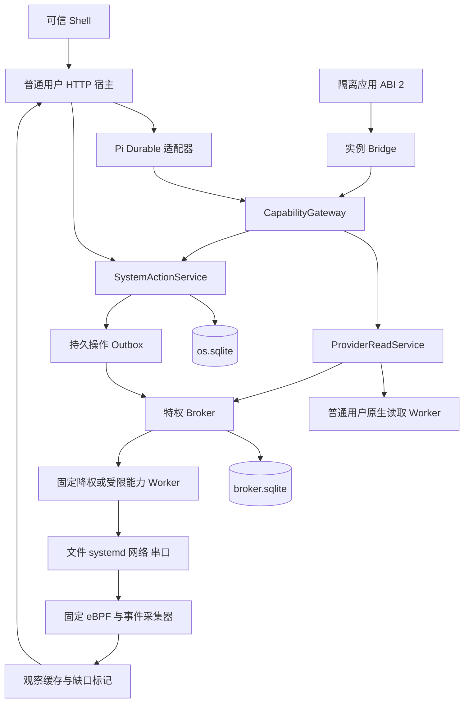

# AgentOS v0.3：Linux 原生能力与系统操作实施规格

版本：0.3-draft；编写日期：2026-10-28；承接版本：v0.2；目标文档目录：`E:\agentos\docs`。

本文沿用 [v0.1](AGENTOS_MVP_V0.1.md) 与 [v0.2](AGENTOS_MVP_V0.2.md) 的实施规格方式，给出下一轮编码的范围、接口、数据模型、恢复协议、开发顺序和验收要求。本次只新增方案文档，不实现其中列出的代码、schema、原生程序或部署配置。

v0.3 的目标是让 AgentOS 和已生成应用通过受控的原生 providers 读取 Linux 状态、管理指定文件与服务、调整受限网络策略并接入一种串口协议。宿主保持普通用户权限；特权动作由独立 broker 执行，模型和应用始终只能提出结构化请求。新增 eBPF 遥测用于观察指定工作负载，系统操作的成功仍以真实状态核对和持久执行记录为准。

本方案以 GitHub `cszf1/agentos` 的提交 `53420fe0feec31f1ead67ab194c80344884e5bd5` 为实现参考，并结合两份本地演进大纲。该提交包含 v0.2 验收报告；本次静态阅读了相关代码与报告，未重新运行仓库测试。以下 v0.3 名称、限制和协议是拟实现契约，不代表当前仓库已经提供。

## 1. 本版交付与完成条件

交付一个能够使用 Linux 原生系统能力的 AgentOS：原有两类应用和数据库命令保持工作，新增系统应用可以读取已授权的资源，并把文件写入、服务控制等请求交给宿主和 broker 执行。每个操作都能回答“谁提出、用户授权了什么、执行到了哪里、实际发生了什么、是否可以重试”。

主验收用例为一个“本地服务工作台”：

1. 从真实 v0.2 工作区副本升级，已有声明式应用、代码应用、记录、版本、服务连接和冷备份能力保持有效。
2. 用户登记一个只读导入目录，并绑定一个平台管理的输出目录及一个预安装演示服务；模型生成工作台，显示目录文件、服务状态、CPU 和内存概况。
3. 工作台读取一份有界 UTF-8 文本，生成统计结果，并通过系统动作导出到管理目录。重复确认、HTTP 重试和宿主重启不会把同一计划重复当作新操作。
4. 用户在工作台启动、停止演示服务，并修改它的一个运行时资源限制；操作由 systemd D-Bus 完成，界面展示核对后的实际状态。
5. 输入自然语言“把这个演示服务的 CPU 上限调整到 50%”，Agent 在绑定资源范围内形成可检查的系统操作计划；用户确认后执行，模型无需获得 Shell 或 root。
6. 在文件发布、服务任务提交、broker 收据保存及宿主结果同步等位置强制终止进程，重启后能区分已完成、确定未执行和结果待确认；不把未知结果报告成“失败且没有变化”。
7. 撤销应用授权、切换应用版本并恢复一份旧工作区备份，证明旧计划、旧实例和旧授权不能重新执行特权动作。

另外三条专项验收线：

- **网络**：在专用测试 network namespace 内切换已批准的防火墙 profile，以真实流量验证允许与拒绝；宿主网络、SSH、DNS 和管理连接不受影响。
- **设备**：通过一个已登记的串口协议读取样例帧；正常收发、拔插/重新连接、部分发送和响应丢失有明确状态。PTY 验证软件协议，真实串口硬件验证实际设备接入，两者分别记录。
- **遥测**：eBPF 捕获指定工作负载的进程事件；丢事件、探针失效或实例代次变化时，界面显示采集缺口并触发状态重读，不凭缺失事件推断操作成功。

第 26 节全部必需项通过才称 v0.3 完成。真实设备暂不可用时可以先完成 PTY 路径，但设备实测项须标记未验收；eBPF 不可用时普通应用可继续运行，不能据此宣称完成本版遥测验收。

## 2. 固定范围与演进大纲对应关系

### 2.1 本轮的具体选择

| 维度 | v0.3 选择 |
|---|---|
| 环境 | 延续 Linux、systemd、cgroup v2、rootless Podman；首轮以 v0.2 使用的 Debian 13 为基线，重新核对内核及特权能力 |
| 用户与生成 | 一个本地用户、一个工作区、一个未终结 Agent run；增加 build 与 system_plan 两种 run 目的 |
| 应用 | v1/v2 原格式冻结；新增 formatVersion 3、SDK ABI 2 和带系统动作的受限界面协议 |
| 文件 | 已登记用户目录只读；平台拥有写权限的管理目录支持有界文本原子创建/替换和变更观察 |
| 服务与资源 | 对预安装且列入目录的 systemd 服务执行状态查询、ensure-running、ensure-stopped 和单项资源限制修改 |
| 网络 | 宿主接口/路由只读；仅在预创建专用 namespace 内修改 AgentOS 自有 nftables 表的已批准 profile |
| 设备 | 设备元信息、一个串口协议 profile、短期串口会话与有界收发；不提供任意 ioctl 或原始设备访问 |
| 系统写入 | 一次计划只包含一个 provider 的一个资源动作；与 records mutation 严格分开 |
| 特权边界 | 普通用户宿主 + 类型化 Unix socket + root 所有的 broker/策略/执行日志；应用容器不挂载 broker socket |
| 遥测 | 固定 eBPF 程序、cgroup 指标、D-Bus/udev/inotify 事件和必要的状态重读 |
| 日常运行 | 不需要模型；系统操作核对与重试是固定控制器逻辑 |
| 恢复 | 进程崩溃、broker 重启和受控系统重启；工作区恢复不会自动重放旧外部操作 |

### 2.2 对大纲的工程收敛

| 大纲方向 | 本版交付 | 本版暂不交付 |
|---|---|---|
| 文件系统 provider | 按资源别名授权、FD 相对访问、管理目录原子文本写入、监听与重新扫描 | 任意用户目录覆盖、递归删除、系统配置文件编辑、跨盘移动 |
| 进程及 cgroup provider | 固定服务集合、真实状态核对、CPU/内存单项限制 | 任意命令、任意 PID kill、自定义 unit 内容、任意 ExecStart |
| 网络 provider | 原生查询及隔离 namespace 内的策略切换 | 主机默认路由/DNS/SSH 防火墙修改、开放公网端口、任意外部 HTTP |
| 外设 provider | 完成一种串口设备的接入和恢复契约 | 音频、显示、蓝牙、USB 通用控制、磁盘/固件写入 |
| 特权代理 | 独立权限上限、持久执行账本、资源围栏和撤销 | 模型代码在特权进程中执行、通用 root 命令通道 |
| eBPF 感知与安全 | 固定进程探针与有界遥测；继续使用 namespace/seccomp/cgroup 等实际隔离 | 动态生成 BPF、全机载荷采集、把 BPF LSM 当作通用动态授权引擎 |

大纲中的“全量 Linux 原生控制”是长期能力方向。本轮先把每类能力接入共同协议，并在受限资源上完成真实执行与恢复；不以一个版本覆盖 Linux 的全部管理功能。

后台自动修复、多 Agent、长周期自治任务、跨应用写事务、可靠定时任务、Wayland 和系统镜像仍不属于 v0.3。系统事件可以更新界面和唤醒固定的核对流程，不能自动触发模型修改机器。

## 3. 当前仓库承接与升级前提

### 3.1 核对到的实现位置

| 当前路径 | 已有职责 | v0.3 改动方向 |
|---|---|---|
| `packages/contracts/src/v2/bundle-v2.ts` | formatVersion 2、queries/commands、imports/exports 和严格能力枚举 | 保留原校验与 hash；增加独立 v3 分支，不能直接放宽 v2 schema |
| `packages/core/src/invocations/invocation-service.ts` | 普通查询、accepted/executing 命令、一次事务提交 mutation | 保持原事务承诺；系统动作另建 SystemActionService |
| `packages/app-sdk/src/index.ts` | ABI 1；query 可调用只读服务，command 只有记录上下文 | 新增 ABI 2 的 provider 只读接口与系统计划 handler；不扩权旧 ABI |
| `packages/core/src/runtime/instances.ts` | callId、callKind、generation、lease、服务调用分发 | 增加 system-plan 调用类型和 provider-read 帧，验证上下文与读取配额 |
| `packages/app-runner/src/runner.ts` | 查询/命令导出核对及 bridge 消息 | 按 ABI 装载三个 handler 表；系统 handler 只产出计划 |
| `packages/core/src/capabilities/gateway.ts` | user/run/app 主体与短事务收据 | 增加 provider 决策、计划准入及可信控制器上下文；不在同步回调中等待系统操作 |
| `packages/core/src/persistence/migrations.ts` | v1/v2 事实表与工具集迁移记录 | 追加资源、授权、操作 outbox、观察和工作区 incarnation 字段 |
| `packages/host/src/backup-v2.ts` | 两库、产物、catalog 和 OCI 镜像冷备份 | 增加 broker 暂停协调与恢复防重放；不把 broker 执行历史跟随旧备份倒退 |

参考：[固定提交的命令服务](https://github.com/cszf1/agentos/blob/53420fe0feec31f1ead67ab194c80344884e5bd5/packages/core/src/invocations/invocation-service.ts)、[SDK](https://github.com/cszf1/agentos/blob/53420fe0feec31f1ead67ab194c80344884e5bd5/packages/app-sdk/src/index.ts)、[运行实例](https://github.com/cszf1/agentos/blob/53420fe0feec31f1ead67ab194c80344884e5bd5/packages/core/src/runtime/instances.ts)。

v0.2 报告记录了真实 rootless Podman、恢复、浏览器及真实模型测试，也记录其内核没有 AppArmor/SELinux，以及 VM 的 `/proc` 挂载问题。这些是本版预检的输入，不应推断该环境已经支持 BPF、目标设备或 root broker。[v0.2 验收报告](https://github.com/cszf1/agentos/blob/53420fe0feec31f1ead67ab194c80344884e5bd5/docs/ACCEPTANCE_V0.2.md)

### 3.2 升级前必须满足

升级在 Pi root 空闲、无未终结 run、deployment 和 invocation 的状态执行，并先完成 v0.2 完整冷备份。保留 appId、revisionId、storeUUID、既有 schema/hash 规则和只增不减的数据契约，按实际 migration 序号追加。

先升级只读/管理接口，再启用系统写入。broker 尚未安装或未完成配对时，已有应用可以运行，新增系统写动作明确显示不可用；不能由 Agent 自动安装 root 服务或修改安全策略。

已存在的 API、旧 runtimeLock 和 ABI 1 镜像必须继续可用。升级工具集通过现有工具迁移流程进行，不能为加载新工具清空 agent.sqlite。

## 4. 技术栈与原生接口选择

| 部分 | 选择与职责 |
|---|---|
| 宿主与前端 | 延续仓库锁定的 Node 24.22.1、pnpm、TypeScript、Fastify、React、AJV 和 SQLite |
| Agent | 延续 Pi Durable / pi-ai / chord 1.4.0；本轮不捆绑 Agent 框架升级 |
| 原生层 | 新增 Rust workspace，固定 Rust toolchain 与 Cargo.lock；共享严格 DTO，少量平台调用集中封装 |
| 文件 | Linux openat2/openat、fstat/statx、renameat2、fsync、inotify；普通用户读取在降权 worker 中完成 |
| 服务 | Rust zbus 调用固定 systemd D-Bus 方法；只使用已探测存在的接口 |
| 网络 | rtnetlink 获取接口/路由；libnftables 接收可信代码构造的 JSON，修改自有表 |
| 设备 | libudev 获取设备身份与热插拔；termios/poll/read/write 承载固定串口协议 |
| eBPF | 平台维护的 C 程序 + Clang + libbpf CO-RE；Rust 采集器只装载已固定 hash 的对象 |
| 特权账本 | broker 独占 SQLite，WAL、foreign_keys、synchronous=FULL；不向普通宿主开放数据库文件 |
| 通信 | 仅本机 Unix socket，长度前缀 JSON、peer credentials、版本握手和有界消息 |

新增原生库的具体补丁版本在 M0/M1 与目标发行版一起锁定并记录，不依据文档中的“latest”推断可用 API。跨语言 DTO 从同一契约生成或执行双向 fixture 一致性测试，禁止两边默默接受不同字段。

systemd 的 D-Bus 提供服务控制和运行时资源属性接口，方法返回、job 完成与服务真实状态需要分别核对。[systemd 257 D-Bus 文档](https://www.freedesktop.org/software/systemd/man/257/org.freedesktop.systemd1.html)、[zbus 接口文档](https://docs.rs/zbus/latest/zbus/connection/struct.Connection.html)

这里的“原生”指使用系统 API 与结构化库。模型提供的 Shell、命令行、D-Bus destination/method、nft 文本、eBPF 字节码和动态库路径都不进入执行入口。

## 5. 架构与信任边界



普通宿主继续拥有工作区业务权限和模型凭据；原生读取 worker 只使用对应用户权限。broker 的高权限部分仅处理身份、策略、持久执行资格和固定 provider 分发，具体操作尽可能在专用 worker 中降权执行。

应用容器保持禁网、只读 rootfs、资源配额和无宿主资源挂载。增加 provider 能力不意味着把目录、设备、D-Bus、cgroup 或 broker socket 直接挂进容器。

broker 信任经过安装登记的宿主 UID，并独立执行 root 所有的资源范围上限。工作区内的应用授权由可信宿主建立；broker 不把宿主自报“用户已确认”当作可越过安装策略的凭据。相同本地 UID 的其他程序属于同一用户信任域，本版不宣称能隔离恶意本地用户或已攻破的宿主。

broker 不读取 Pi 数据库、模型 prompt 或生成源码，也不加载第三方动态 provider。运行期只注册随平台发布的固定能力。

## 6. 未来仓库结构与模块职责

```text
agentos/
  packages/
    contracts/src/v3/       Bundle、providers、资源、授权、计划、收据和观察 DTO
    core/src/
      providers/           ProviderRegistry、只读分发、观察核对
      system-actions/      计划冻结、授权、outbox、执行结果与取消
      system-grants/       应用授权、root 上限交集、撤销同步
      resources/           稳定资源 ID、代次、别名、受管范围
      observations/        事件位置、缺口、快照刷新、限额
      persistence/         追加 migrations
      runtime/             ABI 2 上下文与消息分发
    broker-client/src/     类型化本地协议；无通用命令方法
    app-sdk/src/           ABI 1 保持；ABI 2 只读与计划类型
    app-runner/src/        按 ABI 加载 handler 和限制消息种类
    agent-pi/src/          build/system_plan 模式和可信工具
    host/src/              HTTP、启动对账、升级、冷备份协调
    web/src/               资源连接、动作预览、状态、撤销与诊断
  native/
    Cargo.toml
    Cargo.lock
    rust-toolchain.toml
    crates/
      protocol/            版本化类型、上限与严格解析
      provider-user/       无特权只读文件和观察入口
      broker/              授权上限、日志、执行队列、取消与核对
      provider-workers/    固定 file/systemd/network/serial 实现
      telemetry/           固定探针装载、事件过滤、丢失计数
    bpf/                   平台维护的 C 源码与构建清单
  deploy/v0.3/             安装登记、策略模板、演示 unit、测试网络配置
  fixtures/v0.3/           工作台、原生协议、文件竞争、串口与故障样例
  tests/native/            Rust 与真实系统集成
  tests/recovery/          跨宿主/broker/外部状态恢复
  docs/AGENTOS_MVP_V0.3.md
```

现有 RuntimeDriver 继续负责代码容器。systemd provider 不去修改同一容器的 cgroup，避免两个控制器争夺资源设置；本版服务资源操作只针对独立注册的演示/受管 unit。

`ProviderReadService` 只能读取。`SystemActionService` 只能登记和协调，不能在 SQLite 回调里执行系统调用。`BrokerClient` 只表达固定协议；涉及完整外部结果的事实归 broker 执行账本，业务界面和关联关系归 os.sqlite。

## 7. Provider 统一契约

### 7.1 每项能力必须声明的内容

| 项目 | 必须明确的内容 |
|---|---|
| 输入输出 | capabilityId、contractVersion、严格 input/output schema、字节和集合上限 |
| 权限 | resourceKind、可见字段、scope、参数边界、主体种类、安装级权限上限 |
| 操作身份 | 宿主生成的 actionId/operationId、冻结请求 hash、工作区 incarnation |
| 生命周期 | prepare、dispatch、verify、cancel、reconcile；每阶段 deadline 和中断含义 |
| 重放安全 | read-only、convergent、owned-atomic 或 non-replayable；适用前提必须写清 |
| 真实状态核对 | 如何取得资源身份、预条件和结果证据；不能只读自己的成功标记 |
| 补偿 | 是否支持反向操作、需要哪些新预条件；不支持时明确为空 |

registry 中另外记录执行位置、是否可被跨应用服务间接访问、是否允许自动执行、观察事件种类及诊断红线。以上描述属于固定平台代码，模型只能选择已有能力并填写 schema 内的参数。

### 7.2 首轮能力目录

| provider | 只读能力 | 写能力 | 重放类别 |
|---|---|---|---|
| file | `file.list`、`file.stat`、`file.read_text`、变更摘要 | `file.write_text_atomic`，仅管理目录 | 只读 / owned-atomic |
| service | `service.describe`、`service.metrics` | `service.ensure_state`、`service.set_limit` | 只读 / convergent |
| network | `network.snapshot`、`network.policy_status` | `network.apply_profile`，仅隔离 namespace 自有表 | 只读 / convergent |
| device | `device.list`、`serial.status`、已收样本 | `serial.exchange`，仅固定协议 | 只读 / non-replayable，除非设备协议另有实测去重保证 |
| telemetry | `telemetry.summary`、`telemetry.events` | 无应用可调用的探针安装或改写能力 | 只读，可能有事件缺口 |

prepare 不应产生用户可见的目标变更。允许创建受限临时文件或建立必要的只读观察，但不能提前写目标文件、启动服务、修改策略、打开可能改变控制线的串口或发送串口帧。

系统状态返回统一 envelope：resourceId、resourceGeneration、observedAt、observationId、resourceVersion、data、quality。quality 至少区分 fresh、stale、gap 和 unavailable；缺数据不能自动替换成 0 或空数组。

## 8. 资源身份、授权与安装级权限上限

### 8.1 资源 ID

应用和模型使用宿主分配的 resourceId 与别名，不能把原始路径、unit 名称、网卡索引、PID 或 `/dev/ttyUSB0` 当作权限证据。

| 资源 | 身份至少包含 |
|---|---|
| 只读目录 | 登记 UID、根目录 FD 身份、device/inode、允许后代边界和 scope 版本 |
| 管理目录 | broker 登记 ID、固定根、写入者服务 UID、root generation、受管文件元信息 |
| 服务 | 精确 unit 名、system/user bus 类型、可信模板 hash、unit incarnation；状态观察含 InvocationID |
| 网络 | 固定 namespace 句柄与 incarnation、自有表名、profile catalog hash；ifindex 只作当前观察值 |
| 串口 | udev 稳定属性、真实设备 major/minor、连接代次、协议 profile 和 broker 会话 ID |
| cgroup | 已登记工作负载与实例代次、当前 cgroup 身份；ID 复用后不得继续继承旧授权 |

资源消失、重新创建或身份变化时增加 generation，并使旧 observation、计划和租约失效。只读目录被移动或替换时暂停访问，要求重新登记；不能仅因原路径又出现就继续授权新对象。

### 8.2 应用授权

用户将应用声明的 bindingAlias 连接到实际资源，授权精确绑定 appId、revisionId、capability/contractVersion、resourceId/generation、参数范围、有效期和确认策略。权限取“应用声明、用户授权、broker 安装策略”三者交集。

只读目录连接只能由可信 Shell 发起；注册时用普通用户权限核对真实目录。写目录、systemd unit、网络 namespace 和串口协议必须已经列入 root 所有的目录，浏览器不能把任意绝对路径升级为特权可写资源。

preview、构建容器和旧 ABI 1 应用不取得新能力。跨应用 service 上下文默认禁止 provider 读取，避免通过 v0.2 只读服务授权间接扩大系统资源授权；如需共享系统统计，应由后续版本另行定义委托规则。

读取与执行前检查当前授权，输出返回前再次检查撤销和版本。撤销后不能追回已经显示的数据，但要清空平台查询缓存并拒绝新结果。

### 8.3 Broker 同步与撤销

os.sqlite 保存用户授权意图和同步状态；broker 维护特权能力的有效授权记录及单调 grantVersion。新增授权先在宿主登记，再幂等同步到 broker，收到确认后才显示 active。同步失败显示 pending，不默认放行。

撤销先在宿主阻断新准入，再提交 broker。只有 broker 已持久确认撤销时才显示“撤销已生效”；失联时显示“撤销待确认”，禁止所有依赖该授权的新写入。broker 在同一日志写锁下决定撤销与执行准入谁先发生。

应用版本切换会使其 provider 授权失效，不因回退到旧 revision 自动复活；这比原有只读应用间授权更严格。激活前须确认没有待核对外部操作，并完成旧 provider 授权的 broker 撤销确认；broker 不可用时，该次含系统权限的版本切换等待或失败，保留原版本与已有结果。

本版不要求每个动作重复询问：用户可为管理目录的有界导出、指定演示服务的固定启停设定持续授权。网络策略、资源限制和串口发送默认需要检查具体计划；持续授权若覆盖这些动作，必须由用户显式设置参数上限。模型不能修改确认策略。

### 8.4 system_plan 的主体与授权

用户启动 system_plan 时，可信 Shell 将所选资源、允许读取的元信息和可提出计划的 capability 范围冻结到 run。资源 ID 本身不是读取权限；宿主须校验当前用户连接及安装策略，建立仅在该 run 有效的只读 scope。模型不能追加资源或把“可提出计划”解释为可执行。

系统计划冻结时记录来源 run、只读 scope、资源/策略版本与拟执行参数，但尚无写入授权。Pi 正常结束后，这个不可变计划归用户操作流程持有，在原 5 分钟有效期内仍可确认；run 结束不触发执行，也不延长期限。新 run 不能继承原 scope。

用户确认后，宿主重新检查资源和安装策略，创建主体为 `system_action:<actionId>` 的一次性 broker grant，精确约束 capability、资源代次、冻结参数 hash 和期限。授权同步成功才进入 ready；重复确认复用同一授权意图和 operationId。grantId/version 属于确认及执行元数据，不回写修改 planHash 对应的原计划。系统计划执行期间依靠这份 action 授权，不依靠已经结束的 run。

## 9. 应用包、SDK 与界面协议增量

新增 formatVersion 3、`runtime:isolated-code-v2`、SDK ABI 2、`view.kind:slot-tree-v2`。v1/v2 schema、规范化算法、runner 和 runtimeLock 都保持；v3 新 profile 使用新的不可变 lock ID，不能更换 `core-v1@1` 等旧锁的含义。

| v3 新增内容 | 契约 |
|---|---|
| `system.bindings` | 别名、resourceKind、需要的 capability/contractVersion、说明；无实际路径、授权 token 或 broker 凭据 |
| `queries.*.providerReads` | 此 query 允许使用的 bindingAlias 与只读 capability，最多 4 组 |
| `system.actions` | handlerId 到声明；每个声明固定一个 bindingAlias 和写 capability，含 inputSchema、previewSchema 与允许的只读观察；handlerId 与每次计划新建的 actionId 分开 |
| 模块导出 `systemActions` | 计划 handler 表；函数接收 input/context，返回 SystemPlan，不执行外部操作 |
| SDK `providers.read` | 仅在宿主许可的 query 或 system-plan callId 下使用；返回有界数据及 observationId |
| Slot Tree v2 事件 | 明确区分 records command 与 system action；系统动作结果和确认界面由 Shell 承载 |

v3 仍保留 queries、commands、imports、exports 及四种持久字段。旧 records command 仍只返回 result 与 mutations；新 SystemPlan 固定包含 bindingAlias、capabilityId、params、observationIds 和临时 preview，不能混入 mutations。

应用 action 的实际资源由宿主从 binding 解析。provider 观察证据由宿主记录并绑定顶层 callId；应用提交自造 observationId、跨顶层 callId 证据和任意 resourceId 均被拒绝。Agent 系统计划使用第 10 节的 run 级观察范围。预览摘要由可信 provider 根据冻结参数生成，应用自述文字不能替代实际路径、服务、限制值和影响范围。

`isCodeBundle`、AnyBundle、snapshot/accept 路径、revision 解码、构建器、runtime catalog 和 renderer 必须显式覆盖 v2/v3。现有源码中 `formatVersion === 2` 的分支是接入检查点，不能仅增加一份 schema 后认为运行链路已经支持 v3。

新应用 Prepare 仍只使用固定 fixture；provider 读取使用明确标注的模拟快照，broker 写入全部拒绝。发布时不要求所有资源已连接；未连接的系统区域显示“需要连接资源”，不能用样例数据充当真实系统状态。

## 10. 系统读取与观察证据

provider-read 消息必须来自当前实例、当前 callId 和允许的 callKind。宿主根据固定声明检查 alias/capability，解析有效授权，再分派到普通用户 worker 或 broker。容器不能指定执行 UID、原始 socket、系统路径或 native worker。

查询中最多 4 次 provider 读取，单次子调用默认 750 毫秒，受原有 3 秒总 deadline 约束。系统计划 handler 默认 5 秒，可读取其声明允许的目标观察。普通 records command、跨应用 service、preview 的真实读取及无顶层调用的后台消息全部拒绝。

ObservationStore 保存 observationId、scopeKind、顶层 callId 或 runId、来源 toolTaskId、主体、资源身份、观察版本、时间、可信摘要及到期时间，不将完整文件或串口内容复制到事件日志。应用观察只在同一顶层调用内使用；Agent 的 system_read 与 system_plan 属于不同工具调用，可引用同一未终结 run、同一冻结资源 scope 内尚未过期的观察，不能跨 run 或引用应用调用的观察。系统计划冻结后保存其证据摘要，确认时由可信控制器重新核对目标，不要求 Pi 再次运行。模型生成上下文默认只获得目录元信息和契约；读取真实文本是应用获授权后的运行行为。

资源版本只覆盖对执行预条件有意义的配置与身份，不能把持续变化的 CPU 用量纳入 serviceVersion，否则用户永远无法确认计划。文件版本包含内容 hash，网络策略版本不包含包计数器。

只读结果可标为缓存数据，但用于系统写入的观察必须有明确有效期，并在最终执行前重新核对目标。事件只能使缓存失效，不能把 observation 变成永远有效的授权。

Shell 保留完整状态重读机制。BPF/inotify/D-Bus 事件缺失、重连和缓冲溢出时返回 gap；客户端丢弃增量假设，重新读取当前资源快照。

## 11. 系统计划与外部操作流程

### 11.1 三种行为分开

| 行为 | 执行位置 | 持久化保证 |
|---|---|---|
| 普通 query | 应用容器计算，宿主只读 provider 可选 | 有界快照，可能过时，无业务写入 |
| records command | 容器返回 mutations，宿主提交 | 保持 v0.2 单个 SQLite 事务的全有或全无、至多一次提交 |
| system action | 容器/Agent 提出计划，宿主与 broker 执行 | 持久操作身份、明确执行状态及核对；不承诺与业务数据库原子提交 |

一次 system action 只允许一个写 capability、一个目标资源和一个 effect。不能在同一返回值里组合“改文件 + 重启服务 + 写用户记录”。需要这种工作流时本版由用户分别执行，后续再设计补偿工作流。

执行结果和审计可写入系统操作表，这是宿主事实记录，不等于应用自定义 records mutation。系统成功后也不自动再次调用生成代码去改记录。

### 11.2 计划冻结

1. 用户触发应用 system action，或 Agent 的 system_plan run 提交结构化能力请求。
2. 宿主校验输入和主体范围：应用来源检查活动版本、声明、授权与实例代次；Agent 来源检查当前 run 及冻结资源 scope。应用 handler 只做计算与许可的读取。
3. 宿主校验计划与观察归属，将 alias 解析为唯一资源，规范化参数，并核对 provider 的输入 schema、安装上限和前置条件。
4. 保存不可变 actionId、planHash、主体、源 revision/epoch 或 run/scope、必要的 dataEpoch、已有应用 grantVersion 或系统计划策略版本、resourceGeneration、预条件、参数/内容 hash、到期时间及确认策略。
5. 由可信 UI 展示目标、参数差异、预期效果、可否重试/补偿及真实风险。需要确认时进入 awaiting_approval；已被持续授权覆盖的应用操作直接进入 ready。Agent 的 system_plan 一律进入 awaiting_approval，按第 8.4 节取得一次性执行授权。

计划默认 5 分钟有效。确认提交 actionId、planHash 和 Idempotency-Key，不接收一个“顺便修改过参数”的新正文。同一计划只能产生一个 operationId；重复确认只返回原执行状态。用户修改参数或刷新已过期观察时，应产生新计划和新 hash。

### 11.3 执行准入与结果记录

进入 ready 的短事务复核版本、授权、dataEpoch（若计划使用了应用记录）和期限，并登记唯一 operationId 与完整冻结 envelope 的 outbox。这个提交点阻止同一应用的版本激活，直到操作已得到确定结果或完成明确的异常处置。

后台控制器将同一 envelope 发送给 broker。broker 校验连接身份、机器/工作区 incarnation、授权版本和资源围栏，先持久登记，再在独立的执行准入事务中决定能否派发。网络重试必须复用相同 operationId 和 hash。

broker 调用 provider 后核对真实系统状态，将证据与结果写入自己的账本。宿主根据已验证的 broker 结果补写 os.sqlite 结果、收据和事件。broker 已执行但宿主落库失败时只是结果待同步，不能重新创建系统动作。

一旦外部操作可能已经发生，结果同步不再因为 app/data epoch 改变而丢弃事实。版本、数据和授权检查约束的是新执行资格；它们不能把已发生的系统变化改写为“没有执行”。

### 11.4 版本、实例和运行任务的关系

awaiting_approval 的旧版计划可以在版本切换时作废；ready/dispatching/running/reconciling 或尚未处置的 indeterminate 操作必须先核对，阻止该 app 的新版本激活。构建候选可以继续，但激活应返回 SYSTEM_ACTION_PENDING。

应用实例崩溃不删除冻结计划。计划一旦移交宿主，执行与核对不依赖原实例存活，不能为恢复外部操作再次运行应用 handler。实例 generation 只用于接收计划之前拒绝旧进程的迟到输出。

停止应用撤销其新调用资格，并请求取消未派发计划；已派发的动作由独立控制器继续核对，Shell 的全局操作中心保持可见。停止容器不等于取消已发送给 systemd 或设备的命令。

## 12. 特权 Broker 协议与部署

### 12.1 安装与配对

部署者一次性安装 root 所有且普通用户不可修改的可执行文件、策略、服务目录和 socket 单元。登记允许连接的宿主 UID、storeUUID、工作区路径标识、资源上限和 machineInstallId。运行期模型不能修改登记。

工作区额外拥有由 broker 分配的 workspaceIncarnation。它是独立于 storeUUID 和 client_epoch 的单调防重放代次：storeUUID 继续标识业务工作区，client_epoch 使浏览器会话失效，incarnation 使旧外部执行请求失效。

Unix socket 使用明确所有者/组和最小访问权限，连接时核对 SO_PEERCRED；握手协商 protocolVersion、brokerInstanceId、machineInstallId、workspaceIncarnation 和策略版本。JSON 中自报 UID/PID 不能替代内核提供的 peer credentials。[Linux Unix socket 文档](https://man7.org/linux/man-pages/man7/unix.7.html)

不使用宿主自签的“允许 root”文本代替 root 策略；也不把“有一个随机 token”作为全部授权检查。本机通信身份、固定资源上限、当前授权和不可变操作正文都必须匹配。

### 12.2 固定方法与消息

公开方法仅包括 handshake、describe、read、grant-sync、grant-revoke、submit、operation-get、operation-cancel、operation-resolve、history-sync、workspace-quiesce、workspace-resume、restore-begin、restore-status 和 restore-complete。operation-resolve 只登记用户处置及释放资格，不能伪造设备证据；history-sync 只供当前合法宿主读取本工作区旧代次审计；三个 restore 方法按 restoreRequestId 协调防重放代次。安装登记/扩大策略通过单独管理员入口，普通宿主接口不能调用。

写请求至少包含 protocolVersion、machineInstallId、storeUUID、workspaceIncarnation、operationId、planHash、capability/contractVersion、resourceId/generation、grantId/version、preconditions、deadline 和规范化 params。broker 重新计算 hash，拒绝未知字段和版本。

同一 operationId 同 hash 返回现有状态；不同 hash 返回 OPERATION_CONFLICT。身份和 incarnation 检查先于结果返回，失效调用方不能利用旧收据接口继续读取敏感结果。恢复后的合法宿主可通过专用历史同步入口读取旧代次审计，但不能重新提交旧操作。

控制消息上限 512 KiB，文件正文等内容受更小能力限额约束。读取长度头后先限额，JSON 深度最多 8；每连接限制未完成请求数。不能让巨大或部分帧占住整个 broker。

### 12.3 进程分权

| 进程 | 权限与边界 |
|---|---|
| Node host | 普通用户，保留原 NoNewPrivileges；不改为 root、不获取通用 sudo 权限 |
| provider-user | 对应普通用户身份，无额外 capabilities；只能处理已绑定的只读资源 |
| broker | root 所有的固定守护程序；负责策略、执行日志与分发，禁止任意 exec、动态库和脚本 |
| file worker | 专用服务 UID，只有管理目录的读写权限；不以 root 身份按用户路径打开任意文件 |
| network worker | 由 systemd 启动在预创建的固定 namespace 内；仅所需 NET_ADMIN，不能切回主机网络 |
| serial worker | 专用 UID，经精确 udev/ACL 规则访问登记设备，无通用 root 权限 |
| telemetry worker | 固定对象和工作负载范围，仅探针装载需要的经实测能力；无配置其他系统服务的接口 |

network namespace 的创建及 systemd NetworkNamespacePath 配置由安装流程完成，普通请求不执行任意 setns。每类服务单独设置允许地址族、可写路径、system call filter 和 capabilities；依据真实 API 验证，不套用会破坏功能的统一配置。

特权服务不依赖 Node 进程继承的环境，不接受代理地址、PATH、LD_PRELOAD、动态配置目录或模型指定的库名。固定服务程序必须是 root 不可由普通用户修改的安装产物。

broker 与 worker 的内部通道也核对 peer 身份，并按 operationId、dispatchNonce 和 brokerInstanceId 去重。broker 重启后不能只更换 instanceId 就认为旧执行者已经消失：须通过固定 systemd 单元/控制组停止并确认旧 worker 退出，或取得可靠的停写确认，再开始本地效果核对和安全继续。不能同时派出两个写同一资源的 worker。旧 worker 已提交的 systemd job、内核 I/O 或串口发送仍可能继续，须按对应 provider 核对；进程退出本身不证明无效果。无法确认停写时保持资源隔离。

## 13. File Provider

### 13.1 两类目录

`import-root` 是用户明确登记的只读目录，使用该用户权限读取，绝不因 broker 存在而提升访问权限。`managed-root` 是平台建立、由专用 file worker 独占写权限的输出目录；其父目录也不能由宿主用户、应用或其他普通程序更名、插入链接或写入。

本版文件写入只支持 managed-root。系统管理员可以绕过任何本地策略，因此不把恶意 root 纳入隔离保证；普通编辑器需要先通过受控接口导入/更新管理文件，不能直接并发写同一目标。

这样才能落实单写者预条件与原子替换。对任意用户目录，先检查 hash 再 rename 并不是原子的比较交换，不能宣称防住不合作写入者的并发覆盖。

### 13.2 路径与读取

输入路径是根目录内的规范化相对路径。拒绝绝对路径、空段、`.`、`..`、NUL、路径分隔变体和超长段；基于根 FD 使用 openat2 的 beneath/no-symlink/no-magic-link 约束，禁止越过不在授权范围的挂载点。[openat2 文档](https://man7.org/linux/man-pages/man2/openat2.2.html)

只接受普通文件与目录，拒绝设备、FIFO、socket、符号链接及多硬链接文件。不能先 realpath 检查后再用原始路径打开；文件类型和身份要对已经打开的 FD 检查。

list 每页最多 200 项，read_text 单次最多 256 KiB，严格 UTF-8，返回内容 hash 和截断/变化状态。只读外部文件有并发写入时检查读取前后元信息，发现变化返回 RESOURCE_CHANGED；它不提供非合作写入者条件下的文件系统快照保证。

目录被移走、替换或卸载时观察标记失效并暂停访问；重新绑定后增加 generation。监视由 inotify 承载，目录数量与深度有界，出现队列溢出后重新扫描。[inotify 文档](https://man7.org/linux/man-pages/man7/inotify.7.html)

### 13.3 原子文本创建和替换

write_text_atomic 输入包含相对路径、content、expectedVersion 或 expectedAbsent。单文件最多 128 KiB，权限由平台固定，不能设置可执行位、任意 UID/GID、ACL 或 xattr。本版不提供删除、跨目录移动或递归写入。

执行步骤：

1. broker 获得资源锁，核对根 generation、受管目录所有权和当前目标版本。
2. 在日志保存 operationId、目标、旧/新 hash、唯一临时文件名与执行阶段，并同步提交。
3. file worker 在同目录创建不可预测且只属于本操作的临时文件，写入完整字节并 fsync。
4. 重新核对预条件；新建使用 renameat2 的 no-replace 语义，替换在独占写者与资源锁条件下执行原子 rename。
5. fsync 父目录，重新读取目标身份/hash，保存实际结果和资源新版本，再清理残留临时项。

原子 rename 保护的是目录项切换，不让 SQLite 与文件系统成为一个事务。[Linux rename 文档](https://man7.org/linux/man-pages/man2/rename.2.html)

崩溃后比较旧 hash、新 hash、临时项和日志阶段：确认新内容已生效则补记；确认仍为旧值且满足独占写者条件时可继续原操作；出现第三种内容、身份变化或不确定 I/O 结果时进入待核对并阻断覆盖。临时文件清理只能处理登记过的本操作名字。

将文件恢复成旧内容是新的补偿计划，要求当前 hash 仍等于待补偿操作的结果 hash；不能覆盖后续成功写入，也不删除原成功收据。

## 14. Process 与 Cgroup Provider

只管理 root 所有目录中登记的精确 unit。演示 unit 使用固定可执行程序、固定非特权 User、受管 WorkingDirectory 和明确资源边界；应用不能提供 unit 文本、ExecStart、环境变量、工作目录或任意参数。

service.describe 返回 unit、ActiveState/SubState、InvocationID、启动时间、受管 cgroup 与当前可修改限制。metrics 读取 cgroup v2 的 CPU/内存/进程及 OOM 概况，不返回其他用户进程的命令行、环境或内存。[cgroup v2 文档](https://docs.kernel.org/admin-guide/cgroup-v2.html)

`service.ensure_state` 只接受 running/stopped。已经满足目标时返回 already_satisfied；不提供可被重复解释为“再重启一次”的通用 restart。执行时使用 StartUnit/StopUnit，保存可取得的 job 身份，并结合 JobRemoved 信号和实际 unit 状态核对；信号丢失则重新读取。

StartUnit 返回 job 路径不等于服务已运行，进程曾短暂启动也不等于现在健康。成功结果标明实际 InvocationID、状态和核对时间；如果需要健康检查，目录只能指定可信的固定探针，不能接受应用给出的命令或 URL。

`service.set_limit` 每次只修改一个 runtime 属性：CPUQuotaPerSecUSec 或 MemoryMax，参数取安装上限与用户授权的交集。使用 SetUnitProperties 的 runtime 模式，不自动写入永久 unit 文件。[systemd 资源属性接口](https://www.freedesktop.org/software/systemd/man/257/org.freedesktop.systemd1.html)

演示目录默认 CPU 范围为单个逻辑 CPU 的 10%—200%，内部用每秒微秒数表示，50% 对应 500000；界面不能将它解释成整台机器总算力的 50%。MemoryMax 使用整数字节，演示范围为 64 MiB—1 GiB，并受安装策略更小上限约束；不接受 infinity、负数、NaN 或隐含单位。实际目录值在部署清单中固定并进入策略 hash。

不能把 systemd 的运行时设置宣称为跨重启持久配置。主机重启后读取实际默认值，显示与用户上次设置的差异；本版不在启动时自行补做此前操作。降低 MemoryMax 可能影响目标进程，预览必须展示当前用量和拟议值，并拒绝平台策略范围外的收缩。

ensure 操作保证的是指定目标状态的核对与受限收敛，不保证程序的启动副作用只发生一次。允许自动收敛的服务必须在目录中明确可安全重复启动；否则派发结果不确定时进入 indeterminate，等待处理。任意用户服务不能只因名字相似就继承该资格。

补偿同样是新操作：只有当前 unit identity/限制仍匹配原操作的后置条件才允许恢复旧值。已经发生的请求处理、内存回收或进程退出无法被“设回原值”撤销。

## 15. Network Provider

宿主级能力仅通过 rtnetlink 读取接口、地址、路由摘要和链路状态。数据按注册范围过滤，模型和应用不能给出原始 netlink 消息。

写能力只针对安装时建立的 `lab-net` 资源：固定 namespace、自有 veth 测试连接、固定 nftables 表和两种 profile：`local-allow` 允许指定测试地址/端口，`local-deny` 阻断同一测试路径。该网络不桥接主机管理接口，不修改主机 NAT、DNS 或默认路由。

network.apply_profile 只接受 profileId 和预条件。可信 worker 根据 root 所有的 profile 编译 nftables JSON，在目标 namespace 内通过 libnftables API 提交；不接受 nft 命令文本、规则表达式、用户选择的表名或 include 路径。[Netfilter 原生库说明](https://wiki.netfilter.org/wiki-nftables/index.php/Portal%3ADeveloperDocs/nftables_internals)

核对范围包括 namespace incarnation、profile catalog hash、自有表的规范化规则 hash 和受控流量探针。计数器不参与配置 hash。规则批量提交是否为当前安装版本支持的原子事务，在 M0/M4 通过真实失败注入验证；失败不得退化为逐条 Shell 修改。

本版不创建“跨接口、地址、路由、防火墙”的虚拟全局事务。安装资源和修改自有表是不同职责；操作只能改变已登记 profile 的自有表，不 flush 整个 ruleset。

network namespace 隔离网络设备、路由及相关栈状态，仍须以真实测试证明没有影响初始主机 namespace。[Linux network namespace 文档](https://man7.org/linux/man-pages/man7/network_namespaces.7.html)

策略恢复为一个新计划，要求目标 namespace 和当前规则 hash 仍匹配原操作结果。namespace 消失时使计划失效，不按旧 ifindex 找一个新接口继续执行。

## 16. Device 与 Serial Provider

设备发现使用 libudev；用户只能看到安装策略允许的类型和元信息。serial 资源绑定稳定硬件属性、当前 major/minor、连接 generation 与协议 profile，不能仅按 `/dev/ttyUSB0` 的名字认设备。

首轮 profile 固定为 `telemetry-echo-v1`：有限采样查询和回显帧，不定义执行器、固件升级或存储写指令。baud、数据位、校验、最大帧长度和帧编码由目录固定；应用填写 schema 内参数，由 worker 生成帧，不提供任意 ioctl/原始字节写入口。

worker 独占已登记设备会话，应用不获得 FD。会话有 TTL，宿主/授权失效、设备拔出或 worker 重启后关闭；设备实际重连或 worker 失去可信会话状态时增加 resource generation，并要求重新授权。普通闲置关闭后再次打开只产生新的 sessionId，不把它误当作硬件重连；已冻结的请求仍须核对设备身份。打开端口可能影响控制线，因此协议验收需要确认驱动和设备的实际行为，不能将“只准备读取”笼统视为物理无副作用。

serial.status 只读取 udev 元信息及已获授权会话的缓存状态，不为查询或 prepare 新开端口。端口打开、termios 配置和首次发送都属于确认后的派发阶段，之前先持久登记执行 fence；从可能改变控制线起即不能仅凭“尚未写帧”报告 failed_no_effect。会话关闭的控制线行为也纳入固定 profile 和预览说明。

serial.exchange 的一次派发最多发送一帧，帧最大 256 字节、响应最大 4 KiB、总时限 2 秒。日志在首次发送尝试前持久写入 dispatch_started；出现部分写、进程死亡或响应丢失后，默认不重发。

write 返回字节数或 tcdrain 完成，只说明相应主机端传输阶段，不能证明设备已经完成动作。成功需要 profile 定义的、匹配请求标识的有效响应；超时保留“可能已发送”的证据。若未来协议支持持久去重，必须同时验证设备重启后的去重行为，才能改 replayClass。[tcdrain 文档](https://www.man7.org/linux/man-pages/man3/tcdrain.3p.html)

不确定操作进入 indeterminate，并隔离该资源的进一步写入。用户可查看设备、明确确认现状后解除隔离或提交新计划；这不会把原操作改写为失败或成功。用户主动重试是新操作，界面要说明前一次可能已经送达。

PTY fixture 可以测试帧、超时、部分发送和进程恢复；真实串口板卡或 USB 转串口回环另做设备项验收。没有硬件时不能把 PTY 结果称为已验证 USB 插拔、串口控制线或真实设备兼容。

## 17. 操作账本、重放、取消与补偿

### 17.1 两层事实

os.sqlite 保存“用户/应用提出了什么”和可展示的结果投影。broker.sqlite 保存“执行资格何时取得、外部操作是否派发、核对到了什么”。两者没有共同事务，依靠冻结 outbox、操作身份和对账恢复。

broker 的唯一键为 machineInstallId、storeUUID、workspaceIncarnation、operationId，另保存 planHash 与规范化请求 hash。宿主不能为了绕过重复检测给一次重试生成新的 operationId。

动作与任务状态固定如下：

| 状态 | 含义与允许后续动作 |
|---|---|
| awaiting_approval | 计划冻结，尚未取得执行资格；可确认、拒绝或过期 |
| ready | 宿主已准入并写 outbox；尚未确认 broker 是否收到 |
| dispatching | 宿主正在投递或等待 broker 状态；不能视为未执行 |
| running | broker 已持久通过执行准入，动作可能已经发生 |
| reconciling | 正在核对系统状态或补同步结果，禁止盲目重新执行 |
| succeeded | 有可信结果证据；completionKind 为 applied、already_satisfied 或 satisfied_on_reconcile |
| failed_no_effect | 能证明目标副作用没有发生的失败，须给出证据类别 |
| cancelled_no_effect | 取消在执行准入前赢得竞争，或 provider 能证明未产生目标副作用 |
| expired_no_effect | 尚未派发时期限耗尽；派发后超时不能用此状态 |
| indeterminate | 可能已产生效果但无法确定结果；资源隔离，保留人工处置入口 |

失败收据必须带 effectCertainty（none、verified、unknown）和 evidenceKind。接口不能把所有异常都映射成一个 FAILED 并显示“未写入”；继续使用 v0.2 原错误文案的地方仅限普通 records command。

### 17.2 执行准入的线性化点

broker 在一个短事务中检查有效授权、资源锁、generation、deadline、取消标记与请求 hash，再将记录转为 running，持久化 dispatch fence。该事务提交前不得发送目标系统调用。

撤销/取消与这个事务使用相同的串行化顺序。取消先提交，则同 operationId 此后即使由 outbox 迟到，也只能返回 cancelled_no_effect；为未见过但身份有效的 operationId 先写取消 tombstone。准入先提交，则取消只能阻止尚可中断的后续步骤，并要求核对，不承诺没有效果。

running 的标记只证明“准许派发”，不证明调用已经发生。因此它本身既不是成功证据，也不能在重启后直接变成 failed_no_effect。

每资源最多一个未核对写操作。锁和 quarantine 状态持久化，连接断开、租约 TTL 到期或 broker 重启不能直接释放不确定操作的锁。只允许核对路径或明确的人工处置解除。

### 17.3 各类操作的重放规则

| 类别 | 重启后的处理 |
|---|---|
| read-only | 重新读取即可，返回新的观察版本，不沿用旧结果作写预条件 |
| owned-atomic 文件写 | 在独占写者、相同根代次和旧/新 hash 证据下补完成或补记；证据不符则隔离 |
| convergent 服务/网络 | 先核对当前目标状态；已满足则报告核对满足，只有目录明确允许重复收敛时才再次派发 |
| non-replayable 串口 | 确认尚未派发才允许原操作执行；一旦存在发送可能性，默认不重发 |

恢复最多自动尝试两次核对/安全继续，并受独立恢复预算约束；任何重新派发还必须处于原执行 deadline 内并通过原授权和预条件检查。deadline 到期后仍允许只读核对与补记已发生事实，不能继续产生新目标效果；无法确认转 indeterminate，不做无限重启。状态读取仍可继续帮助用户诊断，不等于继续取得执行资格。

### 17.4 必测中断分支

| 中断位置 | 恢复规则 |
|---|---|
| 宿主已保存计划但用户未确认 | 保留待确认或过期，不能启动执行 |
| ready/outbox 已提交，发送前退出 | 重投同 operationId 与冻结正文 |
| broker 已接受，宿主未保存 broker 映射 | 查询或重投同 ID，取得原记录 |
| broker running 已提交，系统调用尚未发生 | 按 provider 证据恢复，不能仅因 running 认为成功或失败 |
| 文件 rename 完成、结果收据未提交 | 核对新内容和身份后补记，不再覆盖一次 |
| systemd 接受 job、响应丢失 | 查询 job/InvocationID/实际状态；允许收敛与否由固定目录决定 |
| nftables 提交响应丢失 | 核对自有规则 hash 和测试流量，禁止 flush 全局表来“修复” |
| 串口发送后、响应/收据前退出 | 无可靠设备证据则 indeterminate，不重发 |
| broker 成功已提交，宿主未同步 | 只补投影和收据，应用无需再次运行 handler |
| 撤销先提交、原请求随后到达 | broker 拒绝并回放撤销/取消事实 |
| broker 文件缺失或身份不配对 | 禁止系统写入；不得自动建空日志后重放宿主 outbox |

### 17.5 补偿与人工处置

“补偿”是有新 operationId 的新授权操作，并关联 compensatesOperationId。原操作及其结果保持不变；补偿也可能失败或待核对。文件、服务限制和网络 profile 只有当前后置条件仍匹配时才能提供恢复旧值计划。

串口不提供通用补偿。人工处置只记录 observed evidence、operatorDecision 和解除隔离的范围；可以确认结果，也可以保留未知并明确承担继续操作的风险，不能把“用户点了继续”伪造为设备确认。

版本激活锁可在操作确定终结后释放；indeterminate 必须先记录明确处置，必要时继续保留资源隔离。原始状态和处置历史必须可见。

## 18. eBPF、系统事件与观察恢复

### 18.1 本版探针范围

平台维护固定的进程 exec/exit 探针，仅收集已登记服务和应用工作负载的事件。事件字段限定为时间、kernel boot ID、cgroup 身份、工作负载代次、PID/进程起始身份、事件类别和有界退出信息；不采集 argv、环境、文件内容、网络载荷或其他用户活动。

CPU/内存/OOM 指标主要从 cgroup v2 读取；文件变化用 inotify，设备用 udev，服务变化用 D-Bus。选择各系统提供的结构化入口，不为了使用 eBPF 重做所有状态接口。

采集器仅装载随平台安装、hash 已固定的 BPF 对象。模型和生成应用不能上传源码/字节码、任意 attach、修改 map 或指定全机过滤范围。工作负载注册来源于可信 RuntimeManager/服务目录，再核对实际 cgroup，而非应用自报 PID。

CO-RE 用于处理内核类型差异，不意味着任何内核都能运行同一探针；必须验证 BTF、相关配置、可用 hook、权限及资源限制。旧 v0.2 环境的 seccomp 成功不能作为 eBPF 可用证据。

### 18.2 丢失与代次

内核 ring buffer 预留失败时会丢事件，程序必须维护独立 drop 计数，用户态也维护解码/传输/消费丢失计数。[BPF ring buffer 文档](https://docs.kernel.org/bpf/ringbuf.html)

事件 envelope 含 sourceEpoch、sourceSeq、resourceGeneration、observedAt 和 gap 标记。sourceSeq 是已收到事件的编号，不伪装成捕获了所有内核事件。发现丢失时将对应观察置 gap，触发 D-Bus/cgroup/资源真实状态重读。

kernel boot、probe 重装、cgroup 删除/复用和设备连接代次变化时使旧映射失效。用户态无法确认事件归属时丢弃该归属并报告 gap，不能给复用的 cgroup ID 或 PID 自动继承旧 app 标签。

探针不可用时显示 telemetryAvailable=false，普通应用继续工作；可靠写入授权不依赖“最近没看到异常事件”。provider 操作账本与核对仍必须完整。

### 18.3 安全围栏与自治边界

本版的强制访问边界来自现有容器隔离、文件目录所有权、broker 固定能力、原生 worker 降权和资源限额。eBPF 观察结果用于诊断，不能代替这些措施。

BPF LSM 可以实现访问控制，但依赖特定 hook、内核配置和正确的策略组合。本版不把它列为完成全部动态文件/网络授权的捷径，也不在不支持的内核上伪报已启用。[LSM BPF 文档](https://docs.kernel.org/bpf/prog_lsm.html)

事件可触发固定的“刷新状态、清理已失效连接、继续已登记核对”，不能自动生成新 root 动作。后台模型诊断、自动补丁、跨资源自治属于 v0.4。

## 19. 数据库与事实归属扩展

### 19.1 os.sqlite

不改变 agent.sqlite 内部表；保留原有 records、invocations、deployments、operations 与 service_grants 语义。

| 实体 | 核心字段与约束 |
|---|---|
| `meta` 增量 | provider_protocol_version、broker_install_id、workspace_incarnation、broker_binding_state、provider_policy_version |
| `system_resources` | id、kind、display_name、execution_class、generation、catalog_key、identity_digest、status、created_at/updated_at；不向应用暴露特权绝对路径 |
| `provider_grants` | id、principal_kind、app_id/revision_id 或 action_id、binding_alias、capability_version、resource_id/generation、limits_json、params_hash nullable、confirmation_policy、grant_version、sync_state、revoked_at；旧授权不可覆盖修改 |
| `provider_grant_outbox` | id、grant_id、kind、request_hash、frozen_request、dispatch_state、broker_result、created_at；创建/撤销幂等同步 |
| `system_actions` | id、origin、app_id/revision_id nullable、run_id nullable、source_app_epoch/data_epoch nullable、handler_id nullable、plan_hash、plan_json、observation_refs、grant_id/version、resource_id/generation、state、operation_id nullable、expires_at、approved_at、result/evidence/error、resolution、timestamps |
| `system_outbox` | operation_id PK、action_id UNIQUE、machine_install_id、workspace_incarnation、frozen_envelope、request_hash、dispatch_state、last_broker_seq、attempt、created_at；正文一旦投递不可修改 |
| `resource_observations` | id、scope_kind、call_id 或 run_id、tool_task_id nullable、principal_key、resource_id/generation、version、observed_at、expires_at、quality、summary_json；不长期存完整内容 |
| `provider_event_cursors` | source、source_epoch、last_received_seq、drop_count、quality、last_refresh_at |
| `provider_events` | seq、source_epoch、resource_id/generation、kind、bounded_payload、observed_at；允许按明确保留策略清理 |
| `runs` 增量 | mode 默认为 build；system_resource_scope 保存冻结的资源/读取/提案范围；prepared_action_id nullable，按 mode 决定完成判据；原 applied_revision_id 约束保持 |

同一 actionId 只能绑定一个 operationId，成功/未知结果不能被常规重试清空。系统写操作的应用激活锁必须是可恢复状态，不能仅用进程内 Mutex 表示。已有 `operations` 只保存接受/最终投影收据，不充当 broker 执行日志。

系统计划 awaiting_approval 时 grant_id/version 可为空，确认阶段关联一次性授权；执行 metadata 不属于已冻结的 plan_json，禁止因此重写 planHash。

### 19.2 broker.sqlite

| 实体 | 核心内容 |
|---|---|
| `broker_meta` | machineInstallId、schema/policy 版本、全局日志序号 |
| `workspace_bindings` | storeUUID、允许 UID、incarnation、active/quiescing/fenced、登记策略与更新时间 |
| `restore_sessions` | restoreRequestId、工作区、源/目标 incarnation、检查点、阶段与完成状态；重复恢复返回同一会话 |
| `broker_grants` | grantId/version、工作区/代次、主体、资源、参数上限、有效期、撤销事实 |
| `resource_state` | resourceId/generation、可信 identity、observedVersion、未核对 operationId、quarantine 状态 |
| `effect_operations` | 完整唯一操作身份、request/plan hash、冻结输入、replayClass、状态、dispatch fence、provider/job/session 关联、deadline、证据、结果、取消与核对次数 |
| `effect_steps` | operationId、step、attempt、before/after 摘要、外部关联 ID、时间；不能仅依赖日志文本 |
| `broker_audit` | seq、事件种类、关联身份、结果与处置摘要；不保存模型 prompt 或原始凭据 |

broker 数据目录权限 0700、数据库/敏感 payload 0600，仅服务账户可读写。一个 broker 写进程持有独占锁。所有外部调用在短事务之外，前置执行资格与最终证据各自持久提交。

内容较大的文件计划以有 hash 的受控 blob 保存，先落不可变 blob 再登记引用；读取或恢复时再次校验。缺失 blob 不能被解释成空字符串继续覆盖文件。

## 20. Pi 构建模式与系统计划模式

### 20.1 模式与权限

保持一个 root 和一个未终结 run，新增 `mode=build | system_plan`。mode 由用户入口明确选择并由宿主冻结，模型不能切换。root 工具集可以包含两类工具，但服务端按 run mode 校验每一次调用。

build 继续使用 v0.2 构建工具，增加只读 provider catalog 和系统应用协议说明；它不能读取任意用户文件、执行系统动作或授予能力。

system_plan 从用户选择的资源集合出发，最多形成一个系统操作计划。用户没有绑定资源时可读取能力目录并解释缺失项，但不能推测一个真实路径、服务名或设备后执行。

### 20.2 新增可信工具

| 工具 | 作用 |
|---|---|
| `provider_catalog` | 查询固定 capability、contractVersion、参数 schema、效果与核对类别，不返回真实内容 |
| `system_resource_list` | 当前 run 被用户绑定的资源 ID、类型和有界说明 |
| `system_read` | system_plan 模式下读取已许可的元信息/状态，输出有 observationId 的结果 |
| `system_plan` | 根据绑定资源、一个 capability、参数和观察证据冻结 action；返回 actionId、可信预览与确认状态 |
| `system_action_status` | 只读查看本 run 关联计划状态，不自动执行 |

不提供 system_exec、grant、sudo、任意 read_file、原始 D-Bus/netlink 或 broker 方法工具。模型不能通过命名为“诊断”的工具绕开 schema 与授权。

系统计划 run 默认 180 秒、最多 6 次模型请求、20 个工具 task、3 次不合格计划尝试，最终仅保留一个有效 prepared_action_id。build 保持 v0.2 的 900 秒、12 请求、50 task 和 3 次候选预算。

### 20.3 完成判据

build 仍以 applied_revision_id 表达发布事实。system_plan 以 prepared_action_id 表达“计划已生成”，不能沿用“没有发布应用就失败”的 finalizer，也不能把 planReady 显示为系统动作已完成。

计划形成后让 Pi 收敛并释放生成槽位；用户确认发生在可信 Shell 的独立动作流程，不让 root 长期等待批准。即使已有持续授权，system_plan 本版仍停在具体计划待确认，避免自然语言解释直接变成新的特权执行。

用户看到的状态分为“方案已生成/待确认”和“执行中/核对后完成”。模型文本不是执行事实来源。模型或网络离线后，已冻结计划仍可在有效期内通过 Shell 确认、执行与核对。

取消 system_plan run 与取消 system action 是两个入口：尚无计划时取消 run；已生成但未执行的计划可以撤销；已经派发的动作按第 17 节核对。新 run 不继承旧 run 的资源授权或 observationId。

## 21. HTTP 与 Shell 行为

### 21.1 接口增量

所有接口保持本地认证、同源、JSON、client_epoch 和错误 envelope。业务写入要求 Idempotency-Key；查询 POST 仍校验身份和配额，但不伪造写入收据。

| 接口 | 行为 |
|---|---|
| `GET /api/providers` | 固定能力、版本、可用性、确认策略上限 |
| `GET /api/system-resources` | 当前用户可绑定的资源摘要与真实可用状态 |
| `POST /api/system-resources/import-roots` | 用户登记普通权限只读目录；不创建特权写范围 |
| `GET /api/provider-grants` | 应用权限及 pending/active/revoking/revoked 状态 |
| `POST /api/provider-grants` | 用户创建精确 revision/resource 授权，受安装上限限制 |
| `POST /api/provider-grants/:id/revoke` | 宿主先阻断，再同步 broker；返回撤销进度 |
| `POST /api/apps/:appId/system-actions/:handlerId` | expectedAppEpoch、input；计算并冻结计划，返回 actionId 与状态 |
| `GET /api/system-actions/:actionId` | 可信预览、确认要求、状态、effectCertainty、证据与处置 |
| `POST /api/system-actions/:actionId/confirm` | actionId 对应的 planHash；只确认这一不可变计划 |
| `POST /api/system-actions/:actionId/cancel` | 取消 tombstone 或进入核对；不能承诺撤销已发生效果 |
| `POST /api/system-actions/:actionId/resolve` | 用户提交明确处置，关联新观察；不能自行填写“broker 已成功” |
| `POST /api/system-actions/:actionId/compensations` | 针对支持的 provider 生成新的补偿计划，仍需授权与预条件 |
| `GET /api/system-operations` | 工作区系统操作中心，包括恢复后仅有 broker 记录的历史操作 |
| `GET /api/observations` | 有界快照/事件、游标与 gap，缺口时要求完整重读 |
| `POST /api/runs` 增量 | mode=system_plan、显式 resourceIds 与用户选择的 capabilityScopes；宿主冻结实际读取/提案范围；build 保持原参数兼容 |

system action 接受、确认、执行和最终核对都是不同阶段。HTTP 202 只表示任务或确认请求已接受，不能在按钮旁直接显示“文件保存成功”。

### 21.2 界面必要内容

资源连接页展示目录/服务/网络/设备的真实身份、来源和授权边界；应用不能绘制伪造的宿主确认框来获得权限。确认区由 Shell 提供，显示规范化的目标、差异、预条件、是否可能不可逆、是否自动重试及确认期限。

只读状态带观察时间，过时、缺口和不可用有独立显示。动作区明确区分确定未执行与结果待确认；indeterminate 不提供无说明的“再试一次”，先显示现状核对和处理入口。

全局操作中心独立于应用渲染、实例存活和当前版本。发生异常时用户仍可查看已派发动作、撤销权限和确认结果。版本切换因未核对操作受阻时，显示关联 action，不能只给 RUN_BUSY。

控制按钮使用用户能理解的目标与影响，例如“将演示服务 CPU 上限设为 50%”。路径解析策略、broker 库、BPF map 和数据库表不进入日常操作流，仅在诊断中出现。

### 21.3 最低错误集合

| 分类 | 错误码 |
|---|---|
| 协议/资源 | PROVIDER_UNAVAILABLE、CAPABILITY_VERSION_UNSUPPORTED、RESOURCE_NOT_BOUND、RESOURCE_GONE、RESOURCE_GENERATION_STALE |
| 权限 | PROVIDER_GRANT_REQUIRED、GRANT_PENDING、GRANT_REVOKING、GRANT_REVOKED、BROKER_POLICY_DENIED |
| 计划 | INVALID_SYSTEM_PLAN、MIXED_EFFECTS_FORBIDDEN、PLAN_EXPIRED、PLAN_HASH_MISMATCH、PRECONDITION_STALE |
| 执行 | BROKER_UNAVAILABLE、BROKER_IDENTITY_MISMATCH、WORKSPACE_FENCED、OPERATION_CONFLICT、RESOURCE_BUSY、SYSTEM_ACTION_PENDING |
| 文件 | PATH_SCOPE_VIOLATION、UNSUPPORTED_FILE_TYPE、RESOURCE_CHANGED、FILE_VERSION_STALE、CONTENT_UNAVAILABLE |
| 服务/网络/设备 | SERVICE_TARGET_NOT_REGISTERED、SERVICE_STATE_UNCONFIRMED、NETWORK_SCOPE_DENIED、DEVICE_DISCONNECTED、SERIAL_DELIVERY_UNKNOWN |
| 核对/恢复 | EXTERNAL_RESULT_INDETERMINATE、RECONCILIATION_REQUIRED、COMPENSATION_CONFLICT、BROKER_HISTORY_MISSING |
| 观察 | TELEMETRY_UNAVAILABLE、OBSERVATION_GAP、OBSERVATION_EXPIRED |

409 用于版本/状态冲突，403 用于授权拒绝，422 用于非法计划/输入，429 用于配额，503 用于组件不可用。异步 action 的运行结果通过状态 DTO 表达，HTTP GET 成功不代表 action 成功。

## 22. 启动、关闭、系统重启与升级

### 22.1 组件启动

systemd 管理 broker 与各固定 worker；宿主仍是原用户服务。默认 broker 数据在 `/var/lib/agentos-broker`，管理文件在 `/var/lib/agentos-managed/<storeUUID>`，仅对应服务账户可写；宿主数据目录保持原设置。路径由安装配置决定，不由模型或应用填写。

broker 启动先取得独占锁、校验 root 所有的策略与日志、恢复资源锁及取消 tombstone，再核对未完成操作，最后开放新的执行准入。日志损坏、缺失、版本过新或身份不配对时只开放最小诊断，不能自动删除重建。

宿主启动顺序为：

1. 按 v0.2 规则取得 host.lock，检查 restore-in-progress，打开并迁移业务库和 Pi 库，暂不恢复模型调度。
2. 读取 broker 绑定元数据，完成只读握手，核对 installId、incarnation、策略版本与组件支持。
3. 对账授权同步、取消、system outbox 和未核对结果；优先恢复已有事实，不准入新系统写入。
4. 按 v0.2 重建代码实例；同时恢复观察源，重新取得当前 namespace/设备/cgroup 身份。
5. 恢复 run 模式与工具绑定，按事实判定原 run 终态；开启查询和获准的写入路径。

broker 暂不可用时，Shell、数据库应用和无系统权限的版本管理可继续工作。`/api/state` 分别报告 hostReady、runtimeReady、brokerReady、telemetryAvailable 和各 provider 状态，不能用一个总布尔值掩盖降级原因。

### 22.2 关闭与失联

普通 SIGTERM 先停止新系统计划准入与 outbox 新投递，再关闭 Pi、应用 bridge 与原普通任务。已被 broker 接受的操作不因宿主退出而自动取消；broker 在自己的期限和核对协议内继续处理，结果留在日志待宿主同步。

如果用户要求停止全部系统操作，先发取消/暂停请求并等待明确结果，再停服务。直接杀死 broker 后仍可能有文件已替换、systemd job 已提交或串口帧在传输，不得把服务停止作为无副作用的证明。

broker 失联时宿主暂停新的系统写入，保留已有 operationId；连接恢复后先查询。应用 UI 可以继续显示最后快照，但标记不可确认，不能自行创建替代 broker 或改走 Shell。

### 22.3 主机重启与升级围栏

kernel boot 变化时，服务 InvocationID、网络 namespace、串口会话与 cgroup 映射重新核对。已终结操作只保留历史事实，不为恢复运行时 CPU 设置或网络 profile 自动重做。

跨 kernel boot 的未完成操作只先核对：文件可依据稳定的受管根与内容证据完成恢复；服务/网络/设备若外部身份已改变，原请求不得自动应用到新资源。需要再次设置时产生新观察和新操作。

升级本版原生协议或 root 策略前暂停新系统写入，处理已派发动作并固定日志检查点。不能在 provider contract 改变后用新的解释继续执行旧冻结正文；不支持旧协议时标记需要维护处理，保留原日志。

本版验证重点是进程崩溃和受控系统重启。保留 Pi agent.sqlite 使用 NORMAL 的已知持久性边界；不会因为 broker 使用 FULL 就宣称整个系统已经证明断电后零丢失。

## 23. 备份、恢复与旧请求防重放

### 23.1 备份的范围

继续备份 v0.2 的两库、artifact、runtime catalog 与所需镜像，增加 provider 契约/策略 hash、资源登记摘要、broker 检查点与本工作区操作审计导出。管理文件可导出内容快照；只读导入目录、任意系统文件、服务运行状态和设备状态不冒充工作区文件被自动备份。

broker.sqlite 是独立的外部执行历史，不能跟随一份旧用户工作区备份一起回退。完整机器灾难备份由管理员另行负责；本版工作区 restore 不替换 broker 的权威日志。

### 23.2 协调冷备份

1. 停止宿主并取得原 host.lock，阻止普通数据写入及容器活动。
2. 请求 broker workspace-quiesce，持久阻断本工作区的新执行准入；等待正在派发的动作得到确定结果或进入已隔离的 indeterminate。
3. 将 broker 最新结果同步到业务副本，记录检查点序号、installId、incarnation、未确定动作及隔离范围。
4. 验证没有继续写入管理文件的 worker，复制工作区集合与受管文件快照，生成完整 manifest/hash。
5. 最后标记备份完整；根据管理命令的明确成功/失败处理解除 quiesce，重启宿主。

quiesce 超时不能静默解除冻结并宣称备份一致。已经隔离的未知操作可以作为未知状态进入备份，但其身份和 quarantine 必须保留。root 管理员绕过服务修改机器不属于该一致性协议。

### 23.3 工作区恢复

恢复旧数据库最危险的情况是：备份时一项动作还在 ready，之后真实系统已经执行；恢复后若直接重放旧 outbox，就会再次产生效果。v0.3 必须通过独立 incarnation 解决，而不是只换浏览器 token。

恢复流程为：

1. 停止宿主、取得 host.lock、核对备份并保存当前集合，设置原 restore-in-progress 标记。
2. broker 进入 quiesce，先处理旧代次中已准入的操作；在其日志持久推进 workspaceIncarnation，fence 所有旧代次未派发请求。
3. 按 v0.2 恢复数据库、产物和镜像，更新 client_epoch、登录 token、broker incarnation 绑定；源备份中的旧 incarnation 只作历史记录。
4. 将恢复出来的未派发系统计划标为失效/待重新确认，所有旧 outbox 禁止重投。对可能已执行的操作，从 broker 取回历史事实或显示需要核对，不重建副作用。
5. provider 授权默认失效，重新检查实际资源身份后由用户连接；原有纯数据库应用和 v0.2 服务连接按原规则恢复。
6. integrity、引用和外部历史检查完成后移除恢复标记，解除 quiesce，开放新代次；中途退出保留冻结，由恢复入口继续完成。

推进 incarnation 的恢复请求本身使用独立 restoreRequestId 去重，重复运行不能无限推进或解除未完成恢复。若 broker 已推进而宿主尚未恢复，普通启动必须发现代次不符并拒绝系统写入。

检查点之后已发生、但旧业务库不含对应 action 的操作，通过系统操作中心作为外部历史展示；不能因恢复了旧数据库就隐藏这些实际变化。

### 23.4 外部资源不会随应用回退

恢复工作区不会停止实际服务、改回网络规则、重发设备帧或覆盖当前管理文件。备份中的管理文件快照只能用于生成新的恢复计划，显示当前 hash 与备份 hash 的差异，得到授权后逐项应用。

若 broker 日志丢失，系统写入保持关闭。管理员恢复日志或重新登记一个新的 machineInstallId，并让所有旧计划、授权和 outbox 失效；不得以空日志加旧 installId 继续服务。无法核实的历史操作保持未知。

宿主降回 v0.2 同样需要恢复升级前工作区，并停止新系统入口、撤销 broker 访问；已经发生的 Linux 状态变化不因此自动撤销。

## 24. 配额、诊断与运行入口

### 24.1 初始限额

| 项目 | 默认上限或规则 |
|---|---|
| 原有应用与生成 | 沿用 v0.2 的 20 个应用、4 个活动代码实例及原有字段/记录/构建限额 |
| 资源 | 只读根 8 个、管理根 2 个、受管 unit 8 个、测试网络资源 1 个、串口 2 个 |
| 系统计划 | 每应用最多 4 个待确认计划；工作区最多 16 个；每计划 5 分钟有效 |
| 执行并发 | 每工作区最多 1 个外部写操作在途，每资源只能一个未核对写；未知资源保持隔离 |
| 计划计算 | 应用 handler 5 秒；计划及参数总计最多 256 KiB |
| Provider 读取 | 每顶层调用最多 4 次，单次默认 750 ms；受 query 3 秒或计划 5 秒总期限约束 |
| 文件 | list 每页 200，目录观察最多 128 个且深度不超过 4；文本读 256 KiB、写 128 KiB |
| 服务 | ensure 核对最长 15 秒；CPU 单位与上下界固定，MemoryMax 不允许超过部署上限 |
| 网络 | 固定两个 profile，自有表最多 32 条规则；写入及核对总计 5 秒 |
| 串口 | 单帧 256 字节、响应 4 KiB、单次 2 秒，会话闲置 30 秒关闭，发送不自动重试 |
| 写操作总期限 | 从执行准入到核对默认最多 30 秒；超过转核对/未知，不等于取消已发生效果 |
| 观察保留 | 最多 10000 条事件或 24 小时，先达者清理；完整 provider 正文不进通用事件日志 |
| eBPF | ring buffer 初始 4 MiB；有界 workload map；丢失可见，不为保全遥测阻塞业务 |
| 操作账本 | 业务终态与取消 tombstone 不自动删除；容量告警与拒绝新准入先于磁盘耗尽 |

未来增加 tombstone 清理必须设计调用方 epoch 与旧请求永久失效规则。本版不能为节省空间删除去重事实后重新接受旧 operationId。

宿主/native worker/broker 分别有 CPU、内存、FD、队列和输出限额。受管文件总额默认 256 MiB，计划 blob 默认 64 MiB；新写入先预留容量，空间不足时拒绝准入，不能删除活跃计划、核对证据和历史结果来继续执行。

日志包含 actionId、operationId、runId、appId/revisionId、resourceId/generation、incarnation、阶段、耗时、错误码和证据类别。默认不记录文件正文、串口原始帧、模型密钥、cookie 或整个调用输入。

### 24.2 下一轮应提供的命令契约

以下均是未来实现要求，本次没有创建脚本。

| 入口 | 必须完成的动作 |
|---|---|
| `pnpm native:build` | 用锁定 Rust/Clang/库构建 native 程序及固定 BPF 对象，输出版本与 hash 清单 |
| `pnpm native:doctor` | 检查 openat2、systemd API、cgroup、broker 身份、root 策略、网络/串口/BPF 能力，分别报告 |
| `agentos-system-admin install` | 管理员安装固定产物与策略，登记宿主 UID/工作区，创建受管目录、演示 unit 与 lab namespace |
| `agentos-system-admin inspect` | 只读检查登记、权限上限、账本版本、资源隔离和未核对操作 |
| `pnpm test:native` | Rust 契约、真实文件/systemd/netlink/nft/串口软件链路，使用专用资源 |
| `pnpm test:broker-recovery` | 真进程强杀、跨库对账、取消 tombstone、复用请求及 incarnation 恢复 |
| `pnpm test:telemetry` | 真探针装载、事件、过滤、丢失和身份代次测试 |
| `pnpm test:e2e` | 扩展资源连接、确认、未知状态、撤销和旧版兼容路径 |
| `pnpm smoke:v0.3-real` | 真实模型生成工作台及系统计划，保存实际 provider/模型/用量和原生执行证据 |
| 原 backup/restore | 升级为协调 broker 的 v0.3 语义，保留旧备份读取与严格版本检查 |

所有故障测试使用专用 workdir、unit、namespace、设备或 PTY。不能对宿主 SSH、生产服务、真实用户文件和不属于测试的硬件注入故障。

## 25. 编码顺序与阶段退出条件

### M0：冻结 v0.2 与核对 Linux 能力

保存 v0.2 提交与冷备份，复跑原回归；核对实际内核、BTF、BPF 权限、systemd 方法、openat2、cgroup、rootless 容器及专用设备。建立独立测试工作区和受管资源，不从模型工具开始开发。

退出条件：v0.2 回归通过；环境报告明确每项原生能力可用或缺失；在真实目标 Linux 上能访问固定 D-Bus/文件接口并加载固定 BPF 探针。若 VM 禁止 BPF，先选择满足条件的验收环境，不用模拟结果替代。

### M1：契约、资源与新 ABI

实现 v3 schema、独立 hash、provider registry、资源身份/观察/授权模型、Rust/TS DTO 一致性、SDK ABI 2、计划 handler 与 UI 事件区分。先用手写应用和假执行器检查控制流，不产生真实外部写。

退出条件：v1/v2 hash 与普通命令语义不变；v3 运行链路可识别；非法混合 mutation/effect、伪造观察、错误 alias/ABI 均拒绝；旧 app 不因升级获得系统权限。

### M2：Broker、账本与操作对账

实现安装配对、独立策略上限、peer credentials、授权同步/撤销、operationId 去重、outbox、取消 tombstone、执行 fence、资源锁和 indeterminate 状态。

用可观察的固定测试 effect 验证所有跨进程断点，避免先写复杂 provider 再补恢复语义。

退出条件：同键不同正文拒绝；取消先赢不派发；响应丢失找回原操作；日志缺失和身份错配禁止写入；未知结果不会变成普通失败或被自动重试。

### M3：文件与服务闭环

接入只读根、管理目录写入、目录观察、受管 systemd unit 状态/启停/单项限制。对文件 rename、D-Bus job 返回和最终收据保存分别做真实故障注入。

退出条件：手写工作台完成读取、导出、启停和限额；竞争路径不越界，原子文件写恢复正确；服务状态与真实 systemd 一致；操作不碰任意系统文件或服务。

### M4：受限网络与串口

实现固定 namespace/network profile、规范化规则核对、受控流量探针、串口身份/会话/帧协议与不确定发送处理。先完成 PTY，再接真实硬件。

退出条件：策略切换影响仅限测试 namespace；重启或重建资源使旧计划失效；串口发送不确定时没有自动重发，软件与真实硬件证据分别完整。

### M5：系统观察与 eBPF

实现固定对象装载、工作负载登记、exec/exit 事件、cgroup 指标、各事件源游标、drop 计数、缺口重读与保留限额。

退出条件：只观察授权工作负载；探针丢失和 cgroup/PID 复用不会产生错误归属；遥测失效不削弱 broker 策略，也不使界面伪报“没有异常”。

### M6：Shell 与 Pi 双模式

完成可信资源连接/预览/确认、权限撤销、全局操作中心和异常处置；接入正式 Pi faux，再完成真实模型构建工作台与 system_plan。

退出条件：用户可看清实际效果并决定执行；模型没有 exec/grant/root 入口；build 与 system_plan 各自按正确事实收敛；系统计划不会因 Pi 结束自动执行，模型离线仍能操作已生成工具。

### M7：升级、恢复与完整交付

完成协调冷备份、incarnation 恢复、防旧 outbox 重放、原生程序升级围栏、资源/空间压力和全部验收；整理从干净 Linux 环境安装的步骤及实际结果。

退出条件：第 26 节必需项通过；恢复旧备份不会重复产生外部效果；依赖/内核/硬件差异被准确记录；无通用特权后门、只在测试有效的 stub 或把未知结果标成功的路径。

M0—M7 可分提交交付，但本版完成必须覆盖整条链。协议、执行资格、资源身份与恢复规则先实现，再扩大能力数量。

## 26. 验收矩阵

保留 v0.1/v0.2 的原回归，再增加以下 80 项。fake provider 可用于局部单元测试；涉及内核、特权、设备与恢复的项目必须使用对应真实对象。矩阵描述的是待完成标准，不是本次已执行的结果。

| ID | 检查 | 通过条件 |
|---|---|---|
| V3-C01 | 旧格式冻结 | 原 v1/v2 fixture、hash、revision 与普通 records 事务规则保持 |
| V3-C02 | v3/ABI/视图判别 | 完整构建运行链路支持新格式；错误 ABI 或旧格式中的新字段拒绝 |
| V3-C03 | 单 effect 与命令分离 | 混合 records mutation、跨 provider、多资源写计划拒绝 |
| V3-C04 | DTO 跨语言一致 | Rust 与 TypeScript 对未知字段、数值范围、深度和规范化 hash 一致 |
| V3-C05 | Provider 输入限制 | Shell、unit 文本、任意原始系统消息、脚本/字节码路径拒绝 |
| V3-C06 | 观察归属 | 自造、过期、应用跨顶层 callId、Agent 跨 run 或错误 generation 的 observation 拒绝；同 run 合法工具观察可用于计划 |
| V3-C07 | 新旧 runtimeLock | 新 profile 不改写旧锁；历史应用及离线构建继续可用 |
| V3-G01 | 安装策略上限 | 本地用户授权不能突破 broker 已登记资源/参数上限 |
| V3-G02 | 连接身份 | 自报 UID、错误 peer、错误 installId/incarnation 拒绝 |
| V3-G03 | 应用精确授权 | 错误 app/revision/alias/resourceVersion 拒绝，旧 ABI 无新增权限 |
| V3-G04 | 授权同步中断 | pending 不放行；相同授权意图重投不重复扩权 |
| V3-G05 | 撤销与准入竞争 | 撤销先提交则无新派发；准入先提交则如实核对可能效果 |
| V3-G06 | 失联撤销 | 宿主立即阻断，界面显示待确认，恢复后同步根侧撤销 |
| V3-G07 | 上下文限制 | preview、build、records command、跨应用 service 和后台消息不能取得 provider 写或真实读取权限 |
| V3-G08 | 权限回退行为 | 应用切回旧版本不复活 provider 授权；只读服务原协议不被无意改变 |
| V3-F01 | 目录越界 | 路径穿越、符号链接、magic link、越界挂载及替换竞争被拒绝 |
| V3-F02 | 文件类型与普通权限 | 特殊文件/硬链接拒绝；只读用户根不利用 root 增权读取 |
| V3-F03 | 读取变化 | 大小/编码/并发变化准确报告；不把截断内容说成完整文件 |
| V3-F04 | 管理目录独占写 | 普通宿主/容器/其他程序无法改写父目录和目标，竞争保证有真实权限依据 |
| V3-F05 | 新建与覆盖条件 | expectedAbsent 不覆盖；旧版本/hash 不匹配时拒绝替换 |
| V3-F06 | 文件崩溃恢复 | 临时写、fsync、rename、收据各断点只补原操作或进入未知，不误覆盖第三种内容 |
| V3-F07 | 条件补偿 | 当前内容已变化时拒绝恢复旧值；原成功历史仍在 |
| V3-S01 | 服务范围 | 任意 unit、PID、ExecStart、环境与全机管理请求拒绝 |
| V3-S02 | Job 与真实状态 | job 接受不直接算成功；信号丢失仍可查到实际 unit 状态 |
| V3-S03 | ensure 语义 | 已满足返回 no-op；无法证明安全收敛时不自动重启服务 |
| V3-S04 | 单项限额 | 实际 cgroup 值与请求一致；参数超限拒绝，普通容器控制器不被干扰 |
| V3-S05 | boot/InvocationID 变化 | 旧进程身份不被复用，已完成 runtime 限制不在开机后自动重放 |
| V3-S06 | 服务补偿 | 当前后置条件不同则冲突；不宣称恢复进程已产生的业务效果 |
| V3-N01 | namespace 隔离 | 操作前后主机路由/DNS/SSH 与全局防火墙保持，只有测试网络发生预期变化 |
| V3-N02 | 固定 profile | 原始 nft/任意表/任意地址范围被拒绝，profile hash 受安装目录控制 |
| V3-N03 | 实际流量 | local-allow/local-deny 用原生测试流量证明有效，不只检查返回码 |
| V3-N04 | 提交失败/响应丢失 | 规则 hash 和探针正确核对，无全局 flush 或逐条 Shell 兜底 |
| V3-N05 | namespace 重建 | 旧 generation/ifindex 不能控制新资源，补偿检查当前规则 |
| V3-D01 | 设备身份 | 同路径换设备、major/minor 或连接代次变化使旧计划失效 |
| V3-D02 | 帧与参数限制 | 未注册设备、任意 ioctl/原始帧、越界参数被拒绝 |
| V3-D03 | 正常串口协议 | 请求标识、响应、期限和字节上限校验完整 |
| V3-D04 | 端口副作用/部分发送/丢响应 | 查询不新开端口；可能改变控制线或发送后不假报无效果，未知发送不自动重发 |
| V3-D05 | 拔插与 worker 崩溃 | 旧会话关闭、generation 更新、资源隔离与重新授权正确 |
| V3-D06 | 人工处置 | 解除隔离保留原未知事实；新尝试生成新计划，不篡改原收据 |
| V3-R01 | 同操作重投 | 同 ID/hash 找回同一执行；不同正文拒绝 |
| V3-R02 | outbox 提交前后中断 | 未接受不执行，已接受重投同正文和身份 |
| V3-R03 | broker 接受后宿主退出 | 重连找回原操作，无新副作用身份 |
| V3-R04 | 执行 fence 后、调用前退出 | 按 provider 证据核对，不能自动当作成功或无效果失败 |
| V3-R05 | 外部效果后、broker 结果前退出 | 文件/服务/网络/串口分别遵守重放类别 |
| V3-R06 | broker 结果后、宿主同步前退出 | 只补业务投影，普通 handler 不重跑 |
| V3-R07 | 取消先于迟到请求 | 持久 tombstone 使迟到 outbox 无法派发 |
| V3-R08 | 取消晚于执行准入 | 展示可能已执行，核对或隔离，不伪报 cancelled_no_effect |
| V3-R09 | 旧 worker、资源锁与未知状态 | 重启先确认旧 worker 停写；重启/TTL 不释放未知写资格，无两个 worker 并发执行原动作 |
| V3-R10 | 发布与已准入动作竞争 | 不确定动作阻止新版本激活；已发生结果不会被 epoch 变化抹掉 |
| V3-R11 | 日志缺失/损坏 | 写入禁用，不能空库重放；只读诊断仍可用 |
| V3-R12 | 恢复预算 | 自动核对/继续有上限，不能无限重试或反复重启目标 |
| V3-T01 | 真 eBPF 探针 | 在实际验收内核装载固定对象并捕获指定工作负载事件 |
| V3-T02 | 数据范围 | 不采集未登记进程、参数、环境、内容或网络载荷 |
| V3-T03 | Ring/用户态丢失 | drop 计数与 gap 可见，触发真实状态重读 |
| V3-T04 | PID/cgroup 复用 | 旧身份不归属到新进程/实例；无法确认时明确缺口 |
| V3-T05 | 采集器失效 | 普通应用可用，界面显示遥测不可用，不降低 broker 授权 |
| V3-T06 | 遥测不触发新动作 | 事件只唤醒固定观察/核对，无模型自动 root 操作 |
| V3-A01 | 正式 faux 双模式 | 经过真实 Pi 与新宿主工具，build/system_plan 权限不串用 |
| V3-A02 | 计划完成与执行授权 | prepared_action_id 与发布事实区分；Pi 结束后仍可确认，由一次性 action grant 执行，不依赖已结束 run |
| V3-A03 | 冻结与预算 | 最多一个有效计划、固定正文、请求/工具/期限上限生效 |
| V3-A04 | 生成内容越权 | 模型无法扩大资源、确认策略、直接 broker/exec 或授予权限 |
| V3-A05 | Pi 重放与取消 | 同工具找回原计划；取消 run 不错误取消另一动作或获得新资源 |
| V3-A06 | 真实数据最小化 | 构建上下文和日志没有默认夹带用户文件、设备正文或凭据 |
| V3-U01 | 可信预览 | 实际目标/参数来自 provider，不能被生成文字替换或隐藏 |
| V3-U02 | 持续授权与确认 | 已批准范围可按策略执行，新增范围或参数不被静默放行 |
| V3-U03 | 不确定结果界面 | unknown 与确定未执行有区别，处置前不提供误导性无条件重试 |
| V3-U04 | 应用停止/错误 | 全局操作中心仍可见，停止应用不伪报撤回系统效果 |
| V3-U05 | 观察与撤销刷新 | stale/gap、撤销待确认、版本变化和过期计划准确显示 |
| V3-O01 | 真 v0.2 升级 | 历史应用、记录、hash、镜像、service grants 和原回归保留 |
| V3-O02 | 协调冷备份 | broker quiesce、实际 worker 停写、结果同步及检查点完整 |
| V3-O03 | 旧备份中的 ready 请求 | 恢复后 incarnation 变化，旧 outbox 不再次执行 |
| V3-O04 | 恢复各断点 | broker 已 fence/数据库半恢复时写入保持关闭，可幂等完成恢复 |
| V3-O05 | 备份后已发生效果 | 旧业务库缺失的真实操作仍可查见，不被恢复隐去 |
| V3-O06 | broker 丢失/重新安装 | 新 installId、旧授权和请求失效，不能自动补执行 |
| V3-O07 | 限额与空间 | 文件/队列/blob/事件有界，满额先拒绝新操作，不删除去重证据 |
| V3-O08 | 干净环境部署 | 普通用户宿主、root 服务、worker 权限和协议版本均可复现 |
| V3-E01 | 真实模型工作台 | 生成并发布 v3 应用，授权后完成读取、导出及演示服务操作 |
| V3-E02 | 真实模型系统计划 | 自然语言在绑定资源内生成计划，用户确认后由真实 provider 执行并核对 |
| V3-E03 | 模型离线主路径 | 已生成应用、系统计划确认、原生操作、撤销和查询独立于模型工作 |
| V3-E04 | 真实串口硬件 | 登记实际设备，完成协议/拔插/响应丢失验证；与 PTY 结果分列 |

验收报告须记录源码提交、内核/BTF、systemd、Podman、native toolchain、库版本、BPF 对象 hash、策略/catalog hash、broker 版本和实际设备信息。模拟模型、模拟设备、真实原生接口和真实硬件结果分别标记。

## 27. 完成交付清单

- [ ] v0.2 实际工作区副本迁移与完整旧回归通过。
- [ ] v3 包、SDK ABI 2、Slot Tree v2 和旧运行器并存，旧 hash/锁保持。
- [ ] 文件/服务/网络/串口/遥测均接入统一契约与资源身份。
- [ ] 原生层固定构建，Rust/TypeScript 严格 DTO 与规范化规则一致。
- [ ] broker 普通连接身份与 root 权限上限独立验证，生成代码不能进入特权执行路径。
- [ ] 授权同步、撤销、执行 fence、取消 tombstone 和资源锁跨进程持久化。
- [ ] 外部操作重放类别、真实证据、未知结果和条件补偿均有测试。
- [ ] 文件独占写者条件、服务范围、网络 namespace 和设备身份有真实系统依据。
- [ ] eBPF 事件有过滤、丢失计数、代次与重读；不被误用为执行事实或自动授权。
- [ ] build 与 system_plan 的权限、预算和完成判据正确，真实模型主路径通过。
- [ ] 冷备份协调、恢复 incarnation 与 broker 历史保留有效，旧 outbox 不重放。
- [ ] M0—M7 和 80 项验收完成；缺少硬件/内核能力的项没有被模拟结果冒充。
- [ ] 安装、运行、异常处置和已知范围可从干净 Linux 环境复现。

## 28. 下一版接口与实施依据

### 28.1 为 v0.4 保留的接口

v0.4 可以在本版 provider 观察、操作账本和补偿协议上增加后台诊断与自治，但必须使用独立的调度身份、预算、资源租约和授权上限。后台 Agent 不能因“维护”标签取得更宽的 root 权限。

多步骤工作流需要持久 step/outbox、每步去重、补偿顺序及部分成功状态，不能把本版单 effect 包成数组后宣称跨系统事务。可靠定时任务和跨应用写入同样需要独立设计。

如果未来开放宿主网络、真实执行器、文件删除或 BPF LSM，必须为新增操作补充失联保护、恢复入口和对应真实验收；本版演示资源上的成功不证明这些高影响能力已经安全可用。

### 28.2 依据与验证范围

本地设计依据为 [v0.2 实施规格](AGENTOS_MVP_V0.2.md)、[演进大纲](../AgentOS%20演进与实现路径大纲.docx) 和 [完整版大纲](../AgentOS%20演进与实现路径大纲完整版.docx)。上述大纲提供 v0.3 的系统能力方向；本方案的管理目录、固定服务、隔离网络、单串口协议和单 effect 限制属于本轮工程选择。

实现依据为 [固定参考提交](https://github.com/cszf1/agentos/tree/53420fe0feec31f1ead67ab194c80344884e5bd5)、[v3 需要扩展的现有契约](https://github.com/cszf1/agentos/blob/53420fe0feec31f1ead67ab194c80344884e5bd5/packages/contracts/src/v2/bundle-v2.ts)、[网关](https://github.com/cszf1/agentos/blob/53420fe0feec31f1ead67ab194c80344884e5bd5/packages/core/src/capabilities/gateway.ts)、[migration](https://github.com/cszf1/agentos/blob/53420fe0feec31f1ead67ab194c80344884e5bd5/packages/core/src/persistence/migrations.ts) 和 [现有备份实现](https://github.com/cszf1/agentos/blob/53420fe0feec31f1ead67ab194c80344884e5bd5/packages/host/src/backup-v2.ts)。本次静态阅读只用于确定衔接位置，不替代 v0.3 的实测。

系统机制以文中链接的 Linux man-pages、Linux 内核、systemd、Netfilter 和 zbus 官方资料为依据。原生调用、资源隔离、恢复能力及硬件行为都必须以锁定版本和实际验收环境确认；设计文档中不将计划能力记为已实现。
