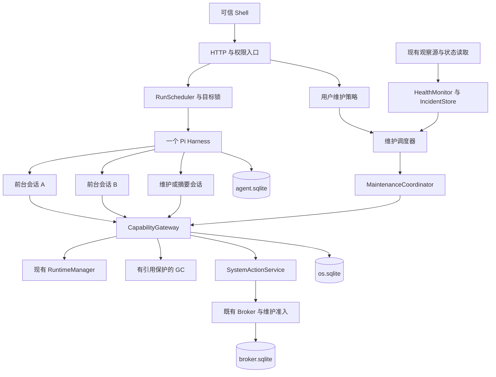

# AgentOS v0.4：后台自治与多智能体并发实施规格

版本：0.4-draft；编写日期：2026-10-29；承接版本：v0.3；目标文档目录：`E:\agentos\docs`。

本文沿用 [v0.1](AGENTOS_MVP_V0.1.md)、[v0.2](AGENTOS_MVP_V0.2.md) 和 [v0.3](AGENTOS_MVP_V0.3.md) 的实施规格方式，给出下一轮编码的范围、模块、契约、恢复规则、实施顺序与验收要求。本次只新增方案，不实现代码、数据库迁移或部署配置。

v0.4 的目标是：让多个用户任务分别拥有会话、权限和预算，同时让后台控制器持续发现问题、执行已经授权的有限维护，并留下可核对的结果。模型参与诊断和生成候选版本；确定性的调度器、运行控制器和 broker 决定任务何时取得执行资格。

实现参考固定为 GitHub `cszf1/agentos` 的提交 `a88021109dbac86fe2355821d4d12d5d7af19da6`。本次静态阅读了相关代码、v0.3 验收报告及本地演进大纲，没有重新运行 GitHub 仓库测试。以下均为 v0.4 拟实现契约。

## 1. 本版交付与完成条件

交付一个支持并发生成、持久维护任务和受控自愈的 AgentOS。用户能同时处理不同应用的需求，查看每个任务的权限与花费，授权指定维护策略，并在后台异常时暂停维护、核对效果或切回历史版本。

主验收场景为“两个前台任务 + 一个后台维护闭环”：

1. 从真实 v0.3 工作区副本升级，保留原应用、记录、版本、runtime locks、系统授权与执行历史。
2. 同时修改两个不同应用；两个 Pi 会话真实并行请求模型，工具结果、预算、发布目标和取消互不混用。构建和发布准备仍按独立资源队列排队。
3. 取消其中一个任务，另一个继续完成；伪造 runId、旧会话迟到输出及恢复中的旧执行代次不能借用另一任务的写权限。
4. 用户启用某个应用的维护策略。故障注入使其实例退出，系统通过现有 RuntimeManager 恢复，记录故障、尝试次数和恢复证据；连续失败触发熔断。
5. 用户为一个固定演示服务启用有次数上限的恢复策略。服务异常停止后，控制器重新观察实际状态，通过 broker 的维护授权执行 ensure-running，再核对健康。
6. 在应用仍可使用时清理确实无引用的构建缓存；正在构建、正在发布、运行中、被备份或历史回退依赖的产物不会被删。
7. 后台模型为一个应用产生经过校验和 fixture 验证的优化候选，用户查看差异后发布。候选不会自动取得发布权限，也不会改写业务记录。
8. 在任务接收、会话创建、模型发起、维护派发、文件清理和结果同步处强制终止宿主，重启后按原身份恢复，不重复执行已经发生的操作。
9. 恢复旧备份后，后台策略、旧调度事件和旧维护 outbox 不自动重放。模型离线时，应用、确定性健康检查、授权内维护和结果查询仍可工作。

附加验收包括：持久周期任务的漏触发处理、时钟变化、权限撤销、只压缩目标会话的异步摘要、归档与恢复、低磁盘与队列压力。第 27 节 88 项及 M0—M8 退出条件共同决定本版完成。

## 2. 固定范围与演进路线对应关系

### 2.1 本轮明确选择

| 维度 | v0.4 选择 |
|---|---|
| 部署 | 单机、单用户、单工作区、一个宿主写进程；保留 systemd、rootless Podman 与原生 broker |
| 前台并发 | 最多 2 个运行中的用户 Agent run；不同目标可并行，同一应用的变更排队 |
| 后台执行 | 1 个维护作业执行槽；模型维护最多 1 个，所有模型请求全局最多 2 个 |
| Agent 状态 | 一个 Harness、一个 agent.sqlite、多个独立 conversation；旧 root 保留作配对与历史入口 |
| 业务事实 | os.sqlite 保存任务、权限、调度、维护、候选和收据；broker.sqlite 仍保存原生外部执行事实 |
| 应用协议 | 沿用 formatVersion 1/2/3、ABI 1/2 和原 runtimeLock；本轮不新增 formatVersion 4 |
| 周期任务 | 固定维护模板、事件触发、UTC 固定间隔调度；不开放任意 Shell、cron 文本或后台应用脚本 |
| 自动维护 | 受控缓存/日志整理、既有应用恢复、指定服务状态恢复、显式策略下的可逆归档 |
| 模型维护 | 有界诊断、生成单个候选 revision、会话摘要；不自动扩大权限或发布候选 |
| 系统写入 | 每次 broker 操作仍是一个 provider 的一个目标 effect；保留 v0.3 的未知结果和隔离规则 |
| 依赖 | 继续固定 catalog/镜像；只报告依赖配置问题，本版不自动联网升级依赖或宿主软件 |
| 长期任务 | 长期存在的是策略、调度状态与检查点；单次模型运行、单步操作始终有期限 |

### 2.2 大纲方向如何落实

| 大纲方向 | 本版可验收交付 | 后续范围 |
|---|---|---|
| 前台多智能体 | 独立会话、权限、预算、排队、取消、并发发布隔离 | 模型递归分派子 Agent、任意多 Agent 聊天和跨应用写工作流 |
| 后台自治维护 | 事实观察 → 事件归并 → 授权判断 → 有界执行 → 核对 → 冷却/熔断 | 对任意系统资源进行自我修复 |
| 缓存与日志消肿 | 在线引用保护、分批清理、真实空间统计 | 删除历史版本、数据库记录、任意目录和 broker 去重日志 |
| 应用睡眠与演进 | 可逆归档、优化候选、用户确认发布 | 数据模型自动合并、无人确认的代码热升级 |
| 异步上下文压缩 | 对指定会话生成受预算约束的摘要，保留原始记录 | 以摘要替代授权事实、直接裁剪 Pi 内部表 |
| 资源重平衡 | 诊断与具体参数建议，沿用 v0.3 的确认路径 | 自动修改主机网络、任意 cgroup 或设备执行器 |

“零手动维护”是大纲中的长期目标。本版承诺在明确授权的维护目录内完成闭环，不把一次故障恢复扩展为对整台 Linux 的管理权。

Wayland、可安装系统镜像、整机原子更新、多用户、多工作区隔离仍留给后续阶段。任务并发不改变用户数据的单调契约，也不取消既有系统操作确认和恢复语义。

## 3. 当前仓库基线与升级前提

### 3.1 核对到的衔接位置

| 当前路径 | 当前实现事实 | v0.4 改造要求 |
|---|---|---|
| `core/src/runs/run-service.ts` | activeRun/currentToolRun/admitModelRequest 从单个活动任务取得身份；system_plan 使用隐藏应用占位行 | 改为显式 run/conversation 绑定；去掉单槽位假设，非应用任务使用可空 target |
| `core/src/runs/coordinator.ts` | 单活动 run 的提交、取消、inspect 与 finalizer | 多任务轮转；状态和取消仅作用于目标会话 |
| `agent-pi/src/engine.ts` | 一个 Harness 与固定 root；workspace marker、全局 idle、root.abort | 保留 marker；创建独立会话，逐会话提交、恢复、终结和取消 |
| `agent-pi/src/tools.ts`、`core/src/runs/agent-ops.ts` | 工具身份只有 piTaskId/toolName，再查询 currentToolRun | 工具入口取得真实 conversationId/taskId，映射到唯一 run 与执行代次 |
| `agent-pi/src/models.ts` | provider 入口预算门；其 admission 回调仍查询活动 run | 每条模型路由绑定确定主体；生成、恢复重发及压缩全部预算归属明确 |
| `core/src/persistence/migrations.ts` | runs_single_active；全局 deployment preparing 唯一索引；严格 CHECK/trigger | 只移除 Agent 全局单槽位约束；保留单构建/准备限制，并迁移枚举和不可空字段 |
| `core/src/runtime/reconciler.ts` | 已有容器发现、清理、探测与恢复收敛 | 继续作为实例生命周期唯一执行者；维护只提出带 fence 的意图 |
| `core/src/builds/gc.ts` | 按引用标记并删除产物；管理入口依赖宿主停止 | 增加在线引用 pin、清理状态、分批与恢复，不直接把原函数放进定时器 |
| `core/src/system-actions/`、`system-grants/` | 单 effect、授权、outbox、broker 结果和未知状态 | 增加 maintenance 来源与独立策略授权，不伪造 user principal |
| `host/src/backup-v3.ts` | broker quiesce、incarnation、防旧 outbox 重放 | 追加调度冻结、全部会话检查点、维护执行者停写及恢复策略失效 |

以上路径以 `packages/` 为前缀。参考：[单任务服务](https://github.com/cszf1/agentos/blob/a88021109dbac86fe2355821d4d12d5d7af19da6/packages/core/src/runs/run-service.ts)、[Pi 适配器](https://github.com/cszf1/agentos/blob/a88021109dbac86fe2355821d4d12d5d7af19da6/packages/agent-pi/src/engine.ts)、[现有 GC](https://github.com/cszf1/agentos/blob/a88021109dbac86fe2355821d4d12d5d7af19da6/packages/core/src/builds/gc.ts)。

### 3.2 v0.3 证据边界

当前 [v0.3 验收报告](https://github.com/cszf1/agentos/blob/a88021109dbac86fe2355821d4d12d5d7af19da6/docs/ACCEPTANCE_V0.3.md) 记录了原生 broker、systemd、隔离网络、真实模型和恢复测试。eBPF 的真实装载在 QEMU 验收 guest 完成，开发宿主缺 BTF；V3-E04 明确因没有真实串口硬件而未验收。v0.4 沿用这些标记，不将 PTY 或遥测降级路径改称真实硬件验收。

串口、主机网络和任意设备操作不进入本版自动维护白名单，因此硬件遗留项不阻塞独立的调度/应用维护开发；也不能因完成 v0.4 而把遗留项自动勾选为通过。

### 3.3 升级入口

停止新请求，处理完旧 run、deployment、invocation 和可能已派发的系统操作，完成 v0.3 协调冷备份后再迁移。保留 storeUUID、revisionId、既有 hash、catalog、runtimeLock 和 broker 历史。

迁移只能在旧 root 无未终结任务/输入时执行。新后台策略初始均为 disabled 或 observe-only，升级不能自动推断用户已经授权维护。只有 v0.4 协议与身份自检通过后才打开第二个前台槽位。

## 4. 核心技术决策

继续使用仓库锁定的 Node 24.22.1、TypeScript、SQLite、Pi Durable/Pi AI/Chord 1.4.0 及现有 Rust 原生组件。本轮不捆绑框架、模型或 catalog 升级。

Pi 1.4.0 已提供独立会话创建、按会话配置及会话取消；这是并发适配的基础。AgentOS 自己保存创建映射、业务权限与恢复收据，不能仅靠 Pi 会话所属关系实现授权。[Pi 1.4.0 README](https://github.com/earendil-works/pi/blob/v1.4.0/packages/durable/README.md)

同一个 os.sqlite 仍由一个宿主写进程提交短事务；异步模型请求可以并行，数据库写入有序提交。SQLite WAL 不会使多个数据库的写入成为一个原子事务，也不提供多个同时写者。[SQLite WAL](https://www.sqlite.org/wal.html)

固定选择：

- 业务调度队列存 SQLite，不引入 Redis、消息服务或分布式锁。
- 一个 Harness 管理多个会话，不复制多份 Pi 数据库；不直接修改 Pi 内部表。
- 一个 run 使用一个新会话，默认无父历史；后续需求通过明确的应用快照和有来源的摘要传递上下文。
- 前台生成、后台模型和确定性维护使用不同主体和额度，模型不能改变任务类别。
- 所有循环由宿主固定控制器启动；应用容器及模型工具不能注册任意后台守护程序。
- 保留 v0.3 单 effect 执行器。维护 job 是有检查点的状态流程，不是跨 Linux 资源事务。

## 5. 架构与控制权



HealthMonitor 只生成证据与 incident；MaintenanceCoordinator 只推进已登记作业。RuntimeManager 仍独占容器生命周期，broker 仍独占其原生资源执行。不能新增另一套“发现进程没了就直接创建容器”的维护线程。

同机相同 UID 与受信宿主仍属于原信任域。多 Agent 隔离针对模型、生成内容和任务路由，依靠宿主映射、scope、fence 和固定工具执行；不宣称多个 Pi conversation 等同于多个操作系统安全账户。

## 6. Agent、Run 与 Pi 会话身份

### 6.1 身份拆分

| 身份 | 含义与生命周期 |
|---|---|
| agentProfileId | 固定角色模板，例如 builder、system-planner、maintenance-analyst；不是长期持有写权限的账号 |
| runId | 一次有预算和期限的模型任务；不可由模型指定或复用 |
| conversationId | Pi 分配的独立会话；通过宿主登记映射到唯一 run，或一个独立 compaction job |
| executionEpoch | 宿主为 run 的执行资格分配的代次；取消、撤销或恢复旧备份使旧资格失效；正常崩溃续接保持原逻辑代次 |
| piTaskId | 真实 Pi 工具/模型任务身份，用于收据与恢复；不能单独决定业务主体 |
| jobId | 持久维护作业，可以等待、冷却或持有未知结果，不等同于正在调用模型 |
| policyId/version | 用户批准的维护范围和规则版本；不因 Agent 自述“维护”而产生 |

旧 root 保留 `agentos.workspace` 配对与历史，不再承载新的用户 run。新增 `agentos.run-binding` 与会话目录 Document，记录 storeUUID、runId、创建请求身份、模式及 conversationId；该元数据由可信适配器写入。

### 6.2 会话创建与两库恢复

1. 在 os.sqlite 接受并冻结 run，登记 conversation-create outbox；此时不调用模型。
2. 适配器在一次 Pi commit 中先查询可信会话目录，再按稳定 createKey 创建 ownerless conversation、写绑定 Document 与目录记录。已有同键记录则复用；同键不同正文拒绝。
3. Pi commit 成功后，将 conversationId 写回 os.sqlite。此间崩溃只补映射，不创建第二个会话。
4. 映射、角色、工具集与预算路由均核对通过后，以 `requestId=runId` 提交冻结输入；重投必须落在同一 conversation。
5. 宿主恢复时先枚举并核对绑定，再恢复调度。找不到对应业务 run 的活动会话隔离处理，不能随机绑定到队列中的下一个任务。

使用 Pi 的会话创建事务和 Document 机制保存目录；不要在创建后才单独写绑定标记。API 约束与原子边界以固定版本规范为准，M0 须验证事务内的读取顺序。[Pi 1.4.0 会话创建规范](https://github.com/earendil-works/pi/blob/v1.4.0/packages/durable/docs/spec.md)

### 6.3 每次工具调用的身份

工具桥从 Pi 的可信 API 取得 conversationId、taskId 和 toolName，映射到 runId，再核对 storeUUID、模式、executionEpoch、目标和当前状态。模型参数中的这些字段不能选择主体。

operation key 包含 storeUUID、runId、conversationId、piTaskId、toolName；重放返回同一收据。查收据前先校验调用方确属该 run，会话 A 不能读取 B 的结果；取消后的合法旧调用只能核对既有事实，不能获得新写资格。

`currentToolRun()`、无参数的 `admitModelRequest()` 和把全局 root 当作当前用户任务的入口必须全部移除。日志和 transcript API 也要按映射过滤，不能只修正写工具。

## 7. 前台调度、队列与公平性

### 7.1 接受与运行分开

原 API 收到合法请求后先持久排队，返回 202、runId、queueState 和等待原因。队列满才拒绝；不因其他应用正在生成而返回全局 RUN_BUSY。

接受时冻结意图、目标 appId、expectedAppEpoch、角色、资源 scope、模型配置引用、预算配置和 queueDeadlineAt。新应用先保留唯一 appId；同一 Idempotency-Key 不创建第二个应用或任务。

获得槽位时再次检查目标和权限。若排队期间 appEpoch 改变，以 TARGET_CHANGED 结束或让用户重新提交，不能悄悄把旧意图应用到后来版本。执行 deadline 从实际派发开始计算，排队期限单独计算。

### 7.2 并发矩阵

| 资源 | 默认并发 | 排队方式 |
|---|---:|---|
| 前台 Agent run | 2 | 同优先级按接受顺序；同目标变更不并行 |
| 后台模型 run/会话压缩 | 合计 1 | 前台待运行工作优先，满足空闲条件才开始 |
| 实际模型请求 | 全工作区 2 | 前台优先；已有流不强杀，下一次后台请求让出 |
| 容器构建及 deployment Prepare | 1 | 继续使用已有有界队列；同一构建身份合并等待 |
| deployment 激活 | 短事务串行 | 目标锁与 appEpoch CAS，保留系统操作围栏 |
| 维护 effect 步骤 | 1 | 无法立即取得资格就等待，不持锁无限自旋 |
| broker 外部写 | 1 | 沿用 v0.3；用户动作优先于尚未派发的维护动作 |

同一 run 的工具仍顺序执行。并发指多个独立会话的模型和计算可以重叠，不把构建数、活动容器数和外部写并发同步放大。

运行中的前台任务不被后台任务取消。已有后台网络请求允许在其短期限内完成，之后暂停新模型调用；不能将“前台优先”实现为丢失已发生的外部操作。后台等待有明确状态，长期没有空闲时显示延后而非声称已经维护。

### 7.3 状态与配额

run 保留 queued、running、cancel_requested、blocked 及原终态，新增独立 scheduling_state 表达 waiting_slot、waiting_target、waiting_build、waiting_model、dispatching、active、draining。资源等待不是工具错误，不自动消耗一次模型重试。

前台队列最多 16 项，排队最多 1 小时。build 执行预算仍为 900 秒，system_plan 仍为 180 秒；执行中的资源等待计入该期限，不无限续期。资源可用性由控制器通知或有界轮询推进，不让模型反复询问“好了没有”。

## 8. 权限、目标锁与竞争规则

### 8.1 主体与权限交集

| 主体 | 可取得的范围 |
|---|---|
| user | 显式创建、确认、授权、取消与版本切换 |
| run/build | 冻结目标应用的读取、暂存、校验、Prepare 与一次发布 |
| run/system_plan | 所选资源的许可读取和一个待确认计划；仍不能执行 |
| run/maintenance_diagnose | 当前 incident 的结构化证据与报告提交 |
| run/maintenance_refactor | 指定应用快照、暂存/验证候选和 proposal 提交，无激活权限 |
| maintenance | 固定 job 的固定步骤；必须同时匹配策略版本、目标、预算与 fence |
| compaction | 目标会话的压缩任务，无应用或 provider 写工具 |

scope 取用户授权、角色模板、任务冻结范围、当前版本与安装上限交集。run 不允许创建 grant、修改 policy 或注册另一个 run；宿主调度的维护分析也不能把自身升级为用户主体。

### 8.2 持久目标锁

新增 target_leases，包含 targetKind/id、ownerKind/id、leaseEpoch、expectedVersion、状态和截止时间。应用级控制同时核对 appEpoch、runtime controlEpoch 与归档状态；系统资源继续检查 resourceGeneration 和 broker 的资源锁。

前台应用变更获得目标变更资格后才能 stage/prepare/activate。后台候选先做只读分析，写候选前短暂取得目标资格并重查 appEpoch；若前台已改变目标，后台结果变 stale，不阻塞用户发布。

锁到期只表示需要回收核对，不能证明旧执行者已经停止。宿主 crash 后先关闭旧执行资格、核对 Pi 任务、容器和 broker 操作，再提升 leaseEpoch。外部结果未知的锁不能因 TTL 到期直接释放。

### 8.3 必须统一处理的冲突

- 同一应用两个前台 build：按目标队列顺序运行；后一个若携带旧 appEpoch，明确返回冲突。
- 用户修改与后台优化：用户优先，关闭后台新写资格；已经得到的候选保留但标 stale，不能自动重定位。
- 用户停止应用/服务与自动恢复：用户操作先持久暂停该目标恢复策略并提升 controlEpoch，再执行停止；迟到恢复请求失效。
- 版本激活与系统动作：继续遵守 v0.3 的 ready/未知操作围栏和旧 provider grant 撤销，不用新调度层绕过。
- 归档、GC 与构建/读取：通过对应生命周期锁、pin 和标记状态决定先后，不能只查一次引用再异步删除。
- 锁按工作区维护屏障、目标、执行资源的固定顺序取得；无法满足时释放尚未产生效果的预留并排队，避免交叉等待。

## 9. 模型路由、预算与后台让行

### 9.1 必须改造 provider 入口

当前 budgetedProvider 在网络请求前调用 admission，这一位置保留；其回调改为显式绑定 runId/jobId、conversationId、purpose 和 executionEpoch。不能从“当前活动任务”、最后一次工具调用或 prompt 文本推断预算归属。

指定实现为：在 Pi Models registry 中为每个会话注册宿主控制的模型路由别名，wrapper 闭包持有主体绑定；向实际 provider 转发时使用原真实 provider/model 配置。别名、配置引用与绑定代次持久保存，密钥只留在宿主原凭据配置中。模型不能通过工具 configure 或参数改选另一会话的路由。

M0 必须用锁定 Pi 1.4.0 验证别名路由、真实模型身份转换、重启重建和 compaction 路由。所有网络出口都必须经过同一个预算门，包括 stream、streamSimple、恢复重发和压缩；无可信绑定时拒绝连接，不能降级回全局 activeRun。普通 hook 抛错不能作为唯一的预算拦截手段。

继续关闭 provider 内部不可计量的自动网络重试，保留原 `stream.maxRetries=0`。wrapper 的两种 stream 入口不能为同一次底层请求重复预留；重发则必须取得新 attempt。测试同时记录准入次数与实际网络发起次数。

### 9.2 预留与实际请求

模型请求开始前，os.sqlite 原子预留主体预算和全局并发 permit，保存 requestAttemptId、purpose、maxOutputTokens、配置 hash 与开始时间。获得 permit 后才连接上游。重启重发是新的网络 attempt，继续扣额度；工具 task 的同身份收据重放不重复计算业务工具次数。

请求次数预留不退还。输出预算按每次 maxOutputTokens 的上限预留，只有取得可信的终态 usage 才可按既定规则结算差额；超时或响应丢失按预留上限记账。费用展示可记录实际 provider usage，不能把缺失价格或缺失 usage 显示成零费用。

宿主退出后，同一旧模型请求可能仍在上游计费，但其迟到输出不能取得业务写权限。恢复时将本地未结算请求记为 interrupted/usage_unknown，保留费用预留；确认旧本地连接已关闭后重建本地并发 permit。

### 9.3 默认预算

| 类别 | 模型请求 / 工具 task / 候选 | 执行期限 |
|---|---|---|
| 前台 build | 12 / 50 / 3 | 900 秒 |
| 前台 system_plan | 6 / 20 / 1 个有效计划 | 180 秒 |
| maintenance_diagnose | 3 / 10 / 1 份报告 | 120 秒 |
| maintenance_refactor | 6 / 25 / 最多 2 次候选 | 300 秒 |
| 会话压缩 | 最多 1 次摘要模型请求 | 120 秒 |

默认全工作区每滚动 24 小时最多 128 次模型请求，其中后台合计最多 8 次；后台额度包含诊断、优化和压缩。沿用前台单响应 16384 token 上限，后台单响应最多 8192；后台输出预留总额最多 65536 token/24 小时。用户可在设置中修改明确限额，模型不能修改。

初次升级后台模型开关关闭。用户启用时展示日额度、参与的任务和可读取内容。确定性检测、缓存清理和恢复不要求调用模型。

### 9.4 空闲与让行

后台模型仅在没有待派发前台任务、没有前台准备请求等待唯一构建槽、系统资源满足维护阈值时发起新请求。用户新任务到达后，后台当前请求最迟按其期限结束，后续请求等待；已有外部动作继续核对。

模型路由通过可取消的有界 permit 队列等待，尚未获得 permit 时不连接、不预扣请求，也不以“模型错误”返回给 Pi 触发重试。等待仍计入该 run 的执行期限；到期关闭该任务，不自动新建另一个 run 续费。后台 job 如需下一轮分析，仍受同一 incident/job 的累计预算与调度次数约束。

不能以用户没移动鼠标作为唯一空闲信号。使用任务队列、当前 invocation、构建/发布、近期用户业务请求和主机可用资源判断。后台无法取得预算或执行资格时落为 deferred，不生成无限告警或新 run。

## 10. 多任务取消、恢复与完成判据

### 10.1 按会话取消

取消先在 os.sqlite 关闭目标 run 的写 fence，提升 executionEpoch 并记录原因，再调用目标 conversation.abort。不得调用旧 root.abort 来取消任意前台任务，不得等待整个 Harness 全局 idle 才结束单个 run。

终结检查覆盖该会话及其实际拥有的任务/输入，不把其他 ownerless 会话算入。取消的后台分析不能取消前台 build，取消前台 build 也不能撤销另一个已确认系统 action。

应用已发布、计划已冻结或 broker 已执行的事实继续保留。取消“来晚了”时展示已完成事实与后续操作入口，不能覆盖成未执行。仍未清理的任务处于 draining，槽位和相关资格待该范围真正终结后释放。

### 10.2 不同模式的完成事实

| 模式 | 成功必须依据 |
|---|---|
| build | applied_revision_id 与实际提交收据，包含合法 no-op 发布 |
| system_plan | prepared_action_id，表示待确认计划已经冻结 |
| maintenance_diagnose | maintenance_report_id，结构化报告已校验并保存 |
| maintenance_refactor | proposal_id，候选与验证结果已登记；不要求发布 |
| compaction job | 指定压缩 task 的结果及摘要实际放置状态；stale 不算新摘要生效 |

模型说“完成”不能代替上述事实。mode/purpose 在接受时固定，生成内容不能选择另一个 finalizer。

### 10.3 恢复规则

恢复按 run 分组处理：业务已接受但会话未建则重做创建；会话已建但映射未回写则补映射；提交回执丢失则向原会话重投原 requestId；业务成功但 Pi 未结束则只收敛旧任务，关闭其新写权限。

普通宿主重启在确认旧宿主退出、取得独占锁后，保持原 run executionEpoch、模型路由与工具收据身份，按原 Pi checkpoint 续接；hostBootId/实际执行者身份重新建立。只有被取消、撤销或旧备份恢复作废的任务才提升逻辑执行代次，这些任务的旧 checkpoint 不再取得新权限。

单个 run 的工具异常、业务 blocked 或取消失败只隔离该 run；记录重试退避，其他任务可以继续。若 agent.sqlite 配对错误、存储损坏或 Harness 存储失败，则关闭整个 Agent 子系统并保留普通应用服务，不能另建空库继续。

恢复前重建全部活跃模型路由、工具定义和会话绑定，再调用 Harness.resume。找不到映射的 Pi work 不执行；无法可靠抑制孤立会话时保持 Harness 暂停并报告恢复问题，不能让孤立任务先跑再补权限。

## 11. 持久维护调度与触发契约

### 11.1 任务来源

维护仅有三类触发：用户“立即检查”、已批准策略的固定间隔、观察事件提示后的真实状态复查。新建周期策略、启用自动执行和扩大 scope 只能由可信用户入口完成。

一个 policy 关联固定 templateId/templateVersion、具体 target、trigger、condition、mode、bounds、预算、cooldown、有效期和用户批准版本。模板由平台实现，不接受生成脚本、动态正则程序、URL 回调或任意 cron 表达式。

间隔调度使用 UTC anchor、intervalSeconds 和递增 occurrenceSeq，间隔范围 60 秒—24 小时。执行 key 为 workspaceScheduleEpoch、policyId/version、triggerKind、occurrenceSeq 或 incidentId；一个触发只能生成一个 job。

### 11.2 事务化触发

在同一短事务内确定到期项、写 trigger receipt、创建 job 并推进 cursor。事务提交后才派发；没有 job 不能先推进 cursor，崩溃也不能为同一触发新建多个 jobId。

事件触发以 resource/condition/episode 归并。事件序号只是线索，不能逐条变成维护任务。原 incident 未解决时，新事件更新该 incident 的证据，不无限创建恢复作业。

### 11.3 错过、睡眠与时钟

默认 misfirePolicy=coalesce-latest：离线期间错过多轮，只记录跳过数量并安排一次新检查，不追补全部外部写入。旧触发超过 10 分钟不执行其旧效果，重读当前状态后决定是否新建 incident。

UTC 时间用于计划与审计；进程内 deadline/等待使用单调时钟。跨 boot 持久化剩余预算和 UTC 截止时间，恢复时取保守期限，不因重启获得完整新预算。检测到墙钟与单调时钟偏差突变超过 5 分钟，或启动时显著回拨，进入 clock_uncertain：停止自动有副作用步骤，保留观察并要求校正后重查。

同一 occurrenceSeq 不因时钟回拨重复；大幅快进不瞬间补发所有任务或清空次数计数。系统睡眠唤醒后重新采样；不宣称宿主停止期间仍在执行任务。Linux 区分 realtime 与 monotonic 时钟，具体行为据此实现。[Linux 时钟文档](https://man7.org/linux/man-pages/man2/clock_gettime.2.html)

v0.4 的任务账本由宿主调度器维护，systemd 负责启动宿主。即使以后用 systemd timer 唤醒进程，也仍须经过上述业务去重和授权；timer 本身不等于持久工作流。[systemd timer](https://www.freedesktop.org/software/systemd/man/257/systemd.timer.html)

## 12. 健康观察、Incident 与证据

HealthMonitor 消费已有 RuntimeManager、cgroup、provider observation 与有界日志摘要。eBPF/D-Bus/inotify 事件只唤醒检查；事件缺失、provider 失联或 unknown 不能解释成资源已停止。

### 12.1 初始检测目录

| 条件 | 默认检测与排除项 | 可生成结果 |
|---|---|---|
| 应用异常退出 | 实际容器终态、enabled=true、非用户 stop、非发布 drain；沿用原重启统计 | 恢复事件或 crash-loop incident |
| 应用探测失败 | 已有探测失败且非 busy；用户命令执行中不新增维护强杀 | 交原控制器处理，持续失败后诊断 |
| 受管服务停止 | 间隔 15 秒取得 3 次 fresh 状态，策略期望 running，控制代次未变 | service-down incident |
| 构建缓存压力 | 有效统计超过 10 GiB 缓存预算的 80%，或配置的可用空间阈值 | GC 检查作业 |
| 应用长期闲置 | 30 天无有效使用、无依赖消费者、无未终结动作且有归档策略 | 归档建议或可逆归档作业 |
| 长上下文 | 指定会话达到宿主登记阈值且允许摘要 | compaction job |

阈值可由用户在模板允许范围内调整，默认值进入 policy hash。压力检测至少采用两次有效快照和滞回；清理目标为缓存降至预算的 60%，没有可清理对象时结束为 no_reclaimable_space，不能扩大删除范围。

### 12.2 Incident 记录

incident 包含 target、conditionKey、episodeId、首次/最近观察时间、证据引用、quality、generation/epoch、严重程度、关联 job、状态和解决证据。状态为 open、investigating、mitigating、resolved、suppressed、needs_attention。

解决需要新的有效观察；“动作收据成功”与“目标已恢复健康”分开。例如 StartUnit 成功后立即再次退出，应保持 incident，而不是不断生成新的成功恢复记录。

模型输入仅包含固定长度的结构化快照、允许的错误摘要、相关源码/契约；不默认包含用户记录、文件正文、串口帧、其他 run transcript 或凭据。日志文本和应用自述属于待分析数据，不能新增工具、改变 scope 或授予权限。

## 13. 维护策略授权与 Broker 增量

### 13.1 三种模式

| 模式 | 行为 |
|---|---|
| observe | 观察和记录 incident，无模型和维护写入 |
| suggest | 在显式模型开关/预算下产生诊断、参数建议或候选；用户确认后执行 |
| automatic | 只执行用户批准且平台列入自动白名单的固定动作；超范围转建议 |

自动白名单初始为：当前工作区无引用缓存分批删除、已轮转且关闭的诊断日志清理、应用恢复预算内的实例收敛、登记服务 ensure-running、显式开启的可逆归档。用户记录、历史 revision、原生日志/收据、串口发送、网络改写、服务限额修改与代码发布不在自动白名单。

policy 精确绑定目标及契约版本，保存批准人、批准时间、expiresAt、policyVersion、maintenanceEpoch、允许动作、参数范围、频率和总次数。默认有效期 30 天，最长 365 天；不能自动续期。改动任何权限相关字段创建新版本并重新确认，旧批准不覆盖新范围。

### 13.2 主动暂停与用户接管

全局暂停先在业务库关闭新维护准入并提升 maintenanceEpoch，再同步 broker；界面分别显示“本地已暂停”和“系统执行端已确认”。broker 失联时不声称已撤回已派发动作，继续保留核对。

暂停阻止新效果，已派发动作继续核对。后台模型停止新请求并定向取消。普通前台应用和既有 RuntimeManager 的基本运行语义保持；用户要停止应用时使用应用 stop，它同时暂停该目标维护恢复，防止被重新拉起。

### 13.3 原生维护使用协议 2

保留 broker protocol 1 的 v0.3 DTO 与 hash 域；新增 protocol 2 分支，专门表达 maintenance principal、策略授权和计数。旧协议不接受 maintenance 字段；宿主不能把新请求删掉字段后降级为 user/action 请求。

新增固定方法 maintenance-policy-sync、maintenance-policy-revoke、maintenance-control、maintenance-state。写 envelope 增加 jobId、stepId、policyId/version、maintenanceEpoch、targetControlEpoch 和 triggerKey，并使用新的规范化 hash 域。其余 operationId、incarnation、资源代次、期限和单 effect 协议继承 v0.3。

broker 安装策略须明确哪些登记服务允许维护恢复及硬上限；普通用户策略只能进一步收紧。维护 grant 不能从应用 standing grant 推导，也不能借用已结束 system_plan 的一次性授权。

原生准入事务同时检查策略/撤销/暂停、resource generation、目标控制代次、冷却、滚动次数、取消 tombstone 和资源锁，再预留维护计数并提交 dispatch fence。创建新 jobId、更新 policyVersion 或重启宿主都不能清空计数；同 operationId 重投不二次扣次数。

### 13.4 预算权威与时钟

宿主控制的应用维护计数归 os.sqlite；特权资源维护计数归 broker.sqlite。broker 记录 target + action family 的滚动计数、政策版本和派发事实，不只按可随意新建的 policyId 计数。

已通过派发准入的动作即使结果未知也消耗额度；纯 observe、不取得执行资格的拒绝不消耗效果次数。时间异常时冻结自动准入，不能因时钟跳变重置冷却。工作区恢复沿用 broker 新 incarnation，旧维护授权一律失效。

## 14. 维护 Job、步骤与完成语义

### 14.1 固定流程

job 只运行平台模板：observe → decide → acquire → act → verify → settle。可选 diagnosis/proposal 阶段只生成结构化报告或候选，不给模型自由编排未知执行步骤。

每个 effect step 保存固定 stepId、输入 hash、预条件、授权版本、执行身份和结果引用。broker 步骤以一次 system action 为执行单位；本地 GC 的每个对象删除也有独立的删除意图和恢复阶段。步骤超时不等于效果不存在。

### 14.2 作业状态

| 状态 | 含义 |
|---|---|
| queued / deferred | 已持久接收；等资源、冷却、空闲或预算 |
| observing / diagnosing | 只读核对或受限模型分析 |
| awaiting_approval | 有具体建议/候选，等待用户决定；不占执行槽 |
| ready / running | 已取得资格，具体步骤可能产生效果 |
| verifying / reconciling | 核对真实状态或补记结果，禁止盲重试 |
| succeeded / no_change | 目标已核实完成或本来满足 |
| failed_no_effect | 有证据证明该步骤未产生目标效果 |
| cancelled / expired | 只适用于没有尚未核清效果的任务；保留已完成步骤 |
| indeterminate / needs_attention | 未知效果或无法自动解决，目标隔离或熔断 |

job 额外返回 completedSteps、effectCertainty 和 outcomeReason。清理 30 个对象后取消，应该显示已清理 30 个，不显示“取消，因此没有变更”。

### 14.3 去重、取消与人工处置

同一 job/step 只对应一个执行身份，控制器重启不重新生成。取消在执行 fence 前生效则不得派发；派发后只停止尚未执行的后续步骤，并核对现有结果。未知串口等历史 v0.3 动作不能被维护系统自动 resolve 或清除 quarantine。

人工处置记录用户决定和观察证据，保持原未知历史；重新尝试是新的明确操作。补偿仍是有新身份的新动作，不能由维护日志直接把旧成功标记回退。

## 15. 应用故障恢复与单一控制器

v0.3 已有 Reconciler、启动回退、探测和实例退出处理。v0.4 先将这些事件接入 incident/attempt 账本，再在原控制器上增加策略与熔断，不建立第二套容器启动器。

普通启动和已有基础恢复保持原语义。新增维护恢复的次数必须与已有 restart_count/next_restart_at 对账，不能通过“基础重试用完再新建维护 job”无限清零。自动补充恢复默认最多每目标每小时 2 次、24 小时 3 次，连续失败 3 次后进入 circuit_open，须用户明确恢复策略才能继续。

每次恢复前检查：目标仍 enabled、appEpoch/controlEpoch/revision 未变、没有用户 stop/归档意图、没有正在激活的 deployment、没有未经处理的 invocation 或不确定外部操作。未知容器状态先核对，不能当作 absent 创建另一实例。

实例替换通过 RuntimeManager 生成新 instance/generation/lease，并持久关闭旧实例调用资格；只在确认旧实例已停止或旧资格确实不能提交时推进。恢复不重放普通用户点击，不修改 records，不绕过原命令幂等规则。

恢复成功至少满足当前版本实例握手、固定健康探测、可服务状态，并在 60 秒观察窗内无再次失败。无模型参与这个成功判定。忙于用户命令时不因后台探测失败新增强杀；现有命令 deadline 和原控制器负责收敛。

达到熔断后保留应用数据、候选和日志，展示原因及下一步。模型可在预算内诊断并产出 proposal，但不能自己点击“解除熔断”或发布修复版本。

## 16. 受管服务的有限自治

自动服务恢复仅允许已安装目录中明确可安全重复启动的 service.ensure_state(running)。默认不提供自动 restart、stop、修改 MemoryMax/CPUQuota、更新 unit、安装依赖或扩大 cgroup 权限。

用户启用策略时明确授权目标 unit、期望 running、可用范围、观察窗、次数和冷却；默认冷却 10 分钟，每小时 2 次、滚动 24 小时 3 次。broker 安装上限更小时取更小值。

三个 fresh stopped 样本只创建一个 incident。执行前再核对实际状态、unit identity、InvocationID、策略及 controlEpoch。目标已运行则 no_change；目标处于未知状态、身份变化或有用户停止意图时不执行。

用户经 AgentOS 停止该服务，先暂停其自动恢复策略并把新的控制代次同步到 broker，再提交停止动作。外部管理员直接 systemctl stop 无法表达用户意图，只有被明确配置为“保持运行”的资源才会被恢复；界面在启用策略时必须说明这一点。

StartUnit 的 job 返回后仍按原协议验证 ActiveState/SubState 与健康探针，并观察 60 秒。启动成功后再次退出计为恢复未持续，不能换 jobId绕过频率上限；未知派发进入原 quarantine，无自动补偿或反复启动。

内核重启后只重读实际资源。若资源 generation 或目录身份变化，原维护绑定暂停，要求重新确认；如果身份稳定且策略仍有效，也必须由新的检查触发新操作，不重放旧 operation。网络、串口和 v0.3 未完成硬件验收项继续使用人工确认流程。

## 17. 在线缓存与日志清理

### 17.1 在线化前提

现有 gc.ts 的停机假设不能直接带入后台。原计划扫描到删除之间，在线构建或 Prepare 可能新引用同一个对象；因此必须把“取得引用”与“取得删除资格”纳入同一数据库约束。

新增 artifact_pins 和对象 gcGeneration。构建发布、revision-artifact 关联、Prepare、preview/checker、实例启动、运行实例、冷备份、proposal 保留及打开产物读取都先登记 pin。pin 含 ownerKind/id、对象身份、generation 和可恢复状态；释放依据真实所有者终结，不能只因租约时间到就删除仍挂载的文件。

历史上曾激活的 revision 及其回退产物继续永久保护；本版归档也不解除这项保护。仅删除未发布且无保留需求的产物、确认为孤儿的 staging 及有限的关闭日志。平台镜像自动删除暂不纳入在线路径，仍通过原停机管理入口处理其他工作区的 claim。

### 17.2 标记与删除协议

1. 有界扫描登记对象，生成候选 objectId/generation、大小、引用摘要；不得从任意外部路径列表生成删除范围。
2. 短事务重新核对所有持久引用与 pin，将对象从 live 转 deleting，并登记 deleteIntentId。只有此事务成功才取得删除资格。
3. 从该状态开始，新增 pin、构建复用或 Prepare 必须拒绝该对象，转为等待/重建，不能把 deleting 改回 live 继续使用。
4. 在确定的工作区缓存根内按对象 ID 打开并核对真实目录身份；可先原子移入同文件系统的内部 trash，再删除。禁止跟随 symlink、挂载越界及删除登记根之外的路径。
5. 保存逐对象进度、实际删除结果，再在短事务清理可移除的引用行与 artifact 行。相关历史收据保持，不能因文件消失删除操作历史。
6. 重启按同 deleteIntentId 恢复：原位、trash、已不存在分别核对；出现未知身份或 I/O 结果时停止该对象，不扩展为扫描上级目录清空。

所有复用路径都必须检查 gc_state 和 generation，包括缓存命中、候选验收与备份。删除结束后同一内容 hash 可以重新构建，但新的物理对象代次不能被旧 deleteIntent 删除。

### 17.3 Staging 与空间压力

新 staging 先写构建/写入意图，再创建目录并登记所有者；在线扫描不能再把“尚未登记为 artifact”当成可删除。旧 staging 仅在关联 build 已确定终结、执行容器已停止且超过 1 小时宽限后清理。来源无法核实的目录只报告。

每批最多 100 个对象、256 MiB 逻辑大小、10 秒执行时间，先达到者让出；下一批重查引用与用户负载。单对象中途退出按删除意图恢复，不从零重新评估成另一份可重复任务。

文件扫描、移入 trash 与删除交给一个平台固定的维护 I/O worker，以 worker_threads 运行可信代码；主线程仅处理有界结果并提交数据库事务。worker 只接收已准入的 deleteIntentId、缓存根标识和对象身份，不接收生成脚本或 SQL，也不直接写业务库。关闭、备份及接管必须确认 worker 停写，不能只清空它的队列标记。

报告分别显示 bytesUnlinked、实际可用空间变化与剩余受保护大小；打开文件、文件系统压缩或共享层可能使二者不同。无可清理空间时停止新构建、保留诊断并提示处理，不删除历史版本来伪造清理成功。

### 17.4 日志边界

仅清理本工作区宿主拥有、已经轮转关闭的诊断日志，默认保留 7 天或 100 MiB，超限按已关闭文件从旧到新处理。日志写入器先完成原子轮转并交出文件资格，GC 不对活动日志 truncate。

os.sqlite、agent.sqlite、broker.sqlite、WAL/SHM、系统操作收据、取消 tombstone、策略批准与未知结果证据不属于日志清理对象。数据库压缩/VACUUM、Pi 历史裁剪和全局 journald 清理本版不自动执行。

## 18. 应用归档与恢复

归档是平台元数据与运行意图的变更：将应用从默认列表隐藏、停止新调用并收敛实例，不删除 records、revisions、授权审计或历史产物。它节省活动实例资源，不宣称一定释放磁盘。

默认只提供归档建议。用户可对明确应用启用“30 天无使用时归档”，不得自动对新应用、所有未来应用或含关键依赖的应用授权。

lastUsedAt 由宿主记录成功用户打开/查询/命令及合法服务消费；后台探测、列表扫描和维护本身不算用户使用。归档前再次检查近期使用、入站 service grants、活动消费者、前台 run、deployment、invocation、未终结系统 action 与维护目标锁；有依赖或不确定动作则跳过。

归档过程持久记录 archive intent：先关闭新调用并提升 controlEpoch，再停止实例、暂停目标维护、撤销相关 provider grants，最后标 archived。无法取得 broker 撤销确认时保持 archiving，不伪报已全部生效。

归档与新用户调用竞争由同一短事务检查决定。新调用先被接受则归档延期；归档先提交则返回 APP_ARCHIVED，提供恢复入口，不能在后台偷偷继续执行命令。

恢复由用户发起，重新检查当前 revision、runtimeLock、数据契约与运行环境，打开新调用资格；provider 授权需要重新连接，不因恢复旧 appEpoch 而复活。原应用 ID、记录和版本保持。归档失败或取消仍须核对实例与授权的实际状态。

重复工具检测仅生成有来源的相似性报告，本版不自动合并数据模型、迁移记录或删除“重复”应用。

## 19. 后台诊断、优化候选与发布

### 19.1 模型只提交受控产物

maintenance_diagnose 输出严格报告：incidentId、证据引用、假设、可信度说明、建议模板及尚缺的证据。自然语言原因是待验证解释，不能直接成为恢复授权或“已经修好”的事实。

maintenance_refactor 绑定一个 appId、baseRevisionId/appEpoch、固定 runtimeLock、输入证据及用户允许的目标，例如减少重复计算或修复确定的异常。最多生成一个有效 proposal；禁止借诊断工具读取其他任务内容、用户文件或实际业务记录。

本版优化候选必须保持数据 schema、公开 query/command/service 契约、system bindings/actions、capability 集合与 runtimeLock 不变。需要新增字段、权限、依赖或服务接口的建议转为用户新的 build 请求，不在后台继续扩展。

### 19.2 验证不等于激活

候选按 v0.3 的严格 schema、编译、受控 import、无网络容器及固定 fixture 验证。CandidateService 复用 BuildService、ArtifactStore 和 preview/checker，但不创建长期占住全局 deployment 准备槽的 ready deployment。

每次验证有 candidateCheckId、baseline/candidate hash、fixtureSetVersion、runtimeLockId、工具版本、资源限额和结果。结束即停止 checker、释放构建/验证槽；保留 proposal pin，默认 7 天等待用户处理，过期后只释放未发布产物 pin。

若声称性能改善，必须在相同 fixture、环境与预算下比较基线和候选，至少进行预热与多轮测量，保留原始结果与误差；一次更快的运行不能视为普遍优化。模型自造的测试或解释不替代平台固定验收。

### 19.3 用户接受候选

用户看到原因、源码/契约差异、验证证据、预期收益和已知不足。点击接受提交 proposalId、proposalHash 和 expectedAppEpoch；后台 run 没有 activate 工具。

接受后创建 `origin=proposal_accept` 的正式 deployment，重新进行必要 Prepare 和当前状态检查，随后使用原激活事务、epoch CAS、系统动作围栏与 provider grant 撤销规则。未激活过的候选不能冒用“历史版本切换”入口。

发布成功原子保存 proposal.appliedRevisionId 与部署事实；回执丢失只补状态。基线已改变、fixture/catalog 变动、授权撤销或候选过期则不发布，显示 stale/needs_recheck；不能重新生成一份不同内容却沿用原用户确认。

用户可以在发布后切回已激活历史版本，数据保持单调契约。新版本的应用/系统健康观察另记，不承诺候选在 fixture 通过就证明所有真实业务行为正确。

### 19.4 依赖维护

只读核对已安装 catalog、镜像 hash、离线可用性与平台登记的支持状态。没有可信公告源时不把版本较旧直接称为存在漏洞；不让模型自行搜索版本后运行包管理器。新增 runtimeLock、系统补丁或依赖升级走后续独立的管理员/用户审查流程。

## 20. 异步上下文压缩

Pi 压缩生成摘要以缩短后续模型上下文，原始 entries 仍在存储中；不能将它列为清理 agent.sqlite 磁盘空间的方法。[Pi 1.4.0 压缩说明](https://github.com/earendil-works/pi/blob/v1.4.0/packages/durable/README.md#compaction)

### 20.1 两类压缩归属

运行中达到上下文阈值的阻塞压缩计入该 run 的请求/输出预算与期限。用户批准的闲时压缩则创建独立 compaction job，绑定指定已终结且 idle 的会话、cutoffEntryId、上下文版本和批准 scope，计入后台预算。

保留 `backgroundTokens=0`，不直接开启 Harness 对所有会话的无区分自动后台压缩。后台调度器按已批准目标调用受控 compact；此会话压缩期间，其他前台会话可以继续。

### 20.2 授权与模型路由

闲时压缩先取得会话维护锁，确认其没有未终结输入/工具，再临时绑定 purpose=compaction、jobId、独立 budgetRouteEpoch 的模型路由。该会话不接收新用户输入或任何业务工具调用；新需求使用新 run。

压缩结束后关闭该 job 的路由资格并释放会话维护锁；不能重新启用原已结束 build 的写权限。宿主重启若发现摘要尚未终结，先恢复同一压缩绑定，不把它按旧 run 的剩余额度重放。

摘要输入不得跨会话读取。包含真实 provider 内容的系统计划会话默认不允许后台摘要，除非用户明确授权相同数据范围；已有一次性 provider grant 不自动授权未来再次把内容发给模型。

摘要最多包含当前目标、已验证结论、未解决事项与来源 ID；scope、政策批准、预算余额、operation 状态和激活事实始终从业务库/broker 读取，不能从摘要恢复权限。日志中的指令不能因进入摘要就提升为宿主指令。

### 20.3 恢复与质量

创建压缩任务与保存 compactionKey → piTaskId 的映射必须在同一可恢复 Pi 事务中完成。固定版本已导出 CompactionTask，适配器以 conversation-owned 的 manual compaction 创建该任务，并在同 commit 写宿主 Document；宿主自行展示这条作业状态，不依赖直接改写 Pi 的 live 内部结构。配置、cutoff 核对、任务创建与映射的顺序须通过 M0 原型验证。若崩溃发生在业务投影回写前，先查原任务与摘要 placement，不再新发一次相同压缩。[固定版本任务实现](https://github.com/earendil-works/pi/blob/v1.4.0/packages/durable/src/harness/compaction.ts)

M0 必须验证该创建/登记原子路径及 task result 读取。摘要完成但未放置、因 cutoff 过旧返回 stale、模型失败和取消分别展示；stale 不覆盖已有更靠后的摘要。取消仅作用于目标会话的压缩任务，不能 abort 全局 root。

检查摘要引用是否指向该会话范围，保留可点击原始记录及 source cutoff。后续新 run 使用摘要时附上基线版本并重查业务事实；摘要丢失或质量不足可退回原始有限上下文，不影响日常应用运行。

## 21. 数据库、契约与工具增量

### 21.1 os.sqlite

迁移按仓库实际序号追加；带 CHECK、NOT NULL 或 immutable trigger 的表必须正式迁移，不能仅在 TypeScript 放宽类型。

| 表/实体 | 关键字段与约束 |
|---|---|
| meta 增量 | scheduler_protocol_version、scheduler_epoch、maintenance_epoch、maintenance_state、clock_state |
| runs 增量 | agent_profile_id、mode、conversation_id、execution_epoch、scheduling_state、priority、queue_deadline_at、started_at、execution_deadline_at、budget_config、report_id/proposal_id；target_app_id 允许非应用模式为空 |
| agent_conversations | conversation_id UNIQUE、run_id UNIQUE nullable、create_key UNIQUE、binding_hash、toolset_version、model_route_id、binding_state；旧 root 另标 legacy |
| agent_dispatch_outbox | run_id、phase、frozen_request/hash、create_key、conversation_id、submission_id、dispatch_state；同阶段正文冻结 |
| target_leases | target_kind/id、owner_kind/id、lease_epoch、expected_version、state、deadline；同目标只有一个有效冲突资格 |
| model_attempts | attempt_id、run_id/job_id、conversation_id、purpose、route_epoch、reserved_output、usage、state、started_at/ended_at |
| maintenance_policies | id/version、template/version、target/scope、trigger、condition、bounds、mode、approval、expires_at、state、policy_hash；批准后的正文不可变 |
| schedule_cursors / trigger_receipts | policy/version、schedule_epoch、occurrence_seq、next_due_at、last_seen_utc、missed_count；trigger_key UNIQUE |
| health_incidents | target、condition、episode、generation、quality、evidence_refs、state、关联 job、解决证据；同目标条件最多一个开放 episode |
| maintenance_jobs | id、trigger_key UNIQUE、policy/version、maintenance_epoch、template/version、target_version、state、step_cursor、budget、deadline、stop_reason、outcome/evidence |
| maintenance_steps | job_id/step_id UNIQUE、input_hash、state、effect_key、action_id/delete_intent_id、结果；执行正文不可覆盖 |
| maintenance_effect_outbox | job_id/step_id UNIQUE、冻结 envelope/hash、派发状态、宿主接管代次；效果后只补结果 |
| maintenance_attempts | target/action_family、job/step、准入/核对/冷却与次数；不得因换 policyId 清零 |
| artifact_pins / gc_delete_intents | object_id/generation、owner、状态；删除身份、源/trash 身份、阶段、实际字节与错误 |
| app_lifecycle | app_id、active/archiving/archived/restoring、last_used_at、archive_intent、control_epoch、关联策略 |
| maintenance_reports / proposals | immutable 正文/hash、证据、基线 revision/epoch、候选、checkId、状态、确认与发布收据 |
| candidate_checks | 输入/fixture/runtime/catalog hash、checker 身份、预算、结果、artifact pin |
| compaction_jobs | 会话/cutoff、输入 scope、compactionKey、piTaskId、budgetRouteEpoch、placement 及结果 |

去掉 `runs_single_active`，改为目标资格与运行槽位约束。全局 deployment 准备限制保持，并以队列说明等待原因。将所有 activeRun 检查逐项替换成“是否与本目标/资源冲突”，不能为了并发直接删除原 guard。

现有 system_plan 隐藏占位应用保留为历史兼容信息，新非应用任务使用空 target，不当作真实应用参与目标锁、归档或容量计数。旧 receipt principal/key 和 hash 不重算。

`system_actions.origin`、provider_grants 主体及 deployment.origin 增加 maintenance/proposal_accept 等严格枚举，并保存 job/policy 关联。终态、冻结 envelope、授权批准和已激活事实的不可变规则继续存在。

### 21.2 Pi 与 broker

agent.sqlite 只通过 Pi API增加会话目录、绑定 Document、压缩任务与运行记录。旧 workspace marker 保持，另记 AgentOS 工具集/调度协议迁移；升级时所有相关会话必须 idle，不清空旧库。

broker.sqlite 增加 maintenance_policies、workspace_maintenance_state、target_control_epochs、maintenance_attempts；effect_operations 记录 v2 envelope 与 job/step 归属。重放、取消 tombstone、history-sync 和恢复 incarnation 继续包含这些事实。

维护策略更新、暂停及用户 stop 的根侧同步有独立 outbox 和单调版本。半同步显示 pending/revoking，不能先在界面宣称已经停止后续特权操作。

### 21.3 可信模型工具

| 角色 | 允许工具 |
|---|---|
| builder | 原构建工具，显式绑定该 run 的目标；发布最多一次 |
| system-planner | 原 provider catalog/resource list/system_read/system_plan/status；仍一计划一确认 |
| maintenance-analyst | maintenance_context、incident_get、maintenance_report；仅冻结证据 |
| maintenance-refactor | target_app_get、candidate_stage、candidate_validate、candidate_check/status、proposal_submit |
| compaction | Pi 固定摘要任务，无通用业务工具 |

没有 maintenance_exec、policy_grant、spawn_agent、sudo、Shell、任意 URL fetch 或模型自建定时任务工具。工具是否出现在 prompt 只影响可见性，服务端仍逐次执行角色/scope/epoch 检查。

## 22. HTTP、Shell 与状态展示

所有写入口保持认证、同源、client_epoch、Idempotency-Key 和冻结请求 hash。后台控制器使用宿主构造的 maintenance principal，不调用用户 HTTP 接口来冒充人工确认。

### 22.1 接口增量

| 接口 | 契约 |
|---|---|
| `GET /api/agent-profiles` | 固定角色、可用模式、能力与默认预算 |
| `POST /api/runs` | 保持旧参数兼容；返回排队状态，服务端分配 run/conversation，不接收客户端主体身份 |
| `GET /api/runs` | 按状态/目标分页返回任务，不能只返回一个 activeRun |
| `GET /api/runs/:id/transcript` | 仅该任务映射会话及许可摘要；不读取全局 root 混合历史 |
| `POST /api/runs/:id/cancel` | 关闭该任务 fence，定向取消并返回 draining/终态 |
| `GET /api/maintenance/templates` | 固定能力目录、自动白名单、阈值和风险 |
| `POST /api/maintenance/policies` | 创建待批准策略，返回规范化范围与 policyHash |
| `POST /api/maintenance/policies/:id/approve` | 确认精确版本/hash/额度，完成必要 broker 同步才启用 |
| `POST /api/maintenance/policies/:id/pause` | 暂停新准入，返回本地/根侧同步状态 |
| `POST /api/maintenance/control` | 全局 pause/resume；resume 重查当前政策和资源，不自动扩权 |
| `POST /api/maintenance/checks` | 用户发起指定模板/目标的立即检查，不隐含持续授权 |
| `GET /api/maintenance/jobs` | 作业、步骤、原因、次数、等待与真实效果 |
| `POST /api/maintenance/jobs/:id/cancel` | 停后续步骤，核对已发生效果 |
| `GET /api/health/incidents` | 证据、quality、关联维护、熔断和解决情况 |
| `GET /api/proposals` | 候选差异、基线、验证、过期/stale 状态 |
| `POST /api/proposals/:id/accept` | 精确 proposalHash/expectedAppEpoch，走正式 Prepare/Activate |
| `POST /api/proposals/:id/reject` | 保存拒绝决定，结束候选保留策略 |
| `POST /api/apps/:id/archive`、`/restore` | 用户生命周期意图，按目标锁与实际执行状态返回 |
| `POST /api/conversations/:id/compactions` | 宿主查归属与内容 scope，创建受预算限制的摘要作业 |

### 22.2 必须提供的界面

任务中心展示两个前台槽、队列、当前目标、权限、进度、预算和独立取消；等待构建不显示成模型故障。维护中心显示已启用范围、最近检查、实际变更、冷却/熔断、预算及醒目的暂停入口。

默认不为每个正常采样发通知。只有用户待决定、自动维护失败/熔断、未知效果、关键资源不可用或用户显式要求的报告出现通知；同 incident 合并更新，避免告警风暴。

“诊断完成”“候选已验证”“已发布”“外部动作核对成功”分开显示。业务 UI 使用“等待其他任务完成构建”“已暂停自动恢复”等描述，内部 conversationId、锁表和协议版本留在诊断详情。

### 22.3 错误与降级

新增最少错误集合：RUN_QUEUE_FULL、TARGET_BUSY、TARGET_CHANGED、RUN_IDENTITY_MISMATCH、EXECUTION_EPOCH_STALE、MODEL_BUDGET_EXCEEDED、MAINTENANCE_DISABLED、POLICY_VERSION_STALE、POLICY_SYNC_PENDING、CLOCK_UNCERTAIN、CIRCUIT_OPEN、ARTIFACT_GC_PENDING、PROPOSAL_STALE、APP_ARCHIVED、COMPACTION_SCOPE_DENIED。

队列接收返回 202；目标/版本冲突 409；授权问题 403；结构非法 422；配额 429；组件不可用 503。普通 GET 成功不代表 job 成功，未知外部结果继续用 v0.3 的状态表达。

## 23. 启停、升级、备份与恢复

### 23.1 启动顺序

1. 取得 host.lock，检查 restore-in-progress、两库配对、版本和迁移；所有新调度暂关闭。
2. 恢复 broker 连接、incarnation、维护暂停状态、授权撤销和已派发系统操作事实。
3. 恢复清理意图、artifact pins、实例和 staging 所有者；确认旧执行者停写前不开在线 GC。
4. 核对全部 Pi 会话/run 映射，重建预算路由、目标锁和未结算请求；按 run 收敛历史结果。
5. 重读资源状态、时钟、incident 与 schedule cursor；丢失观察标 gap，不触发未经复查的自动效果。
6. 先开放普通应用与用户操作，再恢复已验证的前台任务；最后按当前批准策略开启后台调度。

root broker 失联时已有应用可以运行，本地维护只有在它不依赖未知系统状态时才可继续。Pi 不可用时确定性维护保留；数据库配对/文件归属不可靠时相关写入关闭。

### 23.2 正常关闭

先停止新触发和新 run 派发，冻结后台准入，等待正在进行的短事务；通过宿主 quiescing 屏障关闭所有会话的新业务写入口，并通过 Harness.close 保存可恢复状态。正常关闭不提升 run executionEpoch，不等于用户取消，也不主动把所有任务标失败；重启核对后才能重新开放入口。

有界等待本地维护 worker 与清理步骤；无法完成的步骤保存检查点，核对旧执行者后再恢复。已被 broker 接受的动作继续由 broker 核对，宿主重启后同步。数据库关闭前停止所有 timer/回调并 drain，防止退出后仍访问 store。

### 23.3 协调冷备份

延续 v0.3 冷备份，增加持久 scheduler-quiesce：阻止新触发/run/清理/候选发布，停止宿主并取得 host.lock，等待所有本地执行者退出，保存全部 Pi 会话检查点，再协调 broker quiesce 和结果同步。

复制的仍是两份业务/Agent 数据库与相应产物、catalog、镜像和 manifest；broker 权威日志不跟随用户备份回退。manifest 增加会话绑定摘要、scheduler/maintenance epoch、策略批准 hash、未完成 job/清理意图、pins 和未知效果。

备份 pin 必须在清理开始前取得。复制期间不运行在线 GC；清理已标记对象先按意图核对再决定备份包含关系。备份完整标记只在文件集合、引用及 hash 全部成立后写入。

### 23.4 恢复旧备份

按 v0.3 推进 broker workspaceIncarnation 并保留外部历史；同时产生新的 schedulerEpoch、maintenanceEpoch、run executionEpoch 和浏览器 client_epoch。恢复出来的政策统一置 paused_needs_review，旧 schedule/trigger 不自动产生新效果。

已确认发生的外部结果由 broker history 补回，不存在于旧业务库的维护操作仍在操作中心可见。旧 run 可保留 transcript/候选，但默认不恢复其模型写入或发布资格；用户继续时创建新的 run，重新冻结当前目标与 scope。

恢复入口先持久关闭旧会话预算/工具资格，再对其未终结任务登记定向 abort，核对完成后才开启新的 Agent 调度。旧未结束会话不能在 Harness.resume 时先发一次请求再被补标失效。

本地删除不能被旧数据库“撤销”：核对 artifact 是否实际存在，缺失的可重建缓存标 unavailable，按原 runtimeLock 重建；不得把旧 live 行当作文件仍存在。旧 gc intents 不对恢复后的新物理对象继续执行，恢复出新 gcGeneration 并重新扫描。

策略恢复后由用户检查范围、预算和资源身份，再启用新版本；不通过自动重发旧 grant 恢复自治。恢复中途崩溃沿用同 restoreRequestId，保持写围栏直到完整集合及双方代次核对通过。

原生协议或工具集升级同样先让所有受影响任务 idle/quiesced；不让新工具解释旧冻结任务。降回 v0.3 需恢复升级前工作区并禁用新维护入口，已发生的外部效果不自动回滚。

## 24. 配额、运行诊断与命令

### 24.1 初始资源上限

| 项目 | 默认值 |
|---|---|
| 现有应用资源 | 保持 20 个应用、4 个活动代码实例和原单实例资源限额 |
| 前台队列/执行 | 16 个排队，2 个运行；排队 1 小时到期 |
| 模型并发/总额度 | 全局 2 请求；128 请求/滚动 24 小时，后台占其中最多 8 |
| 后台并发 | 1 个维护执行槽、1 个后台模型 run 或压缩任务；不额外突破模型总并发 |
| 策略/作业 | 最多 32 个启用策略、64 个待处理 job；同目标条件只保留一个开放 incident |
| 周期/检测 | 策略周期最短 60 秒；服务验证采样 15 秒；事件提示按 5 秒窗口归并 |
| 单次维护 | 活跃执行默认 120 秒；后台 refactor 300 秒；等待用户批准不占执行槽 |
| 故障恢复 | 默认每目标 2 次/小时、3 次/24 小时，冷却 10 分钟，连续失败 3 次熔断 |
| GC | 每批最多 100 对象、256 MiB、10 秒；缓存原预算 10 GiB，80% 触发、60% 目标 |
| 诊断输入 | 一个模型请求的维护证据正文最多 64 KiB；不夹带原始大日志或业务数据 |
| proposals | 每 app 最多 2 个待处理、全工作区最多 8 个；默认保留 7 天 |
| 压缩 | 全工作区最多 1 个；同会话/cutoff 幂等；单次 120 秒 |
| 检测样本 | 最多 10000 项或 24 小时；incident/效果/批准/取消事实不跟随采样清理 |
| 后台 I/O | 1 个受控 I/O worker，有界队列；不在主线程递归同步清理 |

作业容量不足时归并或拒绝新低优先级工作，不删除尚未核对 job、去重 receipt 或 broker 审计腾位置。低于原运行时最小可用空间阈值时先阻断新构建；已经缺乏安全落账空间则停止新效果。

### 24.2 诊断字段

按 run/job 记录 conversationId、scope hash、执行代次、目标版本、policy hash、触发 key、预算预留、模型实际请求、等待原因、步骤和真实结果。provider 密钥、cookie、文件正文、串口帧与完整用户记录不写入普通日志。

指标包含前台/后台队列长度、排队/执行耗时、目标锁等待、模型并发、预算拒绝、自动恢复次数、熔断数、GC 受保护大小与实际回收、事件缺口、时钟异常和待核对效果。任务状态不能只靠进程内日志推断。

### 24.3 下一轮应提供的命令

以下均为拟实现入口，本次不创建脚本。

| 命令 | 验证内容 |
|---|---|
| `pnpm agents:doctor` | Pi 版本、会话映射、每会话取消/路由、模型预算与工具集版本 |
| `pnpm maintenance:doctor` | 策略同步、目标 scope、时钟、暂停状态、队列、磁盘/pins、broker protocol 2 |
| `pnpm test:agents` | 多会话、目标竞争、工具/预算归属、取消和 faux 并发 |
| `pnpm test:maintenance` | 触发、incident、策略、恢复、候选与归档 |
| `pnpm test:maintenance-recovery` | 宿主/worker 强杀、两库/根侧断点、GC 与备份恢复 |
| `pnpm test:gc-online` | 真文件竞争、pin、staging、删除中断与持续运行 |
| `pnpm test:compaction` | 固定 Pi 的创建去重、预算、placement、stale 与会话隔离 |
| `pnpm smoke:v0.4-real` | 真实双前台生成、后台报告/候选、原生恢复与真实模型压缩 |
| 原 backup/restore/native build/doctor | 增加本版兼容与围栏检查，保留可复现原生构建清单 |

所有注入故障仍只使用专用工作区、容器、演示 unit 和测试数据。测试自己的维护调度，不使用用户机器上的真实生产服务或目录作为故障目标。

## 25. 未来代码结构与职责分配

```text
agentos/
  packages/
    contracts/src/v4/       平台任务/维护契约；不是 AppBundle formatVersion 4
    core/src/
      runs/                多 run 服务、显式身份、按会话协调与完成判据
      scheduling/          队列、资源槽、目标 lease、时钟与周期触发
      model-budgets/       持久请求预留、全局 permit、usage 对账
      maintenance/         模板、策略、job/step、固定准入、暂停与熔断
      health/              证据快照、incident 归并与解决检查
      proposals/           诊断报告、候选校验、用户接受与 deployment 衔接
      lifecycle/           归档/恢复与使用时间
      builds/              artifact pins、在线 GC 与删除意图
      runtime/             原 Reconciler 接入资格与维护事实
      system-actions/      maintenance 来源，继续单 effect
      persistence/         新表/索引/枚举迁移与旧数据检查
    agent-pi/src/
      conversations.ts     可信会话目录、原子创建、映射及恢复
      routes.ts            绑定主体的模型 wrapper 和路由重建
      compaction.ts        指定会话的压缩任务与可恢复映射
      tools.ts             按角色/会话取得真实身份
    host/src/              队列 API、维护 API、I/O worker、启停和协调备份
    web/src/               任务中心、维护策略、incident、proposal 与归档入口
    broker-client/src/     protocol 1/2 判别及维护策略同步
  native/crates/
    protocol/              protocol 2 DTO、hash 和跨语言 fixtures
    broker/                维护策略、暂停/控制 epoch、次数与派发事务
  fixtures/v0.4/           两应用并发、故障服务、候选、长上下文与 GC 竞争
  tests/                   agents、maintenance、gc-online、compaction、恢复与 UI
  docs/AGENTOS_MVP_V0.4.md
```

本版可以在现有包中分目录实现，不必为每个控制器创建独立 npm 包。先使接口归属清晰；不要把维护全部堆进新的大定时回调，也不要复制 AppService、RuntimeManager 或 broker 的执行职责。

## 26. 编码顺序与阶段退出条件

### M0：冻结基线与验证关键 API

保存 v0.3 固定提交和协调备份，复跑已有验收主线。用锁定 Pi 1.4.0 做最小原型：两个独立会话、相互隔离的工具/预算路由、按会话取消、原子创建目录、原子登记压缩任务与重启恢复。记录真实 model/provider、操作系统与原生协议。

退出条件：上述 API 路径确实可用；现有单槽位位置、global idle、currentToolRun、模型 admission、全局版本切换 guard 和 GC 假设已列清。无法验证路由归属或原子映射时先修适配方案，不能带着全局 activeRun 开并发。

### M1：契约、迁移与显式身份

实现 run/conversation/epoch、target lease、预算表、维护主体与新模式；迁移单槽位索引、非应用 target 和严格枚举。先保持一个前台运行槽，完成所有工具与模型调用的显式绑定。

退出条件：旧数据与 v1/v2/v3 fixture 保持；伪造主体、会话错配、旧 epoch 和跨任务读取拒绝；任何入口都不能回退到取“第一个活动 run”。

### M2：前台并发与有界调度

启用两个前台槽、目标队列、唯一构建/Prepare 队列、按会话 cancel/finalize、全局模型 permit 和恢复。先跑真实 Pi faux，再跑两个真实模型请求的重叠。

退出条件：两不同目标可并行；同目标冲突明确；取消/blocked 只影响目标任务；工具收据、预算和发布结果不串用；第二个会话不是仅在 UI 中排队冒充并发。

### M3：持久作业与健康观察

实现模板、policy 的 observe/suggest 状态、schedule cursor/trigger receipt、incident、时间异常、预算/冷却和全局暂停。此阶段先不自动执行维护效果。

退出条件：重复事件、时钟回拨、离线错过触发和重启都不产生重复 job；丢失遥测会重读状态，不直接恢复资源；UI 能解释等待、延后和证据。

### M4：授权内自愈与 Broker 协议 2

接入 RuntimeManager 的维护恢复记录/熔断；实现 root 策略上限、维护 principal、控制 epoch、次数预留与原生 ensure-running。验证用户停止、暂停、撤销和派发竞争。

退出条件：没有第二个实例启动器；操作在授权/次数范围内；根侧计数不因重启或换政策清零；未知效果保持 quarantine，健康观察完成才报告恢复。

### M5：在线清理与可逆归档

先补齐所有 artifact 引用 pin 与 staging 所有者，再实现 deleting/trash/删除意图、I/O worker、分批与恢复。接入关闭日志的清理，以及归档/恢复的意图和 guard。

退出条件：真实构建/Prepare/运行/备份与 GC 并发时文件不被误删；主线程保持响应；历史与用户数据保留；归档可恢复，停止/撤销结果真实。

### M6：诊断候选与异步压缩

实现 maintenance_diagnose/refactor 角色、证据最小化、CandidateService、proposalAccept 的正式部署路径、压缩绑定和后台预算。用固定 fixtures 验证权限，再接真实模型。

退出条件：模型只能生成报告/候选；用户确认关联精确内容与基线；压缩不串会话、不删除历史、不绕预算；前台任务可在另一会话压缩时运行。

### M7：多会话启停、备份与恢复

覆盖全部会话/worker 的 shutdown drain、scheduler quiesce、协调冷备份、旧策略失效、broker 历史同步、缓存缺失重建和恢复断点。

退出条件：恢复旧备份不会重放后台效果或候选发布；不出现半恢复两库/会话映射；本地被删除缓存能明确缺失并重建，不能假报存在。

### M8：完整验收与交付

完成真实模型主线、目标 Linux 原生恢复、在线压力/UI/离线测试、可复现构建、干净安装升级和 88 项验收报告；记录遗留 V3-E04 的真实状态。

退出条件：原应用与数据操作保持可用；前后台预算、延后与失败均可解释；不存在自动提权、无限修复、无确认发布或清空日志重试的路径。

M0—M8 可分提交推进。先解除身份与恢复的单槽位假设，再开放并发，最后开启自动维护；不要只增加并发数后补权限。

## 27. 验收矩阵

以下 88 项为本版必需项。契约/故障可以使用正式 Pi faux 与专用 fixtures；涉及真实模型、Linux 文件、容器、systemd、broker 和磁盘的条目须有对应实测，不能只用 mock 返回值。

| ID | 场景 | 通过条件 |
|---|---|---|
| V4-B01 | 旧格式与日常运行 | v1/v2/v3 hash、ABI/锁、records/系统动作语义和旧主线回归通过 |
| V4-B02 | 真实 v0.3 升级 | 真工作区副本的版本、记录、授权、broker 历史与 catalog 保持 |
| V4-B03 | Pi 多会话能力 | 固定 Pi 版本的独立会话、模型路由和按会话取消通过原型验证 |
| V4-B04 | 会话创建原子性 | 创建提交后宿主退出，找回同一 createKey/conversation，无重复会话 |
| V4-B05 | 会话与任务绑定 | 缺失/错配绑定拒绝；工具、预算、日志和 transcript 不混入其他 run |
| V4-B06 | 旧 root 与配对 | 原历史可读，workspace marker 保留，新任务不再写入混合 root |
| V4-B07 | 数据迁移约束 | 单槽位索引、nullable target、模式/CHECK/trigger 正式迁移，隐藏占位不当真实目标 |
| V4-B08 | Broker 协议兼容 | v1 请求保持；v2 维护身份不可降级成旧 user/action 请求 |
| V4-S01 | 双前台真实重叠 | 两不同应用的实际模型请求时间有重叠，分别正确发布 |
| V4-S02 | 同应用竞争 | 两个修改按目标资格运行，旧 appEpoch 不被静默重定位 |
| V4-S03 | 排队与超限 | 16 项边界、队列超时、相同请求去重与新应用 ID 预留正确 |
| V4-S04 | 取消隔离 | A 取消并 drain，B 继续；不误 abort root 或整个 Harness |
| V4-S05 | 完成判据 | 发布、计划、报告、proposal 各按事实结束，其他会话忙不阻止目标终结 |
| V4-S06 | 前台优先 | 新前台任务阻止下一后台模型请求，已有操作仍完整核对 |
| V4-S07 | 构建资源队列 | 单构建/Prepare 限制保持，不因两个 Agent 超配或全局报错 |
| V4-S08 | 模型总并发 | 生成、诊断和压缩合计不超过 2；后台不挤占已承诺前台许可 |
| V4-S09 | 等待行为 | 等待资源不消耗循环模型调用；执行 deadline 不无限续期 |
| V4-S10 | 局部与全局故障 | 单 run blocked 隔离；Pi 存储致命故障关闭 Agent 子系统但保留应用 |
| V4-P01 | 工具身份攻击 | 模型自报 run/conversation/task/epoch 无效，跨任务写和收据读取拒绝 |
| V4-P02 | 角色越权 | 维护模型无 grant、exec、spawn、激活、任意数据读取入口 |
| V4-P03 | 模型预算归属 | 并发、恢复重发、stream/streamSimple、压缩均扣正确主体 |
| V4-P04 | 预算持久性 | 网络请求前预留；响应丢失/宿主重启不退回未知额度 |
| V4-P05 | 用户批准范围 | policyHash/版本/期限/参数变化须新批准，不自动续期或绑定新资源 |
| V4-P06 | 根侧上限 | 用户 policy 不能突破安装允许的服务、次数、参数和自动白名单 |
| V4-P07 | 旧执行代次 | 取消/撤销/恢复后的迟到工具和步骤不能取得新写资格 |
| V4-P08 | 主体区分 | maintenance 不伪造 user，不能继承应用 standing 或系统计划一次性授权 |
| V4-J01 | 调度事务 | cursor、trigger receipt 与 job 原子提交，触发两端崩溃无漏登记或重复效果 |
| V4-J02 | 离线漏触发 | coalesce-latest 只重新检查一次，记录跳过数，不批量追补写入 |
| V4-J03 | 时钟与睡眠 | 回拨/快进/睡眠不会重复 occurrence 或重置预算，异常停止自动效果 |
| V4-J04 | 事件风暴 | 事件归并到同 incident，队列及检测缓存有界 |
| V4-J05 | 取消与派发竞争 | 取消先赢无派发；派发先赢保留效果和核对，不伪报无变化 |
| V4-J06 | 策略变更 | queued/ready 步骤检查 policyVersion，旧版本不继续扩权执行 |
| V4-J07 | 步骤恢复 | 同 job/step 找回原 effect；部分清理成功后取消如实保留结果 |
| V4-J08 | 全局暂停 | 本地先阻断，根侧同步状态可见，已发生效果仍被核对 |
| V4-H01 | 唯一运行控制器 | 维护与原 Reconciler 不重复创建/删除实例，无双重恢复 |
| V4-H02 | 用户停止优先 | stop/归档提升 controlEpoch 并暂停恢复，迟到任务不重新拉起 |
| V4-H03 | 实例身份 | 旧 instance/generation/lease 的迟到结果被拒绝，unknown 不当 absent |
| V4-H04 | 恢复健康证据 | 实际握手、探测及观察窗通过；短暂拉起再退出不报稳定恢复 |
| V4-H05 | crash-loop 熔断 | 原/新增尝试统一计数，重启不清零，超过限额停自动恢复 |
| V4-H06 | 服务真实恢复 | fresh 样本与执行前复查、真实 D-Bus job/状态/健康证据齐全 |
| V4-H07 | 根侧次数与冷却 | 换 job/policy 或宿主重启不能绕过 target/action-family 滚动计数 |
| V4-H08 | 未知与遥测降级 | gap、失联、身份变化先观察；无自动清除 quarantine 或凭缺事件执行 |
| V4-G01 | 活跃引用保护 | 构建、Prepare、checker、运行、历史、proposal 与备份 pin 均保护产物 |
| V4-G02 | 标记/新引用竞争 | deleting 后禁止取得新引用；双方竞争由事务决定先后 |
| V4-G03 | Staging 身份 | 活跃和刚创建 staging 不被当作孤儿删，所有者/宽限核对正确 |
| V4-G04 | 删除中断 | 标记、移 trash、删除、落库断点可恢复，不删除后续新 generation |
| V4-G05 | 文件范围 | symlink、路径穿越、越界挂载、未知目录拒绝或报告，不全局清空 |
| V4-G06 | 批次与真实空间 | 达到对象/字节/时间上限让出，逻辑删除量和可用空间变化分别报告 |
| V4-G07 | 日志轮转 | 只处理关闭日志，活动 FD 与写入过程不被 truncate/并发误删 |
| V4-G08 | 不可删事实 | records、历史版本、Pi 原始历史、broker 收据和 tombstone 保持 |
| V4-E01 | 候选能力边界 | refactor 改 schema/权限/接口/锁被拒绝，不能激活或读真实 records |
| V4-E02 | 候选验证 | 真编译/容器/fixture，基线和候选证据固定；验证后释放 Prepare/checker 资源 |
| V4-E03 | 前台改变基线 | 后台 proposal 变 stale，不覆盖用户新版本或沿用旧确认 |
| V4-E04 | 用户接受候选 | 精确 hash/epoch、正式 Prepare/Activate 与旧系统动作围栏全部执行 |
| V4-E05 | 发布回执丢失 | 只补 deployment/proposal 事实，不重复激活；取消保留已发布事实 |
| V4-E06 | 归档竞争 | 新调用、service 消费、未确定动作或 broker 撤销未完成时不假报归档成功 |
| V4-E07 | 恢复归档 | 原应用/记录/历史保留，运行资格重建，旧 provider grant 不复活 |
| V4-E08 | 建议不越界 | 重复模型、依赖或性能建议不能触发自动合并数据、安装软件或无确认发布 |
| V4-C01 | 压缩输入范围 | 只读目标会话及批准内容；含真实 provider 正文的默认禁止路径生效 |
| V4-C02 | 压缩预算与路由 | 独立后台或所属 run 正确记账，无 activeRun 混用或遗漏请求 |
| V4-C03 | 压缩创建恢复 | 创建/绑定原子，崩溃找回同 task/placement，无重复摘要调用 |
| V4-C04 | 摘要 stale | 老 cutoff 不覆盖新摘要，未放置/失败/生效状态可区分 |
| V4-C05 | 压缩并发与取消 | A 压缩时 B 可运行，取消 A 不影响 B，终结会话不获得新业务工具 |
| V4-C06 | 原始事实保留 | 原 entries 可查；scope、预算、效果从可信库重建，不依据摘要授权 |
| V4-U01 | 多任务界面 | 各 run 的目标、队列、费用与取消清楚，transcript 不串线 |
| V4-U02 | 策略确认 | 启用展示真实目标、自动能力、频率、日额度和期限，模型不能绘制授权入口 |
| V4-U03 | 结果真实性 | 诊断/候选/发布/健康/未知效果分开，202 不显示为执行成功 |
| V4-U04 | 通知合并 | 正常采样不刷屏，同 incident 告警合并，需人工决定事项可见 |
| V4-U05 | 模型离线 | 应用、确定性检查、已授权维护、撤销/暂停与结果查询仍可使用 |
| V4-U06 | 数据与提示注入 | 恶意日志/源码文字不改变工具和权限，凭据/其他任务内容不进诊断输入 |
| V4-R01 | 接受/会话/提交断点 | 各阶段强杀后同 run/createKey/requestId 恢复，无重复绑定 |
| V4-R02 | 取消/终结断点 | 旧写 fence 关闭、取消可重试、已成功事实不被终态覆盖 |
| V4-R03 | 效果后执行日志前中断 | 按 provider/本地删除协议核对，未知不自动重做 |
| V4-R04 | 日志后业务投影前中断 | 仅同步原 operation/job 结果，不重新调用模型或生成 effect |
| V4-R05 | worker 与锁恢复 | 确认旧执行者停写后接管；TTL 不释放未知资源资格 |
| V4-R06 | 多会话冷备份 | 全会话/本地 worker drain、pins、调度冻结、broker 检查点一致 |
| V4-R07 | 旧计划恢复 | 新 scheduler/maintenance epoch，旧触发/outbox/政策不自动执行 |
| V4-R08 | 外部历史保留 | 备份之后的 broker 效果和次数可查，不随旧业务库倒退 |
| V4-R09 | 恢复后的缓存状态 | 已删除物理文件明确 unavailable，重建用新 generation，旧删除意图不误删 |
| V4-R10 | 不完整/损坏恢复 | 两库/绑定/日志不配对关闭相应写入，不清空状态“修复” |
| V4-O01 | 真实模型主线 | 两前台应用并行、后台诊断/候选和用户发布经过实际 Pi/provider，证据注明模型 |
| V4-O02 | 真维护且模型断网 | 实际容器/演示服务故障恢复、在线 GC 在模型离线时完成 |
| V4-O03 | 真实模型压缩 | 固定版本的长上下文摘要真实生成/放置，预算与来源可追溯 |
| V4-O04 | 干净安装与升级 | protocol 1/2、工具集、migrations、备份恢复和原生构建可复现 |
| V4-O05 | 前台性能 | 固定环境同负载对照，后台批处理期间 CRUD/query 的 p95 不超过无后台基线 1.25 倍，记录原始数据 |
| V4-O06 | 压力与空间 | 队列/证据/pins/model/worker 有界；空间不足拒绝新效果而非删去重事实 |
| V4-O07 | 关键 API 门槛 | 会话路由、原子映射、定向取消及压缩原型实测通过，无未验证替代路径冒充 |
| V4-O08 | 证据与遗留项 | 自动/建议范围清楚，V3-E04/PTY/guest eBPF 证据分列，无“全机零维护”泛化结论 |

性能验收使用固定目标机器与同一数据集，记录 CPU/内存/存储、预热、重复次数及前后台请求负载；不将模型网络时延混入本地 CRUD 测量。阈值未达标应调整批次、worker 和准入，不能通过关闭所有后台功能冒充并发维护测试。

验收报告必须附源码提交、数据库/工具集/broker 协议版本、模型配置标识、native 产物/策略 hash、故障点和重复测试结果。静态阅读、faux、模拟设备、真实原生接口与真实模型证据分别标注。

## 28. 完成交付清单与后续接口

### 28.1 本版必须交付

- [ ] 真实 v0.3 工作区升级及 v1/v2/v3 旧回归通过。
- [ ] 两个独立前台会话可并行，身份/权限/预算/取消/完成无单槽位残留。
- [ ] 持久 queue、target lease、trigger receipt、job/step 与多会话恢复具备真实断点证据。
- [ ] 用户维护策略、暂停/撤销、broker protocol 2、根侧计数与未知结果隔离完整。
- [ ] 应用恢复复用唯一控制器，服务恢复有真实状态证据、次数限制与熔断。
- [ ] 在线 GC 的所有引用入口、staging 与备份 pin 已覆盖，历史和业务数据不被清理。
- [ ] 归档可逆；后台候选须用户确认，经正式部署流程生效。
- [ ] 异步压缩按会话和预算执行，保留原记录，不从摘要恢复授权。
- [ ] 模型离线、低磁盘、组件失联、旧备份恢复与全局暂停均有明确结果。
- [ ] M0—M8 与 88 项验收完成，未验证的硬件/内核能力没有被模拟结果替代。

### 28.2 为后续阶段保留

后台模板、policy、job/step 和 effect receipt 为以后更长工作流提供接口，但本版不提供任意 DAG 或跨系统原子回滚。未来增加模型分派子 Agent 时，必须另定委托 scope、父子预算、取消所有权与结果授权，不能把任意 conversation fork 直接视为权限继承。

后续可沿大纲推进全屏 Wayland 宿主、系统镜像、受控系统更新和多用户隔离。应继续保留本地应用日常运行与模型生成分离、业务/Agent/外部效果事实分离，以及旧请求失效与可核对恢复。

### 28.3 依据与本次工作边界

本地依据：[v0.3 实施规格](AGENTOS_MVP_V0.3.md)、[演进大纲](../AgentOS%20演进与实现路径大纲.docx)、[完整版大纲](../AgentOS%20演进与实现路径大纲完整版.docx)。大纲中的双环、多智能体、后台整理和压缩方向在本文收敛为具体目录、权限与验收；材料中的长期愿景不等于当前实现事实。

实现依据：[固定参考提交](https://github.com/cszf1/agentos/tree/a88021109dbac86fe2355821d4d12d5d7af19da6)、[v0.3 验收报告](https://github.com/cszf1/agentos/blob/a88021109dbac86fe2355821d4d12d5d7af19da6/docs/ACCEPTANCE_V0.3.md)、[RunCoordinator](https://github.com/cszf1/agentos/blob/a88021109dbac86fe2355821d4d12d5d7af19da6/packages/core/src/runs/coordinator.ts)、[模型预算入口](https://github.com/cszf1/agentos/blob/a88021109dbac86fe2355821d4d12d5d7af19da6/packages/agent-pi/src/models.ts)、[原运行控制器](https://github.com/cszf1/agentos/blob/a88021109dbac86fe2355821d4d12d5d7af19da6/packages/core/src/runtime/reconciler.ts)、[原备份实现](https://github.com/cszf1/agentos/blob/a88021109dbac86fe2355821d4d12d5d7af19da6/packages/host/src/backup-v3.ts)。

外部机制依据为文中链接的 Pi 1.4.0 官方文档、SQLite、Linux man-pages 与 systemd 文档。本文未运行上述新原型和验收，也没有修改 GitHub 仓库；下一轮编码从 M0 开始。


