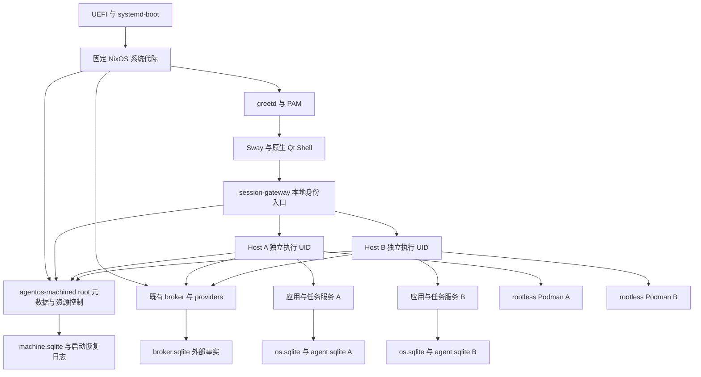

# AgentOS v1.0：原生桌面与系统镜像完整实施规格

版本：1.0-draft；编写日期：2026-10-30；承接版本：v0.4；目标文档目录：`E:\agentos\docs`。

本文沿用 [v0.1](AGENTOS_MVP_V0.1.md)、[v0.2](AGENTOS_MVP_V0.2.md)、[v0.3](AGENTOS_MVP_V0.3.md)、[v0.4](AGENTOS_MVP_V0.4.md) 的实施规格方式，给出下一轮编码所需的范围、模块、契约、状态机、恢复协议、部署顺序与验收条件。本轮只交付方案，不创建实现代码、迁移脚本、Nix 配置或系统镜像。

v1.0 的目标是把已有应用生成、Linux 原生能力与后台维护装入一个能够安装、登录、日常使用、升级和恢复的 Linux 系统。确定采用 **NixOS 系统底座、Sway Wayland 合成器、Qt Quick 原生画布、每工作区独立 Linux 执行身份、签名系统代际更新与协调恢复**。原生客户端继续使用既有 AppBundle 和业务服务；生成内容不能变成任意 QML 或本机程序。

方案以 `cszf1/agentos` 的固定提交 [`ae925392c083de5cd07f8bc2ea3f8638782e8f1a`](https://github.com/cszf1/agentos/commit/ae925392c083de5cd07f8bc2ea3f8638782e8f1a) 为衔接基线，并核对本地《AgentOS 演进与实现路径大纲完整版》第五阶段。主分支已合入上一轮审查 F1—F7 及后续修复；本次核对提交、差异、相关源码与仓库报告，没有重新执行 v0.4 验收。本文列出的 v1.0 能力均是待实现契约。

## 1. 本版交付与完成条件

交付一个单机、单物理座席、支持多个本地用户和隔离工作区的 AgentOS 发行版。用户从安装介质启动，经明确选择目标磁盘、创建账户后，正常开机进入图形登录；登录后直接进入 AgentOS 全屏画布，无需打开外部浏览器、终端或手动启动宿主。

完整主验收链为：

1. 在空白 UEFI 虚拟机安装签名发布介质，首次启动建立独立机器身份、管理员和普通账户。
2. 用户 A 创建两个工作区，导入一个真实 v0.4 冷备份；旧应用、记录、版本、服务连接和会话历史可以核对。
3. 在原生画布创建和修改应用；声明式 CRUD、代码应用查询/命令、系统动作确认、任务中心、维护策略及候选发布全部可操作。
4. A 在两个工作区各启动一个任务，切换画布不会取消已接受任务；两个任务具有不同数据库、执行 UID、Podman 存储和权限上下文。
5. 用户 B 登录，无法发现或访问 A 的私有工作区；A 显式把一个工作区授予 B 后，B 按角色协作，撤销后旧连接、排队任务和派发资格被关闭。
6. 锁屏、休眠/唤醒、Shell 崩溃、宿主强杀及网络中断后恢复；不能出现解锁绕过、跨工作区画面残留、重复发布或未知外部效果被掩盖。
7. 安装一个签名的新系统代际，在重启前保留当前系统；试启动失败后回到已知可用代际，用户记录与最新 broker 事实不回退。
8. 创建机器恢复集合，在恢复介质中恢复工作区；旧批准、旧会话令牌、旧调度与旧 outbox 不重新获得执行资格。
9. 在一台指定的真实 x86_64 Intel/AMD 图形设备完成显示、中文输入、锁屏、音频、网络和睡眠验收，并给出明确的硬件支持表。

“可回滚”分别指应用 revision 切换、系统代际切换和显式数据恢复。三者使用不同入口、权限、保留策略与结果说明，不合并成一个含义不明的恢复按钮。

## 2. 固定范围与大纲对应关系

### 2.1 首个完整版本的范围

| 项目 | v1.0 固定选择 |
|---|---|
| 平台 | Linux x86_64、UEFI、systemd、cgroup v2；QEMU/KVM + 一种真实 Intel/AMD Mesa 设备 |
| 显示 | 一个物理 seat、一个活动图形登录、一个主显示器；支持 100%/200% 缩放及拔插后安全恢复 |
| 原生交互 | Sway 合成、Qt 6 Quick/Controls + C++ 适配层；不依赖浏览器或 WebEngine |
| 登录 | greetd + ReGreet + PAM；swaylock 负责真实会话锁；默认不自动登录 |
| 用户 | 本地管理员/普通账户；一个活动图形用户，可顺序切换用户；不实现远程桌面和快速保留多图形会话 |
| 工作区 | 每个工作区一个固定执行 UID、一个 Host、一个 Pi Harness、独立双库及 rootless Podman 存储 |
| 协作 | 工作区成员 owner/editor/viewer；共享工作区内的应用数据，按角色限制任务、授权和管理 |
| 并发 | 默认最多 4 个登记工作区、2 个运行工作区；跨工作区共享机器资源配额 |
| 系统基础 | NixOS 26.05 维护分支的固定 nixpkgs revision，具体包版本写入发行锁定清单 |
| 安装介质 | 可离线安装的 x86_64 ISO、同一闭包构建的 qcow2 测试镜像、离线更新包 |
| 存储 | GPT + EFI 分区 + LUKS2/Btrfs；工作区事实、执行缓存、机器权威日志分别管理 |
| 更新 | 签名清单 + 校验后的 Nix 闭包；重启切换、单次试启动、健康确认、保留已知可用版本 |
| 恢复 | 协调冷备份与机器恢复集合；同机恢复保留最新外部事实，异机克隆建立新机器身份 |
| 应用协议 | 保留 formatVersion 1/2/3、ABI 1/2、slot-tree-v1/v2；产品 v1.0 不等于 AppBundle formatVersion 4 |
| 日常系统设置 | 有线/Wi-Fi、音量/静音、亮度、电池、时间/时区、锁屏、注销、重启、关机和受支持设备的 suspend |

NixOS 26.05 当前维护期限至 2026-12-31。它是本方案的开发基线；若发行时间越过维护窗口，M0/M9 必须先更新底座锁定清单并重跑整套镜像验收，不能把过期基线直接标记为正式支持。[官方发布说明](https://nixos.org/blog/announcements/2026/nixos-2605/)

### 2.2 大纲目标的可验收解释

| 大纲方向 | 本版具体交付 | 后续范围 |
|---|---|---|
| 全屏原生合成宿主 | 已有成熟 Wayland 合成器 + 自有原生 Shell/Slot Renderer；启动、锁定和故障流程完整 | 自研 DRM/KMS 合成器、多屏 HDR/复杂窗口兼容 |
| 多用户、多工作区 | 本地账户、执行身份隔离、成员授权、跨工作区资源调度 | 分布式账户、云同步、跨机协同 |
| 整机原子更新 | 系统闭包和启动项按代际切换，试运行失败不提交新默认项 | 内核热更新、无重启系统升级 |
| 整机状态恢复 | 一个可核验恢复集合协调多个数据域；保留外部事实和安全撤销历史 | 恢复外部设备状态、逆转所有网络/硬件动作 |
| 桌面即画布 | 原生应用卡片、任务、维护、版本、系统设置和工作区导航 | 任意第三方桌面程序、应用商店、任意本机窗口嵌入 |
| 后台自治 | 继承 v0.4 的明确策略，扩展为机器资源协调和更新提示 | 模型自行修改 Nix 配置、安装驱动、升级系统或扩大特权 |

不在首发支持列表中的能力包括 ARM64 安装、Legacy BIOS、双系统分区调整、NVIDIA 专有驱动、Secure Boot 签名链、TPM 自动解锁、hibernate、任意跨工作区 RPC 和在线热备份。它们不得以未验证配置开关伪装成首发支持。普通 Linux 安装方式保留为开发入口，发行版验收以本节的完整镜像为准。

## 3. 当前实现基线与继承约束

### 3.1 现有模块如何承接

| 现有位置 | 保留的职责 | v1.0 增量 |
|---|---|---|
| `packages/contracts/src/v2/ui.ts` | Slot Tree、绑定、组件白名单和限额 | 导出原生端可读取的 schema/测试向量；不改旧 bundle hash |
| `packages/web/src/SlotRenderer.tsx` | Web renderer 及行为参考 | 保留开发端，新增 Qt renderer；共享行为用例而非复制 React 代码 |
| `packages/core/src/capabilities/gateway.ts` | 写入授权、client epoch、幂等收据 | 显式 userId/memberVersion/sessionEpoch，保留 admit 与 commit 双重检查 |
| `packages/core/src/runs/`、`scheduling/` | run、conversation、执行代次、队列和目标 lease | 增加成员来源及机器 permit，不重新引入全局 activeRun |
| `packages/core/src/model-budgets/` | 持久预算、请求预留与后台让行 | 工作区预算与机器预算同时通过；撤权在最终 permit 前复核 |
| `packages/core/src/runtime/` | 应用生命周期唯一控制器 | 实例标签加入稳定工作区执行身份；不让 Shell 管容器 |
| `packages/host/src/http.ts`、`config.ts` | API、鉴权和单工作区配置 | 增加 UDS 监听和可信本地代理入口；去掉发行模式固定 4317/`user:local` 假设 |
| `packages/host/src/backup-v3.ts` | 双库协调、broker history、incarnation | 组成工作区备份组件，参与机器级 checkpoint |
| `native/crates/broker/` | root 资源目录、执行收据、未知效果、维护授权 | 以执行 UID 验证工作区，增加主体协议；机器管理单独服务 |
| `deploy/`、`runtime/` | 运行入口、固定 OCI catalog | 包装成 Nix derivation/模块；保留镜像 digest 与离线预取语义 |

本次已核对当前提交及其相对上一轮的差异。已有修复包括所有可准入策略版本一起暂停、observe 不进入模型、后台分析不占应用变更锁、取消作业关闭关联 run、压缩参与暂停以及写操作先通过 epoch gate。v1.0 必须把这些情形纳入回归，不能按旧审查报告再次宣称它们仍未修复。[修复提交](https://github.com/cszf1/agentos/commit/a5394983aa5a538dd82a5204a7b3b00bfd443b04)、[当前验收报告](https://github.com/cszf1/agentos/blob/ae925392c083de5cd07f8bc2ea3f8638782e8f1a/docs/ACCEPTANCE_V0.4.md)

### 3.2 继续成立的核心规则

业务事实归 `os.sqlite`，模型会话归 Pi 自己维护的 `agent.sqlite`，外部效果归 `broker.sqlite`。单个工作区仍只有一个 Host 写者；跨库、跨进程、启动项与外部效果通过持久意图、稳定操作 ID 和对账完成，不能宣称获得跨系统数据库事务。

应用 revision、数据单调契约、准备/激活/对账、原生单 effect、未知结果隔离、模型预算和在线 GC pin 协议继续有效。系统版本切换不恢复删除过的记录，恢复数据不撤销已执行设备动作，用户退出界面也不等于已完成外部效果被取消。

仓库报告中的真实模型、Linux 原生、软件 PTY 和 guest eBPF 证据保留原标签。V3-E04 真串口硬件未验收不能因 v1.0 发布而自动变为通过；首发镜像可明确关闭该未认证硬件入口。

## 4. 技术栈与实现边界

### 4.1 固定技术选择

继续保留 Node 24.22.1、Pi Durable/Pi AI/Chord 1.4.0、仓库锁定的 pnpm/TypeScript/Rust 和应用 ABI 作为迁移起点。系统整合期间不同时迁移模型框架；安全修复若要求升级，单独更新锁定清单及兼容证据。

新增部分采用 Nix flakes 固定输入、NixOS 模块构建系统、Qt 6 Quick/Controls 与 C++20 构建原生客户端，Rust 扩展已有原生工作区实现 machine 服务。Qt/Sway/greetd/systemd/Btrfs 工具等具体版本从固定 nixpkgs revision 导出到发行清单，不用 `latest`，也不以动态官网文档版本代替实际构建版本。

Sway 负责 Wayland 会话、输入与合成；AgentOS Shell 是受信的 Wayland 客户端。QML 文件来自发布闭包，模型生成的 JSON 只作为数据绑定到固定组件。[Sway 项目](https://github.com/swaywm/sway)、[Qt Quick 文档](https://doc.qt.io/qt-6/qtquick-index.html)

### 4.2 不重写的部分与必须改造的部分

AppService、RecordService、DeploymentService 和 Pi 恢复协议继续使用；原生 UI 通过 API 调用它们。仍必须改造身份、入口、工作区路径、跨工作区调度和系统启动，不能照搬大纲中的“业务核心完全无需修改”作为实际工作量承诺。

Nix 的系统代际提供程序和配置闭包；用户记录、PAM 账户状态、机器授权日志和 Podman 可写层不因此自动变为可回滚。机器恢复以第 23—24 节的集合协议为准。[NixOS 手册](https://nixos.org/manual/nixos/stable/)

信任边界包含签名发行程序、Linux 内核、root 管理员和当前登录 UID 的受信桌面进程；隔离对象包括生成代码、模型输出、其它登录用户及其它工作区。`SO_PEERCRED` 证明进程身份，不证明它一定是官方 Shell；本版不声称抵御已经控制当前桌面 UID 的恶意本机程序。没有 Secure Boot/TPM 的首发也不承诺抵御离线篡改启动盘或强行回放整块旧磁盘；软件管理的回退/恢复必须保留当前根侧权威状态。

## 5. 进程架构与控制权



控制权固定为：

- `agentos-machined` 是机器目录、账户/工作区编排、机器配额和更新/恢复流程的唯一协调者。它不加载 Pi，不读取 prompt，不执行模型提供的命令；只有它写 `machine.sqlite`。
- `agentos-session-gateway` 是单独、尽量小的受信本地代理，验证 Linux peer、登录会话、成员关系和请求范围。它无磁盘安装/系统更新工具，不能把请求正文作为任意转发地址。
- 每个 Host 独占一个工作区双库；每工作区的 RuntimeManager 独占其应用生命周期；root broker 仍独占登记原生资源的执行与核对。
- Shell 只持有 UI 状态和短期会话，不直接打开数据库，不调用 Podman，不保存 provider 密钥，不从模型输出创建进程。
- 系统更新器、备份 worker、安装器是由 machined 启动的固定 helper。每类只有固定参数 schema、限定根目录及独立审计，不提供通用 root exec。

新增 root 组件是可信计算基的一部分，代码量和输入面必须可审查。进程拆分服务于限制职责，不把“用了 UDS”当成自动安全。

## 6. 身份、作用域与代次

### 6.1 稳定身份

| 字段 | 类型及规则 |
|---|---|
| `machineInstallId` | 随机 UUID；安装/异机克隆新建；同机日常更新保持 |
| `userId` | 随机 UUID；稳定账户身份；Linux UID 不是永久业务身份 |
| `loginUid` | uint32；当前 PAM/Linux 账户；禁用账户的 UID 不在本发行安装期内复用 |
| `workspaceId` | 随机 UUID；机器目录中的工作区身份；不从显示名生成目录 |
| `storeUUID` | 已有工作区数据身份；一台机器仅允许一个可写登记；同一备份不能注册两个活跃副本 |
| `executionUid` | 独立系统账户 UID；该工作区 Host/引擎运行身份；与登录 UID 分离 |
| `memberVersion` | 正整数，成员范围变更时递增；源自 machine 权威目录 |
| `sessionId` | 服务端随机 256 bit 不透明标识；绑定登录会话、userId、bootId、连接及期限 |
| `sessionEpoch` | 正整数；锁定、注销、会话重新绑定时递增，旧 UI 写请求失效 |
| `workspaceIncarnation` | 既有 broker 恢复代次；恢复/重新绑定后递增，不等于 UI 切换 |
| `clientEpoch` | 工作区业务状态代次；继承现有恢复围栏 |
| `executionEpoch` | run 的写/模型资格；取消、撤权、恢复旧备份使旧值失效 |
| `machineControlEpoch` | 机器控制代次；恢复、撤销机器管理资格及恢复屏障时推进 |
| `bootId` | Linux 本次启动身份；禁止将跨重启的进程/连接视为仍然存在 |

新建的 machine/user/workspace/operation 等业务 ID 采用 canonical 小写 UUID；sessionId 保持 256 bit 不透明形式，既有 app/revision/run 和 Pi task/conversation ID 保留原格式。hash 采用现有 `sha256:` 形式，计数不超过 JSON safe integer，时间使用 UTC 毫秒；不能由模型指定上述主体字段。路径只能从已登记 ID 构造，不接受客户端提交数据目录、socket 路径、Nix store path 或 systemd unit 名称作为权限依据。

### 6.2 可信调用上下文

Host 内部统一使用 `WorkspacePrincipal`：kind、userId（用户任务时必有）、workspaceId、storeUUID、memberVersion、sessionId/sessionEpoch（交互请求时必有）、runId/conversationId/executionEpoch（Agent 时必有）、scopeHash、requestId。

可执行权限为“机器硬上限 ∩ 当前成员角色 ∩ 用户冻结授权 ∩ 工作区策略 ∩ 应用能力 ∩ 当前代次与资源状态”。UI 活动工作区只是展示选择，不参与后端猜测请求目的地。后台维护始终保持 maintenance 主体，不能借最后一个登录用户的身份执行。

会话关闭不销毁已经授权的持久 run。run 在接受时冻结发起 userId、memberVersion、scope 和预算；注销后仅能继续这些有界权利。新特权确认必须来自当前本地活动且未锁定的会话。账户禁用、成员撤销和机器恢复则关闭对应 run 的未来写/模型资格。

## 7. 本地账户、成员授权与撤销

### 7.1 角色矩阵

| 操作 | viewer | editor | owner | machine admin |
|---|---|---|---|---|
| 读取已授权应用、记录、发布状态 | 是 | 是 | 是 | 仍需成员身份 |
| 写记录、创建/修改应用、切换既有 revision | 否 | 是 | 是 | 仍需成员身份 |
| 查看任务正文/模型 transcript | 否 | 本人任务 | 本工作区 | 无默认正文读取入口 |
| 取消任务 | 否 | 本人任务 | 本工作区 | 可停止执行进程，结果仍需核对 |
| 维护策略、系统资源 grant、候选确认 | 否 | 只能提交建议 | 是，且受 root caps 限制 | 管理机器 caps |
| 模型配置、工作区导出/恢复、成员管理 | 否 | 否 | 是 | 可实施恢复但不自动取得成员身份 |
| 创建账户、磁盘安装、系统更新、机器恢复 | 否 | 否 | 否 | 是，要求本地交互认证 |

root 本来能够读取本机数据，上表描述产品授权，不宣称能够抵御 root 管理员。每工作区恰有一个 owner；owner 转移需双方本地确认，不能删除最后一个 owner。新增成员初始 viewer；升级 editor 必须明确提交新角色并增加 memberVersion。

双方无需同时登录：原 owner 创建有效 24 小时的 transferId，冻结双方 userId、成员版本和范围；接收者随后本地登录确认，提交时再次核对原 owner 未变。任何角色变化均关闭旧 memberVersion 的未来执行资格，重新准入使用新版本；不把权限提升自动补到已运行 Agent。工作区配置 `runWhenLoggedOut=false` 时，最后一个有效成员会话结束便检查点暂停该工作区的继续执行；否则已授权 run 可在原期限内继续，后台新触发另受策略限制。

### 7.2 账户生命周期

账户状态为 provisioning → active → disabled；删除先禁用和撤销会话/任务，保留身份 tombstone。创建 Linux 账户、写注册表、建立目录使用稳定 provisioningId 和步骤收据，崩溃后对账实际 UID、home 与目录 owner。不得遇到同名已有账户就接管。

PAM 负责密码验证；密码只经本地受保护输入通道到固定账户 helper，不进入模型、普通日志、Nix store、命令行参数或可持久重放的请求正文。登录失败限流由 PAM/登录服务执行。普通账户无 sudo、无 Nix trusted-users、无机器管理组权限。

### 7.3 撤权必须跨进程闭合

成员撤销事务先在 `machine.sqlite` 记录新 memberVersion、revocationId 和 `revoking`。gateway 立即关闭其新请求；Host 接收撤销控制消息，在单工作区事务中关闭关联 run/待确认计划/旧 grant 的资格，持久登记定向 abort；broker 记录对应撤销序号并拒绝旧 envelope。

只有 gateway、Host 和 broker 都确认当前序号，且已派发效果的后续状态已纳入核对，才显示“已撤销后续操作权限”。Host 不可达时停止并核验其整个执行 cgroup，保持该工作区 fenced；broker 不可达时本地立即拒绝，新特权执行保持关闭，界面显示“撤销同步中”。时间到期不能替代这些事实。

撤权之前已经提交的业务事务保留；之后不得开始新事务/模型请求/外部派发。使用撤销消息与 Host 短事务的序列化点定义竞争结果；UI 不在用户点击瞬间声称所有在途操作消失。由该成员批准的自动维护策略转 `paused_needs_review`，owner 必须重新批准当前范围。

## 8. 工作区进程与存储隔离

### 8.1 一个工作区一个执行身份

machined 从预留且无重叠的 UID/subuid/subgid 池分配执行账户，禁止交互登录。建立其独立 systemd user manager 与 rootless Podman socket；仅给执行账户启用运行所需 linger，登录用户不依靠 linger 启动工作区。

每个工作区拥有自己的数据根、Podman graphroot/runroot、Unix socket、模型凭据、cgroup slice 和日志。模型/代码容器无会话总线、Wayland socket、gateway socket、Nix daemon socket及其它工作区挂载。UID 池、subuid 区间、socket 权限任一冲突时拒绝启动。

| 路径 | 所有者与用途 |
|---|---|
| `/var/lib/agentos-machine/machine.sqlite` | root 0600；用户/工作区/成员目录、机器流程、撤销与 permit 事实 |
| `/var/lib/agentos-broker/broker.sqlite` | root；继续保存外部效果，不随工作区回滚 |
| `/var/lib/agentos/workspaces/<workspaceId>/data/` | executionUid 0700；os.sqlite、agent.sqlite、产物、固定配置 |
| `/var/lib/agentos/workspaces/<workspaceId>/secrets/` | executionUid 0700；provider 密钥，文件 0600 |
| `/var/lib/agentos-runtime/<workspaceId>/` | executionUid；独立容器存储、可重建 cache，与备份事实区分离 |
| `/run/agentos/workspaces/<workspaceId>/` | root 管理父目录，私有子目录；Host/控制 socket 与运行代次 |
| `/var/lib/agentos-snapshots/` | root；有 pin、集合 manifest 和显式保留策略的本地恢复集合 |
| `/home/<login>/` | 登录用户；仅 UI 偏好等普通个人文件，不直接存工作区数据库 |

发行版默认不开放工作区 TCP 端口。开发用浏览器入口必须显式启用、loopback、独立登录会话，并沿用完整成员校验；不能因“本机访问”接受匿名请求。

### 8.2 创建、停止、切换和归档

工作区状态为 creating → stopped → starting → running → quiescing → stopped；异常可进入 recovery_required，删除前进入 archived。建立双库、Pi marker、执行账户与 broker 登记使用稳定 createId，不允许部分创建的工作区进入列表中的“可用”状态。

切换工作区只关闭旧页面订阅、清理应用表单/选择/正文缓存、绑定新 workspaceId 与新客户端请求上下文；已接受的 run 仍按原授权推进。事件回包若不匹配 workspaceId/storeUUID/clientEpoch 必须丢弃。达到运行工作区上限时显示等待/选择停用入口，不自动终止另一个工作区的任务。

工作区归档停止全部进程但保留数据；彻底删除需要 owner 和机器管理员的明确操作，先导出/确认数据处理，验证无未核对外部动作、无快照引用和无运行实例，再删除已登记根。UID 和 storeUUID 留 tombstone，不立即复用。本版不提供定时删除工作区。

## 9. 登录、原生会话与本地传输

### 9.1 登录与会话绑定

greetd/PAM 建立真实 logind session 后，固定 session launcher 启动 Sway、session agent 和 Qt Shell。gateway 在 UDS 上使用 `SO_PEERCRED` 取得 PID/UID，并通过 logind 验证 session、seat、active、locked 和 bootId；客户端自报用户名、sessionId 或环境变量不能证明身份。

session agent 在登录会话 scope 内启动，不作为脱离 session 的任意 user service。若进程属于无法映射的 user-manager scope、远程会话或已退出 session，默认拒绝机器交互权限；不能为方便使用同 UID 最近一次登录记录补齐身份。

gateway 建立内存短期连接会话，把真实 userId 与机器签发的成员上下文附到请求。Host 的代理入口只接受 root gateway 的 peer；普通工作区 UID 不得伪造该入口。控制消息与用户请求分开监听，schema 不包含任意 method/path/socket 转发功能。

### 9.2 传输格式

原生客户端使用 `native-rpc/1`：UDS 上 4 字节大端长度 + UTF-8 JSON，单帧最多 4 MiB，最多 32 个在途请求，超过限制关闭连接。各写路由的正文上限仍取原业务协议的更小值；较大的记录/transcript 列表按条数和编码字节数分页，单条长 transcript 使用固定内容分段读取接口，备份文件走独立流式文件通道，不无限加大 RPC。普通操作复用现有 HTTP method/path/body 语义；gateway 仅映射登记 route ID 与 path 参数，Host 的业务处理器保持同一实现。流式模型正文不进入机器日志。

每个请求有 requestId、workspaceId、clientEpoch、sessionEpoch、methodId、params/body；写入还必须有 idempotencyKey。gateway 添加 principal envelope 并重算规范请求 hash。session/membership/epoch 检查在异步准备前、提交事务时及外部派发前分别实施。

响应包含 requestId、workspaceId、clientEpoch、status、body 或标准 error。并发事件有每工作区单调 eventSeq；订阅断开从最后确认 cursor 重连，cursor 不可用返回 `EVENT_GAP`，先获取完整快照再订阅。事件不是授权凭证。

本版不把 Cookie 值复用为机器管理令牌。schema 解析失败、重复键、超深对象、未知字段、非法 ID、非有限数值都拒绝；TS/Rust/C++ 使用同一 fixture 向量验证 canonical hash 和错误边界。

交互 session 最长 12 小时，断开连接后必须重新经 peer/logind 绑定；默认闲置 5 分钟锁屏，可由用户在 1—30 分钟内调整，不能由模型禁用。普通 RPC 默认 30 秒等待后转为按 requestId 查询，不用超时证明未提交。分页 cursor 绑定 workspace、调用人、查询条件与数据快照；单条文本按最大 64 KiB UTF-8 完整字符边界分段，偏移和源版本共同校验。

### 9.3 锁屏、会话结束和故障

锁屏由 swaylock/ext-session-lock 协议完成；Shell 中的遮罩不算锁屏。session agent 收到锁定确认后推进 sessionEpoch、撤销交互确认 ticket、清空剪贴板和敏感 UI 缓存。解锁重新绑定会话与工作区状态。[swaylock 文档](https://github.com/swaywm/swaylock/blob/master/README.md)

锁屏后可以继续已有有界普通 run；新 owner 批准、成员变更、机器动作和系统更新不可进行。模型和维护不得唤醒或解锁会话。Shell 崩溃由 session agent 有界重启；锁屏进程/合成器异常优先退出图形会话回到 greeter，禁止在未验证锁状态下恢复敏感画面。

注销关闭交互会话及其未使用 ticket。默认停止后台新触发；已有任务保存检查点后按 owner 设置继续或暂停。允许无人登录运行的工作区必须具有显式 `runWhenLoggedOut` 设置及机器配额，默认 false，不能由模型打开。

## 10. 原生画布与 Slot Renderer

### 10.1 三层实现

`desktop/transport` 用 C++ 实现 UDS framing、DTO、幂等请求队列、事件 cursor 和错误处理；`desktop/models` 提供 QAbstractItemModel/固定状态对象；`desktop/qml` 只负责可信布局和组件。Qt UI 线程不执行数据库、编译、模型等待或同步大文件 I/O。

Host 是数据、状态和命令的唯一权威。原生端对 bundle 再做防御性限额检查，版本/权限最终仍由 Host 校验。QML 引擎只能载入发布闭包内的固定资源，不接受任意 QML 源、JS 表达式、组件 URL、HTML、CSS 或文件路径。

### 10.2 必须覆盖的组件

| 协议内容 | 原生实现与语义 |
|---|---|
| formatVersion 1 records view | 原生表格、筛选、搜索、创建/编辑表单；保留隐藏字段及旧版本默认规则 |
| Stack / Grid / Tabs | 固定 Row/Column/GridLayout/TabBar；限制 children、列数与 tab 数 |
| Text / Alert / Metric | 纯文本、固定样式枚举；禁用 Qt 自动富文本识别 |
| Table | QAbstractItemModel + 分页/选择；遵守 rowId、pageSize、emptyText |
| Kanban | 按协议组值分列；选择语义与 Web 一致，不私自增加拖拽写命令 |
| Form / TextInput / TextArea | 有类型表单状态；缺失/空值/整数范围/Unicode 长度规则与 Host 一致 |
| Select / Checkbox | 固定值集合及布尔值；不进行隐式字符串转换 |
| Button | 通过 form/selection/constant/item 组装命令；可重复点击由幂等键及 busy 状态控制 |
| BarChart / LineChart | 固定原生绘图，最多 8 系列、每系列 500 点；提供可读数据/图例 |
| List（slot-tree-v2） | 最多 100 项，单模板最多 24 节点；item binding 仅在本项作用域解析 |
| SystemActionButton（slot-tree-v2） | 只请求计划；由可信系统确认页面显示目标、效果、授权和当前基线 |

保留 256 个静态节点、12 层深度、64 children、8 dataSources、5—3600 秒刷新范围。List 同时实例化最多 4096 个原生组件，使用虚拟化/分页/懒创建；合法旧树可继续滚动查看全部协议允许内容，不能因本地实例预算直接把有效 bundle 判为无效。此上限只限制内存中的渲染实例，不修改已存 bundle 的字节/hash；超出原协议上限的非法树仍明确拒绝。

Binding 仅支持 query/form/selection/item 与受限 JSON Pointer；visibleWhen 只做 exists/eq；字段缺失与 null 分开处理。禁止把 pointer、文本或 query 返回值拼成 QML 表达式。未知组件/不支持版本显示错误卡和版本切换入口，不让整台桌面白屏。

### 10.3 原生与 Web 的一致性判据

复用同一组 fixture 生成输入、绑定解析结果、点击产生的请求、字段校验和权限错误向量；对比语义而非像素。覆盖 v1 CRUD、v2 看板/图表/跨应用只读服务、v3 List/系统动作，以及 v4 任务/维护完整流程。

中文输入采用固定发行版的 Fcitx5 + Qt 输入插件，提供简体/繁体中文字体和英数输入；输入法属于受信会话组件，工作区容器不接入其 socket。必须验证组合输入尚未确认时切换字段、工作区和锁屏的行为。

## 11. 原生 Shell 必要页面与状态

首页包含工作区切换、应用画布、意图输入、任务状态和系统状态区；应用可以固定、排列、恢复布局。布局只保存 appId、位置、尺寸和版本化 UI 偏好，不存应用正文或授权。最多同时展开 4 张卡，其它只显示摘要；展开/聚焦不自动产生模型调用。

完整交互页面包括：登录/首次设置、工作区与成员、应用详情/版本、任务中心、系统计划确认、维护策略、incident、proposal、运行时诊断、备份恢复、系统更新与硬件设置。每个异步动作展示 accepted/进行中/需要确认/已核对结果，不能把 HTTP 202 或 UI 动画结束当作完成。

系统确认面板位于生成内容无法覆盖的可信 Shell 层，显示用户与工作区、资源、计划 hash、版本、权限变化和未知结果说明；确认必须对应当前 planHash 与全部 epoch。应用标题中伪造“系统批准”不改变权限。

本地错误时提供恢复导航：Shell 断开可重连、Host 不可用显示只读缓存状态且停止提交、模型不可用仍可运行已激活应用、broker 不可用仍可执行不依赖它的普通 CRUD。缓存页面必须标出更新时间，不能伪装当前事实。

键盘操作必须覆盖所有主要流程；支持 Tab 顺序、明确焦点、缩放、可读状态文字和 Accessible 名称。锁屏清除通知正文、任务 prompt、剪贴板和未提交敏感输入；默认不跨工作区保留剪贴板内容。

## 12. 机器设置与硬件控制

### 12.1 与既有系统 Provider 分界

现有应用资源 provider 继续管理登记文件、服务、隔离网络和串口。新增机器控制面专门管理显示会话、物理网络、音频、电源、账户、安装与更新；这些能力不加入 AppBundle/模型工具集。模型最多提出结构化建议，只有可信 Shell 的用户路径可以形成机器操作。

| 控制项 | 真实后端 | 固定边界 |
|---|---|---|
| 网络状态/Wi-Fi 连接 | NetworkManager D-Bus | 登记接口、DHCP、WPA2/WPA3 Personal；不开放任意路由、防火墙或 VPN 配置 |
| 音量/静音/输出选择 | PipeWire + WirePlumber 会话接口 | 当前 seat 用户自己的输出，不管理其它用户麦克风权限 |
| 亮度 | logind 的登记 backlight 控制 | 整数 5—100%；无亮度设备时不可用，不写任意 sysfs 路径 |
| 时间/时区 | systemd-timesyncd/timedated | 固定时区目录；管理员更改，模型不可关闭时间同步 |
| 电池/外接电源 | UPower/内核状态 | 只读；低电量与更新门槛使用真实状态 |
| 锁定/注销/电源 | logind + session agent | 当前本地活动会话；重启/关机按第 18 节排空 |
| 显示配置 | Sway 登记输出接口 | 仅支持当前输出枚举的 mode 和 1/2 缩放；15 秒未确认恢复原设置 |

NetworkManager 操作使用结构化对象并核对连接的实际状态，不能用执行成功的命令退出码替代已联网事实。[官方 D-Bus 接口](https://networkmanager.dev/docs/api/latest/gdbus-org.freedesktop.NetworkManager.html)

### 12.2 计划、认证和收据

网络更改、机器更新、账户管理、恢复和电源请求先创建 MachineActionPlan。plan 包含 actionKind、受控 resourceId、resourceGeneration、paramsHash、initiator、machineControlEpoch、期限和影响摘要。确认 ticket 有效 60 秒、一次性、绑定完整 planHash；需要管理员的操作经 PAM/polkit 认证，不能复用工作区 owner 身份。

Wi-Fi 密码等秘密单独通过受保护输入通道交给 NetworkManager secret agent；操作日志只保存 secretRef/秘密版本，不保存可重放明文。首次配置可离线完成，网络失败不阻止创建本地工作区和运行已有应用。

一般显示/音量设置允许当前用户操作，敏感主机操作不得获得“整个桌面所有 D-Bus 方法”的泛化授权。若系统后端不提供某能力，UI 明确标为不可用，不模拟成功。

机器操作状态固定为 planned → authorized → dispatching → reconciling → succeeded；确定没有派发可进入 cancelled_no_effect/failed_no_effect/expired_no_effect，已派发而无法判断则进入 indeterminate。ticket 消费、操作 intent 和幂等收据在 machine 同一事务中提交，之后 helper 才执行；取消先赢则不派发，派发先赢则只停止后续步骤并核对。未知网络/电源/账户结果读取对应真实服务，不能更换 operationId 自动重做。

## 13. 跨工作区调度、预算与资源公平性

### 13.1 两级准入

工作区内继续使用 v0.4 RunScheduler、目标 lease、模型预算和构建状态机。machined 只分配机器级 permit，不查看 prompt、工具正文或记录内容。每次模型请求、构建、重型备份 I/O 同时通过本工作区准入和机器准入；模型不能改变 foreground/background 标记。

默认机器上限：两个运行工作区、两个并发模型请求、一个后台模型请求、一个编译/Prepare 执行槽、一个重型备份/清理 I/O 槽。工作区原有两个前台 run 可等待这些槽位；任务存在不等于正在耗用模型/编译资源。

MachinePermit 的稳定键是 `(workspaceId, executionEpoch, ownerKind, ownerId, attemptId, resourceClass)`。同键重试返回同一记录，同键不同正文拒绝。状态为 queued → reserved → in_use → released；失联进入 reconciling，确定未使用进入 revoked。额度预留在真正派发前持久化，实际 usage 与未知 usage 分开登记。

Host 最终取得 permit 后，再读取消、成员撤销、全局暂停、observe 限制、策略版本和 deadline，才发模型请求。准入期间权限变化则退还未使用预留。请求可能已出网的未知 attempt 保守记入请求预算；不因为 Host 重启而删除账目或重新免费派发。

### 13.2 公平性与失联

前台队列按工作区轮转、工作区内按接受序号 FIFO；已有等待工作区时，一个工作区最多占一个模型 permit。无其它等待者可临时使用第二个；新前台到来只影响后续派发，不杀死他人的有效请求。后台仅在机器和工作区都满足空闲条件时请求新 permit。

不得持有模型 permit 等待构建槽、等待用户确认或等待其它工作区释放目标。后台诊断/优化读取冻结快照，不占全程应用写锁；候选提交与发布仍走短事务和当前 app epoch。跨工作区没有共享的 appId 锁，资源键必须包含 workspaceId。

机器服务重启时禁止立即把 permit 全部标空。先核验 executionUid、bootId、cgroup、Host instanceId 和 attempt，向旧执行者查询；不能确认时保持 reconciling，必要时停止相应执行 cgroup并确认进程退出后再释放计算槽。外部模型可能仍在服务端处理，此时不声称远端工作被取消，未知费用不返还。

机器服务不可达时，已发生效果继续核对，已有应用普通 CRUD 可继续；新模型/构建及依赖机器准入的维护停止。成员状态无法确认时交互写入口关闭，不依靠长期缓存继续放行。

## 14. Broker 主体协议与跨工作区资源

### 14.1 协议版本

新增 broker protocol 3 用于发行模式的多主体 envelope；保持 protocol 1/2 的已有 hash、收据和历史解码，不把旧请求重算成新协议。迁移后该 workspace 标记 `minWriteProtocol=3`，旧协议仅允许受限历史读取/迁移核对，不能成为绕过成员校验的写入口。

protocol 3 外层包含 machineInstallId、workspaceId、storeUUID、workspaceIncarnation、executionUid、principalKind、userId/memberVersion（若适用）、runId/executionEpoch（若适用）、machineControlEpoch、requestId、deadline、bodyHash。模型不得填写这些值；broker 核对真实 socket peer UID 与 machine 注册目录。

业务 body 保持已冻结计划、grant、policy、job/step、资源代次与原 action family；新 hash 域固定为 `agentos.broker.workspace-write.v3`，包含外层完整主体与业务正文。新用户操作和维护操作明确区分，不能退回 protocol 1 的 user 主体。

### 14.2 根侧目录与撤权

machine 目录是账户/成员/执行 UID 的权威，broker 保存可核验同步版本和撤销高水位。同步通过 root 专用控制通道，以 machineControlEpoch + registrySeq 幂等；broker 版本落后或缺少主体登记时拒绝新效果，不能默认信任 Host 自报成员身份。

维护策略增加 approvedByUserId、approvedMemberVersion；成员撤权、owner 变更或工作区恢复时 root 侧同样停止新准入。计数和冷却按真实资源身份聚合，不能通过换用户、换工作区策略或新 executionUid 清零。

### 14.3 同一物理资源的竞争

文件管理根默认独占工作区。机器级网络、电源与更新只归机器控制面。若管理员把同一服务/设备共享给多个工作区，broker 对底层稳定 resourceId 使用一个全局 effect fence；Host 的工作区 target lease 不足以代替它。

一项未明外部效果使该物理资源进入 quarantine，所有相关工作区只能读取已授权的受限状态。其它成员或工作区不能通过新 operationId 绕过隔离；明确 resolve 仍按原 provider 的事实条件执行。

## 15. 数据模型、持久事实与迁移

### 15.1 新机器数据库

`machine.sqlite` 使用本地文件系统、WAL、foreign_keys、FULL 持久化，只有 machined 写入；设计 schemaVersion=1。以下字段为必要字段，`?` 表示可空；未注明的 ID 为 UUID、epoch/version 为正整数、时间为 UTC 毫秒，JSON 有独立严格 schema，禁止无界任意对象。

| 表 | 必需字段与约束 |
|---|---|
| machine_meta | singleton；machineInstallId、machineControlEpoch、registrySeq、schemaVersion、currentReleaseId、knownGoodReleaseId、restoreState、createdAt |
| users | userId PK、loginUid UNIQUE、loginName UNIQUE、role、state、authVersion、createdAt、disabledAt?；身份 tombstone 不删除 |
| workspaces | workspaceId PK、storeUUID UNIQUE、ownerUserId、executionUid UNIQUE、subuidStart/subgidStart、rangeSize、state、instanceEpoch、dataPathId、runWhenLoggedOut=false、createdAt |
| workspace_members | workspaceId+userId PK、role、memberVersion、state(active/revoking/revoked)、changedAt；每工作区恰有一个 active owner |
| registry_outbox | id PK、registrySeq、targetKind/targetId、bodyHash、state、ackSeq?、attemptCount；同目标序号唯一，按序核对 |
| revocations | revocationId PK、scopeKind/scopeId、oldVersion/newVersion、reason、gatewayAck、hostAck、brokerAck、state、createdAt/completedAt? |
| workspace_instances | instanceId PK、workspaceId、instanceEpoch、bootId、hostPid?、cgroupId、state、lastSeenAt；一个工作区一个非终态实例 |
| machine_permits | permitId PK、稳定键 UNIQUE、resourceClass、priority、state、reservedAt、usedAt?、deadlineAt、usageStatus、usageJson?；释放不能删除预算事实 |
| machine_operations | operationId PK、principalUserId、sessionEpoch、kind、planHash、requestHash、state、effectCertainty、resultJson?、createdAt；主体+幂等键 UNIQUE |
| provisioning_steps | provisioningId+stepId PK、kind、targetIdentity、intentHash、state、receiptJson?；固定步骤目录 |
| releases | releaseId PK、manifestHash、releaseSequence UNIQUE、closurePath、compatibilityJson、verificationState、supportUntil、createdAt |
| update_jobs | updateId PK、fromReleaseId、toReleaseId、planHash、state、trialBootId?、previousEntryId、candidateEntryId、checkpointSetId?、errorJson?；最多一个开放更新 |
| checkpoint_sets | setId PK、scope、state、manifestHash?、releaseId、barrierId、createdAt、completedAt?、exportState；未完成集合不得用于恢复 |
| restore_jobs | restoreId PK、setId、mode、state、old/new control epoch、stagingIdentity、stepCursor、createdAt；最多一个机器恢复 |
| root_audit | seq PK 单调、operationId、actorId、kind、scopeId、outcome、timestamp；不含密码/密钥/模型正文 |

session 明文随机 token 仅驻内存，持久审计保存 sessionId 的摘要及登录事实。machined 重启后交互会话全部重新绑定；不能从备份恢复 token。machine DB 不存工作区记录、应用包、模型 transcript 或密钥。

### 15.2 工作区与 broker 增量

工作区数据库计划从 schema 4 迁移到 schema 5：meta 增加 workspaceId、identityProtocolVersion、instanceEpoch；runs 增加 initiatorUserId、memberVersion、scopeHash；操作收据 principal 增加真实用户身份；策略/提案/grant 增加批准者及成员版本；增加会员镜像版本、撤销收据和 machine permit 映射。

旧行中的 `user:local` 保留其原始审计/幂等域，在迁移 manifest 中绑定导入 owner，标为 legacy principal；不得重写全部旧收据 hash。新请求只使用新的域 `user:<userId>:workspace:<workspaceId>`。旧未完成任务不能自动继承新 owner 的权利。

broker 按现有 schema 3 设计增量 schema 4，新增多主体目录版本、撤销高水位、协议 3 envelope 与 minWriteProtocol；保存所有旧 effect、policy 次数、quarantine 和历史分页序号。Pi 数据库不直接执行自定义 SQL 迁移，只通过固定 Pi API 写新的可信绑定 Document。

### 15.3 幂等与跨库规则

新增每个写 API 都有稳定 operationId、主体域、请求 hash 和持久收据。先鉴权/代次校验再查可返回收据；错误主体不能通过猜幂等键读到别人的结果。异步 prepare 阶段只读，持久意图与收据在对应权威库同事务提交，提交后才启动可恢复执行者。

machine → Host、machine → broker、Host → Pi 均使用 outbox/ack，不存在跨三库事务。恢复时先发现缺口、重投同一 ID、读取已有事实，再放开调度。任何“启动进程后再补 intent”的实现均不符合本规格。

数据库事务内不等待 IPC、模型、文件复制或 systemd job。跨域屏障按“机器流程 → workspaceId 字典序 → 工作区局部目标”的顺序协调，以持久状态和 ack 推进，不持有 SQLite 写事务等待另一库；更新、恢复、备份激活使用同一机器排他流程，不能各建一把互不认识的全局锁。

## 16. API、事件与错误契约

### 16.1 原生入口

以下为 route ID，映射到固定 Host/机器方法；现有 `/api/apps`、records、runs、maintenance、proposals 等业务路径保持并加完整主体上下文。所有写入要求幂等键；异步响应返回 operationId 和查询入口。

| route ID | 语义与必要输入 |
|---|---|
| `session.bind/status/end` | 绑定真实 Linux session；返回角色、epoch 与受支持协议；end 只关闭本人连接 |
| `workspaces.list/get/create/start/stop/archive` | 仅返回有成员权限的目录；create 需要配额及 owner，stop 检查开放任务 |
| `workspaces.attach` | workspaceId + expectedClientEpoch；返回初始状态、capabilities、事件 cursor |
| `members.list/setRole/revoke/transferOwner` | owner；userId、expectedMemberVersion、目标角色及双边转移确认 |
| `workspace.forward` | 登记业务 route ID + path 参数 + body；禁止任意 URL/header/principal |
| `events.subscribe/ack` | workspaceId、cursor；必须持续验证成员和会话 |
| `machine.status/capabilities` | 当前 release、组件健康、配额、有限硬件目录；按角色过滤 |
| `machine.actions.plan/confirm/get/cancel` | 固定 actionKind、params；确认传 planHash + 一次性 ticket |
| `machine.users.create/disable` | 管理员，经过机器计划与身份核验 |
| `updates.check/prepare/activate/status/cancel` | 管理员；签名 releaseId/hash；activate 表示请求一次重启试启动 |
| `backups.create/list/export/inspect` | owner 可管理本工作区，管理员管理机器集合；export 指定已登记目标 |
| `restores.plan/confirm/status` | 区分 same-machine/clone/workspace；确认精确集合与数据损失范围 |
| `diagnostics.collect` | 作用域、脱敏级别；返回有界诊断包，默认无用户正文 |

成员不可见对象统一返回 `NOT_FOUND_OR_FORBIDDEN`，不通过状态、计数或日志泄露其存在。必须有 `request.accepted`、`operation.state_changed`、`membership.revoking/revoked`、`workspace.state_changed`、`update.state_changed`、`restore.state_changed` 与 `event.gap` 事件。

### 16.2 错误分类

| 错误 | 行为 |
|---|---|
| `SESSION_REQUIRED` / `SESSION_LOCKED` / `SESSION_STALE` | 停止交互提交，重新认证/绑定；不自动重发敏感确认 |
| `MEMBERSHIP_REVOKED` / `REGISTRY_NOT_SYNCED` | 停止新写/派发；等待权威同步或撤权完成 |
| `WORKSPACE_FENCED` / `STORE_ALREADY_REGISTERED` | 不启动第二个写者；保留检查与恢复入口 |
| `CLIENT_EPOCH_STALE` / `PLAN_STALE` | 读取新状态并由用户重新提交；不静默更新计划再确认 |
| `MACHINE_CAPACITY` / `PERMIT_RECONCILING` | 有界排队，显示资源与持有者的脱敏原因 |
| `UPDATE_SIGNATURE_INVALID` / `RELEASE_REPLAYED` | 拒绝导入/派发，保存校验结果；不降低验证等级重试 |
| `ROLLBACK_INCOMPATIBLE` / `MIGRATION_REQUIRED` | 进入兼容检查/恢复模式，不让旧 Host 打开新库 |
| `CHECKPOINT_INCOMPLETE` / `RESTORE_IN_PROGRESS` | 不开放业务写入，不选择部分文件自动启动 |
| `EFFECT_UNKNOWN` / `RESOURCE_QUARANTINED` | 保留已知外部事实，禁止自动换 ID 重做 |
| `HARDWARE_UNSUPPORTED` / `NATIVE_RENDER_UNSUPPORTED` | 显示范围与替代操作；不返回伪成功 |

## 17. 启动链与服务依赖

### 17.1 正常开机

1. UEFI 加载 systemd-boot；选择签名清单对应的已登记启动项；内核/initrd 挂载受支持磁盘并完成 LUKS 解锁。
2. 进入固定 NixOS 系统代际；先检查 `restore-in-progress`、机器日志、发行兼容清单与恢复状态。恢复未完成只启动恢复 UI/管理员工具。
3. 启动 machined，核对账户、workspace 执行身份、root 目录、已知更新/备份任务、撤销和 permit；业务调度保持关闭。
4. 启动 broker/providers，核对 machineInstallId、schema、目录版本、quarantine 与 minWriteProtocol；共享资源未核对前不派发新效果。
5. 启动 greetd，完成 PAM 登录后启动 Sway 与原生 Shell。登录页不等待模型、Podman 镜像拉取或后台维护完成。
6. 用户选择工作区；machined 启动其 user manager、rootless 引擎及唯一 Host。Host 取得 host.lock，按 v0.4 顺序恢复双库、意图、会话、实例与外部事实。
7. 原生端完成协议、schema、rendererCapabilities 和 epoch 握手；首先开放已核验的应用与记录操作，再开放前台任务，最后恢复当前合法后台策略。

### 17.2 systemd 单元职责

| 单元/作用域 | 启停关系 |
|---|---|
| `agentos-machine.service` | root；本地持久目录挂载后启动；输出机器 ready 状态 |
| `agentos-session-gateway.service` | root 受限代理；依赖机器目录可读，不依赖任一工作区 Host |
| 原 broker/provider 单元 | 依赖机器身份与 root policy；独立核对效果，不从属于某一图形会话 |
| `agentos-workspace@<id>.target` | machined 生成登记实例；属于对应 executionUid 的 user manager，控制 Podman 与 Host |
| `agentos-host@<id>.service` | 唯一 Host；Restart 有界退避，退出不直接删除运行事实 |
| `agentos-desktop-session` | 位于真实登录 session scope；组织 Sway、session agent、Shell、输入法和锁屏 |
| `agentos-update-worker@<id>` / backup worker | 固定任务，机器独占流程；失败由持久 job 恢复，不能自动无限重启 |
| `agentos-recovery.target` | 最小 UI/控制台与诊断；所有普通工作区写入口关闭 |

工作区 Host 的沙箱设置不得阻止 rootless Podman 必需的 user namespace/cgroup 委派；实际用 doctor 验证，不能照抄 `PrivateUsers` 等选项后宣称仍正常隔离。每个新服务都要明确可写目录、网络需求、capabilities 和 socket peer。

## 18. 关闭、锁定、休眠与电源恢复

### 18.1 用户重启/关机

机器动作先冻结新 run/构建/维护/更新启动，通知全部活动工作区进入 quiescing；等待短事务结束，为 Pi 写检查点并关闭新工具/模型资格，停止本地 worker，持久化未终结 broker 操作。再让每个 Host 按原 shutdown 顺序关闭双库，确认 Podman 应用执行者停止或登记其剩余状态。

正常关闭不等于取消，不无故增加 run executionEpoch。30 秒默认排空期限到达仍有未知原生操作时，显示阻碍原因；用户明确继续关机可登记 forced_shutdown 和未明范围，但不能写成全部成功。强制断电按崩溃恢复路径处理。

### 18.2 睡眠与唤醒

通过 logind 的 PrepareForSleep 和有界 delay inhibitor 做检查点。主动请求 suspend 前先等待 swaylock 锁定完成，再排空本地短事务和新派发；准备不能在既定窗口完成则拒绝本次 UI 睡眠，不以无限 inhibitor 卡住系统。[logind 文档](https://www.freedesktop.org/software/systemd/man/latest/org.freedesktop.login1.html)

系统配置为电源/合盖事件先走同一 session agent；若外部系统仍强制进入睡眠，按非正常暂停处理。唤醒后提升 sessionEpoch、重建连接，检查 boot/进程身份、Podman 状态、broker history、时钟变化与模型未知 attempt；先核对再恢复队列。错过周期维护按 v0.4 合并规则处理，不补发所有历史触发。

本机执行期限使用包含睡眠时间的 `CLOCK_BOOTTIME`；跨重启持久截止时间以 UTC 与可信时间状态重建，若时钟显著回退/未知则新敏感动作停止。不能用暂停期间停止计时的普通循环让 120 秒任务睡醒后继续无限执行。

### 18.3 故障与重启界限

Shell 重启只恢复 UI；Host 重启恢复一个工作区；machined 重启重核全部实例/准入；broker 重启先恢复外部事实。合成器反复崩溃则回 greeter 或恢复界面，不能为显示故障重装工作区。内核 panic/断电属于磁盘持久性和整机启动恢复验收，不与 SIGKILL 进程测试混用。

## 19. 系统镜像、磁盘布局与安装

### 19.1 构建输出

一份固定 flake 输入生成：安装/恢复 ISO、空白 qcow2、NixOS base closure、AgentOS 程序和 Qt 资源、已批准 OCI images、发行 manifest、SBOM/许可证清单、校验与签名文件。ISO 和 qcow2 使用同一发行闭包，不维护两套不同的“演示系统”。

运行设备不需要从源码编译 TypeScript/Rust/Qt；生成应用仍在既有无网络 builder 容器内编译。Nix 只供应平台包和固定镜像，不替代 AppBundle 的 runtimeLock。OCI blob 可作为只读发行资产共用；导入后的每工作区 rootless 存储独立，容量按实际占用计，不宣称跨 UID 自动共享可写镜像层。

首发只接受两个冻结 hardwareProfile：QEMU virtio 和已验收的 Intel/AMD Mesa 机器。CPU 架构、驱动组合、initrd 模块、所需固件及字体/输入法全部写入锁定清单。另一型号只有完成硬件门槛后才加入支持表。

### 19.2 磁盘布局

安装目标为一块完整磁盘，最小 64 GiB，推荐 128 GiB；EFI 分区 2 GiB，余下为 LUKS2 内的 Btrfs。默认 zram，不提供磁盘 hibernate。加密口令由用户输入，另提供可导出的恢复材料；不写到 ISO、日志或模型上下文。固件/启动分区在首发没有 Secure Boot 保护，此边界必须体现在支持说明中。

| 子卷/存储域 | 挂载与用途 | 回退规则 |
|---|---|---|
| `@root` | `/` 的可变系统状态及声明式配置落点 | 不用整卷回退代替机器恢复 |
| `@nix` | `/nix` 平台闭包 | 通过 GC roots 保留当前/已知可用/恢复依赖 |
| `@home` | `/home` 登录用户偏好与个人文件 | 可显式恢复；不恢复旧会话令牌 |
| `@machine` | `/var/lib/agentos-machine` | 同机恢复保留最新身份、撤销、更新高水位 |
| `@broker` | `/var/lib/agentos-broker` | 同机恢复始终保留最新外部事实 |
| `@ws_<id>` | 对应工作区 data/secrets | 每工作区一致性 checkpoint，受授权恢复 |
| `@runtime_<id>` | 对应工作区 Podman/cache | 不作业务权威；必要时重建 |
| `@snapshots` | `/var/lib/agentos-snapshots` | 仅完整集合，按 pin 与保留策略清理 |

子卷不是安全主体，权限仍由 UID、目录/挂载和容器隔离保证。Btrfs 快照不递归覆盖嵌套子卷，因此 manifest 必须列出所有参与域，不能对 `/` 做一次 snapshot 就声称双库和机器日志已一致备份。[Btrfs 官方文档](https://btrfs.readthedocs.io/en/latest/Subvolumes.html)

### 19.3 安装事务

安装器状态为 inspecting → plan_ready → confirmed → partitioning → copying → configuring → verifying → installed；失败保留步骤与恢复说明。进入 partitioning 是不可逆磁盘写入点，必须由本地用户确认目标型号、序列号、容量及完整清除范围。

计划绑定磁盘 WWN/序列号、major/minor、容量、分区表摘要和安装介质身份。写前重新核对、拒绝安装介质本身、已有挂载/交换/活动持有者以及身份变化的设备；不把 `/dev/sda` 当作稳定目标。崩溃重启后先检查实际 GPT/文件系统及原安装 ID，不能自动再格式化另一块同名设备。

配置只接受固定 schema 的硬件/磁盘 UUID/时区/用户输入。可信安装器在离线介质中用固定模板生成机器 deployment closure，引用已经验证的 base closure；只产生小型机器配置与启动资产，不下载包、不接受任意 Nix 片段。manifest 分别记录 baseReleaseHash 与本机 hardwareConfigHash/deploymentClosureHash；本机派生配置由可信 root 安装器负责，不能冒充远端签名覆盖了任意本机内容。

安装完成前验证 ESP 启动项、内核/initrd/闭包 hash、磁盘 UUID、加密解锁、基础服务和无预置秘密。`installed` 标记持久化后才提示重启。安装器不配置自动 root 登录、不带默认口令、不写开发 testMode/faux 凭据。

### 19.4 首次启动

首次启动生成 machineInstallId、machine secret、broker install identity 和审计起点，创建本地管理员和默认工作区；重复启动沿同一 firstBootId 对账，不生成第二份机器身份。qcow2 模板必须在未登记身份状态出厂。

模型配置可跳过，已有 fixture/确定性应用必须可离线使用。provider 密钥在用户明确输入后进入对应工作区 secrets，由 Host 读取；不向 Shell提供读回明文接口。初始化成功后永久关闭未认证 first-boot 控制入口，进入普通登录。

## 20. 发布清单、供应链与安装信任

### 20.1 ReleaseManifest 必要字段

所有清单字段均严格校验并参与签名。发布内容包含 formatVersion=1、releaseId、单调 releaseSequence、版本、channel、发布时间/到期时间、支持期限、源码 commit、flake.lockHash、nixpkgsRevision、platform、hardwareProfiles、baseClosurePath、closureContentHashes、内核/initrd 描述、OCI digest 列表、包/SBOM hash、各协议/数据库兼容区间、迁移类别、healthProfile、最小恢复程序版本。

源码地址与 releaseId 不决定可信性。更新器同时验证清单签名、文件 hash、依赖闭包完整性和兼容约束。Nix `require-sigs` 保持开启；内容寻址只能证明内容一致，仍需发行清单证明该内容被批准为 AgentOS 系统。[Nix 签名配置](https://nix.dev/manual/nix/2.35/command-ref/conf-file.html#conf-require-sigs)

签名私钥只在发布环境使用，绝不写入镜像或开发 fixture。发行版包含信任公钥和 keyId；新公钥通过旧受信密钥签署的轮换声明或本地管理员恢复介质登记。最高接受 releaseSequence 与撤销 key 清单保存在不随工作区恢复的 machine 权威状态。

### 20.2 更新来源

支持固定 HTTPS 发布源和本地离线包两种输入，走同一个验证器。URL 仅由管理员选择已登记源；重定向/下载大小/超时均有上限；模型不能添加源、证书例外或 `trusted=true`。无可信时间时不自动接受新清单，先修复时间或由管理员明确使用离线验证流程，不能忽略到期字段。

日常通道拒绝低于已接受 releaseSequence 的包。管理员选择已保留 known-good 回退属于独立、已授权的恢复动作，不降低更新高水位。版本号比较不能替代 signed sequence。

### 20.3 可复现和依赖策略

所有 fetch 都固定版本与内容 hash，固定 source epoch、locale、生成顺序和工具链。至少两次干净构建比较 AgentOS TS/Rust/Qt 产物与关键闭包内容；ISO 压缩时间戳等若不能逐字节一致，必须记录具体差异和可验证文件 manifest，不把“同一依赖列表”称为全镜像可复现。

用户可安装系统与生成应用使用不同信任域。生成应用不能调用 Nix、修改闭包、公钥、启动项和系统服务；模型依赖只能来自批准 catalog。平台缺失依赖由明确发行更新补齐，不让 agent 现场安装包。

## 21. 系统更新状态机与试启动

### 21.1 持久状态

更新流程固定为 discovered → verified → downloading → staged → waiting_confirmation → quiescing → armed → trial_boot → validating → committed。可在写启动项前 cancelled；下载/验证错误进入 failed_no_switch；试启动失败进入 rollback_pending → rolled_back；无法确认启动资产或外部效果时进入 needs_attention。

更新计划冻结旧/新 releaseId、manifestHash、本机 hardwareConfigHash、兼容区间、所需空间、恢复集合 ID 和默认启动项。确认后若任一值变化，原确认失效。后台可检查与下载已批准来源，但不得自行激活、重启或修改保留版本。

### 21.2 阶段与写入顺序

1. 验证发行签名/支持范围，下载到 staging，逐项核对闭包及镜像；为候选建立 GC root。运行中系统和默认启动项保持原值。
2. 检查所有登记工作区（含停止的工作区）的 schema/协议兼容性、密钥可读性和迁移需求。任何无法检查的工作区使更新停在 needs_attention，不能通过只检查当前用户绕过。
3. 用户确认后取得机器更新屏障，关闭新任务/维护/备份与成员变更，排空执行者，建立第 23 节的协调 checkpoint。不能把正在备份的快照同时交给 GC。
4. 固定 BootEntryWriter 从已验证 deployment closure 生成内核/initrd/BLS 启动资产，复制到新目录，fsync 文件与父目录、核对 hash 后原子发布完整候选项。始终保留当前 known-good 项及恢复入口。
5. 持久登记 `armed` 意图，再用 systemd-boot 的 one-shot 指向候选，读回确认后允许重启。持久 default 仍为 known-good；不直接调用会改默认项的 `nixos-rebuild switch`，也不把普通 `boot` 的行为视为本协议的实现。
6. 候选启动后凭 bootId、当前闭包和 updateId 进入 validating。全体工作区以检查/冻结模式打开，不接纳用户业务写入、不执行不可逆迁移；机器账户/成员/设备控制仍关闭。
7. 通过健康条件后记录 commit intent，设置并读回新的持久 default，登记 committed/knownGoodReleaseId，核对 Nix profile 与 GC roots，最后开放登录后的业务调度。中途崩溃依据当前启动项、默认项与 commit intent 对账，不只相信某一个数据库字段。

NixOS 模块必须使启动项生成、默认项变更、自动 bless 和相关 GC 服从上述唯一控制器，禁用会绕过它提前提交的默认任务。系统激活不得重置由 machine 管理的动态账户、密码和 UID 登记。更新流程创建 checkpoint 时复用已有 barrierId，不再次获取同一机器排他锁；失败退出也由该 updateId 统一解除或保留屏障。

systemd-boot 提供一次启动选择与持久默认选择，但它本身不验证 AgentOS 双库、原生界面或模型业务，后者由本方案的 health agent 完成。[bootctl 官方文档](https://www.freedesktop.org/software/systemd/man/latest/bootctl.html)

### 21.3 健康条件和失败处理

验证最长 180 秒、连续稳定观察 60 秒；要求系统磁盘可读写、machined/broker schema 与身份匹配、greeter/合成器实际提供帧、Qt 固定健康画布可渲染输入、Host/Pi 双库只读配对与恢复检查通过、全部登记工作区兼容、无新的根侧执行错误。不依赖模型联网，也不要求用户输入密码才能把系统标好。

健康画布运行在受限探测环境，不打开真实用户记录、不持有用户 session。试启动期间后台效果与业务写入保持冻结；不能一边允许用户写新 schema，一边声称可以无损返回旧系统。

失败时保留诊断和默认旧项，若用户态仍工作则请求一次重启回 known-good；不能反复自动试同一个失败候选。内核完全卡死时，需要已验证硬件 watchdog 或用户复位才能再次启动；“下次启动回退”不等于能够软件修复所有内核死机。首次安装尚无 known-good 时进入恢复介质/恢复项，不能虚构可退版本。

保留当前、上一 known-good 和恢复闭包；只在不存在更新/备份/恢复 pin 时清理更旧代际。禁止无条件执行 `nix-collect-garbage -d`。更新器只管理自己登记的启动项，不能遍历删除其它引导项。

## 22. 系统回退与数据迁移兼容

### 22.1 四种操作的区别

| 操作 | 变化 | 数据与授权 |
|---|---|---|
| 应用版本切换 | active revision、运行实例 | 记录不回退，按原数据单调契约 |
| v1.x 系统代际回退 | 内核、平台程序、声明式配置 | 保留最新双库、账户、授权撤销与 broker 事实；仅允许兼容版本 |
| 工作区数据恢复 | 指定双库/产物回到明确 checkpoint | 用户确认数据回退；推进 incarnation/epoch，策略重新审查 |
| 机器灾难恢复/克隆 | 多工作区及系统恢复集合 | 同机保留最新根侧事实；异机新身份，旧授权失效 |

### 22.2 迁移类别

ReleaseManifest 声明 `none / compatible_expand / offline_breaking`。普通 v1.0.x 更新只接受前两类，且旧 known-good 必须明确支持新数据库布局、枚举和语义；“只加列”不能单独证明兼容，旧代码可能因严格检查而拒绝新值。

compatible_expand 在冻结屏障内执行，有 preflight、单库事务或可恢复步骤、备份与兼容测试；试启动前后都不能删除旧版需要的字段/收据/索引语义。运行双方必须能保留不认识的扩展事实并拒绝自己不能解释的写入。

offline_breaking 必须作为独立升级工程，明确新恢复入口和数据损失边界，首发普通更新器拒绝。恢复到 v0.4 不属于 v1.x 无损系统回退：v0.4 不认识 schema 5/多主体身份，只能从升级前备份在单独受控环境恢复，根侧外部事实仍需对账。

### 22.3 回退的安全事实

机器成员版本、禁用账户、更新序列高水位和 broker 收据不跟随 Nix generation 回退。旧代际必须具备同一撤权和协议能力，否则在数据库打开前拒绝启动工作区。不能先启动旧 Host 接受请求，再尝试发现 schema 不兼容。

试运行结束后若发现新的硬件/应用问题，管理员可以选择仍兼容的已知可用代际，先按关闭流程保存状态，重启切换；不会自动恢复 pre-update 数据快照。用户希望同时回退数据时，必须另走明确的数据恢复计划。

## 23. 工作区备份与机器恢复集合

### 23.1 集合内容与可信边界

沿用协调冷备份，不引入热备份。工作区集合包含配对的 os.sqlite/agent.sqlite、必要 WAL 状态、所有被引用且不可重建的产物、catalog/runtimeLock、managed 文件导出、Pi 绑定目录摘要、pins/未知效果和恢复配置。必须先关闭连接/核对 checkpoint，再复制或做快照；不得只复制一个正在运行的 `.sqlite`。

机器集合包含全部选定工作区集合、用户文件/偏好、账户与成员目录的**恢复参考副本**、release manifest 与闭包/OCI 离线资产索引、磁盘布局、checkpoint 屏障、根侧历史导出和完整性清单。机器目录与 broker 的历史副本用于核对和灾难审计，同机恢复不得用它们覆盖最新权威日志。

集合 manifest 固定包含 setId、formatVersion、sourceMachineInstallId、barrierId、createdAt、releaseId、各数据 schema、参与工作区列表、每工作区 storeUUID/incarnation/主体目录版本/双库配对摘要、文件与子卷标识/hash、catalog 和镜像 digest、broker checkpoint sequence、未知 effect 列表、加密配置、公钥指纹、完整标记。缺任一必要组件的集合不能标 complete。

### 23.2 冷备份屏障

1. machined 持久登记 barrier，冻结参与工作区的新用户写、任务、维护、GC、成员变更和机器资源变更；其它不参与工作区仅在不触及共享资源时继续运行。
2. 各 Host 关闭新派发并保存 Pi 检查点，停止 worker/容器，取得 host.lock；broker 对受影响工作区 quiesce，完整同步历史分页直到同一 checkpoint sequence。
3. 核验无未终结本地执行者、所有数据文件可一致读取，建立 artifact/镜像/Nix/快照 pin。未知外部效果允许作为明确清单保存，但恢复后对应资源必须继续 quarantine。
4. 创建工作区只读快照或复制集合。机器全量恢复集合还要注销图形用户、停止相关用户写者后获取 home/账户参考；不把活跃桌面上的 home 快照称为应用一致。
5. 根侧数据库使用固定 SQLite backup/导出接口得到一致参考视图，记录审计序号；不能直接复制仍运行的机器数据库文件。计算所有组件 hash，核对双库和引用，最后原子写 complete manifest。
6. 解除屏障，按启动顺序核对并恢复原来可运行的工作区。崩溃后读取 barrier 状态，不能仅因备份 worker 不见了就开放写入或删除半成品。

多个 Btrfs snapshot 不是一个原子事务；一致性来自全体相关写者已停、屏障保持到所有组件完成。集合完整标记是可恢复发布点，半完成子卷只能清理或续作，不能供恢复选择。

### 23.3 导出、秘密与保留

本地快照与原盘同故障域，只能用于快速恢复，不能代替离机备份。支持导出到登记外置介质或用户明确选择的文件目标，流式生成 `archive + manifest` 并使用固定版本 age 的标准 recipient 格式加密；恢复私钥由用户单独保管，不与密文放在同一自动备份目录。[age 项目与格式](https://github.com/FiloSottile/age)

provider 密钥仅在 owner 明确选择“包含工作区秘密”的加密导出中包含，默认不包含；恢复缺密钥时标记 model_unconfigured，已有应用继续可用。PAM 明文密码、会话 token、发布签名私钥永不进入集合。原生导出只写已登记文件目标，拒绝符号链接穿越、设备节点与归档路径逃逸。

默认保留最近 3 个 complete 本地集合，且至少保留当前更新所依赖的 pre-update 集合；带 pin 的集合不因数量上限删除。空间不足时拒绝新集合或请求用户清理，不删除唯一已知可用恢复点。加密导出完成必须重新读回 hash，并在验收中实际解密/恢复。

## 24. 恢复、克隆与根侧历史

### 24.1 同机数据恢复

恢复计划冻结集合 hash、受影响工作区、将丢失的 checkpoint 之后的数据范围、未知外部效果、模型秘密处理和当前目录版本。owner 确认本工作区数据回退；机器管理员批准执行停写/替换。机器全量恢复必须从恢复 target/介质执行。

协议固定为 planned → verified → quiescing → staging → replacing → reconciling → complete，失败保持 recovery_required：

1. 先写 root-owned `restore-in-progress` 与 restoreId，关闭 gateway、Host、worker 和 broker 新派发；推进根侧恢复/撤权屏障，保留当前数据作为失败恢复候选。
2. 验证签名/解密/manifest/hash/配对/兼容性，在新 generation 目录或子卷重建完整集合；不边解包边覆盖活动路径。归档绝不允许绝对路径、`..`、越界 hardlink/symlink 或设备节点。
3. 向 broker 登记同一个 restoreId，提升目标工作区的 workspaceIncarnation、clientEpoch、scheduler/maintenance/gcGeneration 与相关 run executionEpoch，撤销指向它的旧会话和未使用确认。机器全量恢复另提升 machineControlEpoch 并重新绑定全机交互会话；单工作区恢复不无故改变其它工作区的执行代次。
4. 工作区 data 的选择指针由 root 控制；准备所有新根后逐项替换并记录 journal。多工作区替换不是物理原子操作，因此在全部核对完成前保持全局恢复屏障。重启只能继续原 restoreId 或恢复保留的完整旧集合，不能启动混合状态。
5. 当前 machine 账户/成员/禁用状态与 broker 权威日志优先于备份；完整同步 broker 历史，补回备份后发生的 effect，保留 quarantine。旧 policy 全部 `paused_needs_review`，旧 model/tool routes 在 Harness 恢复前关闭。
6. 验证目录归属、双库、引用产物、catalog/镜像与当前资源；缓存缺失则按固定 lock 重建，不将旧 cache 行当成文件真实存在。全部工作区 readiness 通过后才清除 restore-in-progress 和开放界面。

不得恢复旧 PAM shadow 覆盖当前密码、重新启用已禁用用户、把已撤销成员从备份变成 active，或把历史授权当成自动重新批准。用户可查看差异并重新授予当前权利。

### 24.2 异机灾难恢复与克隆

目标机器创建新的 machineInstallId、broker install identity、用户凭据、executionUid/subuid 和 session secrets。导入工作区可以保留原 storeUUID 用于双库配对，但目标机器拒绝重复可写登记；机器身份参与所有新根侧操作域，因此不会冒充原机器继续派发。

原 broker 历史只作为只读 evidence 保存，不导入为当前机器可执行 operation。所有物理资源 ID/绑定、grants、自动策略、待确认系统计划及旧 run 写资格失效；用户在新机器重新登记资源并重新批准。未知真实设备效果必须由用户核对，不能以“新机器没有日志”解释为未执行。

账户采用显式 userId/owner 映射，设置新密码；共享成员初始未启用，须当前 owner 重新确认。恢复模型秘密也必须由 owner 选择；发行签名私钥不属于机器克隆内容。旧设备仍在线时，界面说明这是独立副本，两个工作区不会同步记录。

### 24.3 机器权威日志丢失

machine.sqlite 或 broker.sqlite 丢失/损坏时不自动生成同一 machineInstallId 的空日志。进入恢复模式，管理员建立新安装身份，关闭所有旧授权，导入双库作为待审查数据，保留能读取的历史证据。无法恢复的外部结果保持 unknown；不清空 quarantine 来“恢复绿色健康”。

## 25. 从 v0.4 导入与兼容验证

v0.4 仍是一个普通 Linux 单工作区部署；本版采用“冷备份导入已安装 AgentOS”的迁移方式，不在用户原 Debian/Ubuntu 系统上原地换发行版或重新分区。

1. 从冻结且已修复的 v0.4 提交完成原验收和协调冷备份，导出记录/hash、应用版本、service grants、broker 身份与未知效果清单。原环境和备份保留。
2. 在新 AgentOS 中由 owner 导入到 staging，严格检查备份格式、双库标记、storeUUID 唯一性和 catalogue/ABI；重新分配 workspaceId/executionUid，不复制旧文件的 owner UID。
3. 用 schema 4→5 的受控迁移绑定 legacy principal 与新 owner，保留 appId/revisionId/recordId/operation receipt，不重算旧 bundle/operation hash。原会话历史保留，未完成任务默认停止，需要继续时创建新 run。
4. 扫描新工作区树，安全重建允许的文件/目录权限，拒绝归档逃逸。Podman graphroot 不直接跨 UID 拷贝，按批准 OCI digest 导入和重建；数据目录绝不挂载旧用户 home。
5. 原设备若不是同一根侧安装，按异机规则全部解绑；若管理员明确在同机移动执行账户，则先停旧 Host、root 更新唯一绑定并提升 incarnation，完成新旧 peer 的撤销核对后再运行。
6. 原自动策略全部暂停、共享成员未启用、模型密钥需明确导入/重配。先核对应用数据、版本切换、代码构建与只读状态，再开放新生成和审批。
7. 在原生 UI 重放 v0.1—v0.4 主流程，比较迁移前后记录规范 hash、已激活版本与收据；输出迁移报告。失败删除 staging/回到未导入状态，不能破坏原备份。

导入不是同步或合并；同一 storeUUID 的第二次导入必须选择恢复既有工作区或明确新机器副本流程，不能静默生成另一个可写实例。首发不提供自动合并两个工作区数据库。

## 26. 故障矩阵与恢复判据

| 故障窗口 | 必须保留的事实 | 恢复动作与禁止事项 |
|---|---|---|
| 创建执行账户后目录未登记 | provisioningId、已分配 UID/subuid | 对账已创建对象，不能重复分配或接管同名用户 |
| 接受 run 后 gateway 断线 | Host 收据、run/conversation 绑定 | 同幂等键查询；不得在新工作区重发为新任务 |
| 撤销已写 machine、Host 未 ack | revocationId、memberVersion、高水位 | 本地拒绝、停止失联执行者、根侧同步；不先显示完全撤销 |
| 取得模型 permit 后被取消 | 本地 route fence、permit 状态 | 发网前最终检查；未知请求保守结算，不返还不确定预算 |
| Shell/输入法崩溃 | 工作区后端事实、当前真实锁状态 | 有界重启 UI；锁状态不明退出 session |
| Host 被强杀 | 双库、outbox、pins、根侧历史 | 按原 run/operationId 续接，不建立全新 activeRun |
| machined 被强杀 | permits、实例、更新/恢复 journal | 先枚举真实执行者再放槽位，不能按心跳超时清账 |
| broker 已执行、Host 未收到 | broker effect 收据与 history seq | 同 operationId 核对；不得跨工作区新建请求重做 |
| 下载中断或 hash 不符 | staging 任务、已核验分块/文件 | 有界续传或重下候选；当前默认项保持 |
| 候选启动项复制到一半断电 | 旧启动项、未完成 intent | 只使用完整 manifest 的项，半目录不进入启动菜单 |
| one-shot 已写、armed ack 丢失 | updateId、EFI 读回、默认旧项 | 对账后继续/清除同一候选；不能武断生成第二次更新 |
| 新内核不能启动 | 原 known-good、恢复入口 | 下次复位进入旧项；无 watchdog 时说明需人工复位 |
| default 已切、committed 未落账 | commit intent、当前/默认闭包 | 验证后补提交；不盲目再迁移数据库 |
| 第一个工作区已恢复、第二个未恢复 | restore-in-progress、逐域 journal | 所有业务保持关闭，续作完整集合 |
| 恢复旧库但缓存已被 GC | 原 lock、实际文件扫描 | 标缺失并重建；不能执行旧 deleteIntent 删除新物理对象 |
| 根侧日志损坏或丢失 | 能导出的证据、旧身份 tombstone | 新安装身份/重新登记；不把缺日志视为无外部效果 |
| 磁盘满/只读 | 已持久收据与安全落账空间 | 停新效果，保留查看/导出；不删授权和去重账目腾位置 |
| 单个硬件功能不可用 | capability 与实际探测结果 | 局部降级；不回退无隔离容器或任意 Shell |

所有恢复执行者都从权威事实推导下一步。超时只决定停止等待/转入待核对，不决定外部效果一定未发生。

## 27. 配额、诊断与体验指标

### 27.1 默认配额

| 项目 | 默认限制 |
|---|---|
| 参考机器 | 4 vCPU、8 GiB RAM、64 GiB 可用系统盘；推荐 16 GiB/128 GiB，内核/固件列入报告 |
| 本地账户/登记工作区 | 最多 4 个普通用户、4 个工作区；容量检查可能更早拒绝创建 |
| 运行工作区/代码实例 | 机器最多 2 个工作区、4 个活动代码实例；单工作区不超过 v0.4 的 4 个 |
| 模型请求 | 机器并发 2，后台最多 1；机器 256 次/滚动 24 小时，其中后台最多 16，工作区仍受原 128/8 限额 |
| 构建/重型 I/O | 机器各 1 槽；优先前台，备份期间禁止冲突 GC |
| 工作区内存 | Host/执行 slice 默认 MemoryHigh 2 GiB、MemoryMax 3 GiB；每应用继承原限额，安装时校验机器总量 |
| UI | 单 Shell 512 MiB 目标预算，最大 1 GiB；4 张展开卡，4096 个 List 展开实例 |
| 原生 IPC | 单帧 4 MiB、32 个在途请求、每连接 8 MiB 待发送缓冲；大列表/正文分页，慢读端断开后支持重新同步 |
| 账户/成员更改 | 单个机器目录串行事务；控制消息按 registrySeq 递增 |
| 机器操作 | 同类目标单开放 effect；确认 ticket 60 秒，不允许无限排队保留认证 |
| 更新与备份 | 各最多 1 个开放机器流程；互斥激活/恢复屏障；本地 complete 集合保留 3 个加全部 pin |
| 平台缓存 | 工作区原 10 GiB 上限继续，机器聚合软上限 20 GiB；保护引用优先，不能靠删除历史版本满足限额 |
| 更新空间 | 可用空间至少覆盖候选完整闭包/启动资产 + 预估 checkpoint 增量 + 2 GiB 安全余量 |
| 电源门槛 | 更新激活需外接电源，或电池 ≥50% 且用户明确继续；电池未知时要求外接电源 |

配额是拒绝/排队门槛，不承诺 64 GiB 盘能同时容纳所有工作区的最大数据。低空间下先关闭新构建/下载；无法安全写收据时禁止新效果。受保护缓存超过软限额时显示容量不足，不删除旧数据契约或 broker 日志。

### 27.2 可验收指标

在固定参考机和固定数据集测量：已初始化系统从启动项进入到 greeter 可交互 ≤30 秒；已运行工作区切换 p95 ≤500 ms；未运行工作区启动到确定性应用可用 ≤10 秒；本地 1000 条记录的常规 CRUD p95 ≤100 ms；后台调度/清理持续负载下相同 CRUD 的 p95 不超过清洁基线 1.25 倍。

中文输入/指针/滚动使用帧与事件延迟测量，固定画布操作 p95 ≤100 ms，无超过 500 ms 的 UI 主线程阻塞；Shell 崩溃后 ≤5 秒进入重启或清晰错误界面。以上为待验收目标，不是本轮测得性能；冷启动不包括固件自检和用户输入 LUKS/PAM 密码等待。

性能测试沿用修复后的独立基线、暖机、ABBA 顺序和持续背景负载要求；记录样本数、分位数、硬件与后台真实工作次数。不得以后台已结束的空闲区间证明后台性能。

### 27.3 诊断与秘密处理

诊断包含 releaseId、bootId、schema/协议、身份摘要、目录同步序号、执行者/cgroup、permit、队列、恢复屏障、外部效果和启动默认项；各工作区正文只在明确授权的独立诊断导出中出现。默认包脱敏 user prompt、记录、Wi-Fi 密码、provider secret、cookie 和串口帧。

机器审计与业务收据不可跟随普通日志轮转删除。日志轮转只处理已关闭日志，沿用 pin 和所有者规则。禁用无界 core dump，避免 native UI/Host 的密钥或记录出现在普通崩溃包。

## 28. 支持等级与验证环境

| 等级 | 用途 | 能证明什么 |
|---|---|---|
| 契约/同进程 | TS/Rust/C++ schema、幂等、路由与确定性 fixture | 数据规则与状态转换；不能证明真实登录/隔离/启动 |
| 真实 Pi faux | 锁定 Pi、多会话、恢复、候选/压缩 | 真实适配层行为；不能证明真实模型质量或成本 |
| 真实 Linux 多 UID | 独立进程、systemd、UDS、PAM、broker、Podman | 身份和运行边界，真实 SIGKILL 恢复 |
| QEMU UEFI 镜像 | 安装、试启动、断电、坏候选、离线恢复 | 系统交付与虚拟硬件恢复；不能代表真实 GPU/睡眠 |
| 真实硬件 | 指定 Intel/AMD 机型与有线/无线/音频设备 | 该硬件档案的显示、锁定、输入、网络和睡眠 |
| 真实模型 | 新生成、两个工作区并发、候选和压缩 | 明确 provider/model/预算下的真实主流程 |

正式 v1.0 需要完整满足上述所需等级，只有 VM 结果时最多发布 VM 预览，不能宣称真实硬件桌面已经验收。报告列出每项 pass/fail/blocked/not_applicable 及理由；required 项 blocked 不计通过。V3-E04 等继承限制保持原状态和入口限制。

所有断电、设备断开、账号撤销、坏更新和文件损坏注入只在专用虚拟磁盘、测试账户、演示资源及已同意的测试硬件执行。测试 fixture、调试 root、faux provider、故障注入控制文件绝不进入正式安装默认配置。

## 29. 下一轮代码结构与职责

```text
agentos/
  packages/
    contracts/src/v1_0/        主体、机器/会话、更新、恢复、Native RPC 契约
    core/src/identity/         WorkspacePrincipal、角色、撤权、legacy 映射
    core/src/scheduling/       工作区调度接入 machine permit
    core/src/model-budgets/    机器与工作区预算联合准入
    core/src/persistence/      schema 4→5 与恢复检查
    host/src/transport/        UDS/HTTP 共享处理器、可信代理上下文
    host/src/workspace/        执行身份、启动/冻结、机器控制消息
    agent-pi/src/              多主体可信绑定；保持 Pi 数据访问边界
    web/src/                  开发客户端，继续使用同一契约
    broker-client/src/         protocol 3 与旧历史兼容
  native/crates/
    machine/                  根侧目录、账户/工作区、permit、状态协调
    session-gateway/           小型 UDS 认证/路由/流控服务
    machine-protocol/          Rust DTO、canonical hash、跨语言向量
    desktop-session/          logind、锁屏确认、session 生命周期
    update-worker/            固定验证/导入/启动项/核对步骤
    recovery-worker/          checkpoint、staging、restore journal
    broker/                   多主体目录与根侧执行 fence
  desktop/
    CMakeLists.txt            Qt/C++ 构建定义（下一轮创建）
    transport/               原生 IPC、DTO 与幂等请求队列
    models/                  可信状态与 Slot 数据模型
    renderer/                固定组件、bindings、原生绘图
    qml/                     画布、任务、维护、机器设置与恢复 UI
    tests/                   语义向量、QTest、输入与界面测试
  os/
    flake.nix / flake.lock    系统构建与固定输入（下一轮创建）
    modules/                 基础、安全、账户、图形、工作区、更新、恢复
    hardware/                qemu 与已认证实体硬件档案
    packages/                TS/Rust/Qt、OCI、离线安装闭包
    installer/               目标磁盘计划与安装流程
    boot/                    BLS 生成、one-shot、health/commit 适配
    tests/                   NixOS VM、多 UID、更新/恢复、离线安装
  fixtures/v1.0/             多用户/工作区、旧备份、坏发行包、原生组件全集
  tests/identity/            入口、成员撤销、broker 协议与多 UID
  tests/machine/             全局 permit、预算、屏障和失联
  tests/migration/           v0.4 导入及 v1.x 双向兼容
  docs/AGENTOS_MVP_V1.0.md
```

机器管理模块不要塞进现有 app SystemActionService，也不要将 workspace database 合并成一份全机业务库。先独立模块与清晰契约，再决定是否拆更多 package；每个权威数据库保持一个写者。

## 30. 拟实现命令与运维入口

下列是下一轮应实现并在文档中固定的命令，本轮没有创建这些脚本。

| 命令/入口 | 输出与边界 |
|---|---|
| `pnpm contracts:check` | 追加 native-rpc、protocol 3、ReleaseManifest 与跨语言向量检查 |
| `pnpm test:identity` | 成员/epoch/peer/撤权/旧令牌和工作区隔离 |
| `pnpm test:machine` | permit、预算、公平性、失联与机器屏障 |
| `pnpm test:migration-v1` | 旧备份导入、principal 映射、hash 与不兼容回退拒绝 |
| `pnpm smoke:v1-real` | 原生 UI + 两工作区 + 真模型 + 受控系统动作主线 |
| `nix flake check` | 固定输入下平台构建、契约与 VM checks；重型硬件任务另列 |
| `nix build .#agentos-iso` / `.#agentos-qcow2` | 从同一发行闭包构建安装介质与 VM 镜像 |
| `nix build .#agentos-release` | 清单、闭包、SBOM、离线资产；签名由发布环节另行完成 |
| `ctest`（desktop 构建目录） | Qt 原生组件语义、输入和服务错误处理 |
| `agentosctl doctor` | 按机器/会话/工作区/引导/存储域输出真实能力与缺失项 |
| `agentosctl workspace list/status` | 当前授权可见的工作区与 readiness；不直接改 DB |
| `agentosctl update status` | 候选、默认项、试启动、健康和恢复依赖 |
| `agentos-admin install/backup/restore/rebind` | 本地管理员流程；所有变化进入同一机器计划/收据协议 |

图形界面和 CLI 必须调用同一服务，CLI 不得另写数据库或旁路确认。旧 backup/runtime/native/agents/maintenance doctor 保留工作区模式；输出加入 workspaceId 和实际发行版本，避免在错误工作区执行恢复。

## 31. 编码顺序与阶段退出条件

### M0：冻结基线与关键平台验证

冻结 v0.4 已修复提交、现有验收证据、schema/ABI/catalog/Pi 版本；复跑 typecheck、contracts、全部适用原有 suites。固定 nixpkgs revision、硬件档案、Qt/Sway/greetd 包版本及支持期限，产出依赖清单和变更清单。

验证四个最小原型：真实 PAM session 的 UDS peer 映射；两个专用 UID 的 rootless Podman/cgroup；原生 Qt 读取现有 Slot fixture；systemd-boot one-shot + 保留 default + 坏候选复位回退。它们是实现路径验证，不是完整产品。

退出条件：原型在目标 NixOS VM 可复现；明确 Node/Pi/native 二进制与 libc 的构建方法；固定离线安装闭包和机器部署配置生成方案。关键 API 不成立时先修改本规格和对应验收，不用临时旁路把问题藏到后期。

### M1：身份契约、机器目录与迁移骨架

实现新 DTO/hash 向量、machine schema 1、工作区 schema 5、broker schema 4、旧收据保留与新主体域；目录、注册 outbox、撤销 journal、固定账户/工作区 provisioning 步骤。先保持一个工作区运行，不同时开放并发与共享。

退出条件：旧数据 hash 不变；任何客户端自报 UID/workspace/principal 均不能产生权利；重复 provisioning 和跨库强杀可恢复；旧程序拒绝不兼容新库。

### M2：独立执行工作区、本地入口与机器准入

实现执行账户池、独立 Podman/双库/socket、session-gateway、Host UDS 适配、machine permit、公平队列与实例发现。先以受信 fixture 客户端验证两级准入和一个工作区失败不影响另一个。

退出条件：真实两个 UID 下无法读对方数据/socket；两个并发工作区不会复制模型/构建总额度；machine 重启不重复放槽；事件、日志和收据不串工作区。

### M3：成员协作、撤权与根侧协议

实现 owner/editor/viewer、用户 run 归属、成员变更、定向 abort、broker protocol 3、根侧目录同步及 minWriteProtocol。关联维护批准者，处理 owner 转移、禁用账户及共享资源全局 fence。

退出条件：撤销竞争有明确提交点与 ack，Host/broker 失联时失败关闭；旧 token、旧协议、旧 memberVersion 和旧计划不能派发；共享同一资源不能绕过 quarantine。

### M4：原生画布与完整应用操作

实现 C++ transport/models、固定 QML Shell、v1 CRUD renderer 与全部 Slot Tree 组件。接入任务/维护/候选/系统确认/版本/成员页面，保留错误恢复和 keyboard/accessibility。使用语义向量保证与现有 Web 协议一致。

退出条件：原生客户端完成 v0.1—v0.4 全部用户主流程；不依赖 WebEngine；任意字符串不能注入 QML/富文本命令；中文输入、工作区切换和晚到事件不泄漏状态。

### M5：登录、锁屏、硬件设置与电源

接入 greetd/PAM/logind、Sway、swaylock、输入法、NetworkManager/PipeWire/亮度等固定接口。完成真实锁状态确认、注销、受控 suspend、启动 readiness 与 Host/机器独立崩溃处理。

退出条件：无模型也能登录和操作已有应用；锁屏故障不会暴露画面；硬件设置有真实状态核对；睡眠/唤醒不重派外部效果，未支持设备显示准确。

### M6：NixOS 镜像与离线安装

实现平台 derivations、固定系统模块、磁盘安装计划、LUKS/Btrfs 布局、first-boot、离线 catalog/OCI 和恢复入口。使用新 VM 从零安装，不从开发环境复制已注册数据库或私钥。

退出条件：ISO 可独立离线安装并正常登录；qcow2 克隆首启身份各异；磁盘身份变化拒绝执行；安装中断可核对；首次机器配置没有默认密码、faux 或开放调试入口。

### M7：签名发布、系统试启动与兼容回退

实现 release manifest、签名/sequence/时间验证、下载/import、BootEntryWriter、one-shot、health agent、commit 对账和 GC roots。构造一个合法后续 v1.x 测试版本、一个坏内核候选、一个 schema 不兼容候选。

退出条件：断网/断电不破坏旧启动项；坏候选不会提交 default；兼容回退保留新记录和撤销事实；不可兼容版本明确拒绝；所有写启动项步骤可按 updateId 重入。

### M8：备份恢复与 v0.4 迁移

实现工作区/机器 checkpoint 屏障、加密导出、恢复 staging/journal、同机根侧历史保留、异机新身份和 v0.4 importer。按完整恢复集合做一次离机往返，不只检查 archive 可以打开。

退出条件：同机旧备份不复活授权/旧 outbox；异机无旧物理资源执行资格；恢复中断不启动混合数据；旧 v0.4 内容/版本/收据保持且密钥处理清楚。

### M9：压力、安全与实体硬件验收

完成真实多 UID 攻击用例、native parser/binding fuzz、故障矩阵、机器级预算公平性、持续后台性能、坏介质和空间压力；在固定真实硬件完成图形/锁定/输入/音频/网络/睡眠验收。运行两工作区真实模型主线，记录失败重试和实际用量。

退出条件：本版关键边界无未关闭阻断问题，100 项 required 条目具有匹配等级的证据；原有回归项通过，既有未支持硬件项仍准确标记。未达到硬件门槛只能保留预览状态。

### M10：正式发布候选与交付演练

从干净构建环境构建完整 release candidate，核验签名/支持期限/SBOM、安装说明和恢复材料；由未参与实现的操作路径按文档完成空机安装、v0.4 导入、升级失败回退及离机恢复。

退出条件：可下载/可验证的完整发布集合与实际 hash 对应，全部验收基于同一固定提交/发行锁定清单，已知限制没有被标为通过，恢复文档在 Shell 不可用时仍可取得。正式签名与发布是后续实现交付步骤，本轮不执行。

阶段顺序依赖为 M0→M1→M2→M3；M4/M5 基于其契约完成后进入 M6；M7/M8 必须共享同一冻结/恢复屏障；M9/M10 验证最终组合。允许分提交推进，不能把原生 UI、镜像和恢复各自测试通过相加成整机验收通过。

## 32. 验收矩阵

以下 **100 项**是本版规定支持范围的必需项。每项报告必须记录 commit/releaseHash、环境、步骤、断点/输入、实际断言、证据位置和结果；实现时不得通过删断言、跳过或降低门槛将失败改成通过。下面“真实”均指相应实际进程、服务、VM、硬件或模型，不可用 mock 结果替代。

### 32.1 基线与契约（B，8 项）

| ID | 场景 | 通过条件 |
|---|---|---|
| V1-B01 | 已修复 v0.4 基线 | typecheck/build/contracts 与原适用 suites 通过，F1—F7 和后续修复回归保留；证据基于冻结提交 |
| V1-B02 | 应用/ABI 保持 | formatVersion 1/2/3、ABI 1/2、catalog 和旧 bundle hash 不变；不凭产品版本推断新协议 |
| V1-B03 | 三语言协议 | TS/Rust/C++ 对同一合法/非法向量、canonical hash、UTF-8/整数和缺失/null 得出相同结果 |
| V1-B04 | 发行依赖冻结 | nixpkgs/源码/包/OCI/固件清单固定，正式基线仍在支持期限；无 latest 或隐式包下载 |
| V1-B05 | 单写者和双库 | 重复启动同 storeUUID 被拒绝；Pi marker 不匹配阻断新任务，未创建空库掩盖故障 |
| V1-B06 | 实施证据边界 | 静态、faux、真实模型、多 UID、VM、实体硬件分列；继承串口限制没有自动改为通过 |
| V1-B07 | schema 与原收据 | schema 4→5 保留旧收据/版本 hash，machine/broker 新 schema 在崩溃后正确核对 |
| V1-B08 | 默认配置 | 正式镜像没有 testMode、预置 token/私钥、faux 默认、匿名 TCP 或默认账户密码 |

### 32.2 登录、成员与撤权（I，12 项）

| ID | 场景 | 通过条件 |
|---|---|---|
| V1-I01 | 真实登录绑定 | PAM 后根据 peer PID/UID、logind session、seat/bootId 创建会话；伪造字段不能成功 |
| V1-I02 | 非登录进程 | 无有效 session、远程或脱离 scope 的进程不能借同 UID 的最近会话获取机器权限 |
| V1-I03 | 用户不可见数据 | B 无成员关系时不能枚举 A 的工作区、正文、日志、任务和数量；ID 猜测返回统一错误 |
| V1-I04 | 角色矩阵 | viewer/editor/owner 权限按第 7 节逐项检验，机器管理员身份不自动授予产品数据读取入口 |
| V1-I05 | 自身任务和共享任务 | editor 可取消本人任务，不能读取/取消他人 transcript；owner 管理范围内全部任务 |
| V1-I06 | 撤销与写提交竞争 | 撤销前已提交事实保留；Host 应用新版本后所有新写拒绝；最终 ack 与 UI 结果一致 |
| V1-I07 | 撤销与模型派发 | permit 等待期间撤销后无新请求；已出网 attempt 记实际/未知用量，不伪造未执行 |
| V1-I08 | 撤销时 Host/broker 失联 | gateway 立即拒绝、root 同步有 revoking 状态，失联执行者受 fence；未 ack 不显示全部完成 |
| V1-I09 | owner 转移和禁用 | 最后 owner 不能删除；旧批准策略暂停；禁用账户的 token/run/member 均不继续获新权利 |
| V1-I10 | 锁屏/注销后的请求 | 旧 sessionEpoch 和 ticket 失效；已授权持久 run 仅在原 scope/预算内继续 |
| V1-I11 | 秘密不外泄 | provider/Wi-Fi/PAM 秘密不出现在 argv、Nix store、普通日志、诊断、会话备份或模型正文 |
| V1-I12 | 多版本/旧主体绕过 | protocol 1/2、新客户端伪造 user:local、旧 memberVersion 和旧 plan 均不能获得 v1.0 写入 |

### 32.3 工作区隔离与生命周期（W，10 项）

| ID | 场景 | 通过条件 |
|---|---|---|
| V1-W01 | 真实 UID 隔离 | 两工作区不同 UID/subuid/graphroot；实际文件/socket/进程访问测试不能跨域 |
| V1-W02 | 容器逃逸入口 | 应用容器无 Wayland、session bus、machine/gateway/Nix socket 和其它工作区挂载 |
| V1-W03 | 创建断点 | 账户/目录/双库/登记各断点重启只形成一个工作区，无 UID 冲突或接管旧目录 |
| V1-W04 | 两工作区并行 | 两个 Host/Pi store/runtime 独立运行；一方崩溃、暂停或停止不误停另一方 |
| V1-W05 | 切换与迟到响应 | app/form/query/events 按完整 workspace 身份过滤，快速往返切换不显示前一个工作区正文 |
| V1-W06 | 接受后切换 | 已接受 run 继续属于原 workspace；网络断线重试同幂等键不在新 workspace 复制任务 |
| V1-W07 | 停止/归档 | 排空和保存状态后停止执行，保留数据；恢复归档应用/工作区核对真实实例 |
| V1-W08 | 后台与注销 | runWhenLoggedOut 默认关闭；打开需要 owner 与机器限额，锁屏/注销不扩大维护范围 |
| V1-W09 | 资源共享冲突 | 两工作区访问同一物理资源受 broker 全局 fence/quarantine；换工作区不能重置次数 |
| V1-W10 | 重复导入与删除 | 重复 storeUUID 拒绝双写；删除核对未知 effect/pins/执行者，保留身份 tombstone |

### 32.4 原生渲染与界面（D，12 项）

| ID | 场景 | 通过条件 |
|---|---|---|
| V1-D01 | 原生主链 | 登录后直接 Qt/Wayland 画布；进程与依赖证明没有外部浏览器/WebEngine 承载主 UI |
| V1-D02 | 旧声明式应用 | CRUD、筛选/搜索、默认/隐藏字段、切回历史版本在原生端与 Host 契约一致 |
| V1-D03 | 组件全集 | 第 10 节全部组件、slots、bindings/visibleWhen 在 fixture 中有渲染与行为断言 |
| V1-D04 | 命令语义 | form/selection/item/constant、确认和幂等键与 Web 向量一致，重复点击无重复业务效果 |
| V1-D05 | 纯数据边界 | QML/JS/URL/富文本注入、异常 pointer、保留属性名、超限树全部拒绝或按纯文本显示 |
| V1-D06 | 大列表与图表 | List 实例限额/懒创建、分页和图表限额有效；异常数据不阻塞整个 Shell |
| V1-D07 | 系统确认隔离 | 生成 UI 不能覆盖可信确认；确认绑定当前身份/planHash/epoch，陈旧计划被拒绝 |
| V1-D08 | v0.4 完整页面 | 任务取消、维护暂停、proposal 接受、归档恢复、会话压缩均能从原生 UI 完成 |
| V1-D09 | 事件断线 | cursor 重连及 EVENT_GAP 全量重读正确，慢读端有界且不漏权限撤销 |
| V1-D10 | 中文与键盘 | 简繁中文显示/组合输入、Tab 焦点、快捷键/缩放/Accessible 名称可用，锁屏清理未提交敏感输入 |
| V1-D11 | 崩溃与降级 | Shell 重启≤5秒进入可见状态；Host/model/broker 失联按职责降级，已有确定性应用不依赖模型 |
| V1-D12 | 隐私与布局 | 布局只存位置/ID；切换、锁屏、注销后通知/剪贴板/表单不泄漏前一作用域正文 |

### 32.5 硬件、会话与电源（H，8 项）

| ID | 场景 | 通过条件 |
|---|---|---|
| V1-H01 | 真实图形设备 | 支持清单中的实体 Intel/AMD 设备从登录到画布可用，记录驱动/固件/输出档案 |
| V1-H02 | 显示模式与拔插 | 100%/200% 缩放、合法 mode；15 秒未确认回退；显示拔插不暴露锁前敏感帧 |
| V1-H03 | 真锁屏故障 | swaylock/合成器/屏幕输出相关故障不会绕过 PAM 或恢复未锁定桌面，异常回 greeter |
| V1-H04 | 网络 | 有线/Wi-Fi 真实连接、错误密码、断网/恢复符合实际 NetworkManager 状态，秘密不进模型 |
| V1-H05 | 音频/亮度 | 当前用户音量/静音/输出和受支持亮度实际生效；不存在设备时准确标不可用 |
| V1-H06 | 休眠唤醒 | 真实设备 suspend 前锁定/检查点，唤醒仍锁定；UTC/BOOTTIME、队列、模型 attempt 与设备结果正确重核 |
| V1-H07 | 电源排空 | 普通关机、排空超时及强制继续区分；模型/外部效果事实和收据不被清空 |
| V1-H08 | 不支持硬件 | 不支持驱动/功能只局部降级，未使用普通子进程替代 sandbox，报告未宣称通过未测硬件 |

### 32.6 机器调度与预算（S，8 项）

| ID | 场景 | 通过条件 |
|---|---|---|
| V1-S01 | 两级额度 | 两工作区总模型并发≤2、后台≤1，各自与机器日预算都生效 |
| V1-S02 | 前台公平性 | 两工作区持续排队按工作区轮转；一个工作区不能反复抢占唯一新 permit |
| V1-S03 | 无锁循环 | 后台不持应用长锁；模型/构建/审批等待不互相占槽导致前后台互等 |
| V1-S04 | 准入最终检查 | observe、暂停、job cancel、成员撤销在等待 permit 后仍重新检查，没有晚发新模型请求 |
| V1-S05 | permit 重启 | machined/Host 在 reserved/in_use 各位置强杀不重复预留或立即复用未知占用 |
| V1-S06 | 进程与未知用量 | 确认旧 cgroup 停止后才释放计算槽；远端未知费用保守入账，续接无免费重置 |
| V1-S07 | 背景让行 | 用户任务到来停止后台新请求，已发生外部动作继续核对，压缩包含在同一后台配额 |
| V1-S08 | 机器不可达 | 新模型/构建停止且原因可见；不依赖机器的新本地只读/确定性已授权流程按规定降级 |

### 32.7 安装与系统更新（U，12 项）

| ID | 场景 | 通过条件 |
|---|---|---|
| V1-U01 | 离线空机安装 | 仅用 ISO 完成目标盘计划、LUKS、系统/OCI/字体安装和首次登录，无临时下载依赖 |
| V1-U02 | 磁盘重验/中断 | 磁盘身份变化、已挂载/安装介质目标被拒绝；分区/复制中断后不格式化错误磁盘 |
| V1-U03 | 首启身份 | 两个全新 qcow2/安装实例生成不同 machine/broker 身份；重复 firstBootId 不复制账户/工作区 |
| V1-U04 | 签名与内容 | 篡改 manifest/闭包/OCI/签名、公钥未知、缺文件全部拒绝；不设置 require-sigs=false |
| V1-U05 | 序列与密钥轮换 | 旧 sequence/过期清单拒绝；受信轮换成立；known-good 回退不降低更新高水位 |
| V1-U06 | 下载与低空间 | 下载断线可恢复，空间/电源条件不满足不 armed；旧系统/启动项不被破坏 |
| V1-U07 | 启动项写入断电 | 各文件/目录发布点断电只留下完整旧项或完整候选，未删除 known-good 与恢复入口 |
| V1-U08 | 单次试启动 | one-shot 读回正确、default 保持旧项；坏候选复位后进入旧项，不无限循环失败版本 |
| V1-U09 | 健康门槛 | 假 ready、仅 SSH 可用、Qt 不出帧、某停止工作区 schema 不兼容都不能提交新 default |
| V1-U10 | 提交窗口恢复 | commit intent/default/profile/DB 各断点可对账，未重复迁移、未提前开放业务 |
| V1-U11 | 兼容回退 | 新代际写入新记录后退到明确兼容旧代际，记录和最新撤权/根侧事实保留；不兼容版启动前拒绝 |
| V1-U12 | 保留与回收 | 当前/known-good/恢复/备份 pin 的闭包和启动资产不会被 GC；其它非登记启动项保留 |

### 32.8 备份、恢复与灾难处理（R，12 项）

| ID | 场景 | 通过条件 |
|---|---|---|
| V1-R01 | 双库冷备份 | 完整停止/配对/检查点后复制，真实恢复可读；没有直接热拷贝一个 sqlite 文件 |
| V1-R02 | 多域屏障 | 所有参与工作区、home 写者、GC 与资源已冻结；分别 snapshot 仍是同一一致 checkpoint |
| V1-R03 | 集合发布中断 | manifest complete 前强杀不生成可恢复集合；续作/清理不误删已 pin 内容 |
| V1-R04 | 加密离机往返 | 实际导出、读回、解密到空测试盘、验证数据；错误密钥/篡改密文拒绝 |
| V1-R05 | 恢复路径防护 | 归档 path traversal、link、设备节点、UID 欺骗不能覆盖目标 staging 之外内容 |
| V1-R06 | 同机根侧事实 | 从旧集合恢复后，最新 broker effect/quarantine/成员撤销/禁用账户仍成立 |
| V1-R07 | 恢复各代次 | 目标范围 incarnation/client/session/run/scheduler/maintenance/gc 旧资格失效，机器恢复推进全局 control epoch；Harness 恢复前已关闭旧路由 |
| V1-R08 | 半恢复整机 | 多工作区替换各窗口断电始终保持 restore-in-progress，无混合业务启动 |
| V1-R09 | 缓存与 GC | 备份后删除的缓存不被误报存在；按固定 lock 重建，旧 deleteIntent 不删新对象 |
| V1-R10 | 异机克隆 | 新机器/执行 UID/密码/session，旧 device/grant/outbox 不派发，原历史只作证据 |
| V1-R11 | 根侧日志丢失 | machine/broker 缺损进入恢复模式和新安装身份流程，不以空日志重放旧操作 |
| V1-R12 | 空间与快照保留 | 满盘/只读时停止新效果，保留唯一可用/pin 集合与审计；本地快照不标为离机备份 |

### 32.9 v0.4 导入与兼容（M，8 项）

| ID | 场景 | 通过条件 |
|---|---|---|
| V1-M01 | 真实旧备份 | 从冻结 v0.4 实例冷备份导入新机，原环境/备份保持可用 |
| V1-M02 | 内容保持 | app/revision/record ID、规范数据/hash、历史激活与旧收据一致 |
| V1-M03 | legacy 主体 | user:local 历史显式映射到 owner，但不重算收据、不把未完成任务授予新权利 |
| V1-M04 | 容器与文件身份 | 新 UID 正确，旧 Podman graphroot 不跨 UID 直拷；固定镜像下代码应用重建成功 |
| V1-M05 | 旧授权处理 | 自动策略暂停，provider 密钥明确处理，旧物理资源/grants 重新确认 |
| V1-M06 | 原生回归主线 | 原有声明式/代码/系统应用、任务/维护/候选/压缩都在原生端完成 |
| V1-M07 | 导入失败恢复 | hash/配对/兼容失败仅影响 staging；重复请求不生成两个可写 storeUUID |
| V1-M08 | 退回旧环境边界 | v0.4 程序不能打开 schema 5；需要旧备份时清楚说明数据范围并保留根侧外部历史 |

### 32.10 运行交付与最终证据（O，10 项）

| ID | 场景 | 通过条件 |
|---|---|---|
| V1-O01 | 真实模型原生主线 | 原生 UI 建应用、改版、候选确认/压缩；记录 provider/model、预算、失败重试和实际用量 |
| V1-O02 | 两工作区真实并发 | 真 Pi 与真实模型请求有可证重叠，主体/工具/数据/预算不串用，不以 UI 排队冒充并行 |
| V1-O03 | 断网日常可用 | 无模型连接时已生成应用 CRUD/查询/版本/已授权确定性维护仍可用，生成明确不可用 |
| V1-O04 | 启动与交互性能 | 固定参考机满足第 27 节时间/延迟，报告起止定义、样本与分位数 |
| V1-O05 | 持续后台性能 | 独立暖机/ABBA/持续工作次数证明背景真实运行，CRUD p95 比值≤1.25 |
| V1-O06 | 真实故障恢复 | Shell/Host/machine/broker SIGKILL 与 VM power-cut 分别覆盖第 26 节窗口，证据分开 |
| V1-O07 | 原生入口攻击 | framing/parser/binding fuzz、超限、慢连接、旧票据/跨工作区请求无越权或无界资源耗用 |
| V1-O08 | 日志与支持包 | 脱敏诊断可定位 release/epoch/操作；无秘密正文泄漏，审计/收据不随日志轮转删除 |
| V1-O09 | 干净构建与安装 | 两次干净构建差异可解释，最终同一候选通过 ISO 安装/导入/升级/离机恢复文档演练 |
| V1-O10 | 发布完成条件 | 100 项所需证据齐全、无未关闭阻断问题；支持硬件/期限/限制和恢复材料随发行发布 |

## 33. 完成交付清单

下一轮实现必须交付同一固定版本的：

1. 原生 Qt Shell、全部 renderer 行为与 UI 流程，以及可保留的开发 Web 入口。
2. machine/session/workspace 契约、权限矩阵、注册/撤销协议、数据库迁移与回归 fixtures。
3. NixOS 固定输入、系统模块、硬件档案、安装/恢复 ISO、qcow2、离线闭包/OCI 资产。
4. 签名 ReleaseManifest、校验工具、更新/试启动/health/回退与 GC 保留规则。
5. 冷备份/加密导出、同机恢复/异机克隆、v0.4 导入以及中断续作工具。
6. 安装、日常使用、成员协作、模型配置、系统更新、回退、恢复和硬件限制文档。
7. `ACCEPTANCE_V1.0.md`、逐项 checklist、最终 commit/release hash、环境/原始测量和失败修复记录。

出现下列任一情况不得声明 v1.0 完成：通过浏览器才能完成主流程；同一执行 UID 被当成工作区安全边界；撤权后排队请求仍能派发；只做 Nix generation 回退却承诺用户数据/外部设备也回退；根侧事实随旧备份覆盖；仅开发机运行却无可独立安装镜像；仅 VM 测试却宣称实体硬件支持。

发布名称、package version、Host version、manifest、doctor 输出和文档必须一致。未验收功能保持显式不可用；计划、代码合入、报告声称和本机实测分别记录，不互相替代。

## 34. 实施依据与本轮验证范围

项目依据包括本目录 v0.1—v0.4 规格、本地《AgentOS 演进与实现路径大纲完整版》第五阶段，以及上述固定 GitHub 提交。旧大纲确定原生画布、启动链、多主体隔离和镜像恢复目标；本规格将其展开为有边界的工程契约，不沿用“全机零维护”“任意外部效果可回滚”等无法作为验收条件的表述。

当前仓库核对入口：[main 固定提交](https://github.com/cszf1/agentos/commit/ae925392c083de5cd07f8bc2ea3f8638782e8f1a)、[Slot Tree 契约](https://github.com/cszf1/agentos/blob/ae925392c083de5cd07f8bc2ea3f8638782e8f1a/packages/contracts/src/v2/ui.ts)、[Host 配置](https://github.com/cszf1/agentos/blob/ae925392c083de5cd07f8bc2ea3f8638782e8f1a/packages/host/src/config.ts)、[Broker 登记策略](https://github.com/cszf1/agentos/blob/ae925392c083de5cd07f8bc2ea3f8638782e8f1a/native/crates/broker/src/policy.rs)、[v0.4 验收报告](https://github.com/cszf1/agentos/blob/ae925392c083de5cd07f8bc2ea3f8638782e8f1a/docs/ACCEPTANCE_V0.4.md)。

平台选择依据已在相关章节链接到 NixOS/Nix、Sway/swaylock、Qt、systemd、NetworkManager、Btrfs 和 age 的官方文档。文档中使用的 API 能力须在 M0 的**实际锁定版本**重验；网站的 latest 文档不会自动更新本项目依赖，也不证明该组合已经运行。

本轮仅编写和静态检查本方案，包括章节完整性、阶段顺序、100 个验收 ID 的唯一性、链接与表格/围栏，以及关键授权/迁移/恢复规则的交叉核对。本轮未写运行代码，未构建镜像，未执行新的 Linux、硬件或真实模型验收；所有 v1.0 性能数字与通过条件均是下一轮目标。
